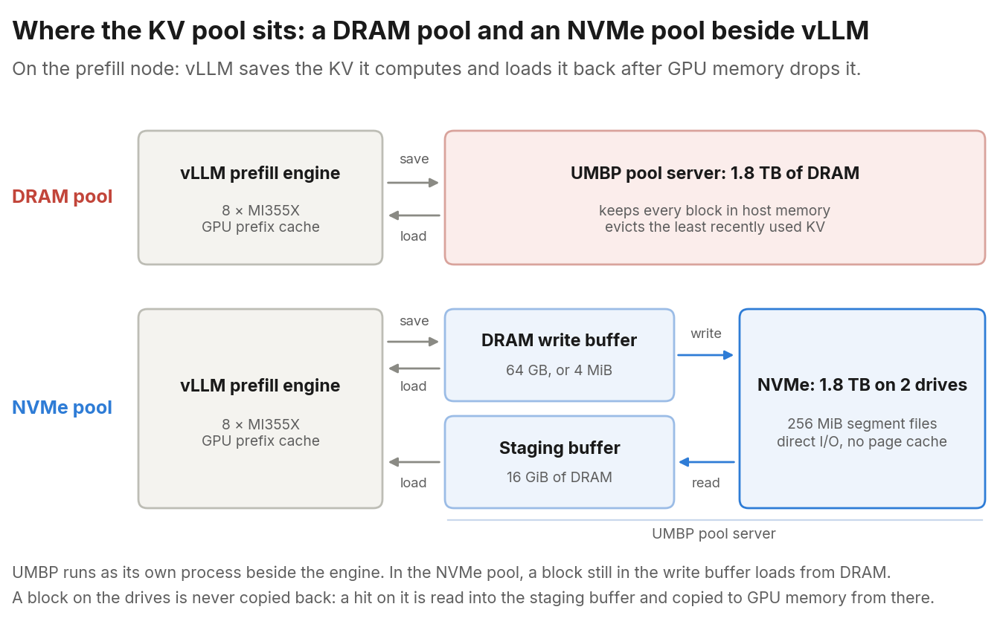

A coding session can give up the GPU while it waits for a tool. Its next turn still brings back almost the whole conversation. In an AgentX replay, the median input was 142K tokens and over 96% belonged to a previously seen prefix. The operational question is how much of that prefix remains reusable when the session returns.

## DRAM becomes a staging area

AMD and Embedded LLM ran Kimi-K3 on 16 MI355X GPUs with separate prefill and decode nodes. The conventional path retains evicted GPU KV in a host DRAM pool. The alternative retains it in NVMe segment files managed by MoRI UMBP, with a 64 GB write buffer and 16 GiB read staging area in host memory. The GPU still serves hot prefixes directly.

The connector looks up and loads cached KV asynchronously. vLLM holds the request until the KV arrives and schedules others meanwhile. On a busy engine the load can overlap the wait for a prefill slot. At 64 sessions on DeepSeek-V4-Pro, loads took 0.80 seconds from DRAM and 0.85 from NVMe, finishing about two seconds before prefill. Light traffic leaves less room for overlap. In a separate single-request test with a 128K prefix, first-token times were 0.45 seconds on a DRAM hit, 0.84 on an NVMe hit and 7.7 on recomputation.

<a class="note-image-link" href="/assets/images/tech/vllm-skip-the-dram-tier/overview.png" target="_blank" rel="noopener" aria-label="DRAM retains KV in one path and stages NVMe writes and reads in the other">View original image ↗</a>

*DRAM retains KV in one path and stages NVMe writes and reads in the other*

## Equal capacity measures the medium, extra capacity buys retention

With both pools at 1.8 TB, NVMe’s throughput differences from DRAM in the Kimi-K3 AgentX replay were +0.3%, +0.8% and −0.2% at 48, 70 and 96 sessions. Similar eviction rules kept hit rates within 0.08% of prompt tokens across six paired comparisons. A drop from 96% hits to 95% raises the share needing prefill from 4% to 5%, a quarter more work. Across 42 runs at 70 sessions, hit rate explained 96% of throughput variance. The fit is specific to that configuration.

On the kvlab corpus at 70 sessions, a 1.0 TB DRAM pool hit on 52% of prompt tokens. A 4.6 TB NVMe pool reached roughly 93% and 8,813 tokens/s/GPU, 5.1 times the smaller pool’s throughput. Another run with 1.8 TB of DRAM reached 91% hits. Capacity pressure can compound: recomputation lengthens the prefill queue, stretching the interval between turns and increasing the chance of eviction before reuse.

## Reclaiming a file can evict live KV

The pool evicts blocks, but the NVMe backend recovers space only when it deletes a whole segment file. Even the oldest file with the fewest live blocks can contain useful data. Changing the segment size alone from 4 GiB to 256 MiB raised the 70-session AgentX hit rate from 94.45% to 95.65%. Throughput rose from 11,672 to 13,492 tokens/s/GPU and P90 first-token time fell from 63.0 to 21.3 seconds. Smaller segments require more open files.

GPU hits also conceal demand from the pool. Reporting those hits refreshes the recency of blocks that would otherwise look cold. Hybrid models introduce another boundary: Kimi-K3 may retain ordinary KV yet still need recomputation if there is no KDA checkpoint where two prompts diverge. More frequent checkpoints improve reuse while increasing writes. These changes were tested in different configurations and their gains do not add together.

## Retention and drive endurance have separate budgets

At the measured 2.3–4.6 TB written per hour, 1.8 TB retains roughly 23–47 minutes of history. Sizing depends on the interval between uses of the same block and on peak write rate. At 96 sessions, 3.5 TB per hour amounts to 83 TB per day. Two 3.84 TB test drives sustained about eleven full-drive writes a day even though the logical pool fit. The authors’ five-year list-price model spreads wear across more drives and assumes continuous load, excluding power, racks and servers.

In the matched-capacity runs the pool served at most 16% of prompt tokens, with hot blocks available on GPU. A deployment that reads most prefixes from disk, has little queueing or enforces a tight first-token tail needs measurements of its own read fraction, queue delay and eviction behavior.

AMD and Embedded LLM · 2026-11-23 · [Skip the DRAM Tier: MoRI UMBP Runs the Agentic KV Cache on NVMe](https://vllm.ai/blog/2026-11-23-skip-the-dram-tier)
