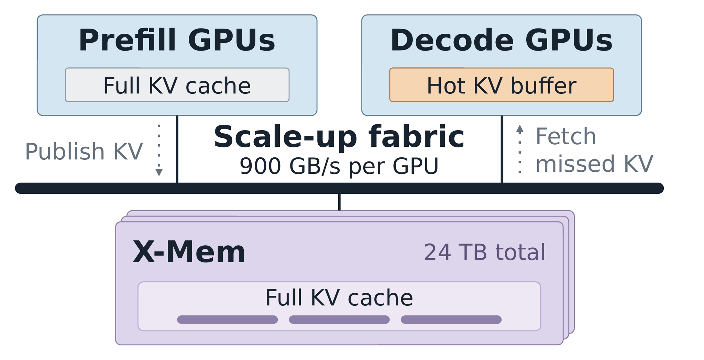

**LMSYS · Netpreme Team · 2026-11-05**  
Original: [XM-Sparse: Pushing the Throughput Frontier of Sparse Attention with Netpreme X-Mem™](https://www.lmsys.org/blog/2026-11-04-xm-sparse/)

Sparse attention reads only selected historical KV entries per decode step, but selections change and the full history must survive. External memory can increase concurrency while HBM holds hot entries. Capacity alone, however, does not make misses fast. XM-Sparse integrates Netpreme X-Mem with SGLang HiSparse and separates these constraints.

## Hot buffers do not replace complete history

HiSparse keeps a hot KV buffer and indexer key cache in HBM, fetching only selected entries absent from that buffer. More external capacity behind a slow link can increase simultaneous misses and TPOT; a fast link with insufficient capacity still limits concurrency.

The analysis uses GLM-5.3 on four GPUs with attention DP4 and MoE EP4, a 4,096-token hot buffer per layer per request, and 2,048 selected KV entries per step. It adds estimated I/O time to measured compute-only timing, assuming no overlap and a 20% miss rate. Bandwidth budgets include 64, 225 and 900 GB/s per GPU, with 1 TB or 24 TB total capacity. These are model assumptions, not universal measurements of PCIe, CXL or C2C systems.

## The bottleneck changes with context length

At 128K context, both constraints bind. A 1 TB tier limits per-GPU batch to 36 regardless of a faster link. A 24 TB tier permits batch 109, but 64 GB/s still constrains miss traffic. At that batch, modeled 900 GB/s gives 1.39× the throughput of the 64 GB/s PCIe-CXL configuration.

At 16K, 1 TB already holds batch 241, making bandwidth the main constraint. At 1M, increasing capacity at the same 64 GB/s raises feasible batch from four to twenty. This is more informative than saying larger memory is faster: context length, miss rate, full-history size and batch jointly determine the limit.

<a class="note-image-link" href="/assets/images/tech/xm-sparse-xmem/kv-tier.png" target="_blank" rel="noopener" aria-label="Prefill publishes full KV and decode fetches selected misses from shared memory · View original image ↗">View original image ↗</a>

*Full history resides in the shared tier while decode keeps a hot buffer; interpret the 900 GB/s and 24 TB labels with the stated design and Pilot VM conditions.*

The proposed memory node has four MPUs, up to 24 TB DDR5 and roughly 4 TB/s aggregate bandwidth shared by rack GPUs. Per-GPU link budgets and node aggregate bandwidth are different quantities; sharing and contention still matter.

## Integration follows the complete KV lifecycle

Prefill publishes prompt KV to X-Mem. After publication, decode can access history without staging the entire prompt cache in decode HBM. Each step fetches only selected misses and appends newly generated KV to external history. Request completion waits for outstanding accesses before reclaiming storage. Common prefixes can share stored KV.

An owner creates the shared region and GPU processes attach through a portable descriptor. Physical memory is freed only after every mapping detaches. This lifecycle is necessary for safe reuse, not an incidental allocation detail. Integration retains HiSparse selection, cache management and prefetch support, with CUDA Graph capture/replay. The measurements below disable prefetch to isolate I/O behavior; implementation support and benchmark settings must remain distinct.

## What the Pilot VM measurements establish

Four B300 GPUs run decode while four additional B300 GPUs use HBM as stand-ins for X-Mem memory banks behind the intended access path. The 24 TB capacity is modeled, not physically present in those four bank GPUs. Prefixes are synthetic and misses are fixed at 20% or 40%. Final X-Mem silicon is not yet available.

At 16K, batch 192 per GPU and 20% misses, average TPOT falls from 167.48 ms for host DRAM to 84.99 ms, a 49.25% reduction. At 40% misses it falls from 255.69 to 93.13 ms, or 63.58%. Small batches show little benefit and can be slightly slower. Peak tested throughput across 16K–1M at 20% misses improves 2.09–3.04×, but longer-context comparisons allow different maximum batches and therefore combine capacity and bandwidth gains.

This is useful early systems evidence with explicit KV ownership and bottleneck decomposition. It motivates examining whether selected-KV misses saturate external links at concurrency. It does not establish the same gains on final silicon, real agent trajectories, dynamic misses, enabled prefetch or contended shared memory, nor a complete serving-SLO advantage including prefill and TTFT.
