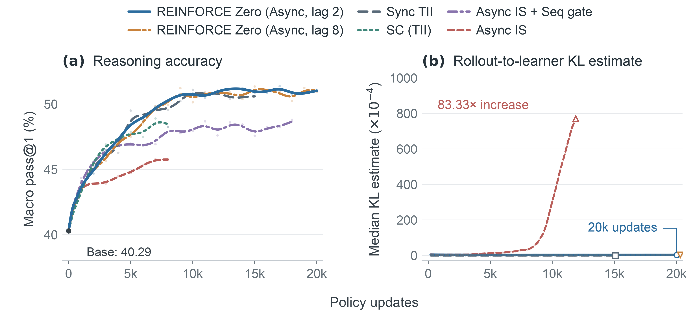

**vLLM · Ao Shen, Jian Hu, Yan Bai, Shekhar Pandey and the REINFORCE Zero authors · 2026-11-06**  
Original: [Zero Mismatch, Simple Async RL: REINFORCE Zero, DeepSeek-V4.1 and Kimi K3.1](https://blog.vllm.ai/2026/11/06/zero-mismatch-async-rl.html)

Asynchronous RL runs rollout and learning concurrently, reducing idle time while training on samples from older policy versions. Importance sampling normally corrects this by dividing the learner’s token probability by the probability recorded during rollout. The post distinguishes two gaps inside that ratio, explaining why correction alone may still leave training unstable.

## Only one probability gap comes from old weights

The first gap is between the learner’s current and historical weights. The second is between learner and rollout implementations at the same historical weights. Kernel selection by batch shape, reduction order and different prefill/decode arithmetic can change logprobs without changing parameters.

The decomposition is:

$$\log \pi_{\theta_k}-\log\mu_v=(\log\pi_{\theta_k}-\log\pi_{\theta_v})+(\log\pi_{\theta_v}-\log\mu_v)$$

An unbiased expected update does not guarantee manageable variance. Numerical fluctuations can create large importance-weight excursions. The post cites REINFORCE Zero’s D3 statistic, the per-update token mean of $$w-1-\log w$$: its peak is 1.50× its median with aligned kernels, versus 442.54× with standard kernels. This comparison uses asynchronous DeepSeek-R1-Distill-Qwen-1.5B runs, not an equivalent long-run flagship-MoE experiment.

## Alignment permits a simpler learning path

REINFORCE Zero first makes rollout and learner logprobs bit-identical for matching weights and tokens. Unclipped token-level importance sampling then corrects the remaining policy lag. Plain REINFORCE uses each response’s reward minus its group mean as the advantage, averaging tokens within responses, without a value model or sample-rejection gates.

This separates controlled version changes from unstable execution differences; it does not erase every off-policy problem. Clipping can suppress excursions while introducing bias, and rejection gates stabilize training by discarding generated samples. Once numerical mismatch is removed, the authors observe stable learning without those rejection mechanisms.

<a class="note-image-link" href="/assets/images/tech/zero-mismatch-async-rl/training.png" target="_blank" rel="noopener" aria-label="Reasoning accuracy and KL with aligned versus standard kernels · View original image ↗">View original image ↗</a>

*Read accuracy and KL together: ordinary IS does not remove standard-kernel drift, while aligned runs remain stable in these experiments.*

With standard kernels and importance sampling, median rollout-to-learner KL rises 83.33× between the first and last thousand updates, while online AIME24 pass@1 falls from 34.27% to 13.96%. A sequence gate stabilizes training but rejects 24.48% of sequences in the last thousand updates; the aligned path rejects none. Sample efficiency and stability are connected through execution semantics.

## Keep throughput, lag and quality conditions separate

For sixteen GPUs and 12K updates, the asynchronous aligned run takes 68.55 hours versus 164.77 hours for synchronous aligned training: 2.40× training-step throughput at comparable quality. The 20K-update lag-2/8 reasoning experiment uses the 1.5B model. The lag-64 demonstration instead uses Qwen3-4B with Python tools and 16K context, improving mean reward from 0.287 to about 0.78 over 5,000 updates. These should not be combined into a claim that every large model trains for 20K updates at lag 64.

Alignment also costs time. On OSWorld, mean step duration is 944.25 seconds versus 884.17 for standard kernels with a sequence gate, a 6.8% increase. Its value depends on reduced waiting, avoided sample rejection and the aligned kernels’ own overhead, not rollout peak speed alone.

## Large-model validation exposes concrete failure mechanisms

The flagship-model sections demonstrate alignment feasibility. DeepSeek-V4.1-Flash maintains diff 0 on sixteen nodes of four GB200 GPUs at 128K agentic-RL context, including prefix-cache hit/miss consistency. Kimi K3.1’s KDA decode must repeat chunk-prefill arithmetic for the same row to avoid different rounding.

MI355X debugging identifies shape-selected library kernels, indexer top-k, prefill/decode divergence and arrival-ordered expert reductions as sources of batch variance. Bit-preserving optimization reduces DeepSeek-V4-Flash’s serving-throughput loss from 62–66% to 7.4–10.1%. Kimi’s wake-up path also needed a fix for eviction and reuse writing the same KDA slot. These mechanisms explain substantially more than a consistency-mode switch.

The post explicitly leaves long asynchronous runs on flagship models for future work. The transferable practice is token-level numerical checking across kernels, caching and recovery, with separate observations for implementation mismatch and policy-version lag.
