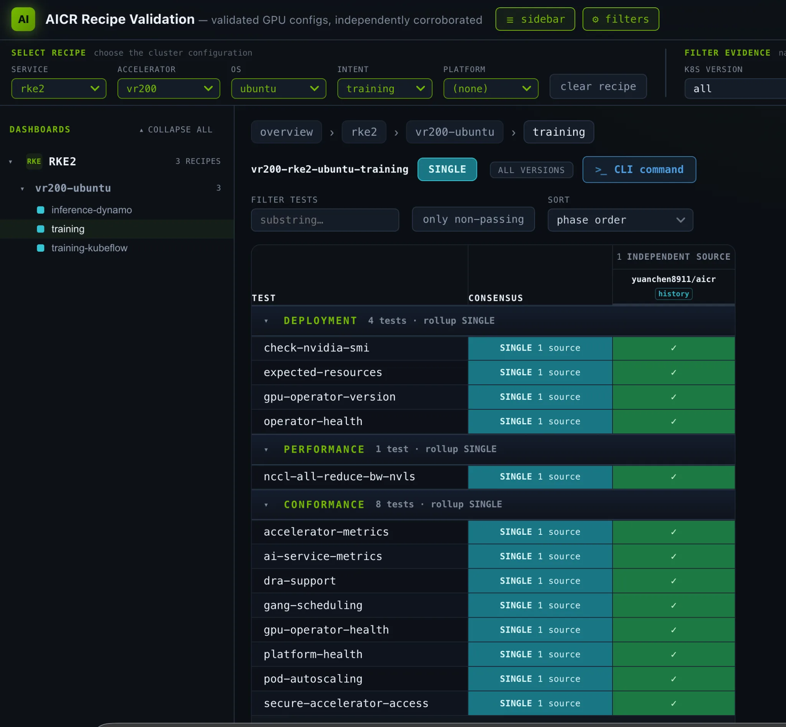

## 新硬件适配是一组版本与所有权约束

NVIDIA 的 Vera Rubin NVL72 实践把驱动、容器运行时、IMEX、网络与调度写进 AICR recipe。测试组合使用宿主预装 R615.23 驱动，GPU Operator 不再安装驱动但仍管理 toolkit；整个 GPU 分配继续走 device plugin，DRA ComputeDomains 管理跨节点 IMEX。这些职责不能因都涉及 GPU 而混为一套分配机制。

recipe 还记录 Ubuntu 26.04、arm64 64K-page kernel 和 RKE2 的版本条件，并提高 NFD topology updater 的内存限制，避免多 TB worker 上的默认额度导致 OOM。DRA 管理 IMEX 时，宿主静态 IMEX 服务不能同时拥有同一节点。这类明确所有权比只列组件版本更能解释启动失败。

## 三层验证分别证明什么

<a class="note-image-link" href="/assets/images/tech/2026-11-03-nvidia-kubernetes-ai-ready-vera-rubin/official-figure.webp" target="_blank" rel="noopener" aria-label="查看原图">查看原图 ↗</a>

*同一 Rubin 训练配方分别记录部署、性能与一致性检查；绿勾对应具体测试，并非对所有负载的认证。*

deployment 检查组件、资源与 nvidia-smi；conformance 覆盖设备访问、调度和指标等运行契约；训练 performance gate 则启动跨节点 NCCL all-reduce，通过 IMEX ComputeDomain 检查 NVLink bus bandwidth。文章给出的 16 GiB 消息下 744.71 GB/s 是这一特定测试，不是任意模型的训练速度。

推理 recipe 通过部署与一致性，但推理性能仍延后。正文解释：源代码包含 Rubin 分派不等于发布镜像已用所需 CUDA 编译 kernel。它还明确排除 MIG 与 ConnectX-9 RDMA 数据路径性能。signed evidence 对应捕获时的 recipe 坐标；Preview recipe 继续变化时，旧签名不能自动认证今天的内容。

## 两类故障要分开归因

首次互联阻塞来自硬件／fabric 问题，重新安装硬件后恢复，不应归因于 DRA。另一个独立问题确实是 go-nvlib 未映射 Rubin 架构值，导致 DRA kubelet 插件循环崩溃；正文描述修复由底层绑定传播到上层组件，并进入正式 DRA v0.5.0。还有 nvidia-smi banner 变化导致验证器初次解析失败，属于检测工具兼容性。

我的理解是，这篇材料展示了“健康资源出现”“通信契约成立”“负载性能达标”之间的差别。适用于新平台 bring-up 的方法是固定配方并保留分阶段证据，而不是把 Preview 验证通过写成生产支持认证。宿主、Operator 与 DRA 的责任边界，以及镜像的实际编译条件，是比版本号新旧更有用的排查入口。

来源：[原始工程文章](https://developer.nvidia.com/blog/making-kubernetes-ai-ready-for-nvidia-vera-rubin-on-day-one/)
