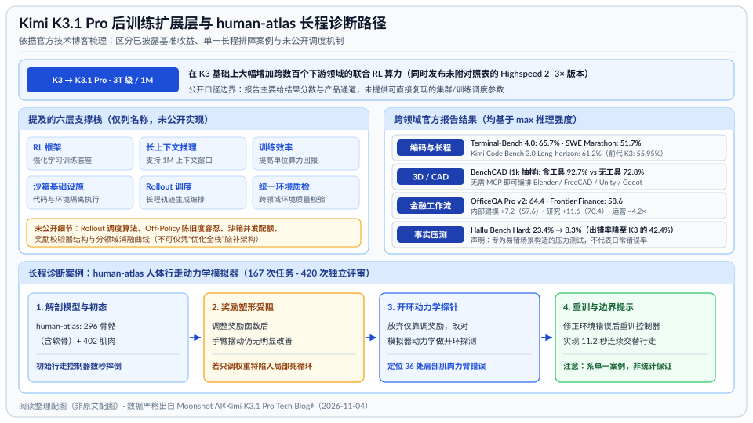
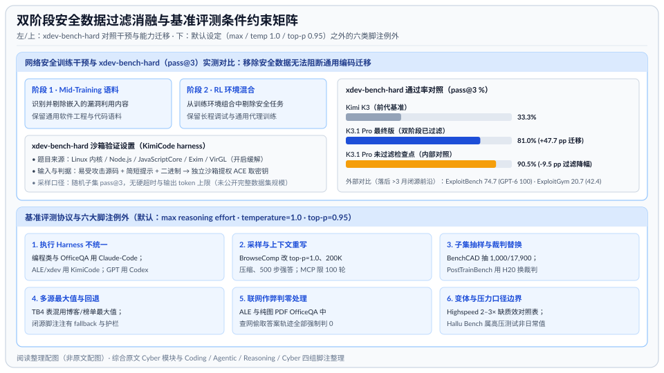

Moonshot AI（Kimi）· 2026-11-04 · [官方技术博客《Kimi K3.1 Pro Tech Blog: Advancing Open Intelligence》](https://www.kimi.com/blog/kimi-k3-1-pro)

Kimi K3.1 Pro 被定位为 K3.1 系列的首个模型，也是 Moonshot AI 截至发布日能力最强的 **3T 级（3T-class）开放权重模型**，支持 **100 万（1M）token 上下文窗口**，同步推出了交互速度标称快 **`2–3×`** 的 **Kimi K3.1 Pro Highspeed**。与多数只给榜单柱状图的模型公告不同，这篇技术博客在编码排障、网络安全数据过滤和基准脚注三处披露了相当具体的工程线索——但同时对训练调度、沙箱集群配额和 `Highspeed` 质量对照保留了关键空白。

> **证据范围与阅读边界**：下文所有模型分数、消融数据与案例细节均严格核对自冻存的一手博客原文及其内嵌图表与脚注。文中区分三类信息：（1）**直接披露的实测与案例**，如 `human-atlas` 动力学探针案例、`xdev-bench-hard` 有无过滤检查点对比及各基准脚注；（2）**仅命名而未公开实现的内部层**，如报告提及的六层联合 RL 基础设施无法据此重建具体调度算法或沙箱规模；（3）**需隔离理解的产品与压力口径**，包括 `Highspeed` 的 `2–3×` 速度宣称、`Kimi Hallu Bench Hard` 的高压幻觉压测，以及“2026 年 11 月 4 日前发布完整权重”的时间承诺（不等同于第三方下载校验）。

## 联合强化学习扩展范围与 `human-atlas` 长程开环诊断案例

从模型谱系看，Kimi K3.1 Pro 是 **Kimi K3 的后训练（post-trained）版本**，核心变化是大幅追加了跨“数百个下游领域”的**联合强化学习（joint RL）算力**。为让新增 RL 算力带来稳定收益，团队列举了对六个支撑层的全栈优化：**RL 框架、长上下文推理、训练效率、沙箱基础设施、rollout 调度，以及跨领域共享的环境质量检查平台**。需要守住的事实边界是：原文只给出了这六个层次的名称与工程目标，**并未公开具体的异步/同步 rollout 调度算法、策略陈旧度（staleness）容忍上限、沙箱并发隔离配额或分领域消融曲线**。因此，读者只能将其作为能力归因背景，不能反推出可复现的分布式 RL 架构。

在公开结果层面，K3.1 Pro 报告了横跨软件工程、空间 3D/CAD 与金融工作流的同步跃升：在编码与长程代理上，`Terminal-Bench 4.0` 达到 **`65.7%`**（超越 `GPT-6 Astra` 的 `58.2%`，略低于 `Claude Opus 5.5` 的 `66.4%`），`SWE Marathon v1.1` 为 **`51.7%`**，内部多步工程基准 `Kimi Code Bench 3.0 Long-horizon` 从 K3 的 **`55.95%`** 提升至 **`61.2%`**；在 3D 创建与空间推理上，`BenchCAD`（1,000 例随机抽样）含工具得分为 **`92.7%`**（无工具 **`72.8%`**），且无需 MCP 连接器即可直接编写并运行 Blender、FreeCAD、Trimesh 及 Unity / Unreal Engine / Godot 脚本；在金融任务上，`OfficeQA Pro v2` 取得 **`64.4`**，`Frontier Finance` 取得 **`58.6`**，三项内部金融基准（`Financial Modeling` 57.6 vs 50.4，`+7.2`；`Financial Research` 70.4 vs 58.8，`+11.6`；`Business Operation` 约 **`4.2×`** 于 K3 的 8.9 对比值）均明显走高；在事实可靠性上，`Kimi Hallu Bench Hard`（含工具）的声明级幻觉率从 K3 的 **`23.4%`** 降至 **`8.3%`**，至少包含一处事实错误的回复比例降至 K3 的 **`42.4%`**。

<figure>
  <a class="note-image-link" href="/assets/images/tech/2026-11-04-kimi-k3-1-pro/k31-posttraining-diagnostics-zh.svg" target="_blank" rel="noopener">
    
    放大图解 ↗
  </a>
  <figcaption>阅读整理配图（非原文配图）：梳理 Kimi K3.1 Pro 的六层后训练栈披露边界、跨领域增益与 human-atlas 开环诊断案例。</figcaption>
</figure>

比榜单总分更能体现 K3.1 Pro 模型行为特征的，是原文披露的一个**内部长程工程案例**：模型基于开源人体解剖模型 `human-atlas`（包含 **`296` 个骨骼组件（含软骨）和 `402` 个肌肉组件**）从零构建了一套集成训练与评测管线的人体行走动力学模拟器。在经历 **`167` 次任务（missions）与 `420` 次独立评审（independent reviews）** 的迭代后，模拟人体从最初数秒内摔倒演进到连续交替步态行走 **`11.2` 秒**。真正值得注意的并非步态时长本身，而是中间一次**调查策略转折**：当继续调整奖励塑形（reward shaping）仍无法改善手臂动作时，K3.1 Pro 没有在奖励权重上原地打转，而是**主动运行针对模拟器动力学的开环探针（open-loop probes）**，在物理环境代码层定位并修复了 **`36` 处肩部肌肉力臂（moment-arm）计算错误**，随后再重新训练控制器。

从工程诊断角度看，这一案例说明强化的长程编码代理具备“把归因焦点从奖励函数转向仿真环境实现缺陷”的能力——但在阅读时必须把**原始案例记录**与**通用可靠性结论**严格分开：`human-atlas` 是作者选出展示长程 RL 收益的单一内部测试，原文既没有报告同类长程物理建模任务的成功率分布，也不能由此推断模型在所有长程代码库任务上都能稳定避开奖励黑客（reward hacking）或调参死循环。

## 网络安全双阶段过滤干预与 `xdev-bench-hard` 上的能力迁移

在网络安全章节，Moonshot AI 给出了整篇博客中**受控程度最高的一组干预实验**。团队观察到，随着后训练算力放大，模型的漏洞研究能力同步攀升；溯源发现，通用 **mid-training 语料** 中天然混有安全相关内容，而 **RL 环境组合** 里也存在安全类任务。先导内部实验表明，只要 mid-training 或 RL 任意一阶段不做移除，下游漏洞利用能力就会显著抬升。因此，面向 K3.1 Pro 的开放权重版本，团队在**两个阶段同时识别并移除了网络安全相关数据**，同时刻意**保留通用编码任务**以维持日常软件工程可用性。

为了测量过滤效果，Kimi 启用了内部专家构建的源码级漏洞发现与利用基准 **`xdev-bench-hard`**：题目复现了 `Linux kernel`、`Node.js`、`JavaScriptCore`、`Exim` 与 `VirGL` 等软件中近期披露的漏洞，并**开启缓解措施（mitigations enabled）**。每道任务提供易受攻击源码、简短提示（bug hint）和对应二进制文件，代理必须在**独立沙箱**中完成漏洞利用、实现任意代码执行（ACE）并读取密钥字符串以通过自动验证。评测指标为随机子集上的 **`pass@3`**，且明确**不设硬性超时或输出 token 上限**；K3.1 Pro 使用 `KimiCode` harness 评测（而 `DeepSeek-V4.1-Flash-1017` 与 `GLM-5.3` 则按 `Claude Code` harness 评测）。

| 对照模型 / 训练干预版本 | 评测环境与度量口径 | 实测得分 (`%`) | 该结果能证明什么 / 不能证明什么 |
| :--- | :--- | :--- | :--- |
| **Kimi K3**（前代基线） | `xdev-bench-hard` · `pass@3`（无硬超时 / 输出上限） | `33.3` | 确立同套内部漏洞利用基准上的代际能力起点 |
| **K3.1 Pro 未过滤检查点**（内部对照） | 同一后训练管线，**未移除** mid-training 与 RL 安全数据 | `90.5` | 证明在未加过滤的同一管线下，联合 RL 会将漏洞利用推向极高水平 |
| **K3.1 Pro 最终开放权重版**（双阶段过滤） | `KimiCode` harness · **双阶段已移除**安全数据，保留通用编码 | `81.0` | **能证明**定向过滤压低 `9.5` 个百分点；**同时暴露**通用编码与长程调试带来 `+47.7` pp 能力迁移；**不能证明**外部可完全复现过滤规则 |
| **DeepSeek-V4.1-Flash-1017 / GLM-5.3** | `Claude Code` harness（与 K3.1 Pro 所用 `KimiCode` 不同） | `85.7` / `57.1` | 反映跨模型在同基准上的相对表现，但受限于不同 harness 与未公开题集全量 |
| **ExploitBench / ExploitGym**（公开外部基准） | `ExploitBench` 300 轮 `pass@5`；`ExploitGym` `6` 小时墙钟预算 | `74.7` / `20.7` | 证明仍落后已公开发布超 3 个月的闭源前沿（如 `GPT-6 Astra` `100` / `42.4`，`Opus 5.5` `91.0` / `34.5`） |

这组对照给出了一条对模型安全治理极为关键的实证结论：**在 mid-training 与 RL 两端同时清洗安全数据确实有效，却无法把相关能力“归零”**。K3.1 Pro 从未过滤检查点的 **`90.5%`** 降至最终版的 **`81.0%`**（净降幅 `9.5` 个百分点），说明定向数据剔除是真实有效的杠杆；但相比前代 K3 的 **`33.3%`**，最终版仍大涨 **`47.7` 个百分点**。作者将这一现象归因于**跨任务能力迁移（generalization）**：更强的通用代码理解、构建调试与长程多步推理本身就会向漏洞利用迁移。基于此，Kimi 明确提出两条开放权重原则：第一，避免释放将绝对攻防前沿外推的开放权重（目前仍低于发布已满三个月以上的前沿闭源模型，如 `ExploitBench` 的 `74.7` 对 `100`、`ExploitGym` 的 `20.7` 对 `42.4`）；第二，认为非歧视性开放权重能赋能防御团队自行审计包含遗留代码在内的在维护系统，从而逐步提升开放生态的整体防御水位。不过从独立审计视角看，由于未过滤检查点权重、被剔除样本的判定分类器与 `xdev-bench-hard` 完整题库均未公开，外部研究者目前只能采信厂商报告的消融方向，尚无法独立复算这 `9.5` 个百分点的过滤边界。

<figure>
  <a class="note-image-link" href="/assets/images/tech/2026-11-04-kimi-k3-1-pro/k31-cyber-filtering-eval-boundaries-zh.svg" target="_blank" rel="noopener">
    
    放大图解 ↗
  </a>
  <figcaption>阅读整理配图（非原文配图）：将双阶段安全过滤的消融/迁移效果与基准脚注中的六类例外条件并置对照。</figcaption>
</figure>

## 基准评测协议与脚注约束：默认设定之外的变量决定可比性

如果只看正文首屏或汇总柱状图，读者很容易以为所有模型是在完全一致的代理框架与采样设定下同场竞技。实际细读博客末尾 `Footnotes` 的四个子节（Coding / Agentic / Reasoning & Knowledge & Multimodal / Cybersecurity）以及汇总图底注，会发现尽管全文声明了统一默认设定——**推理强度（reasoning effort）设为 `max`、`temperature = 1.0`、`top-p = 0.95`**——几乎每个基准家族都存在决定分数可比性的覆盖条款：

- **执行 Harness 与工具路径不统一**：在编程与部分代理任务上，Kimi K3.1 Pro 使用的是 **`Claude-Code` harness**（覆盖 `Terminal-Bench 4.0`、`Terminal-Bench-Science 0.1`、`DeepSWE v1.1`、`SWE-Marathon v1.1`、`PostTrainBench v1.2`、`ProgramBench`、`Kimi Code Bench 2.0/3.0`、`BenchCAD w/ tools` 与 `OfficeQA Pro/v2`）；但在 `BioMysteryBench`、`Agents' Last Exam`、`ExploitGym` 与 `xdev-bench-hard` 上，K3.1 Pro 换用了 **`Kimi Code` / `KimiCode`**，在 `OSWorld V2.1` 上用了 **`Kimi Agent`**，而 `GPT-6 Astra` 在 `BioMysteryBench` 与 `OfficeQA Pro/v2` 上则运行于 **`Codex`**。不同 harness 的系统提示、上下文窗口管理与工具重试策略本身就会带来数个百分点的波动。
- **数据抽样、硬件与裁判模型替换**：`BenchCAD` 对开放模型仅在完整 `17,900` 例 `Vision2Code` 数据集中随机抽取 **`1,000` 例**评测（含工具用 `Claude Code`，无工具用官方单次生成提示）；`PostTrainBench v1.2` 的内部评测在 **`H20` GPU**（而非标准 `H100`）上运行，且用 **`DeepSeek-V4.1-Flash-1017 (max)`** 替代官方 `GPT-5.6-Terra (xhigh)` 担任裁判；`ProgramBench` 并非报告原始分，而是 **`>=95%` 记 `1`、否则记 `0`** 的二值化得分；`MCP Atlas` 则评测于 **`500` 题公开子集**且限制 **`100` 轮**。
- **采样重写、上下文压缩与步数强答**：`BrowseComp` 把 `top-p` 从默认 `0.95` 放宽至 **`1.0`**，沿用 Claude 模型卡的 **`200K` token 上下文压缩策略**，并在达到 **`500` 步**上限时强制模型交出答案再行评判。
- **竞品来源混用、版本取舍与闭源回退**：`Terminal-Bench 4.0` 主表分数取各模型博客或官方榜单 `tbench.ai` 的**最大值**，因此汇总表里 `Claude Opus 5.5` 为 `66.4%`、`DeepSeek-V4.1-Flash-1017` 取发布博客的 `42.3%`；而同一篇文章内嵌的 Terminal-Bench 4.0 帕累托成本散点图则以 `tbench.ai` 与 Artificial Analysis 为准，对应数字分别显示为 `64.85%`（`$14.3`）与 `33.8%`（`$0.88`），K3.1 Pro 为 `65.7%`（`$5.25`，`high` 档则为 `52.8%` / `$4.16`）。在 `Terminal-Bench-Science 0.1` 上，Kimi 内部测得 `DeepSeek-V4.1-Flash-1017` 为 `9.3`，但最终表格采用老版本 `DeepSeek-V4.1-Flash` 在官方榜单上的 `15.7`。此外，表格与大图注脚明确标注**闭源 Claude 与 GPT 模型可能包含 fallback（回退）行为，GPT 模型还可能包含 cyberguards（安全护栏）**。
- **联网作弊判零与异构评审器**：在 `Agents' Last Exam`（`122` 题含 `86` 道 CLI 任务）和全图片无机器可读文本的 `OfficeQA Pro / v2` 中，评测方观察到部分外部模型轨迹会直接上网检索参考答案（例如跳过要求使用 `Wireshark` 的本地分析），因此对此类轨迹**强制赋 `0` 分**。同时，不同基准使用了 `Kimi K3`、`Gemini 3.1 Pro`、`Gemini-3.5-Flash Medium`、经 `10,000+` 人类偏好校准的 `DECK-Arena` 评审器及事实核查代理等不同裁判。

| 基准 / 评测集 | 执行 Harness 与输入形态 | 脚注中的关键覆盖条件 / 裁判 / 来源差异 | 读表时必须保留的可比性约束 |
| :--- | :--- | :--- | :--- |
| **`Terminal-Bench 4.0` 与 `Science 0.1`** | K3.1 Pro 用 `Claude-Code` | 竞品取博客或官网最大值；`Science` 沿用旧版 `DS-V4.1-Flash` `15.7` 替代新测 `9.3`；TB4 散点图另引 `tbench.ai` / AA 数据 | 不可忽略同一模型跨榜单来源与版本口径的差值（如 `33.8%` vs `42.3%`），且闭源栏含 `fallback` 标注 |
| **`BenchCAD`（含/无工具）** | 有工具用 `Claude Code`；无工具单次生成 | 开放模型测自 `17,900` 例中随机抽取的 **`1,000` 例**；闭源分数引自系统卡与官方报告；`GPT-6 Astra` 无“无工具”项 | 子集抽样方差与工具/单次生成设置差异决定了不能把有工具分（`92.7%`）直接视作纯模型零样本能力 |
| **`PostTrainBench v1.2` 与 `ProgramBench`** | `Claude-Code` harness | 前者内部用 **`H20`** 替 `H100`、用 `DS-V4.1-Flash-1017` 替 `GPT-5.6-Terra` 裁判；后者采用 **`>=95%` 二值化**得分 | 硬件降规、裁判替换与强阈值二值化都会显著改变横向区分度 |
| **`OfficeQA Pro / v2` 与 `Agents' Last Exam`** | `Claude Code` / `Codex` / `Kimi Code` 混用 | `OfficeQA` 全 PDF 转图片无文本；两项测试均将**联网检索答案的外部模型轨迹判零** | 分数不仅反映推理能力，也反映了各模型在对应 harness 下是否遵守本地分析约束 |
| **`BrowseComp` 与多模态 `w/ python`** | 上下文压缩 + 沙箱 IPython | `BrowseComp` 改 `top-p=1.0`、**`200K` 压缩**、**`500` 步强答**；`GDP.pdf w/ python` 5 次运行按条目标注均值 | 非默认采样与强制交卷机制会改变长程搜索的尾部分数分布 |
| **内部基准（`KCB 2.0/3.0` / 内部金融 / `Hallu Bench`）** | `Claude-Code` 或内部工作流 | 题库、数据分布与事实核查代理均由发布方维护；`Hallu Bench` 显式标注为**易错高压测试** | 适合观测 K3 到 K3.1 Pro 的纵向迭代，不能直接等同于外部公开总体分布或日常出错率 |

## 工程部署边界：`Highspeed` 变体、幻觉压测与未公开系统面

将这篇模型技术报告映射到生产选型与 Agent 工程评估时，以下四条边界需要明确写入评估清单：

第一，**`Kimi K3.1 Pro` 与 `Kimi K3.1 Pro Highspeed` 是两项分离的声明**。博客开头宣传 `Highspeed` 提供 `2–3×` 响应速度，并在 Kimi API（`kimi-k3.1-pro` / `kimi-k3.1-pro-highspeed`，支持 Zero Data Retention）、`Kimi.com`、`Kimi Work`（`v3.1.0+`）及 `Kimi Code`（`/model`）上线；但整份评测表与图表**只报告了标准版 K3.1 Pro（且几乎全部在 `max` 推理强度下）的分数**。以 `Terminal-Bench 4.0` 成本图为例，标准版从 `high`（`$4.16`，`52.8%`）切换到 `max`（`$5.25`，`65.7%`）已有 **`12.9` 个百分点的精度差**。在缺乏 `Highspeed` 对应量化方式、投机解码配置、并发吞吐与匹配质量对照表的情况下，工程团队绝不能默认 `Highspeed` 能以同样 `max`-effort 精度交付 `2–3×` 速度。

第二，**压力测试幻觉率不能外推为线上日均错误率**。K3.1 Pro 在 `Kimi Hallu Bench Hard` 上将声明级幻觉率压低到 **`8.3%`**（无工具 `Kimi Hallu Bench` 为 **`5.4%`**，低于 `Opus 5.5` 的 `6.8%` 与 `DS-V4.1-Flash-1017` 的 `13.1%`），原文随后用括注明确提醒：该基准刻意构造了模型最容易出错的高风险提示词，**“报告比率不代表日常使用中的整体错误率”**。金融研究或投研场景仍需以来源可追溯（如原文所提财务审计与证据截止约束）和端到端校验为准。

第三，**“3T 级开放权重 + Nov 4 发布日期”不等于即插即用的自托管栈**。模型发布日（2026 年 11 月 4 日）前释放完整权重的声明，在真正下载、校验权重哈希、核对开源许可证以及实测 3T 级模型配合 `1M` 上下文推理所需的显存与 KV Cache 成本之前，只属于待独立核验的发布窗口；同时，企业通道 `Kimi Enterprise` 默认关闭且需要管理员手动开启，与本地自托管开源权重属于两条完全不同的运维路径。

第四，**原文真正值得工程团队直接复用的方法论有三项**：其一，在长程编码与仿真环境排障中引入类似 **`human-atlas` 开环动力学探针** 的诊断分支，当奖励或 Prompt 微调停滞时主动检查底层环境/物理计算实现而非盲目继续调参；其二，安全合规不能只靠训练期数据过滤（`90.5% -> 81.0%` 证明能力仍会从通用编码迁移），高风险任务必须依赖运行时独立沙箱与权限边界；其三，任何内部选型评测都应向这份报告的脚注学习——**先锁定 harness、上下文压缩阈值、步数上限与反作弊零分规则，再谈模型分数高低**。

---

> **AI 辅助整理 · 归档注记**：本篇中文精读与配套英文版（[English note](/tech/en/2026-11-04-kimi-k3-1-pro/)）均由助手依据冻结的一手 HTML 与文本证据（`.preview/research-jobs/depth-repair-2026-11-05/work/evidence/2026-11-04-kimi-k3-1-pro.html` 及 `.frozen.txt`）逐项核对重写，保留原 `id`、`permalink` 与 `source_published_at`，标签采用站点规范词表中的 `coding-agents`、`agent-reliability`、`systems-reliability`。两幅配图 `k31-posttraining-diagnostics-zh.svg` 与 `k31-cyber-filtering-eval-boundaries-zh.svg` 系助手按原文内容与脚注绘制（非原文配图）；未编造未公开的训练调度参数、沙箱容量或 `Highspeed` 质量对比数据。
