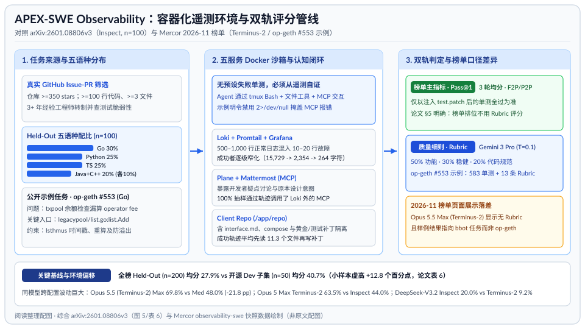
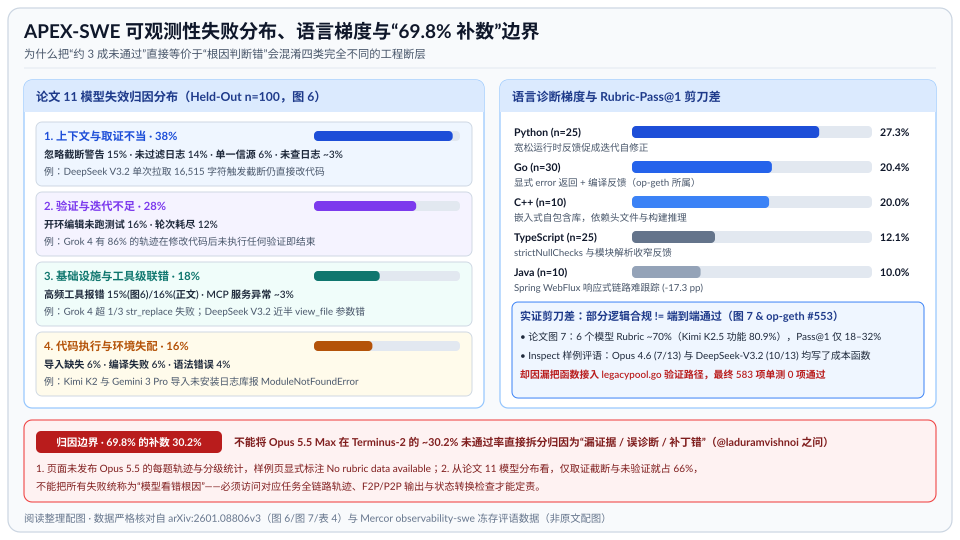

Abhi Kottamasu 等（Mercor · Cognition）· [arXiv:2601.08806v3（PDF）](https://arxiv.org/pdf/2601.08806) / [arXiv 摘要页](https://arxiv.org/abs/2601.08806)（2026-03-23 v3；2026-01-13 提交） · [Mercor APEX-SWE Observability 榜单](https://www.mercor.com/apex/apex-swe-leaderboard/observability-swe/) · [APEX-SWE 总榜](https://www.mercor.com/apex/apex-swe-leaderboard/) · [GitHub 评测 Harness](https://github.com/Mercor-Intelligence/apex-swe) · [Hugging Face 开发集（n=50）](https://huggingface.co/datasets/mercor/APEX-SWE) · [2026-11-04 X 讨论源贴（`@laduramvishnoi`）](https://x.com/laduramvishnoi/status/2117733057184911567)

2026 年 11 月 4 日，Middleware Labs 创始人 Laduram Vishnoi 在 X 上引用 Mercor APEX-SWE Observability 榜单提出了一个直击值班团队痛点的问题：**即使把 `Claude Opus 5.5` 调到 `Max` 推理强度，它在该基准上仍有约三成（`100% - 69.8% = 30.2%`）任务未能通过**；而值班工程真正关心的是，这些失败究竟属于“漏掉了关键证据”“推理定位了错误根因”，还是“改出的补丁未能真正恢复系统”。要回答这个问题，不能只盯着单页百分比做减法，而必须把 **Mercor 榜单快照** 放回其基石技术论文 [`arXiv:2601.08806v3`（《APEX–SWE》，2026 年 3 月）](https://arxiv.org/pdf/2601.08806) 的任务构造、容器拓扑、判定机制与失效分类框架里联合审视。

> **证据分层与口径边界**：本文严格核对两份主源与一份社群背景贴，并显式区分四类事实边界：（1）**论文基线**（`arXiv:2601.08806v3`）报告了 11 个模型在 `n=200` 闭源评测集（`100` Integration + `100` Observability）及 `n=50` 开源开发集上的 `Inspect` ReAct 实测、语言分布、失效环图与 Rubric 散点；（2）**2026-11-04 冻存榜单与子页快照**（`mercor-leaderboard.html` 与 `observability-swe/`）反映了 `Terminus-2` harness 接入与 `Opus 5.5` 等新模型上线后的快照（本文严格排除发布日晚于 `2026-11-04` 的后续新增条目）；（3）**公开示例与底层评分负载**展示 `ethereum-optimism/op-geth` Issue `#553` 的 583 项单测与 13 条 Rubric，同时暴露 `Terminus-2` 页面展示存在 `No rubric data available` 与样例测试名错位；（4）**归因推论边界**——论文失效百分比来自 11 个早期模型在 `Inspect` 上的汇总分析，无法直接当作 `Opus 5.5 Max` 在 `Terminus-2` 上那 `30.2%` 失败的精确拆分比例。

## 基准架构：从五服务容器遥测到双轨判定边界

在动机层面，[`arXiv:2601.08806v3`](https://arxiv.org/pdf/2601.08806) 首先指出了传统编码基准与真实软件工程实践之间的错位：引用 IDC 调查（Resnick, 2025），开发者仅有 **`16%`** 的工作时间花在编写应用代码上，其余 **`84%`** 涉及 CI/CD、基础设施监控、安全、部署与调试（引用 Britton et al., 2013 称软件调试年成本达 3,120 亿美元）；而单仓库修补基准 `SWE-bench Verified` 不仅已在前沿模型上逼近 **`80% Pass@1`** 饱和区，还被 OpenAI 指明存在凭任务 ID 原样背诵补丁的污染风险（Glaese and Watkins, 2026）。为此，Mercor 与 Cognition 联合构建了包含 **Integration（`n=100`）** 与 **Observability（`n=100`）** 两大任务域的 `APEX–SWE`，并分别在 Hugging Face 与 GitHub 开源了 **`n=50`（每域 `25` 题，CC-BY 协议）** 开发集与评测 Harness。

聚焦 **Observability（可观测性排障）** 子域，论文第 4.1 节与图 5 披露了严格的生产化构造流水线：任务全部源自 GitHub 上 **`>=350` stars** 的真实开源仓库中的 **Issue–PR 配对**，并筛选出改动规模 **`>=100` 行代码且横跨 `>=3` 个文件**的复杂变更，再由拥有 **`3` 年以上经验**的工程师检查测试覆盖度与脆弱性（排除依赖特定实现细节的脆弱测试）后转制为基准题。100 道 held-out 题按 **Go（`30%`）、Python（`25%`）、TypeScript（`25%`）、Java（`10%`）与 C++（`10%`）** 五种语言配比。与传统 bug-fix 基准最本质的区别在于：**模型不会预先拿到任何失败单元测试**，必须自己从多源运行信号中拼出真相。

每个任务的隔离环境通过 `docker-compose.yaml` 与 `Dockerfile` 编排 **5 类服务**：客户端代码工作区（`/app/repo`）、`Loki` + `Promtail` 日志聚合、`Grafana` 可视化面板，以及承载工单与开发对话的 `Plane` 和 `Mattermost`。工程师在 `data/` 种子目录中写入 **`500–1,000` 行正常业务日志并混入 `10–20` 行故障症状日志**，同时抽取仓库真实 GitHub Issue 与公开开发者讨论（GitHub Discussions、Gitter）复原现场上下文。模型在默认 `1` 小时墙钟超时内通过 ReAct 循环（由 LiteLLM 驱动，指数退避最多重试 `3` 次/请求）调用三类工具：（1）`tmux` 持久会话中的 `/bin/bash`；（2）工作区文件读写；（3）通过 **MCP（Model Context Protocol）** 访问 `Loki`、`Plane` 与 `Mattermost`。此外，任务目录还附带描述关键接口的 `interface.md`，而测试补丁 `test.patch` 与参考修复 `golden.patch` 则留待评测验收阶段注入。

<figure>
  <a class="note-image-link" href="/assets/images/tech/2026-11-04-mercor-apex-swe-observability/apex-swe-observability-pipeline-zh.svg" target="_blank" rel="noopener">
    
    放大图解 ↗
  </a>
  <figcaption>阅读整理配图（非原文配图）：综合 arXiv:2601.08806v3（第 2、4.1、5 节及附录 B）与 Mercor observability-swe 榜单梳理的构造与判定全链路。</figcaption>
</figure>

在评分与口径设计上，论文与网站 FAQ 之间有一处**极易被读混的双轨边界**：

- **榜单排位唯一依据 `Pass@1`（自动测试套件）**：论文第 2 节与第 5 节写得非常明确——Observability 采用 SWE-bench 风格的 **`FAIL_TO_PASS`（F2P）与 `PASS_TO_PASS`（P2P）** 单元测试判定二值通过，取 **`3` 次独立运行（epochs）的均值作为 `Pass@1`**（至少一次成功记为 `Pass@3`），并特别加粗声明：**“Rubric scores are not used for the APEX–SWE leaderboard, which relies exclusively on Pass@1.”**（Rubric 分数不用于 APEX-SWE 榜单排位）。
- **独立于排名的专家 Rubric 质量评估**：每道题由参与构建的工程师编写细则，包含 **功能标准（Functional，占 `50%`）、稳健性标准（Robustness，占 `30%`）与仅在 Observability 启用的代码风格标准（Style，占 `20%`）**，由 `Gemini 3 Pro`（`Temperature = 0.1`, `Thinking = High`）对照最终补丁与执行日志独立打分，用于衡量“代码是否健壮且符合仓库规范”。需要留意的是，Mercor 网站通用 FAQ 文案曾沿用 `APEX-Agents` 的统一表述（把 `Pass@1` 概括为“Rubric 满分率”），读 `APEX-SWE` 数据时必须以论文定义和底层 F2P/P2P 实测负载为准。
- **闭源评测集与开源开发集的样本膨胀差**：论文附录 B（表 6）对比了同一套评测流程在 `n=200` 闭源榜单与 `n=50` 开源开发集上的全榜均分：虽然头两名（`Opus 4.6`、`Opus 4.5`）与末三名（`Grok 4`、`DeepSeek V3.2`、`Kimi K2 Instruct`）排名完全不变，但中段模型座次出现互换（如 `Kimi K2.5` 从第 `6` 升至第 `4`、`GPT-5.2 Codex` 从第 `5` 降至第 `7`），且小样本开发集平均分高达 **`40.7%`**，比闭源榜单均值 **`27.9%`** 系统性虚高 **`+12.8` 个百分点**。这提醒研究者不可拿 `n=50` 子集分数直接和官方 `n=200` 榜对标。

## 论文基线与 2026 年 11 月榜单：Harness、推理强度与跨代跃迁

对比 2026 年 3 月论文里的 `11` 模型起点与 2026 年 11 月 4 日 Mercor 冻存榜单快照，最显著的变化不只是新模型迭代把绝对分数推高，还包括**执行 Harness 从 `Inspect` 拓展到 `Terminus-2`** 以及 **显式推理强度（`effort`）分层** 带来的大幅分差。

在论文基线（`arXiv:2601.08806v3` 表 3 与表 4，`Inspect` harness，`n=100` Observability）中，全部 `11` 个模型无一接近生产级可靠度：榜首 **`Claude Opus 4.6 (High)`** 仅取得 **`31.7%` Pass@1**（`Pass@3` 升至 `39.0%`，`+7.3` pp），`Claude Opus 4.5 (High)` 为 **`26.7%`**（`34.0%`），`GPT-5.2 Codex (High)` 为 **`21.3%`**（`29.0%`），其余中段模型紧密挤在 **`18.7%–21.0%`** 区间（`Cognition SWE-1.6 Preview` `21.0%`、`GPT-5.1 Codex` `20.3%`、`DeepSeek V3.2` `20.0%`、`Kimi K2.5` `19.7%`、`Gemini 3 Pro` `19.7%`、`Claude Sonnet 4.5` `18.7%`），尾部则断崖跌至 `Grok 4`（`5.7%`）与 `Kimi K2 Instruct`（`4.0%`）。按语言切片（表 4）更暴露出运行时反馈机制的决定性作用：**Python 均值最高（`27.3%`，`n=25`）**，其次为 **Go（`20.4%`，`n=30`）** 与 **C++（`20.0%`，`n=10`）**，而 **TypeScript（`12.1%`，`n=25`）** 与 **Java（`10.0%`，`n=10`）** 几乎腰斩——Python 与 Java 相差 **`17.3` 个百分点**。论文将这一差距归因于反馈回路宽窄：Python 宽松的运行时允许 Agent 先跑不完美脚本观察报错再自修正；Go 凭借显式 `error` 返回与编译检查配合得更好；而 TypeScript 的 `strictNullChecks`/复杂模块解析以及 Java 在 `Halo` + `Spring WebFlux` 响应式异步流中的非同步控制流，显著压缩了模型的试错信号。

到了 2026 年 11 月 4 日前后的 Mercor 榜单（`observability-swe/` 默认展示 `Terminus-2`，同时保留 `Inspect` 切换），同一任务域的格局呈现出三重分化：

| 模型（标明来源阶段） | `Inspect` Pass@1 | `Terminus-2` Pass@1 | `Pass@3` / `Effort` 档位差 | 在评测比较中的核心意义 |
| :--- | :--- | :--- | :--- | :--- |
| **`Opus 5.5`**（2026-11 榜单，`2026-09-22`） | 未列入 | **`69.8%`** (`Max`) / `48.0%` (`Med`) | 同模型 `Max` 较 `Medium` 高 **`+21.8` pp** | 2026-11 榜单头名；同一模型降一档推理强度即跌去超五分之一绝对分 |
| **`Sonnet 5.5`**（2026-11 榜单，`2026-09-28`） | 未列入 | **`63.5%`** (`Max`) / `28.2%` (`Med`) | 同模型 `Max` 较 `Medium` 高 **`+35.3` pp** | 极端证明“只看模型名不看 `effort`”在可观测排障里毫无意义 |
| **`Opus 5`**（2026-11 榜单，`2026-07-24`） | `44.0%` (`Max`) | **`63.5%`** (`Max`) | 同 `Max` 档跨 harness 相差 **`+19.5` pp** | 即使模型与 `effort` 完全锁死，换 harness 也能重写近 20 点分差 |
| **`Fable 5.1` / `Fable 5`**（2026-11 榜单） | `-` / `50.33%` (`Max`) | **`59.0%`** / **`54.2%`** (`Max`) | `Fable 5` `Terminus-2` 略高 `+3.87` pp | 位于 2026-11 `Terminus-2` 榜单第 4、5 位，延续高配优势 |
| **`Grok 4.6`**（2026-11 榜单，`2026-08-12`） | 未列入 | **`51.7%`** (`xHigh`) / `50.0%` (`High`) | `xHigh` 较 `High` 仅 `+1.7` pp | 与早期 `Grok 4`（`5.7%`）相比跨越巨大，高档位边际收敛 |
| **`Opus 4.8`**（2026-11 榜单，`2026-05-28`） | **`43.3%`** (`High`) | `35.7%` (`Max`) | `Inspect` 反超 `Terminus-2` **`+7.6` pp** | 说明 `Terminus-2` 并非单调增益，不同模型与工具脚手架存在耦合 |
| **`Opus 4.6`**（论文基线 & 2026-11 榜单） | **`31.7%`** (`High`) | `30.8%` (`Max`) | 论文 `Pass@3` **`39.0%`**（`+7.3` pp） | 论文期榜首；两套 harness 分数几乎持平，且多次采样仍有 `+7.3` pp 空间 |
| **`Opus 4.5`**（论文表 3） | **`26.7%`** (`High`) | 未列入 | 论文 `Pass@3` `34.0%`（`+7.3` pp） | 论文期第二名，且在图 7 中与 `Opus 4.6` 同处高质前沿象限 |
| **`DeepSeek-V3.2`**（论文 & 2026-11 榜单） | **`20.0%`** | `9.2%` | 论文 `Pass@3` `22.0%`；换 harness 降 **`-10.8` pp** | 论文中单次未过滤日志即触发截断；切 `Terminus-2` 后得分跌去逾半 |
| **`Grok 4` / `Kimi K2`**（论文基线） | `5.7%` / `4.0%` | `-` / `8.0%` (`High`) | 论文 `Pass@3` 均为 `9.0%` | 论文中 `Grok 4` `86%` 轨迹改后零验证、`Kimi K2` 频现导入报错 |

这张对照表揭示了读 `APEX-SWE` 榜单时一条常被忽略的硬准则：**`Model × Effort × Harness` 三者必须绑定解读**。在总榜上（2026-11-04 冻存 `mercor-leaderboard.html`，合并 Integration 与 Observability `n=200` 样本集），`Opus 5.5 (Max)` 综合为 **`67.6% ± 5.9%`**（`Medium` `55.9% ± 6.3%`），`Sonnet 5.5 (Max)` 为 **`66.4% ± 6.1%`**（`Medium` `44.0% ± 6.1%`）；单看 Observability 分项，把推理强度从 `Max` 降到 `Medium` 会让 `Opus 5.5` 掉 **`21.8`** 个百分点、让 `Sonnet 5.5` 暴跌 **`35.3`** 个百分点。而同样是 `Max` 档的 `Opus 5`，在 `Terminus-2` 上拿 **`63.5%`**、在 `Inspect` 上却只有 **`44.0%`**；反过来，`Opus 4.8` 与 `DeepSeek-V3.2` 在 `Inspect` 上反而大幅领先于 `Terminus-2`。换言之，直接比较论文里 `Inspect` 的分数与半年后榜单默认的 `Terminus-2` 分数，本身就已经跨过了两个不同的执行器基线。

## 样例深剖：`op-geth #553` 的状态化约束与 Rubric-Pass@1 剪刀差

在 `observability-swe/` 页面下方，Mercor 公开了一道极具代表性的 Go 语言样例题——来自 `ethereum-optimism/op-geth` 的 **Issue #553**（`core/txpool: Include operator fee in sufficient fund checks`，页面明确提示样例仅作展示，不代表模型在整个 100 题分项上的全貌）。之所以说它把论文第 4 节的设计具象化了，是因为它精准命中了“局部代码看似无误、但跨状态转换与升级边界仍会全盘挂掉”的真实系统难点。

该题描述的线上症状非常清楚：交易池（`legacy pool`）在做余额充足性校验时漏算了 **operator fee**，尽管这不直接触发共识层分叉，却导致账户余额不足以支付 operator fee 的交易被正常放入交易池，随后在执行阶段才失败，造成用户侧反馈延迟与体验混乱。问题要求模型调通以下跨越费用计算、交易池状态机与测试配置的三层约束（共 `15` 条编号需求）：

1. **费用组合与 Isthmus 升级时间门控**：在 `core/types/rollup_cost.go` 与 `core/txpool/rollup.go` 中依托 `NewTotalRollupCostFunc`、`ExtractOperatorFeeParams`、`ExtractEcotoneFeeParams` 与 `TotalTxCost` 计算总成本；**以 `chain.Config().IsthmusTime` 为界**——激活时间之前只计 L1 rollup 成本，达到或晚于激活时间则必须同时计入 L1 与 operator 成本，不足时返回携带**所需交易总额与账户当前余额**的 `ErrInsufficientFunds`。
2. **交易池动态状态转换（不止于单次拦截）**：修改入口 `core/txpool/legacypool/list.go:list.Add`（并保持 `list.Add` 仅接收 `nonce` 与价格抬升参数 `price bump`，通过 `rollupCostFuncProvider` / `newRollupList` 回调 `legacypool.go` 的 `RollupCostFunc()`），必须同时覆盖 **四种运行时状态变化**：（a）新入池交易校验总成本；（b）高 gas 价**替换交易（replacement）**时重算 rollup 成本并更新 pending 总成本记录；（c）底层费用参数变化（如 operator fee 常量上调）后**重算全部 pending 交易**并驱逐变为余额不足的交易；（d）先前因费率变动被拒的账户在**补足余额后恢复接受交易**。
3. **稳健性与测试基础设施联动（需求 `12–15`）**：既要防范 `config.Optimism` 或成本函数为 `nil` 时的空指针 panic，也要在普通执行费用、L1 费用与 operator 费用累加时检查 `uint256` 整数溢出并返回溢出布尔标志；同时还需同步将 RLP 编解码测试、`ExecutableDataToBlock`（切换为 `DefaultBlockConfig`）及历史交易/区块追踪 API 测试切到 `OptimismTestCliqueConfig` 以匹配 Isthmus 规则。

为了解决这道题，环境为 Agent 挂载了 `Loki`（日志标签 `{job="ethereum-optimism-op-geth-553-558-observability"}`）、`Plane`（`mcp-plane`）与 `Mattermost`（`mcp-mattermost`），并在提示词里立下死规矩：**严禁对 MCP 命令追加 `2>/dev/null` 或 `2>&1 /dev/null`**，确保工具报错不被静默吞掉；同时要求在排障中**必须展示可观测性工具的实际使用**。

更有意思的是，当我们核对榜单页面嵌载的真实 `grade_results` 评分负载时，论文第 5 节图 7（**“Rubric 高分不等于 Pass@1 通过”**）在这道 `op-geth #553` 上得到了逐行级别的实证印证：

- 在 **`Inspect` 条目**下，该任务完整挂载了 **`583` 项单元测试**（`573` 项 `correctness-f2p` + `10` 项 `correctness-p2p`）和 **`13` 条 Rubric 细则**（`2` 条功能、`7` 条 nil/溢出稳健性、`4` 条错误文案与命名规范）。查看真实裁判评语可见：**`Opus 4.6 (High)` 在 Rubric 上拿到了 `7/13`**（正确实现了 `NewTotalRollupCostFunc` 的 `nil` 检查），但最终 **`583` 项单测 `0` 项通过**，原因直指状态接入遗漏——*“`legacypool.go` 未更新以调用 `TotalTxCost` 或 `TotalRollupCostFunc`，校验仍只看 L1 成本”*；**`DeepSeek-V3.2` 甚至拿到 `10/13` 的高 Rubric 分**，同样因为 *“未完成 `legacypool.go` 中向 `opts` 传递 `RollupCostFn` 的接线”* 而 **`0/583` 通过**；`GPT-5.3 Codex (High)` 拿下 **`13/13` Rubric 满分**，但在单元测试上依然只过了 **`378/583`**；反过来，`Opus 4.5 (High)`（`6/13` Rubric）与 `Kimi K2.5`（`9/13` Rubric）却通过了全部 **`583/583`** 单测。
- 而在 **`Terminus-2` 条目**（包括头名 **`Opus 5.5 Max 69.8%`** 与 `Opus 5.5 Medium 48.0%`）下，页面轨迹区直接渲染 **`No rubric data available for this model`**，且其底层 `grade_results` 列表实际展示的是另一道完全不相关的 `bbot` 任务测试（`test_module_nuclei.py` 共 `6` 项），而非 `op-geth #553` 的 583 项测例。这一UI 错位本身就说明：**绝不能看着顶部 `69.8%` 的总分和静态贴出的 `op-geth` 题面，去脑补 `Opus 5.5 Max` 在该题究竟调了多少次 Loki 或写了什么补丁**。

## 拆解“约三成未通过率”：论文失效分类与值班归因边界

回到文章开头 `@laduramvishnoi` 的三选一追问——那大约 `30%` 的未通过任务，究竟是**漏证据、误诊断，还是补丁未恢复系统**？把前端页面信息与 [`arXiv:2601.08806v3`](https://arxiv.org/pdf/2601.08806) 的实证分析拼在一起，能给出最严谨的“双层回答”。

**第一层是必须守住的归因红线**：`Opus 5.5 Max` 的 `30.2%` 补数不能在无轨迹数据下强行拆桶。 `69.8%` 只是 `100` 道 held-out 提示词上的平均 `Pass@1`，页面既没有公开按失败原因拆分的直方图，也没有提供 `Opus 5.5` 的逐题工具轨迹与 Rubric 评语。将“总分补数”直接解读成“误诊率”，会把未查日志、工具调用格式崩溃、忘跑测试乃至轮次用尽全部混为一谈。

**第二层是借助论文对 `11` 个模型在 `n=100` 闭源集上的定性全量拆解（第 4.3–4.4 节与图 6），看清 Observability 任务的真实失败重心。** 在论文里，真正把高分模型和其余模型拉开的不是“会不会写 Go/Python 语法”，而是作者反复强调的 **认知纪律（Epistemic Discipline）**——把不完整信息当成需要主动求证的调查对象，而非靠脑补填空的缺口。所有抽样通过的轨迹都体现了三条刚性行为：（1）**把查日志当成逐级窄化的搜索问题**（例如 `Opus 4.5` 先发出宽泛 `Loki` 查询返回 `15,729` 字符，随后用 `LogQL` 过滤器收窄到 `2,354` 字符，再压至 **`264` 字符**锁定异常；而不合格的 `DeepSeek V3.2` 在同一题直接拉取 `16,515` 字符触发截断警告后视而不见，拿着半截日志直接改代码）；（2）**100% 跨源三角互证**（所有分析的通过轨迹都至少调用了 `Loki` 之外的一个 MCP 工具——`Loki` 看发生了什么、`Mattermost` 看开发怀疑什么、`Plane` 看原定设计是什么）；（3）**修补前充分阅读代码库**（通过轨迹平均先读 **`11.3` 个文件**才动手，如 `Opus 4.6` 在一道 C++ 红外库排障题里连续追踪了 `23` 个文件）。

<figure>
  <a class="note-image-link" href="/assets/images/tech/2026-11-04-mercor-apex-swe-observability/observability-failure-boundaries-zh.svg" target="_blank" rel="noopener">
    
    放大图解 ↗
  </a>
  <figcaption>阅读整理配图（非原文配图）：将 arXiv:2601.08806v3 图 6、表 4、图 7 与 Mercor 样例评分负载中的实证断层统一呈现。</figcaption>
</figure>

把论文图 6 统计的全部失败信号与值班团队的工程排障链路对应起来，可以得到如下实证映射表：

| 论文一级失效类与占比（图 6，`n=100`） | 二级子类占比拆分（论文第 4.4 节与图 6） | 论文实测典型故障签名 | 对应值班排障阶段与评测审计重点 |
| :--- | :--- | :--- | :--- |
| **1. 上下文与取证不当（Bad Context Handling，`38%`）** | 忽略截断警告 `15%` · 未过滤日志 `14%` · 单一信源 `6%` · 未查日志约 `3%` | `DeepSeek V3.2` 拉取 `16,515` 字符触发截断警告仍继续修改；只查 Loki 漏看 `Mattermost` / `Plane` 约束 | **漏证据 / 证据残缺**：审计 MCP 查询是否逐级窄化、是否响应截断告警、是否完成多源三角互证 |
| **2. 验证与迭代不足（Insufficient Verification，`28%`）** | 开环执行不测 `16%` · 轮次耗尽 `12%` | `Grok 4` 高达 **`86%`** 的轨迹在编辑代码后未运行任何验证即结束，直接交出未闭环补丁 | **未验证即交卷**：即使找对了原因或部分代码正确，未跑通测试/回归验证也会直接丢分 |
| **3. 基础设施与工具级联错（Infrastructure Failure，`18%`）** | 高频工具报错 `15%`（图 6）/ `16%`（正文） · MCP 服务异常约 `3%` | `Grok 4` 超 `1/3` 的首次 `str_replace` 失败；`DeepSeek V3.2` 近半 `view_file` 因参数格式报错引发重试死循环 | **执行脚手架摩擦**：工具参数错误不断吞噬上下文与轮次配额，导致根本来不及完成根因定位 |
| **4. 代码执行与环境失配（Execution Failure，`16%`）** | 导入缺失 `6%` · 编译失败 `6%` · 语法错误 `4%` | `Kimi K2` 与 `Gemini 3 Pro` 引入未安装日志库报 `ModuleNotFoundError` 且无法从报错中自愈 | **补丁不可运行**：包含编译、依赖环境假设错误，或仅写 helper 而漏接核心调用链（如 `op-geth`） |

综合来看，论文中仅 **“上下文与取证不当（`38%`）+ 验证与迭代不足（`28%`）”** 两项就已经解释了 **`66%`** 的可观测性失败；如果再加上环境/工具级联报错（`18%`）与编译/导入/接线执行错误（`16%`），就能理解为什么在生产式排障榜单上，把所有失分笼统归咎于“AI 没推理出根因”会严重误导工程改进方向。

对正在建设或选型 AI SRE / Coding Agent 的团队而言，把 `arXiv:2601.08806v3` 与 Mercor 11 月榜单放在一起读，可以直接落地四条评测准则：第一，**跨榜比较前先锁定 `Harness × Effort × Sample Size` 三元组**（`Opus 5.5` 在 `Max` 与 `Medium` 间差 `21.8` pp，`Opus 5` 在 `Terminus-2` 与 `Inspect` 间差 `19.5` pp，`n=50` 开发集较 `n=200` 虚高 `12.8` pp）；第二，**把日志检索窄化与禁止静默丢错写入 Agent 行为规范**，强制追踪截断警告与 Loki/工单/群聊多源交叉；第三，**绝不以部分功能 Rubric 替代端到端状态机与回归测试**（`op-geth #553` 上 `DeepSeek-V3.2` 拿 `10/13` Rubric 却 `0/583` 单测通过就是最锋利的反例）；第四，**任何“30% 失手率”的改进决策都必须建立在轨迹级阶段分解上**——先分清模型是在“读截断日志”“工具调用报错”“漏接调用点”还是“改完不跑测试”这一环掉队，再决定投入改 Prompt、修 MCP 工具 schema，还是加固沙箱验证闭环。

---

> **AI 辅助整理 · 归档注记**：本篇中文精读与配套英文版（[English note](/tech/en/2026-11-04-mercor-apex-swe-observability/)）由助手联合精读 [arXiv:2601.08806v3（PDF）](https://arxiv.org/pdf/2601.08806) 全文（13 页及图 1–7、表 1–6）、2026-11-04 冻存 Mercor 总榜页（`mercor-leaderboard.html`）、[APEX-SWE Observability 榜单页](https://www.mercor.com/apex/apex-swe-leaderboard/observability-swe/) 及其结构化评测负载与 X 原讨论贴（`@laduramvishnoi`）重写；保留原 `id`、`permalink`、`source_url` 与 `source_published_at`，标签采用站点规范词表中的 `observability`、`coding-agents`、`agent-reliability`、`systems-reliability`。两幅配图 `apex-swe-observability-pipeline-zh.svg` 与 `observability-failure-boundaries-zh.svg` 系助手按上述一手材料绘制（非原文配图）；文中严格隔离了 `Inspect`（论文）与 `Terminus-2`（榜单）口径，未在缺少 `Opus 5.5` 轨迹的情况下编造其失败分类比例，也未混入晚于 `2026-11-04` 发布的后续榜单项。
