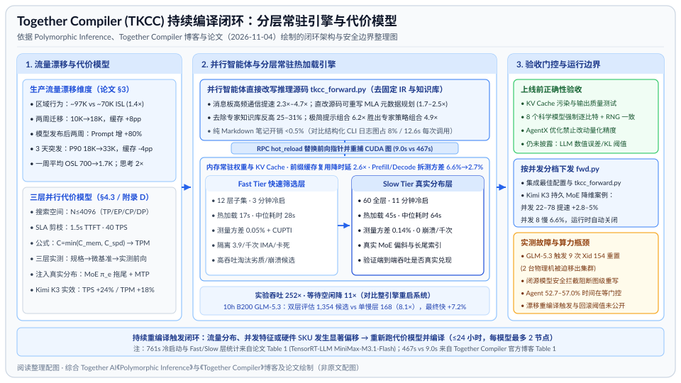
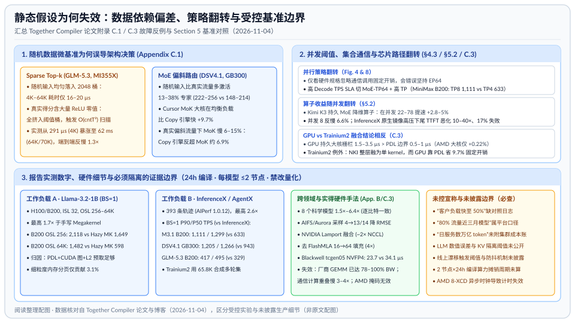

Simran Arora、Dan Fu、Reyna Abhyankar、Dylan Lim 等（Together AI Research）· 2026-11-04 · [主博客《Polymorphic Inference: self-tuning inference for open models》](https://www.together.ai/blog/polymorphic-inference) · [配套博客《Together Compiler: Continual Compilation for AI inference》](https://www.together.ai/blog/together-compiler-continual-compilation-for-ai-inference) · [技术报告《Together Compiler: Continual Compilation for AI Inference》（alphaXiv）](https://www.alphaxiv.org/abs/2611.together-compiler-continual-ai-inference)

如果只读 Together AI 的主宣发文章《Polymorphic Inference》，很容易把它理解成又一篇“用智能体自动调优推理”的厂商愿景稿。顺着文中外链继续读完同日发布的配套博客《Together Compiler: Continual Compilation for AI inference》及其直接链接的 **38 页技术报告（alphaXiv）** 之后，支撑这套叙事的核心工程矛盾、具体算法取舍、对照组消融实验与生产事故记录才真正浮出水面：现代推理优化真正的瓶颈不是“智能体写不出更快的算子”，而是**测量吞吐率与工作负载真实性之间的结构性撕裂**——以及一次静态调优在流量、模型和芯片高频演化下的快速失效。

> **证据范围与阅读口径**：本文严格核对上述两篇官方博客、随附 X 讨论串（`@simran_s_arora`、`@togethercompute`）与 alphaXiv 完整技术报告，并将文内信息明确划分为三层：（1）**报告明确披露的机制与受控实测**，涵盖真实流量漂移实例、随机输入与真实分布的偏差反例、`761s` vs `17s/45s`（官方博客口径 `467s` vs `9.0s`）常驻热加载统计、三层并行代价模型、`24h / ≤2 节点` InferenceX 与科学模型评测，以及 `9` 次 `Xid 154` GPU 重置记录；（2）**厂商自述但缺少逐工作负载明细的业务与平台宣称**，如“OpenRouter `80%` 流量流向近三个月模型”、“日服务数万亿 token”及“客户负载快至 `50%`”；（3）**尚未公开的内部实现细节与本文的工程推演**，包括 LLM 上线前 KV 污染测试的数值误差容忍阈值、生产流量触发重编译的滞后（hysteresis）判定规则，以及第 4 节提出的回归门控与公平对照准则。

## 为什么静态融合与固定并行配置会在真实多态负载下失效

Together AI 将早期推理部署概括为**静态推理（Static Inference）**：围绕少数闭源稠密 Transformer、单一交互形状与固定硬件平台进行手工极限调优。与之相对，**多态推理（Polymorphic Inference）** 描述的是模型、架构、流量分布与硬件同时高速漂移的服务现实。撇开“OpenRouter 上 `80%` 流量来自近三个月发布模型、前十大开源模型各自采用不同架构”这类平台统计背景，Together Compiler 技术报告第 3 节直接给出了生产集群中观测到的三类量化漂移：

- **区域与行为差异**：同一模型（Lab A）在不同地区呈现显著负载分化——某地区工作时段的平均输入长度（ISL）约为 **`97K` token**，而其余时段/区域约为 **`70K` token**（相差 **`1.4×`**），分别偏向智能体长链路与常规对话。
- **发布后的两周使用迁移与检查点演化**：新模型上线初期多用于短对话评测，**两周内**随着用户将其嵌入智能体工作流，配套博客报告 prompt 长度上升 **`80%`**；技术报告具体记录 Lab B 模型在两周内典型上下文从 **`10K` 增至 `18K`**、前缀缓存命中率同步抬升 **`8` 个百分点**；而 Lab A 推送一个增强“思考（thinking）”长度的新检查点后，输出序列长度（OSL）直接翻倍（**`2×`**）。
- **客户级突发脉冲（Burstiness）**：Customer A 在 **3 天**内 P90 ISL 从 **`18K` 跃升至 `33K`**、OSL 从 **`1K` 升至 `1.9K`**、缓存命中率下跌 **`4` 个百分点**；Customer B 在 **1 周**内平均 OSL 从 **`700` 飙升至 `1.7K`**、缓存命中率下降 **`7` 个百分点**。

与此同时，服务硬件在短周期内横跨 **NVIDIA H100、B200、B300、GB300（NVL72）、即将部署的 Vera Rubin，以及 AMD MI350X/MI355X 和 AWS Trainium2**。在这种四维同时漂移的环境里，Together 甚至直接否定了自己两年前大力推动的“全层极限融合”路径——**“在现代多态推理时代，把整步推理融成单个大核（megakernel fusion）并不是正确的设计目标。”**

技术报告附录 C.1 与 C.3 给出了三组极具说服力的反例，解释为什么“在孤立随机测试中跑赢的静态大核或固定配置”会在真实线上流量下反噬：

1. **稀疏注意力 Top-k 算子的随机输入盲区（Appendix C.1, Fig. 12/13b）**：在 AMD MI355X 上优化 GLM-5.3 的稀疏注意力索引器时，Opus 5.5 智能体写出了一版 `tk_topk5` 核函数——先将打分分桶进 `2,048` 个直方图桶，再对包含第 `K=2,048` 大分数的阈值桶内部做全量两两比较以解决平局（时间复杂度 **`O(cntT²)`**）。在均匀随机输入下，分数均匀分散在不同桶中，从 `4K` 到 `64K` 上下文耗时稳定在 **`16–20 µs`**；但真实请求经 ReLU 激活后存在大量**精确零值（exact zeros）**，全部塌缩进同一个阈值桶，导致核函数耗时从 `4K` 时的 **`291 µs`** 一路恶化至 `64K/70K` 时的 **`62 ms`**，直接拖累端到端引擎整体变慢 **`1.3×`**。
2. **MoE 路由偏斜击穿大核假设（Appendix C.1, Fig. 13a/c）**：在 DeepSeek-V4.1-Flash（GB300）上对比 Cursor 的生产级 MoE 大核（Mixture-of-Kittens, MoK）与 Copy 引擎时，随机测试数据会多激活 **`13–38%` 的专家**（在 `64–256` query token 区间随机命中约 `222–256` 个专家，而真实流量仅命中约 `148–214` 个）。当专家负载人为均衡时，MoK 大核比 Copy 引擎快 **`9.7%`**；但在真实偏斜路由下，MoK 性能下降 **`6–15%`**，Copy 引擎反过来以 **`6.9%`** 的优势击败 MoK。
3. **跨并发与跨芯片的最优策略反转（Section 5.2 & Appendix C.3）**：一方面，Kimi K3 上的持久 MoE 下投影（down-projection）优化在并发 **`22–78`** 时带来 **`+2.8–5%`** 加速，但在并发 **`8`** 时反而变慢 **`6.6%`**；另一方面，GPU 上的全层大核需要核内全局网格栅栏（grid-wide barrier），单次开销达 **`1.5–3.5 µs`**，反而慢于利用 NVIDIA **Programmatic Dependent Launch（PDL）** 在核边界触发的 **`0.5–1 µs`** 切换（AMD GLM-5.3 耗时 24 小时写出的大核仅比原版快 **`0.22%`**，NVIDIA GPU 大核也未保住持续优势；唯一相反的是 **Trainium2**，其 NKI 定制核把每层解码的注意力与 MoE 整层融合反而最有效）。此外，在回放 Together 内部生产流量时，当时榜首的 InferenceX MiniMax-M3.1-Flash 静态镜像在较低单副本 QPS 下便撞上容量天花板，尾部 TTFT 恶化 **`10–40×`** 且 **`17%` 请求直接失败**。

## Together Compiler 的持续编译闭环：分层常驻引擎、代价模型与“苦涩教训”消融

面对上述失效机理，Together Compiler（TKCC）放弃了“离线单核随机基准 + 静态图/IR 降级”的传统编译器范式，转而将推理优化重构为一个**围绕生产引擎前向源码（`tkcc_forward.py`）持续搜寻的闭环系统**。整个闭环的核心由三套设计组成：分层常驻热加载引擎、三层实测并行代价模型，以及随编码智能体能力演进而“做减法”的上下文消融。

<figure>
  <a class="note-image-link" href="/assets/images/tech/2026-11-05-together-polymorphic-inference/tkcc-continual-loop-architecture-zh.svg" target="_blank" rel="noopener">
    
    放大图解 ↗
  </a>
  <figcaption>阅读整理配图（非原文配图）：基于 Polymorphic Inference 与 Together Compiler 博客及技术报告整理的系统闭环、常驻引擎分层参数与运行边界。</figcaption>
</figure>

**第一层机制——用“常驻热加载 + 双层测量”解耦启动成本与分布真实性。** 现有端到端智能体优化系统（如 Apple 的 RSI-Inference Bench）每次验证候选改写都要重启整套推理引擎。技术报告 Table 1a 拆解了 **MiniMax-M3.1-Flash 在 TensorRT-LLM** 上的冷启动开销：仅启动到可服务状态就要 **`761 s`（约 `12.7` 分钟）**，其中模型权重加载占 `265 s`（`34.8%`）、autotuning 占 `192 s`（`25.2%`）、prefill/decode CUDA 图捕获共占 `226 s`（`29.7%`）、KV-cache 容量测算 `73 s`（`9.6%`）；而配套博客 Table 1 展示的另一套基线引擎冷启动同样耗去 **`467 s`**。TKCC 的关键工程切口是把**引擎生命周期与前向计算函数解耦**：引擎只启动一次并在显存中锁住权重与 KV cache；多个智能体通过消息板协同生成 `tkcc_forward.py` 后，经 RPC 调用 `hot_reload`，由各 rank `exec_file` 替换 `model.forward` 函数指针并仅重新捕获 CUDA/HIP 图——在博客基线中将切换压至 **`9.0 s`**（`1.7 s` RPC 设置 + `7.3 s` CUDA 图重捕）。为了同时守住快筛与真实分布，TKCC 实例化两层常驻引擎（论文 Table 1b）：

- **快速筛选层（Fast Tier）**：仅加载 **`12` 层**，首任务启动 **`3` 分钟**、热加载 **`17 s`**、单任务中位耗时 **`28 s`**、测量方差低至 **`0.05%`**，并借助 CUPTI 等提供算子级剖面；更重要的是，它将高频触发的非法内存访问（IMA）或卡死（Fast Tier 上高达 **`3.9` 次/千任务**）隔离在筛选层，避免整机重拉。
- **真实分布层（Slow Tier）**：加载全部 **`60` 层**，首任务启动 **`11` 分钟**、热加载 **`45 s`**、中位耗时 **`64 s`**、测量方差 **`0.14%`**、崩溃率降为 **`0` 次/千任务**，用于在真实 MoE 专家激活与长尾上下文分布上检验加速是否兑现。
- **降噪与高并发协同**：由于连续批处理（continuous batching）下混合 prefill 与 decode 会使同一前向代码耗时波动 **`4–6%`**，TKCC 强制拆分 prefill/decode 测量（将背靠背运行方差从 **`6.6%` 降至 `2.7%`**），同时利用**前缀缓存复用**（在 Kimi K3 上再降 **`2.6×`** 测量延迟）、核函数二进制缓存以及智能体高频消息板同步（分别在系统层与 MiniMax-M3 层消融中带来 **`2.3×`** 与 **`4.7×`** 提速）。最终，TKCC 取得 **`252×`** 的实验吞吐率与 **`11×`** 的等待空闲缩减；在 **B200 GLM-5.3 的 10 小时对照**（Fig. 2）中，双层架构评估 **`1,354` 个候选**（单慢层仅 **`168` 个**，相差 **`8.1×`**），找到速度快 **`7.2%`** 的方案并明显甩开单层与 RSI-Inference Bench 基线。

**第二层机制——用三层实测并行代价模型锚定起点（Section 4.3 & Appendix D）。** 当并行切分选错时，底层算子再怎么优化也事倍功半。TKCC 在最多 `N ≤ 4096` 张芯片的空间内枚举 MoE（`EP`、`TP`）、稠密层（`TP`）与注意力（`TP`、`DP`、`CP_act`、`CP_kv`）的合法切分，先按整除约束、显存与互联上限、以及服务 SLA（例如 **`1.5 s` TTFT 与 `40` TPS**）剪枝，再计算考虑单卡内存上限 `C_memory` 与延迟上限 `C_speed` 后的最大并发 **`C = min(C_memory, C_speed)`**，统一折算为单芯片每分钟 token 吞吐量 **`TPM`**。其核心洞察在于把**三档测量源**（硬件规格书 → 自测/厂商微基准如 `nvbandwidth`/`nccl-tests`/`cuBLASLt` → 实测端到端前向）与**线上数据分布**（MoE 实测路由概率 `π_e` 及其 Zipf 拖尾最慢 rank 期望 `E[max_j A_j]`、多 token 预测 MTP 接收长度、批内请求长度不均）结合起来：仅看硬件带宽规格往往忽略每次集合通信的固定延迟从而盲选 `EP64`，而注入实测曲线后（Fig. 4a–b），一旦单用户 Decode TPS SLA 收紧，模型会果断转向 `MoE-TP64` 与更高的注意力 TP。该代价模型直接将 Kimi K3 生产部署的 **`TPS` 推高至多 `24%`、`TPM` 推高至多 `18%`**。

**第三层机制——性能工程里的“苦涩教训”消融（Section 4.4 & Appendix C.2）。** Together 团队回顾了过去两年投入生产的三代系统演进——手工 **Megakernels** → 扩展 **Torch Compile（Inductor FX 图）** 并借助 CUPTI/rocProf 补全 C++ 核启动信息再下发 PTX/PDL → 为智能体配备**专家知识库、固定策略分工与结构化实验日志图 CLI**。当底层编码智能体换代后，团队逐一拆除了这些人类先验抽象：

| 设计维度 | 早期/传统对比方案 | TKCC 现行选择 | 同基准消融或生产对照结果 | 限制条件与说明 |
| :--- | :--- | :--- | :--- | :--- |
| **代码抽象界面** | Torch Inductor FX 图（含 CUPTI 扩展） | 直接向智能体开放完整推理引擎源码 | **开放源码胜出**：Kimi K3 改写 MLA 主机侧元数据规划获 **`1.7–2.5×`** 加速 | 智能体约 **`20%`** 时间用于读源码；FX 图无法改写主机侧元数据 |
| **专家知识库（KB）** | 图谱化生产核、融合配方与论文摘要库 | 移除专家知识库（无 KB） | **无 KB 胜出**：12 小时后带知识库版本性能反而低 **`25–31%`**（Fig. 5a 标 **`26%`**） | 测量于 MiniMax-M3 第 3 层（B200 TP4, BS=1）；KB 易导致检索锚定 |
| **优化策略提示** | 6 类专家定制提示（融合/减发射/重叠等） | 统一极简目标（让前向尽可能快） | **极简胜出**：10 轮后极简集成达 **`6.2×`** vs 专家集成 **`4.9×`**（单路 **`4.8×`** vs **`3.1–4.5×`**） | 在 AMD GLM-5.3 上，限定大核策略的智能体跑满 24 小时仅提速 **`0.22%`** |
| **实验记录数据结构** | 类型化实验知识图谱 + Python CLI 查询 | 智能体用纯 Markdown 文件自记笔记 | **纯 Markdown 胜出**：记账耗时从 **`8%`**（约 **`12.6 s`/次** CLI、占 **`43%`** 调用）降至 **`<0.5%`** | 消融对比于 GLM-5.3（AMD 与 NVIDIA）端到端编译运行 |
| **引擎测量层数** | 单层全量 `60` 层慢引擎 / 每次重启引擎 | `12` 层快筛 + `60` 层全量常驻双层 | **双层胜出**：B200 GLM-5.3 10h 评估 **`1,354` vs `168`** 候选（**`8.1×`**），最终快 **`7.2%`** | 对比重启引擎系统实验吞吐达 **`252×`**；但智能体仍有 **`52.7–57.0%`** 时间在等门控 |

## 实测收益、硬件特异性优化与证据边界

为了评估 TKCC 究竟是“只针对某一张榜单有效”还是具备跨工作负载的真实工程收益，我们把技术报告第 5 节与附录 A/B/C 的所有受控实验与厂商生产宣称分开核对：

<figure>
  <a class="note-image-link" href="/assets/images/tech/2026-11-05-together-polymorphic-inference/polymorphic-failure-mechanisms-and-benchmarks-zh.svg" target="_blank" rel="noopener">
    
    放大图解 ↗
  </a>
  <figcaption>阅读整理配图（非原文配图）：将随机基准失真反例、并发与芯片路径翻转，以及 24 小时编译实验的数值范围与证据缺口分层对照。</figcaption>
</figure>

**第一类受控对比——单卡工作马 Llama-3.2-1B（Batch Size 1, ISL 32, OSL `256–65,536`）。** 在 H100 与 B200 上，TKCC 对比了 Hazy Megakernel、Mirage Persistent Kernel、VDCores 以及 `torch CUDA graph (+ PDL)`，最高取得 **`1.7×`** 吞吐优势——例如在 B200 上，`OSL=256` 达到 **`2,118` TPS**（Hazy MK 为 `1,649`，CUDA 图+PDL 为 `1,249`，Mirage 为 `675`）；当 `OSL=65,536` 时，TKCC 仍保持 **`1,482` TPS**，而 Hazy MK 跌至 **`598` TPS**、Mirage 仅 **`98` TPS**。团队拆解后的关键归因相当克制：细粒度内存分页本身只贡献了整步前向 **`3.1%`** 的收益，**真正拉平甚至反超单一持久化大核的，是 PDL、CUDA 图与 L2 预取等驱动级原语**。

**第二类受控对比——InferenceX / AgentX 前沿模型（`24` 小时编译、每模型最多 `2` 节点、禁改量化）。** 在严格锁定 SemiAnalysis AgentX 压测套件（`AIPerf 1.0.12`、`393` 条开源编码代理轨迹、`seed 42`、且先本地复现官网基线吞吐精确一致与 P90 交互延迟 `~2%` 内误差）的条件下，TKCC 在多个模型与芯片组合上取得最高 **`2.6×` TPS** 提升；在并发 `1` 的低延迟交互区间（Fig. 8 / Fig. 10），代价模型重新选型与前向优化协同将 **MiniMax-M3.1-Flash（B200）** 的 P90 TPS 从 InferenceX 最佳 TP4 的 **`633`** 推升至 TP8 的 **`1,111`**（P50 从 `690` 升至 **`1,299`**，提升约 **`1.8×`**，作者明确说明原镜像强行切到 TP8 并无该收益），并将 **DeepSeek-V4.1-Flash（GB300）** P90 TPS 从 **`943`** 提至 **`1,205`**（P50 **`1,266`** vs `971`），**DeepSeek-V4.1-Flash（B200）** P90 从 `671` 提至 **`813`**，**GLM-5.3（B200）** P90 从 `329` 提至 **`417`**，**Kimi K3（GB300）** P90 从 `423` 提至 **`450`**，**GLM-5.3（MI355X）** P90 从 `463` 提至 **`480`**。但必须读清论文首页脚注：**AWS Trainium2 并未跑在 AgentX 上**，而是因当前实现在有限 HBM 上尚不支持高并发而改用合成多轮数据集（`65,792` 上下文、`3,456` 共享系统提示、`~95%` 缓存命中率、`700` OSL）。

**第三类受控对比——非 LLM 跨领域科学模型（Appendix B, Table 2/3/5）。** 在 8 个涵盖气象（AIFS-ENS 2.0、Aurora 1.5）、生物（Boltz-2、Evo 2）、时序（Chronos-2、Panda-72M）与 PDE（Walrus、Poseidon-T）的基础模型上，TKCC 在**强制要求逐比特输出一致与 RNG 状态对齐**的 H100 评测下实现了 **`1.5×–6.4×`** 加速，而作为基线的 Claude Code `/goal` 在 **AIFS-ENS 2.0** 上未能给出正确解；加速释放的墙钟预算让 AIFS/Aurora 在相同时间内从 `4` 次采样增至 **`13`/`14` 次**，将气温预测 RMSE 分别从 `0.97 K` 降至 **`0.94 K`**、从 `0.60 K` 降至 **`0.55 K`**。

**智能体究竟改对了什么、又在哪些地方反复碰壁（Appendix C.3）？** 这一节的技术含金量极高：有效的跨平台加速主要来自**将通信融进邻近算子**（NVIDIA 上手写 Lamport 式哨兵轮询 all-reduce 融合残差加、RMSNorm 与量化，在 MiniMax decode 上比 NCCL 快约 **`2×`**；AMD 上直接写入 AITER 共享跨卡缓冲省去拷贝）以及**删除死代码与冗余填充**（DeepSeek V4.1 上四个独立智能体均发现原版 FlashMLA decode 核把 `16` 个注意力头填充成 `64` 个，做了 **`4×`** 无用功；Blackwell 用 `tcgen05` NVFP4 下投影以 `23.7 µs` 击败厂商 `34.1 µs`；调整 DeepGEMM tile 将时间从 `273 µs` 缩至 `210 µs`；AMD 上调整 HIP 图分支记录顺序并为 Composable Kernel 缺失形状补全 split-K）。相反，**智能体几乎每次都在三件事上碰壁**：（1）直接重写厂商 GEMM/注意力/MoE 核（因原版已跑在 **`78–100%` 内存带宽上限**）；（2）尝试把通信与计算硬重叠（NVIDIA 上多批重叠与 split-K 反而**慢 `3–4×`**，AMD 上并发 RCCL 全并发皆输）；（3）依赖不可用的硬件控制/计时原语（AMD CU 计算单元掩码被忽略，且 MI350X/MI355X 的 **8 颗计算芯粒 XCD 时钟不同步**导致核内计时毫无意义）。

相比上述可逐项复核的受控指标，厂商在博客与 X 宣发中提到的 **“生产客户负载快至 `50%`”** 与 **“日服务数万亿 token、几小时完成重编译”** 属于未附公开客户切片日志的整体生产宣称；同时报告也没有核算 **`2` 节点 × `24` 小时持续编译算力**在不同规模部署上的成本摊销边界。

## 在线持续优化的安全边界与公平评测准则

把“自动改写服务端前向代码 + 热加载进引擎”从离线竞赛搬到生产集群，技术报告附录 C.3 与第 4.1 节主动暴露出的几处险情，恰好划定了落地时绝对不能绕过的工程安全边界：

1. **物理故障隔离（`Xid 154` 教训）**：在优化 GLM-5.3 期间，智能体生成的代码因非法内存访问触发 NVIDIA 驱动严重故障 **`Xid 154` 并迫使 GPU 全卡重置高达 `9` 次**，最终导致 **`2` 台物理机器被迫移出集群**；即使在 `12` 层的 Fast Tier 上，崩溃率也达到 **`3.9` 次/千任务**。这意味着任何搜索与筛选进程必须在物理/调度隔离的编译集群上执行，严禁与在线租户共享同一批 GPU 进程空间或节点稳定性预算。
2. **闭源护栏的“一刀切”代价与形式化验证空白**：报告指出，在两次智能体修改导致 GPU 崩溃后，闭源安全策略直接禁止智能体修改模型已记录的 GPU 执行序列——这虽然止住了崩溃，却也封死了此前确实带来收益的图级优化路径。同时，作者在第 4.4 节坦言：虽然在搜索期拆除了限制表达能力的 IR，但**未来仍需要专门用于“正确性验证”而不压缩优化空间的新型验证 IR**。
3. **LLM 数值一致性与 KV 污染门槛未明**：不同于科学模型明确给出逐比特与 RNG 校验表（Table 5），报告第 4.1 节虽然提到预算耗尽后运行“KV cache 污染与质量全套测试”，附录 A 也锁定了“禁止改动量化精度”，但对于大语言模型热加载后的 **FP4/BF16 舍入边界、logits KL 散度门限、长上下文跨请求 KV 隔离压测方法**，原文并未披露可复现的验收阈值。

结合上述原文披露事实与生产推理系统工程常识，下表归纳了一套面向持续编译系统的治理与公平评测准则（注：右侧工程要求为结合原文故障线索所作的系统设计推演，非 Together AI 内部已公开规范）：

| 风险与评测维度 | 原文披露的现实线索 / 空白 | 上线治理边界与公平对比准则（工程推演） |
| :--- | :--- | :--- |
| **故障隔离与热加载回滚** | Fast Tier 崩溃 **`3.9`/千次**；GLM-5.3 触发 **`9` 次 `Xid 154`** 并损毁 **`2` 台主机** | 编译/筛选沙箱与线上服务物理隔离；生产环境仅加载通过 Slow Tier 压测的只读制品，保留基线 `model.forward` 与 CUDA 图快照实现毫秒/秒级回滚 |
| **正确性与 KV-Cache 隔离** | 科学模型验证逐比特一致；LLM 仅提“KV 污染与质量测试”及禁改量化，具体误差门限未披露 | 上线前必须独立跑通多并发混合请求下的前缀缓存校验、固定种子 logprob 漂移上限与跨租户 KV 零串扰回归，不可仅凭单条样例输出“看似正常”放行 |
| **流量漂移与防抖动（Hysteresis）** | 生产存在 3 天突刺（P90 `18K→33K`）与两周趋势；单次编译需 `≤2` 节点跑数小时至 `24h` | 必须用滑动窗口分布统计（如 KL/JS 散度或 P90/缓存命中驻留时间）驱动重编译，防止短时脉冲引发编译抖动（thrashing）；按并发分桶维护多套已验证 `fwd.py` |
| **公平基线归因拆分** | MiniMax B200 从 `633→1,111` 既换了 **`TP4→TP8`** 又改了前向核；InferenceX 原镜像高压掉 `17%` 请求 | 评测必须将“并行配置重选收益（代价模型）”与“算子/图重写收益（智能体搜索）”拆开计分，并在相同并发、超时率 `0%`、相同缓存命中口径下对比 |
| **尾延迟与搜索算力账本** | 智能体 **`52.7–57.0%`** 时间在等门控；系统主优化吞吐与 P90 ITL，生产还关乎 TTFT 尾延迟 | 验收门控需同时锁定 **P90/P99 TTFT + ITL** 而非只看吞吐峰值或 P50；纳入“编译节点 GPU 小时数 / 线上节省 GPU 小时数”的净回收周期核算 |

总体而言，把两篇官方博客与 38 页技术报告合在一起读，Together AI 真正拿出来的并非“一句话让 AI 自我进化”的概念空壳，而是一条被真实数据分布与驱动崩溃逼出来的工程路线：**用常驻双层引擎把实验验证周期从十余分钟压缩到十余秒，用融合实测与分布偏斜的代价模型先定并行盘面，再让智能体直接面向引擎源码搜索硬件特异性优化**。它证明了“高吞吐 × 高保真”的反馈回路确实能在 24 小时内压榨出显著的单机与集群性能，但也同样诚实地暴露出当前边界——**智能体仍有一半以上时间卡在测量门控排队上，硬件级异常仍需物理隔离兜底，而线上漂移触发、数值容差与算力投入产出比，才是决定它能否从顶级团队的自研武器变成通用基础设施的真正考题。**

---

> **AI 辅助整理 · 归档注记**：本篇深度技术解读由助手精读冻存主博客《[Polymorphic Inference](https://www.together.ai/blog/polymorphic-inference)》、配套《[Together Compiler](https://www.together.ai/blog/together-compiler-continual-compilation-for-ai-inference)》博客及所链《[Together Compiler: Continual Compilation for AI Inference](https://www.alphaxiv.org/abs/2611.together-compiler-continual-ai-inference)》完整技术报告后重写完成，英文配套版见 [English note](/tech/en/2026-11-05-together-polymorphic-inference/)。文内保留原 `id`、`permalink`、`source_url`、`source_published_at` 与 `inference-serving`、`self-improvement`、`systems-reliability` 规范标签；两幅 `v3-blue` 配图 `tkcc-continual-loop-architecture-zh.svg` 与 `polymorphic-failure-mechanisms-and-benchmarks-zh.svg` 系助手按一手原文绘制（非原文配图），原目录内留存的 `official-figure.png` 已完整保留未删。
