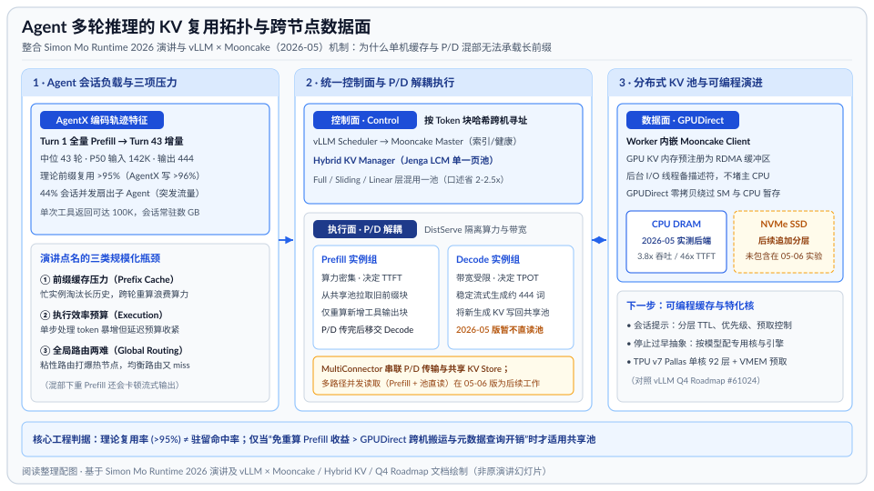
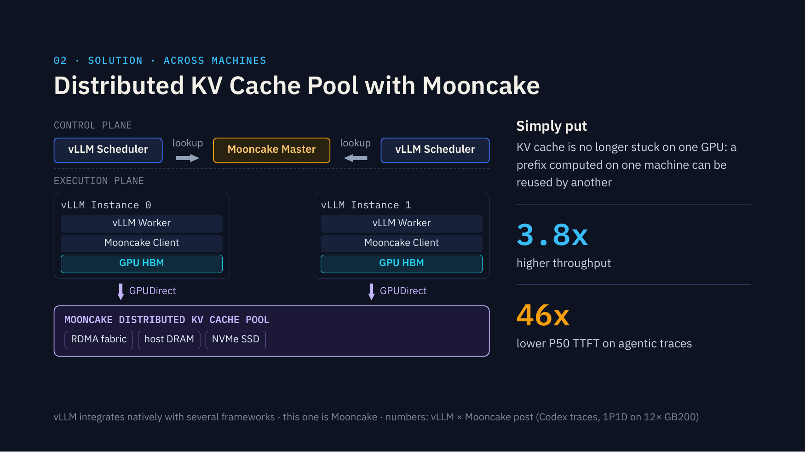
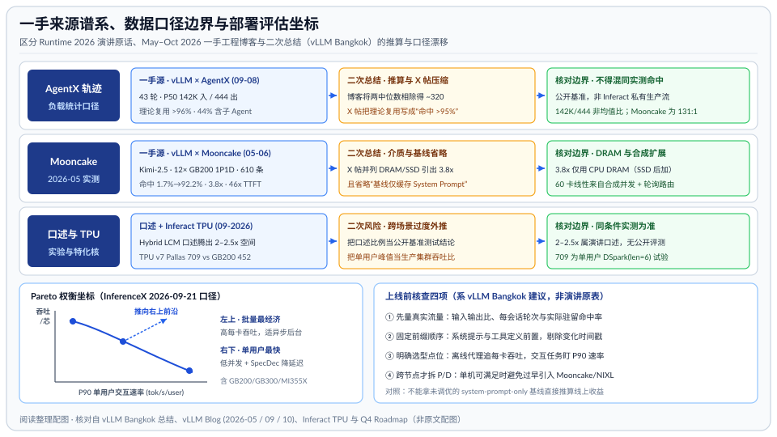

Natdhanai Praneenatthavee（vLLM Bangkok 联合创始人）· 2026-11-04 · [原始二次工程总结](https://vllmbangkok.com/en/blog/serving-the-agentic-workload/) · 对应演讲：Simon Mo（Inferact 联合创始人兼 CEO）于 Modal **Runtime 2026**（2026-10-01 旧金山现场演讲，Modal 于 2026-11-02 发布 18 分钟录播）

当模型从单轮问答进入编码 Agent 与工具循环，推理引擎的瓶颈不再只是“算一次矩阵有多快”，而是“如何避免在几十轮会话里把早已算过的十几万 token 上下文反复重算”。这篇文章系统拆解 Simon Mo 在 Runtime 2026 上阐述的 vLLM 演进路线——从 Agent 流量形态、混合注意力统一内存池、Prefill/Decode 解耦与 Mooncake 分布式 KV 池，一直延伸到多硬件平权、TPU Megakernel 与“停止过早抽象”的内核拆分策略。

> **口径与来源边界**：本文主链接是 vLLM Bangkok 对 Simon Mo 演讲的**社区二次总结**（含英文 20 页整理幻灯片及作者 `@agicafet` 同日 X 帖摘要），而非演讲逐字稿。为避免把推算、口述与实测混为一谈，下文严格区分三层信源：**第一层**是 Simon Mo 演讲原述与幻灯片（含未公开发表的口头估算）；**第二层**是演讲引用的 2026 年 5 月至 10 月一手工程博客与论文（`vLLM × Mooncake`、`vLLM × AgentX`、Inferact TPU Megakernel、`vLLM Q4 Roadmap #61024` 等）；**第三层**是 vLLM Bangkok 明确标出的补充术语、中位数除法算术与落地建议，以及 X 帖在压缩转述中出现的口径漂移。

## 从单轮补全到多轮前缀循环：AgentX 口径与真实压力

Simon Mo 从 UC Berkeley Sky Computing Lab 起步（首版原型早于 ChatGPT，至 2026 年 9 月仓库已有 `3,488` 位贡献者，奠基设计见 [PagedAttention 论文](https://arxiv.org/abs/2309.06180)），将推理负载划分为三个时代：**2020–2022 年单轮补全**（vLLM 最初接口是 completions 而非 chat）、**2022–2024 年多轮对话**（因每轮携带历史而催生自动前缀缓存 APC、分块 Prefill 与 P/D 解耦），以及 **2024–2026 年 Agent 与实时交互时代**（工具调用、子 Agent 扇出与实时流式“把所有复杂度一次性引爆”）。

演讲关键幻灯片拆解了一段典型编码 Agent 会话的生长过程：第 1 轮执行全量 Prefill；此后每轮只在前序历史之后追加推理思考、工具调用与返回结果，旧前缀直接命中缓存，引擎只需计算新增段；到第 43 轮时，几乎整段超长提示都属于历史前缀（`"cached prompt skips recompute"`），且一次工具调用还可能并行扇出大量子 Agent 会话。这组代表性数字源自 2026 年 9 月 8 日发布的 [vLLM × AgentX 官方博客](https://blog.vllm.ai/2026/09/08/vllm-agentx.html)（采用 SemiAnalysis **AgentX** 公开编码轨迹基准，Simon 在演讲中以 Inferact 服务客户经验作背景框定，但**并未**将其称为 Inferact 的私有生产流量）：

- **会话深度与读写极度不对称**：中位数达 **43 轮/会话**，输入长度 **P50 为 142K tokens**，输出长度 **P50 仅为 444 tokens**（单次工具调用或返回本身即可高达 `100K` tokens）。
- **理论可复用潜力与子 Agent 突发**：AgentX 测得**理论前缀复用率超过 95%**（博客原文表述为 `"a theoretical cache hit rate of more than 96%"`），同时 **44% 的会话会触发至少一次并行子 Agent**。
- **二次总结的算术与压缩提醒**：vLLM Bangkok 正文算出“约 320 倍读写比”，但特意标明这是**总结作者把两个总体中位数直接相除**（`142,000 / 444`）得到的约数，并不是逐请求平均输入输出比——例如 [2026 年 5 月 Mooncake 一手文章](https://vllm.ai/blog/2026-05-06-mooncake-store)实测的真实编码轨迹均值就是 `131:1`。而在配套 X 帖中，总结作者用“每轮重读 300 页活页夹只写几行字”作通俗类比，并把 `>95%` 理论前缀重叠简写成 `"Prefix cache hit rate above 95%"`，实际部署绝不能把理论可复用潜力直接等同于生产环境中的 KV 常驻命中率。

当数百上千名用户同时跑着 10 到 100 轮、单会话 KV 动辄占据数 GB 的任务时，Simon Mo 的幻灯片把系统困境归纳为三项：**前缀缓存压力**（每轮回放全量上下文，忙实例一旦发生容量淘汰就会触发天价重算）、**执行效率**（每步需在更紧的延迟预算下吞吐更多 token），以及**全局路由两难**（只做同机粘性路由会打爆热点节点，靠负载均衡切到别台机器又立刻造成跨节点缓存未命中，尤其对突发子 Agent 更加无解）。

<figure class="note-figure">
  <a class="note-image-link" href="/assets/images/tech/2026-11-05-vllm-bangkok-serving-agentic-workload/agentic-kv-reuse-topology-zh.svg" target="_blank" rel="noopener" aria-label="放大查看 Agent 多轮 KV 复用拓扑与跨节点数据面图解">
    
    点击放大 ↗
  </a>
  <figcaption>阅读整理配图（非原演讲幻灯片）：把 Runtime 2026 演讲指出的三项规模化压力映射到 Hybrid KV、P/D 解耦与 Mooncake 跨节点控制/数据面。</figcaption>
</figure>

## 架构回应：Hybrid KV 统一页池、P/D 解耦与 Mooncake 数据面

针对上述三项压力，vLLM 把 KV 缓存从“单卡临时草稿本”改造成贯穿单机内存管理、实例角色拆分与跨节点池化的完整体系：

1. **Hybrid KV Cache Manager（用 LCM 把异构注意力收进同一个页池）**：经典 PagedAttention 面向所有层 KV 形状一致的稠密模型；而现代混合/稀疏模型在同一个网络内混装了全注意力（随 token 数线性增长）、滑动窗口注意力（每请求固定窗口大小）以及线性/状态空间层（每请求恒定状态，Simon 形容“体积还挺大”）。若按层各自静态切池，会造成严重内部碎片。vLLM 采用的做法（设计见 [Hybrid KV Cache Manager 文档](https://docs.vllm.ai/en/latest/design/hybrid_kv_cache_manager.html)，其最小公倍数页分配思想对应 [Jenga 论文](https://arxiv.org/abs/2503.18292)）是将物理页大小设为各层尺寸的**最小公倍数 `LCM(X, Y, Z)`**，让任意空闲页都能在全池自由流转。Simon 在演讲中**口头**提及生产环境“通常能多释放 **2 倍到 2.5 倍** KV 缓存空间，从而带来端到端吞吐与成本收益”——但 vLLM Bangkok 明确提示该 `2x–2.5x` 属于**演讲口述，尚未对应公开评测报告**。
2. **Prefill / Decode 解耦（拒绝生产混部）**：Simon 在台上直言：`"Nobody is serving production agentic workload on an aggregated inference setup."` 在单实例同时承担 Prefill 与 Decode 的混部模式下，一个重型 Prefill 会让正在流式输出的 Decode 回答“思考到一半突然卡顿”，而密集 Decode 又会堵死新请求排队，使 TTFT 急剧恶化。沿用 [DistServe 论文](https://arxiv.org/abs/2401.09670) 的思路将 Prefill 与 Decode 拆入独立实例池后，两阶段互不抢占，且如 vLLM Bangkok 所补充的，两端还可以各自按瓶颈独立扩缩容。
3. **基于 Mooncake 的分布式 KV 缓存池与 `MultiConnector`**：演讲重点展示了 vLLM 与 Mooncake Store 的原生连接器链路（技术细节见 [2026 年 5 月 vLLM × Mooncake 官方文章](https://vllm.ai/blog/2026-05-06-mooncake-store)）。在**控制面**，各 vLLM 调度器先对 token 块计算哈希并向 `Mooncake Master` 查询块位置与节点健康；在**执行面与数据面**，每个 vLLM Worker 旁内嵌一个 `Mooncake Client`，提前将 GPU HBM 上的 KV 内存注册为 RDMA 缓冲区，交由后台 I/O 线程在主 CPU 启动路径之外准备描述符，并通过 **GPUDirect RDMA** 零拷贝搬运——既不占用 GPU SM 算力，也避免经过 CPU 内存二次暂存。

<figure class="note-figure">
  <a class="note-image-link" href="/assets/images/tech/2026-11-05-vllm-bangkok-serving-agentic-workload/mooncake-kv-pool.png" target="_blank" rel="noopener" aria-label="查看原图">
    
    点击放大 ↗
  </a>
  <figcaption>vLLM Bangkok 总结幻灯片（保留原始图件）：展示 Mooncake 控制面查询与 GPUDirect 数据面拓扑。需注意图中 NVMe SSD 属于架构分层选项，右下角标注的 3.8 倍与 46 倍数字对应 2026 年 5 月仅使用 CPU DRAM 的 12 卡 GB200 实验。</figcaption>
</figure>

把 P/D 解耦传输与共享分布式池串联起来的胶水层是 **`MultiConnector`**（同时编排点对点 P/D 传输与共享存储连接器）。对照 2026 年 5 月的一手工程原文可以发现一个在演讲转述中极易被忽略的机制细节：**在当时的版本中，Prefill 实例可以从共享池拉取已有前缀并把结果转交给 Decode，Decode 实例也会把新生成 token 的 KV 写回共享池供后续轮次跨机复用，但 Decode 端尚不直接从池里读取，多路径并发读取（同时向 Prefill 与共享池拉取）被明确列为后续工作**。此外，较新的演讲架构图和 `vLLM × AgentX` 阶段虽然纳入了 **NVMe SSD** 分层，但 5 月 6 日文章中的基准测试跑在 **CPU DRAM** 池上，不能把后来才加入的 SSD 分层反推成那组 `3.8x` 成绩的实测前提。

| 架构机制 | 解决的核心痛点 | 一手机理出处 | 边界与未决项（按一手原文核对） |
| :--- | :--- | :--- | :--- |
| **Hybrid KV（LCM 统一页池）** | 全注意力、滑窗与线性层各自建池导致的内部碎片与显存浪费 | [Hybrid KV 文档](https://docs.vllm.ai/en/latest/design/hybrid_kv_cache_manager.html) · [Jenga](https://arxiv.org/abs/2503.18292) | 演讲口述生产可多释出 `2x–2.5x` 空间，尚无对应公开基准报告；接入多连接器时需确认是否支持 HMA |
| **P/D 角色解耦** | 重 Prefill 卡顿流式 Decode；高 Decode 并发饿死新请求排队 | [DistServe](https://arxiv.org/abs/2401.09670) · 演讲原述 | 演讲强言生产不再混部；单机低并发场景拆池反而会增加传输与运维门槛 |
| **Mooncake Master + GPUDirect** | 跨实例路由未命中重算；CPU 暂存与 GPU SM 拷贝争用 | [vLLM × Mooncake (05-06)](https://vllm.ai/blog/2026-05-06-mooncake-store) | 后台线程脱耦描述符准备；当重算成本低于 RDMA 恢复时延加元数据查询开销时不占优 |
| **MultiConnector 耦合路径** | 同时支持 P/D 直传移交与共享池跨机前缀复用 | [vLLM × Mooncake (05-06)](https://vllm.ai/blog/2026-05-06-mooncake-store) | 2026-05 版本中 Prefill 读池交 Decode、Decode 写池不直读；多路径直读为后续工作 |
| **可编程 KV 与特化内核** | 盲目 LRU 误踢高价值长会话；跨架构“过早抽象”拉低极限内核效率 | [Q4 Roadmap #61024](https://github.com/vllm-project/vllm/issues/61024) · [Inferact TPU](https://inferact.ai/blog/tpu-megakernels) | 按层设 TTL/优先级/预取提示仍在 Q4 路线图推进中；按模型拆文件要求更强的 CI 与发布护栏 |

## 数字拆解：May 2026 实验基线、Pareto 前沿与 TPU Megakernel

理解这篇演讲最重要的一步，是把台上亮眼的倍数还原到各自的测试配置与基线条件下，避免把特定实验当成放之四海而皆准的倍率：

- **Mooncake `3.8x` 吞吐与 `46x` TTFT 的真实条件**：据 [2026 年 5 月 6 日官方文章](https://vllm.ai/blog/2026-05-06-mooncake-store)，该对照运行在 **Kimi-2.5（NVFP4）**、**12 张 GB200 GPU（1P1D）** 与 **610 条真实 Codex / SWE-bench Pro Agent 轨迹**（中位 33 轮、平均输入输出比 `131:1`）之上，分布式池后端为 **CPU DRAM**。其对照基线**仅缓存了 System Prompt**，开启跨机 KV 共享池后缓存命中率由 **1.7% 跃升至 92.2%**，才带来了系统吞吐 **3.8 倍**、P50 TTFT 缩短 **46 倍**以及端到端延迟降低 **8.6 倍**。换言之，这证明了“几乎完全没复用历史前缀的服务补齐多轮前缀共享后有多大潜力”，而**不能**直接外推为“已经在本地用好 APC 加合理粘性路由的集群还能白拿 3.8 倍”。
- **60 卡近线性扩展的另一套负载**：同一篇文章展示扩展至 **60 张 GB200 GPU** 时维持 `>95%` 命中率与近线性吞吐，但这是另一组**合成工作负载**——并发会话数随 GPU 数量同步放大，且故意用 **round-robin 轮询调度**强制请求打散到不同节点，以此验证跨节点拉取在高并发跨机访问下的扩展能力。
- **SemiAnalysis InferenceX Pareto 前沿（2026-09-21 口径）**：在硬件与配置选型上，Simon Mo 展示了题为 *Kimi K3 2.8T Agentic Token Throughput per Chip vs. P90 Interactivity* 的 Pareto 散点图（横跨 `GB300 NVL72`、`GB200 NVL72`、`B200`、`B300` 与 `MI355X`）。纵轴是**每芯片吞吐**（决定成本经济性），横轴是 **P90 单用户交互速率**（决定交互体感）。他直言 `"You cannot get best of both world"`：左上角批量最省钱，右下角几乎拿整张卡服务单一用户以追求极速；vLLM 的核心工程目标是通过算子与调度优化把整条 Pareto 曲线向**右上方**推进，再让业务方自由落点。
- **硬件多极化、MI355X 对齐与 TPU v7 Megakernel**：Simon 将 2026 年称为**硬件异构平权之年**——NVIDIA Blackwell 与 AMD Instinct MI355X 在规格与生产可用性上形成对等（两者均配备 `288 GB` HBM3E、`8 TB/s` 带宽；在 2026 年 10 月 16 日的 [MI355X 官方博客](https://blog.vllm.ai/2026/10/16/scaling-kimi-k3-on-amd-instinct-mi355x.html) 中，8 卡跑 AgentX 在固定 `50 tok/s/user` P90 交互门槛下每卡吞吐高出 B300 `24.4%`）。而在支持 Gemini 与 Anthropic 模型的 Google **TPU v7（Ironwood）** 上，Inferact 于 2026 年 9 月发布 [TPU Megakernel 博客](https://inferact.ai/blog/tpu-megakernels)（并随后在 [Google 开发者博客](https://developers.googleblog.com/announcing-new-vllm-and-sglang-inference-engines-on-tpu/) 联合公布），用一个 **Pallas** 巨型内核把 Kimi K3 的全部 **92 个 MoE 层**包进单次 Decode 调用，利用 TPU 容量大且可由软件显式编排的 **VMEM** 在计算当前层的同时异步预取下一层注意力与 MoE 权重（Simon 称这种流水线在当时的 NVIDIA PDL 上尚做不到）。该实验在 **16× TPU v7** 上配合 **DSpark** 投机采样跑出 **709 tok/s/user**（16× GB200 vLLM 基线同开 DSpark 在接受长度 6 时为 `452 tok/s/user`，约 `1.57x`；接受长度 3 时为 `229`），标题图中的 Qwen 3.8 27B 在 `4×` 芯片下为 `1,515` 对 `695`（约 `2.18x`），关闭投机采样、批大小 `1–8` 时约 `1.4x–2x`。但 Inferact 原文将此谨慎定性为 `"a first step"` 与 `"first open-source inference megakernel written in Pallas"`，Simon 亦强调重点在于理解硬件本质差异，而非以单用户峰值代替集群 TCO 评测。

这套极致性能探索也直接推动了 vLLM 的架构反思：Simon 在台上明确反思 **“过早抽象是坏事”（`"Premature abstraction is bad"`）**。2024–2025 年团队曾试图把千百种模型与硬件收进统一抽象接口，2026 年为了压榨极限性能反而转为在共享核心运行时之上 **“每个模型保留独立文件、独立内核乃至独立专用引擎路径”**，让硬件团队与编码 Agent 都能直接贡献顶配内核而保持结构扁平；同时通过 [Q4 2026 Roadmap (#61024)](https://github.com/vllm-project/vllm/issues/61024) 把生产稳定性、投机采样、KV 重构（包含按分层 TTL、优先级与请求级预取/驱逐控制，例如对一小时不用的会话决定钉住、交给 LRU 还是立即淘汰）以及多模态/RL 生态拆给开放 SIG 小组协同演进。

| 高频引用指标 | 一手原文真实出处与实验设置 | 二次总结 / 外部转述中的常见漂移 | 工程决策时的有效边界 |
| :--- | :--- | :--- | :--- |
| **142K 输入 / 444 输出 / 43 轮** | [vLLM × AgentX (09-08)](https://blog.vllm.ai/2026/09/08/vllm-agentx.html)：SemiAnalysis AgentX 公开编码轨迹；`44%` 触发子 Agent | vLLM Bangkok 相除得 `~320` 读写比；易被误读为 Inferact 客户真实平均流量 | 两个总体中位数之比不等于逐请求均值比（Mooncake 真实轨迹均值为 `131:1`） |
| **>95% / >96% 前缀复用** | [vLLM × AgentX (09-08)](https://blog.vllm.ai/2026/09/08/vllm-agentx.html)：`"theoretical cache hit rate of more than 96%"` | `@agicafet` X 帖简写成 `"Prefix cache hit rate above 95%"` | 这是**理论最大重叠度**，真实驻留命中率受容量淘汰、轮转调度与动态提示头影响 |
| **3.8x 吞吐 / 46x P50 TTFT** | [vLLM × Mooncake (05-06)](https://vllm.ai/blog/2026-05-06-mooncake-store)：Kimi-2.5、`12× GB200 1P1D`、`610` 轨迹、**CPU DRAM**，基线仅缓存 System Prompt | X 帖并列 DRAM 与 SSD 讲述 `3.8x` 并省略基线前提；与 60 卡合成实验混淆 | `1.7%` 升至 `92.2%` 测的是从零复用起跳的差距；`60` 卡线性扩展另出自合成轮询并发负载 |
| **2x–2.5x 更多可用 KV 空间** | Simon Mo Runtime 2026 现场**口头描述** Hybrid KV LCM 页池生产体感 | 与已发表的 AgentX / Mooncake 基准数字混列 | 属于未附公开对照报告的口述经验值，选型仍需按目标模型混合层比例实测显存占用 |
| **709 vs 452 tok/s/user** | [Inferact TPU Megakernel (09-2026)](https://inferact.ai/blog/tpu-megakernels)：`16× TPU v7` vs `16× GB200`，均开 **DSpark** 投机采样（单用户、接受长 `6`） | 被简化成“TPU 全面领先 GPU 近两倍” | 属**单用户最佳延迟试验**；不代表高并发批量每卡性价比，未开投机采样 `BS 1–8` 为 `1.4x–2x` |

## 二次总结边界与上线前工程取舍

回顾整条信源链，vLLM Bangkok 这篇汇总的最大价值在于用清晰的结构把 18 分钟演讲与分散在博客、arXiv 论文和 GitHub Issue 里的上下文织成了一张路线图，并且坦诚标明了哪些词汇表、算术推导与建议是作者自己的加注；而真正需要警惕的，是在社交平台二次传播（包括其配套 X 帖的极限压缩）中发生的条件丢失——一旦丢失了“系统提示基线”“CPU DRAM 与后期 NVMe 的时间差”“合成轮询负载”和“单用户投机采样峰值”这些定语，工程判断就会立刻失真。

<figure class="note-figure">
  <a class="note-image-link" href="/assets/images/tech/2026-11-05-vllm-bangkok-serving-agentic-workload/talk-lineage-and-eval-boundaries-zh.svg" target="_blank" rel="noopener" aria-label="放大查看一手来源谱系、数据口径边界与部署评估坐标图">
    
    点击放大 ↗
  </a>
  <figcaption>阅读整理配图（非原文配图）：将演讲口述、5 月至 10 月一手文献与二次总结加注拆开对照，并附上 InferenceX Pareto 权衡坐标与核查顺序。</figcaption>
</figure>

把演讲思路与一手限制条件结合来看，自建 Agent 推理服务的团队在追加 GPU 或上线分布式 KV 池之前，最务实的检验顺序（基于 vLLM Bangkok 的实操清单并补充一手边界约束）如下：

- **先测真实驻留命中率，而不是看理论前缀比例**：分别统计自家业务的输入输出长度分布、每会话轮次，以及开启本地 APC 后在真实并发淘汰压力下的**实际前缀命中率**与跨实例重算比例；如果单机本地缓存命中率已很高且没有跨节点淘汰，强拆 P/D 与引入共享池未必带来净收益。
- **先治理提示词前缀结构，再谈跨机缓存**：把不可变的系统指令、工具 schema 与稳定知识库放在上下文最前端，严格剔除时间戳、请求 UUID 等每次变化的字段；否则无论局部还是分布式前缀缓存都会在第一批块哈希处全部失效。
- **先锚定 InferenceX 式的业务 Pareto 点位**：后台异步编码或批处理 Agent 应盯着每芯片总吞吐；面向人的实时编程与交互会话则应盯着 P90 单用户生成速率、TTFT 尾延迟，并评估是否需要投机采样与混合注意力页统一。
- **跨出单机边界时再引入 P/D 解耦与 Mooncake/NIXL 池**：只有当会话历史大到单节点 HBM 装不下、或突发子 Agent 与负载均衡把跨机重算推成主导成本，且实测确认“省下的 Prefill 算力大于 GPUDirect 恢复时延、写回带宽与元数据查询开销”时，引入 P/D 解耦与跨节点 KV 池才具备正向工程回报；所有硬件选型（Blackwell、MI355X 或 TPU）也应以同负载、同 SLO 下的实测曲线为准，而不替代为单一峰值数字。

---

### 参考来源与一手核对链接

- 二次社区总结（本篇阅读入口）：Natdhanai Praneenatthavee, *[Serving the agentic workload: Simon Mo on what AI agents change in vLLM](https://vllmbangkok.com/en/blog/serving-the-agentic-workload/)*, vLLM Bangkok, 2026-11-04（整理自 Simon Mo 于 2026-10-01 Modal Runtime 2026 演讲及 2026-11-02 视频发布，含作者 `@agicafet` 同日 X 帖摘要）。
- 一手分布式 KV 池实验：vLLM Team, *[Serving Agentic Workloads at Scale with vLLM x Mooncake](https://vllm.ai/blog/2026-05-06-mooncake-store)*, vLLM Blog, 2026-05-06。
- 一手 AgentX 负载特征：vLLM Team & Inferact, *[vLLM x AgentX: Optimizing for Real-World Agentic Serving](https://blog.vllm.ai/2026/09/08/vllm-agentx.html)*, vLLM Blog, 2026-09-08。
- 一手混合内存管理：*[Hybrid KV Cache Manager](https://docs.vllm.ai/en/latest/design/hybrid_kv_cache_manager.html)*（vLLM Docs）与 Zhang, Du 等人, *[Jenga: Effective Memory Management for Serving LLM with Heterogeneity](https://arxiv.org/abs/2503.18292)*, arXiv, 2025-03-24。
- 一手基础机制论文：Kwon 等人, *[Efficient Memory Management for Large Language Model Serving with PagedAttention](https://arxiv.org/abs/2309.06180)*（SOSP 2023）与 Zhong 等人, *[DistServe: Disaggregating Prefill and Decoding for Goodput-optimized Large Language Model Serving](https://arxiv.org/abs/2401.09670)*（arXiv, 2024-01-18）。
- 一手硬件与路线图信源：Inferact, *[700 TPS on Kimi K3: A Case for TPU Megakernels](https://inferact.ai/blog/tpu-megakernels)*（2026-09）；Google Developers Blog, *[Announcing New vLLM and SGLang Inference Engines on TPU](https://developers.googleblog.com/announcing-new-vllm-and-sglang-inference-engines-on-tpu/)*（2026-10-20）；AMD & Embedded LLM, *[Scaling Kimi K3 on AMD Instinct MI355X](https://blog.vllm.ai/2026/10/16/scaling-kimi-k3-on-amd-instinct-mi355x.html)*（vLLM Blog, 2026-10-16）；`simon-mo`, *[[Roadmap] vLLM Roadmap Q4 2026](https://github.com/vllm-project/vllm/issues/61024)*（GitHub Issue #61024, 2026-10-10）。

> **AI 辅助整理 · 归档注记**：本篇中文长文与对应的英文配套版（[English note](/tech/en/2026-11-05-vllm-bangkok-serving-agentic-workload/)）均由助手对照冻存原文及上述一手技术文献逐项核对重写，保留原 `id`、`date`、`permalink` 与 `source_url`、`source_published_at` 元数据，保留原始幻灯片截图 `mooncake-kv-pool.png` 并新增助手绘制的两幅 `v3-blue` 架构与口径对照图（`agentic-kv-reuse-topology-zh.svg`、`talk-lineage-and-eval-boundaries-zh.svg`）。仅对可核验地址保留超链，未凭空补写未抓取 URL，也未在缺少实测支撑的口述数字上外推生产结论。
