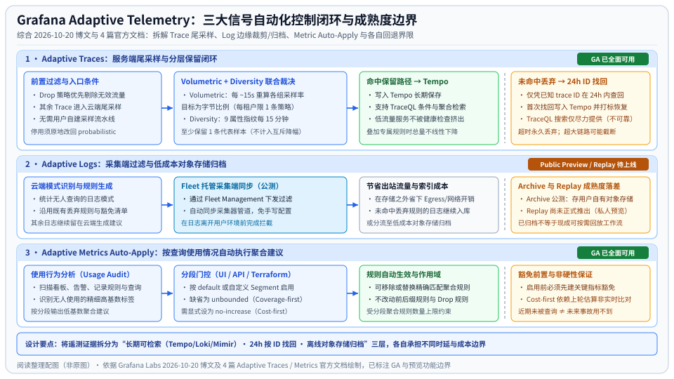
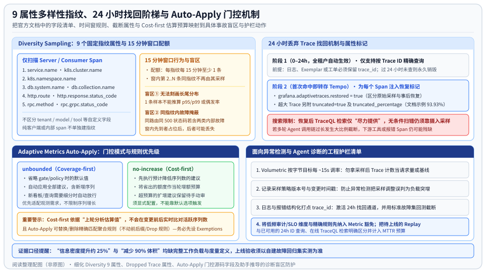

JK Basra、Steven Dungan · Grafana Labs · 原文发布于 2026-10-20（约 7 分钟阅读）· [原始工程博文](https://grafana.com/blog/cut-costs-keep-what-you-need-adaptive-telemetry/) · 配套冻存官方文档：[Volumetric sampling](https://grafana.com/docs/grafana-cloud/observe-and-act/adaptive-telemetry/adaptive-traces/manage-recommendations/volumetric-policy/)、[Diversity sampling](https://grafana.com/docs/grafana-cloud/observe-and-act/adaptive-telemetry/adaptive-traces/manage-recommendations/diversity-policy/)、[Query dropped traces](https://grafana.com/docs/grafana-cloud/observe-and-act/adaptive-telemetry/adaptive-traces/query-dropped-traces/)、[Auto-Apply](https://grafana.com/docs/grafana-cloud/observe-and-act/adaptive-telemetry/adaptive-metrics/additional-configuration/auto-apply/)

当模型调用、工具执行与多步 Agent 链路把遥测体量推上新台阶，团队最常陷入的两难并不是“如何把数据全部存下来”，而是“减量之后真出事故了，关键证据还在不在”。Grafana Labs 在 2026 年 10 月 20 日发布的 Adaptive Telemetry 更新试图回答的正是这个问题：用围绕**使用价值**的自动采样、采集端提前过滤与事后按 ID 找回，取代粗暴的缩短保留期、漏采部分服务或固定比例“数据节食（data diet）”。

> **口径与证据边界**：本文严格对照冻存的 Grafana 博文与四篇 Grafana Cloud 官方文档重写，并清晰切分四类信息**：（1）已全面可用（GA）的工程机制与接口约束**（Adaptive Traces 三项能力与 Adaptive Metrics Auto-Apply）；**（2）仍处预览或待上线阶段的能力边界**（Fleet-managed Adaptive Logs 与 Log Archive 处于公开预览，Log Replay 尚待正式推出）；**（3）厂商自述与客户证言边界**（文中“cut volume by 90%”属于小标题概括目标，Grafana Labs 内部测试称同体量下 Volumetric 比概率采样“信息密度高约 25%”但未披露测试负载与指标定义，Rapid7 首席软件工程师 Carl Eastman 提供的则是定性运维收益证言，以上均不构成跨业务的账单或 MTTR 保证）；**（4）助手基于机制字段推导的诊断盲区与护栏建议**，后文会在涉及处逐一标明。

## 三条信号线的自适应控制闭环：从价值裁决到执行边界

与只靠入口端静态丢弃的传统方案不同，这次更新在 Trace、Log 与 Metric 三条信号线上分别建立了一套“观察使用特征 → 生成或调优保留策略 → 分层落盘与豁免”的控制闭环，而且三条链路的成熟度与生效位置并不对称。

<figure class="note-figure">
  <a class="note-image-link" href="/assets/images/tech/adaptive-telemetry/adaptive-telemetry-control-loop-zh.svg" target="_blank" rel="noopener" aria-label="点击放大查看 Grafana Adaptive Telemetry 三大信号控制闭环与成熟度边界图">
    
    点击放大 ↗
  </a>
  <figcaption>阅读整理配图（非原图）：对照 2026-10-20 博文与四篇官方文档梳理 Trace、Log、Metric 三条控制环路、GA/预览成熟度与规则优先级。</figcaption>
</figure>

在 **Adaptive Traces**（三项新能力均为 **GA**）中，Grafana Cloud 负责服务端尾采样（tail sampling），团队无需自建和维护尾采样网关。需要特别注意策略之间的**执行顺序与覆盖关系**：`Drop` 策略会在进入采样评估前先剔除明确不需要的链路；其余 Trace 进入 `Volumetric` 与 `Diversity` 联合决策；而特定服务的自定义保底规则（例如某核心服务配置 100% 采样）以及 `Diversity` 策略均**独立于全局采样比例之外生效**。官方文档明确提示，停用 `Volumetric` 策略时应**原地将其类型修改为 `probabilistic`**，不要直接删除策略，否则可能在切换间隙短暂出现没有任何采样策略激活的空窗。

在 **Adaptive Logs** 中，系统原已能在云端识别“从未被查询过的日志模式”并在入库路径上裁减。本次新增两项能力的工程重心是“**前移过滤位置**”与“**为误删留退路**”，但两者的发布阶段明显不同：

- **Fleet-managed Adaptive Logs（公开预览）**：把云端已配置好的日志丢弃规则与豁免清单通过 **Grafana Fleet Management** 自动同步到用户自管的采集器（collectors）上，在日志离开内网环境前就地丢弃，从而在云端存储之外再省出一笔**网络出站（egress）与传输开销**；同时云端继续对其余残留日志运行基于模式的分析建议。
- **Archive 与 Replay（Archive 公开预览；Replay 待正式推出，提供私人预览申请）**：`Archive` 把原本会被丢弃的低价值日志转存至用户自己的低成本对象存储中，避免直接索引费用；而按需拉回历史归档用于事故调查、审计或合规的 `Replay` 仍标记为 `"coming soon"`。因此现阶段“开启对象存储归档”并不等同于“已有开箱即用的云端按需回放工作流”，团队仍需自行评估对象存储账单、保留期策略与应急读取方式。

在 **Adaptive Metrics** 中，**Auto-Apply**（已 **GA**）把“识别未被看板、告警、记录规则（recording rules）和查询引用到的高基数指标 → 生成低基数聚合建议”的闭环从人工逐条审核改为按分段（segment）自动生效。不过与另外两条链路相似，其真正决定事故期会不会“恰好删掉唯一能定位故障的维度”的关键，不在于自动化本身，而在于启用前是否建好了**豁免（exemptions）**以及是否选对了门控模式。

| 能力模块 | 触发机制与时间尺度 | 控制参数与管理接口 | 发布状态（2026-10-20 口径） | 关键约束与操作边界 |
| :--- | :--- | :--- | :--- | :--- |
| **Volumetric sampling** | 按 span 属性自动分组，约每 **15 秒**重算组内采样率 | `sampling_percentage`（`> 0` 且 `≤ 100`）；可选 `attributes`；UI / Adaptive Traces API | **GA**（全面可用） | 目标为**字节比例**而非 Trace 条数；**每租户限 1 条**；停用须原地改回 `probabilistic` |
| **Diversity sampling** | 扫描特定 span 的 **9 个属性**生成指纹，每 **15 分钟**固定窗口至少留 1 条 | UI 引导默认开启（`keep unique traces`）或推荐页启用；Policies 页删除关闭 | **GA**（全面可用） | 仅保底“看见路径”，不保延迟分布；不区分同指纹内多根因与自定义属性 |
| **Query dropped traces** | 未匹配采样策略而被丢弃的 Trace，在摄入后 **24 小时**内保留按 ID 检索 | **全租户自动生效**，无需配置；首次按 ID 找回即转存至 **Tempo** | **GA**（全面可用） | **必须已知 `trace ID`**；恢复后 TraceQL 搜索仅尽力提供；超大 Trace 可能被截断 |
| **Fleet-managed Adaptive Logs** | 云端识别未查询日志模式后，同步规则到边缘采集器在出站前过滤 | 复用云端丢弃规则与豁免配置，经 **Grafana Fleet Management** 同步 | **Public Preview**（公开预览） | 仅减少后续入云流量，已留在管道中的非匹配日志仍由云端继续分析 |
| **Log Archive & Replay** | 将低价值日志旁路归档至用户自有对象存储，Replay 用于事后按需拉回 | Archive 路由至自有对象存储；Replay 开放私人预览申请 | Archive **Public Preview**；Replay **Coming Soon** | 仅有 Archive 不代表线上自动化 Replay 已可用，须单算对象存储与取回延迟 |
| **Adaptive Metrics Auto-Apply** | 基于仪表板、告警、记录规则与查询的近期使用分析，自动应用分段内聚合建议 | 需 **Admin** 权限；`auto_apply.gate.policy`（`unbounded` / `no-increase`）；UI / API / Terraform | **GA**（全面可用） | 可移除或替换**精确匹配**聚合规则（不动前后缀与 Drop 规则）；Cost-first 非实时硬上限 |

## Adaptive Traces 深水区：按字节分组、9 属性指纹与 24 小时按 ID 找回

要理解 Adaptive Traces 为什么既能压低体量又会隐蔽地改变后续诊断输入，必须把官方文档里三套机制的精确字段和边界拆开来看。

### Volumetric sampling：按字节调率带来的统计有偏性

固定比例的概率采样有一个经典失衡：如果一个健康检查服务或噪声微服务产生了 `90%` 的流量，传统概率采样也会把 `90%` 的保留空间分给它，导致低流量但关键的业务路径几乎抓不到样本。`Volumetric sampling` 的做法是让 Adaptive Traces 自动挑选一组能区分链路类型的 span 属性（例如 `service.name`、`http.method`），或者接收用户可选传入的 `attributes` 列表，把流量分组后大约**每 15 秒**重新计算一次每组的自适应采样率：低流量组通常获得更高的组内采样率，高流量组则被压缩，从而让整体保留量收敛到配置的 `sampling_percentage`。

这里隐藏着一个极容易被忽略的技术细节：**`sampling_percentage` 约束的是 Trace 数据的字节占比（bytes），而不是 Trace 条数（trace count）**。当团队把原有的 `10%` 概率采样原地替换成 `10%` 的 Volumetric 策略时，因为保留下来的链路大小组合变了，最终留下的总 Trace 条数既可能多于原来，也可能少于原来。更重要的是，**组内采样率每 15 秒随流量动态浮动**这一机制意味着：

- 保留在 Tempo 里的 Trace 原始计数**不再与各服务的真实请求量成正比**；
- 如果下游异常检测器、容量报表或 AI 分诊 Agent 直接统计“某服务某路由今天保留了多少条报错 Trace”来推断故障突增，采样器本身的不均匀调率就会伪装成业务流量变化。因此，**频率统计必须留给独立指标，保留 Trace 只用来解释根因与行为形态**。

### Diversity sampling：9 个服务器/消费者 span 属性与“同指纹掩蔽”盲区

在把全局采样率压低之后，`Diversity sampling` 负责守住稀有路径的最低曝光底线。

<figure class="note-figure">
  <a class="note-image-link" href="/assets/images/tech/adaptive-telemetry/diversity.png" target="_blank" rel="noopener" aria-label="点击放大查看 Adaptive Traces 多样性采样建议控制台原图">
    
    点击放大 ↗
  </a>
  <figcaption>原文保留配图（来源：Grafana Labs 官方文档与控制台示例）：Adaptive Traces 中启用按属性组合采样独特 Trace 的推荐入口，代表为每个独特指纹周期性留样，而非全量保留所有请求。</figcaption>
</figure>

查阅 [Diversity sampling 官方文档](https://grafana.com/docs/grafana-cloud/observe-and-act/adaptive-telemetry/adaptive-traces/manage-recommendations/diversity-policy/) 可以发现，它并非对任意自定义标签做全量去重，而是严格扫描传入的 **server（服务端）与 consumer（消费者）span**，从中提取预先定义的 **9 个标准 OpenTelemetry 属性**拼成指纹（fingerprint）：

1. 服务与部署拓扑：`service.name`、`k8s.cluster.name`、`k8s.namespace.name`
2. 数据库依赖：`db.system.name`、`db.collection.name`
3. HTTP 与 RPC 入口：`http.route`、`http.response.status_code`、`rpc.method`、`rpc.grpc.status_code`

对于每一个独特指纹，Diversity 策略只确保在**每 15 分钟固定时间窗**内至少保留 **1 条** Trace；同一 15 分钟窗口内后续命中相同指纹的请求不会再由 Diversity 策略采样（只能依赖 Volumetric 或其他策略），直到下一个 15 分钟窗口重置。从工程可靠性角度分析（助手基于上述文档规格推导，非原文列出的实测缺陷），这条规则会直接带来两类**事故盲区**：

- **同指纹内异质根因掩蔽**：如果某个 AI 网关路由 `http.route="/v1/agent/run"` 在同一个 15 分钟窗口内先发生了一次普通的 `500` 超时，已经用掉了该指纹的 1 条保底名额，两分钟后同一路由下另一类由模型越权或特定工具参数引发的 `500` 失败在指纹上完全相同——若低采样率的 Volumetric 刚好未命中第二条，Diversity 就无法替你保住这第二种新故障。
- **自定义业务/Agent 维度失明**：指纹只认上述 9 个固定字段且只看 server/consumer span，这意味着 `tenant.id`、`model.name`、`agent.tool_name` 或纯内部/client span 的差异**不会**裂变成新指纹；而且由于每个指纹每 15 分钟可能只有 1 条样本，它能证明“这条路径曾这样跑过”，却完全不能用来估计长尾延迟（p95/p99）或偶发失败率。

### Query dropped traces：24 小时 ID 找回与超大 Trace 截断边界

为了缓解激进降采样的心理负担，Adaptive Traces 为所有租户**自动开启**了丢弃链路找回能力：任何未匹配采样策略的 Trace 在摄入后 **24 小时**内，仍可通过精确的 `trace ID` 查询；首次命中即被写入 **Tempo** 转入长期存储并可在之后继续按 ID 访问，超过 24 小时仍无人查询的 Trace 则永久清除。

但官方文档在操作边界上写得非常克制——找回的 Trace 会在**每一个 span** 上注入 provenance 属性，而且有三条硬约束直接决定应急时能不能指望它：

- **必须已知 `trace ID` 才能进门**：恢复后在 **TraceQL 搜索中的可见性仅“尽力提供（best-effort）”**，文档明确提醒同一条已恢复 Trace 仍可能无法出现在条件搜索结果里。因此如果报警工单或值班反馈只知道“昨晚某区域变慢”，却没有从日志、Exemplar 或测试框架里带出具体 `trace ID`，就无法通过按属性检索把丢弃的 Trace 捞回来。
- **24 小时窗口的时效约束**：超过 24 小时才暴露的慢退化、次日财务对账才察觉的静默错误，都会错失找回窗口。
- **超大 Trace 截断风险**：除必带的 `grafana.adaptivetraces.restored = true` 之外，文档列出了 `grafana.adaptivetraces.truncated = true` 与 `grafana.adaptivetraces.truncated_percentage`（文档示例值高达 `93.93200201457533`），专门标记体积过大时只找回了部分链路。对于动辄几十轮、包含大量工具载荷的长链 Agent Trace，一旦发生高比例截断，事后恢复回来的可能只是一个残缺头节点，真正出错的下游工具调用 span 依然缺失。

## Adaptive Metrics Auto-Apply 与信号联动：无静态基数保证下的护栏设计

如果说 Trace 靠的是“按组分配预算 + 24 小时 ID 补救”，Metrics 端 `Auto-Apply` 要防范的风险则更偏向“**静默覆盖既有规则与预算估算滞后**”。

<figure class="note-figure">
  <a class="note-image-link" href="/assets/images/tech/adaptive-telemetry/diversity-scoring-guardrails-zh.svg" target="_blank" rel="noopener" aria-label="点击放大查看 9 属性多样性指纹、24 小时找回阶梯与 Auto-Apply 门控护栏图">
    
    点击放大 ↗
  </a>
  <figcaption>阅读整理配图（非原图）：把官方技术文档中的 9 属性指纹清单、恢复标记字段、Auto-Apply API 策略字段与助手推导的事故盲区防护映射在同一视图中。</figcaption>
</figure>

查阅 [Auto-Apply 官方文档](https://grafana.com/docs/grafana-cloud/observe-and-act/adaptive-telemetry/adaptive-metrics/additional-configuration/auto-apply/)，有四项行为细节决定了线上配置不能“只点一下开关”：

1. **豁免（Exemptions）必须在开启前建好，且规则类型存在不对称覆盖**：文档在 `Before you begin` 中直接警告先建豁免再开 Auto-Apply。原因在于 Auto-Apply **不会改动**前/后缀（affix）聚合规则和 `drop` 规则，但**可以移除或替换精确匹配（exact-match）聚合规则**。如果团队此前专门为某条核心业务指标写过一条精确匹配聚合规则以保留特定标签，开启 Auto-Apply 后若未对该指标设置豁免，这条精确规则就可能被新建议替换甚至撤掉。此外，当某个分段（segment）接近聚合规则数量上限时，Auto-Apply 可能会跳过部分乃至全部建议。
2. **API 缺省模式是 `unbounded`（Coverage-first），而非限流保守模式**：通过 UI、REST API（默认分段走 `/aggregations/recommendations/config`，自定义分段如 `{team="team1"}` 走 `/aggregations/rules/segments`）或 Terraform（`grafana-adaptive-metrics_recommendations_config` / `grafana-adaptive-metrics_segment`）配置时，如果请求体里**省略了 `gate` 或 `policy` 字段，系统默认启用 `unbounded`（Coverage-first）**——一旦出现新看板或新查询，它会自动放行预计增加序列数的建议，优先保证覆盖面而不是压低系列数。
3. **显式选择 `no-increase`（Cost-first）也并非实时序列数硬上限**：`Cost-first` 会应用所有预计减少序列数的建议，并仅在**同一分析周期省出的系列额度内**放行预计增加序列数的建议（超额建议保留为待手动确认状态）。但文档专门加了一个 **Caution** 提醒：`Cost-first` 依赖的是**上一轮分析周期生成的估算节省量，并不会在规则变更前后实时比对活跃序列数**，因此它只是基于近期估算的护栏，**不能在所有情况下保证序列数绝对不增长**（例如规则刚切换后恰好遭遇新发布标签爆发或容器扩缩容基数突增）。
4. **“最近无人查询”在工程上存在冷启动盲区**：Adaptive Metrics 与 Adaptive Logs 共享同一条前提——依据过去观察到的看板、告警与查询来定义“无用信号”。然而在可靠性工程实践中，诸如季度合规审计、灾备演练排查、罕见死锁或新上线 Agent 工具失败的诊断维度，在平时正常流量下往往数周无人查询；一旦在事故前夕被自动聚合降维，事发时就无法像原始日志归档那样事后追溯（Metrics 聚合本身是不可逆的标签合并）。

## 证据口径核查、AI 工作负载盲区与上线前验证清单

回头审视官方博文中的量化与效果表述，区分“工程机制已被文档证实”与“收益幅度尚未提供独立对照组证据”尤为重要：

- **“cut volume by 90%”**：出现在博文分节标题中，属于能力组合下的降本定位表达；对照 `Volumetric` 与 `Diversity` 文档可知，叠加特定服务保底规则或高多样性指纹后，总体体量甚至**不会随采样百分比呈严格线性下降**，更不能把体量降幅直接换算为等价账单比例下降。
- **“about 25% higher information density than probabilistic sampling at the same volume”**：博文明确指出这是 **Grafana Labs 内部测试结果**，但原文未披露测试数据集规模、服务拓扑、Trace 大小分布，也未给出“信息密度（information density）”的数学定义。从工程评估口径来看，这是一个**值得关注的正向厂商测试信号**，但不能外推为“根因定位准确率提升 25%”或“MTTR 缩短 25%”。
- **Rapid7 客户引述（Carl Eastman）**：文中三段引述完整反映了大型团队从“人工巡检指标基数与日志体积长尾”转向“只人工审视少量关键规则，并把省下的可观测性预算再投资到覆盖面”的真实痛点，但属于**定性运维经验证言**，并未给出可复现的财务或事故响应对比数据。

| 宣称或机制点 | 冻存一手来源中的确定事实 | 未被证明的假设或潜在盲区 | 上线前的工程核查动作 |
| :--- | :--- | :--- | :--- |
| **Volumetric 采样比例与“减少 90% 体积”** | 按属性分组每 ~15s 重算组内率，目标为**字节占比**；每租户限 1 条 | 同比例下保留条数可增可减；叠加专属规则与 Diversity 后总量非严格线性下降 | 用历史流量模拟字节占比与低频服务留样条数，同时单独核对账单计费口径 |
| **同体量下“信息密度高约 25%”** | Grafana Labs 内部测试结论，称同体量优于概率采样 | **未披露**负载结构、样本规模与信息密度公式，无法等价于定位准确率提升 | 在自建已知故障 Trace 回放集上对比 Volumetric 与原采样器的根因召回率 |
| **Diversity 9 属性 15 分钟指纹** | 仅扫描 **server/consumer span** 的 9 个固定字段，每 15 分钟留 >=1 条 | 不区分 `tenant`/`model`/`tool` 等自定义标签；同路由同 500 易发生内含多故障掩蔽 | 对多租户或 AI 工具调用场景补加专属采样策略，不单独指望 Diversity 抓全错误子类 |
| **24 小时丢弃 Trace 找回** | 全租户自动可用；24h 内按 ID 查回写入 Tempo 并打 `restored` 标记 | 依赖日志/工单保留 `trace ID`；TraceQL 仅尽力搜索；超大链路可高比例截断 | 强制所有错误日志、Tool 返回与支持工单输出 `trace_id`，并压测长链截断比例 |
| **Auto-Apply Cost-first (`no-increase`)** | 同周期降额预算内放行增额建议；缺省不填 `policy` 时实为 `unbounded` | 使用**上轮分析估算值**，非实时比对前后序列数；会替换精确匹配聚合规则 | 显式声明 `"policy": "no-increase"`，开启前先锁定关键 SLO 与精确规则豁免 |
| **Log Archive 与 Replay** | Archive（公测）路由至用户自有对象存储；Fleet 过滤（公测）可在采集端省 Egress | 发文日 **Replay 尚待推出**（私人预览），尚非 GA 端到端一键回放 | 仅将 Archive 视作合规/冷备存储，单独核算对象存储账单与应急离线查询工具 |

结合这组机制边界，若团队正在运行高频模型调用与工具链（Agentic/AI workloads）或基于遥测构建异常检测与自动分诊系统，建议在全面切换 Adaptive Telemetry 之前先落实以下五项工程护栏（以下为助手基于前述机制推导的上线核查清单）：

1. **先打通结构化 `trace_id` 闭环，再下调全局 `sampling_percentage`**：只有当错误日志、Prometheus Exemplar、网关响应头和内部工单系统全部稳定透传 `trace_id`，且一线值班能在 **24 小时内**触发排查时，24 小时丢弃链路找回才真正构成安全网。
2. **用长会话 Agent 链路实测 `truncated_percentage` 阈值**：针对包含几十轮检索与大载荷工具返回的 Agent Trace，从历史库抽取典型大链路验证被丢弃再找回时是否触发 `grafana.adaptivetraces.truncated` 及截断幅度；若关键尾端工具调用 span 易被截断，应对该类 Agent 入口配置专门采样规则而非依赖事后找回。
3. **对下游异常检测器隔离采样策略版本与基数变动**：将 `Volumetric` 调率配置、`Diversity` 增删时间与 `Auto-Apply` 规则变更历史同步写入事件标注系统；避免异常检测模型或值班 Agent 把“采样器每 15 秒重分配权重带来的保留条数变化”误报成服务吞吐异常。
4. **先建豁免再开 Auto-Apply，并显式校验 API 字段**：在调用 `/aggregations/recommendations/config` 或 `/aggregations/rules/segments` 之前，先梳理所有依赖低频审计维度、季度灾备排查或既有精确匹配（exact-match）聚合规则的指标并加入 `exemptions`；若目标是不新增系列数，务必在代码/Terraform 中显式写出 `gate.policy = "no-increase"`，防止因省略字段而落入默认的 `unbounded`（Coverage-first）模式。
5. **用“四层可获取性”而非单一压缩率验收降本方案**：在验收阶段同时度量**（a）可实时 TraceQL/LogQL 检索层、（b）24 小时已知 ID 找回层、（c）离线对象存储归档层、（d）不可逆聚合层**各自覆盖了哪些历史故障案例，并把等待找回与离线查档的耗时直接计入 MTTR 预算。

---

### 参考来源与一手核对链接

- 核心官方发布：JK Basra & Steven Dungan, *[Break the link between data volume and your observability bill with Adaptive Telemetry](https://grafana.com/blog/cut-costs-keep-what-you-need-adaptive-telemetry/)*, Grafana Labs Blog, 2026-10-20。
- Adaptive Traces 按字节分组采样文档：*[Use volumetric sampling](https://grafana.com/docs/grafana-cloud/observe-and-act/adaptive-telemetry/adaptive-traces/manage-recommendations/volumetric-policy/)*, Grafana Cloud Documentation。
- Adaptive Traces 多样性指纹文档：*[Use diversity sampling](https://grafana.com/docs/grafana-cloud/observe-and-act/adaptive-telemetry/adaptive-traces/manage-recommendations/diversity-policy/)*, Grafana Cloud Documentation。
- Adaptive Traces 24 小时找回文档：*[Query dropped traces](https://grafana.com/docs/grafana-cloud/observe-and-act/adaptive-telemetry/adaptive-traces/query-dropped-traces/)*, Grafana Cloud Documentation。
- Adaptive Metrics 自动应用文档：*[Enable auto-apply](https://grafana.com/docs/grafana-cloud/observe-and-act/adaptive-telemetry/adaptive-metrics/additional-configuration/auto-apply/)*, Grafana Cloud Documentation。

> **AI 辅助整理 · 归档注记**：本篇中文深度技术拆解与配套英文版（[English note](/tech/en/adaptive-telemetry/)）均由助手对照冻存原文及上述四篇 Grafana Cloud 官方文档逐项核对重写，保留原 `id`、`date: '2026-10-20'`、`permalink`、`source_url`、`published_at` 与 `observability`、`systems-reliability` 两项标准标签；保留原始控制台截图 `diversity.png` 并新增助手绘制的两幅 `v3-blue` 机制与护栏图解（`adaptive-telemetry-control-loop-zh.svg`、`diversity-scoring-guardrails-zh.svg`）。文中所有接口字段、时间窗与限制条件均以冻存文档为据，未捏造未经披露的测试负载或财务账单数据。
