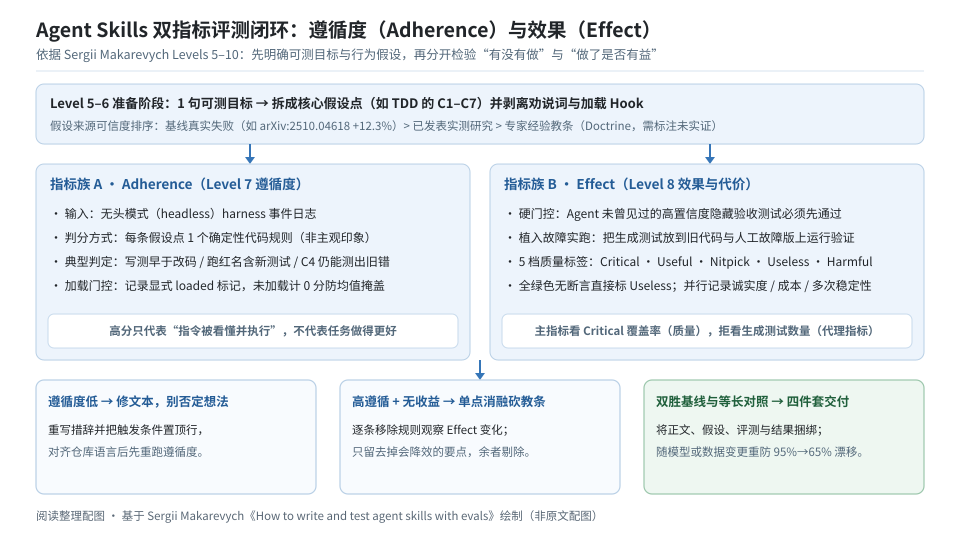
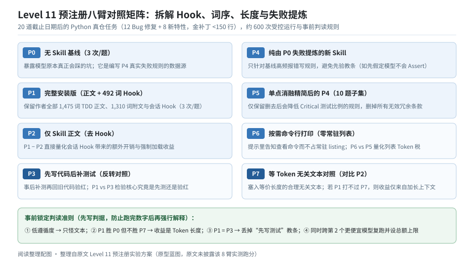

Sergii Makarevych · 2026-10-19/20 · [X 原贴](https://x.com/sermakarevich/status/2112198653469241856) · [X Article 原文《How to write and test agent skills with evals》](https://x.com/i/article/2112186374052802560)

Agent Skills 把团队规约、工具用法和工作流程打包成按需读取的 Markdown 指令包，但在社区大规模分发之后，“写进 `SKILL.md`”往往替代了“验证它真能改善结果”。Sergii Makarevych 在这篇横跨 **Level 0 到 Level 11**、引用 **25 篇文献（含 17 篇 arXiv 论文）** 的长文中拆解了一条反直觉的事实：**一个 Skill 可以被加载、被严格遵循，同时依然不带来任务收益，甚至只稳定放大 Token 与延迟账单。**

> **阅读边界与证据分层说明**：原文同时汇编了同行评审/预印本论文、社区工具测量、厂商工程披露以及作者自己尚未开跑的 Level 11 方案。文中 **`Vercel (2026)`** 与 **`Anthropic (2026)`** 属于原文转述的厂商披露（后者基于每个主题数十例内部评估，前者未公开模型与样本量）；后半部的 **`P0–P7` 八臂实验** 则是 **事前锁定的预注册协议（blueprint），原文尚未给出该八臂实验的实测跑分**。下文严格区分“已有实测”与“实验设计”。

## 实证拆解：从零触发率、Token 税到安全扫描盲区（Levels 1–4）

大多数团队评估 Skill 时直接问“装上之后任务过没过”，但中间至少横着三层独立变量：**有没有被加载、加载后有没有照做、照做之后究竟帮了还是害了**。原文在前四个层级汇总了多组实测数据，把常见误区逐一拆穿：

- **三重 Token 账单与低触发率**：安装一个 Skill 会分三次收 Token——常驻系统提示里的摘要目录（`listing`）、按需读入的正文与配套文档（`body`），以及部分插件附带的会话启动 Hook（例如 `obra/superpowers` 每次会话注入 `492` 词的 `using-superpowers` Hook）。社区排查工具 `skill-doctor` 检查一个真实工作区时发现，**`89` 个已安装 Skill 中有 `81` 个从未被触发**，其余 `8` 个最近一次调用也至少在 **`37` 天前**。厂商工程披露 **`Vercel (2026)`**（原文标注：未公开具体模型与样本数）称其评测中 Skill 有 **`56%` 从未被触发**，开启 Skill 的通过率 **`53%`** 与无文档基线 **`53%`** 持平，明确要求调用可升至 **`79%`**，而把精简文档索引常驻上下文后达到 **`100%`**；相对地，**`Spence (2026)`** 在 Claude Sonnet 4.5 上用 `22` 组提示测试发现，无强制 Hook 时激活率仅为 **`50%–55%`**，加入强制 Hook 后才达到 **`100%`**。而在大样本基准上，*SRA-Bench*（`arXiv:2604.24594`，`5,400` 案例 / `8` 个模型）测得技能加载率在 **`11.1%–72.1%`** 之间，结论直指模型选择技能“并不感知任务真实需求”（not need-aware）；*Demystifying Agent Skills*（`arXiv:2608.14036`）则表明，当 Skill 池从 `5` 个扩到 `100` 个，模型选中正确 Skill 占比会从 **`29.6%` 暴跌至 `3.3%`**。
- **零收益甚至负收益，以及隐形功耗账单**：`agentskills.io` 规范只定义了目录格式与加载方式，没有规定任何测试要求。多组跨仓库评测暴露了严重噪音：*Signal or Noise*（`arXiv:2608.23067`，`31` 个 Skill × `50` 个 Web 项目 × `4` 个模型）显示 **4 个模型在加装 Skill 后平均通过率全数下滑**（Claude Sonnet 4 在 2 次尝试口径下降 **`-4.2` 个百分点**），而 Token 消耗暴涨 **`+72%` 到 `+394%`**，能在全部 4 个模型上稳定增益的 `(skill, project)` 组合仅占 **`1%`**；*SWE-Skills-Bench*（`arXiv:2603.15401`，`49` 个 Skill）测得 **`39/49` 个 Skill 零收益**，整体平均仅 **`+1.2` 个百分点**，Token 开销最高达 **`+451%`**，其中 `3` 个 Skill 因依赖库 API 过时导致成绩反而下降最高 **`-10` 个百分点**；*Agent Skills Can Be Harmful*（`arXiv:2608.11888`，分析 `307` 例负面案例）指出，其中 **`182` 例（`62.6%`）根本没有任何质量收益，纯粹是在烧多余的 Token 与回合数**。
- **跨模型零迁移、流程锚定与月度漂移**：*Signal or Noise* 记录过一个典型案例——完全相同的 Skill 在同一个项目上，让 Claude Sonnet 4 提高了 **`+33` 个百分点**，却让 DeepSeek 和 Qwen 直接下降 **`-22` 个百分点**，同一 Skill 在不同模型上的收益相关性几乎为 **`0`**。不过高质量策划并非无效：*SkillsBench*（`arXiv:2602.12670`）发现经过筛选精编的 Skill 可以让 **Claude Haiku 4.5（`27.7%`）反超无 Skill 的 Claude Opus 4.5（`22.0%`）**；*Demystifying Agent Skills* 则发现“库文档型 Skill”整体 `+2.8` 个百分点增幅的置信区间跨越 `0`，拆因后 **大约 `65.7%` 的有效提升来自把 Agent 锚定在固定执行流程上，仅 `4.5%` 来自新知识本身**。更重要的是时效性：厂商披露 **`Anthropic (2026)`** 称其内部分析 Agent 靠 Skill 与评测在每主题数十例评估中从 **`21%` 升至 `>95%`**，但在底层业务数据变化后，**短短 `1` 个月内便退化回 `95% → ~65%`**。
- **静态扫描不等于安全审查**：随着 Skill 带脚本执行权限，*Agent Skills in the Wild*（`arXiv:2601.10338`，扫描 `31,132` 个公开 Skill）发现 **`26.1%`** 至少包含 1 项安全漏洞模式（携带脚本时风险高达 **`2.12×`**）；*Do Not Mention This to the User*（`arXiv:2602.06547`，USENIX Security 2026，分析 `98,380` 个 Skill）确认了 **`157` 个恶意 Skill**。尽管 `arXiv:2601.10338` 自建扫描器报告 **`86.7%` 精确率 / `82.5%` 召回率**，**Trail of Bits 与云安全联盟（2026 年 6 月）** 实测绕过了 **`5` 款主流安全扫描器**（且其中 `3/4` 的绕过方案在 **`1` 小时内** 构造完成），证明“扫描通过”不能替代沙箱隔离与人工代码审计。

## 先拆假说再双轨打分：Adherence 与 Effect 评测闭环（Levels 5–10）

面对“读没读懂、做了没用、到底哪句话起作用”三件事混在一起的困境，Makarevych 提出了一套从 **Level 5（立目标、拆要点）到 Level 10（捆绑交付与在线漂移监控）** 的双指标评测闭环：先验证 **遵循度（Adherence：指令是否生效）**，再验证 **真实效果（Effect：结果是否更好）**。

<figure>
  <a class="note-image-link" href="/assets/images/tech/agent-skills-evaluation/skill-eval-loop-zh.svg" target="_blank" rel="noopener">
    
    放大图解 ↗
  </a>
  <figcaption>阅读整理配图（非原文配图）：Makarevych Levels 5–10 评测方法论。遵循度衡量指令文本能否驱动行为，效果衡量这些行为是否真正产出关键缺陷拦截并跑赢基线与等长对照。</figcaption>
</figure>

以社区高Star项目 `obra/superpowers` 的测试驱动开发（TDD）Skill 作为解剖对象，该插件实际包含 **`1,475` 词主体 Skill、`1,310` 词编写好测试伴随指南以及 `492` 词会话 Hook**（带有全大写“铁律” `"NO PRODUCTION CODE WITHOUT A FAILING TEST FIRST"`，且原文件通篇用 **TypeScript 示例**，作者计划直接在 **Python 仓库** 上检验它是否真能跨语言迁移）。Makarevych 首先把这份庞大的指令拆解出 **`C1–C7` 七条核心检验假说**、`6` 条次级测试质量细则，并剥离其中的说教劝说段与强制加载 Hook，然后按可信度分级标注来源——*Agentic Context Engineering*（`arXiv:2510.04618`）已经证明，直接从基线失败案例提炼出的行为手册可以带来 **`+12.3%`** 增益，优先度远高于未经证实的经验教条（Doctrine）。

| 评估层级 / 机制 | 验证对象与输入信号 | 判定做法与硬门槛 | 原文依据与核心防陷阱设计 |
| :--- | :--- | :--- | :--- |
| **遵循度评测（Level 7 Adherence）** | 无头模式（headless）harness 事件流、文件编辑顺序、命令执行与退出码、`claude plugin eval` | 为 `C1–C7` 每条假说编写 `1` 条**确定性代码规则**（不用大模型主观打分）；校验写测是否早于改码、`C4` 是否真在旧代码跑出正确失败、以及显式记录 Skill 是否被加载 | 若 Agent 根本没加载该 Skill，直接计 **`0` 分**，防止靠模型本能把“没触发却做对”算成高遵循；遵循高只说明文案写清楚了，**不等于任务收益** |
| **效果门控（Level 8 Gate 1–2）** | 隐藏验收测试集 + 修复前旧代码 + 人工植入故障变体 | 先跑通 Agent 从未见过的高置信度验收测试；再把 Agent 新写的测试放到**旧代码与植入故障版**上实测能否精准抓错 | 多项研究显示单纯要求“写测试”极具欺骗性：见下文 `arXiv:2602.07900` 与 `>6,000` 个虚假通过程序实证 |
| **五档效果分级与代价（Level 8 Effect）** | 经真实人类评判校准的评判器 + 诚实度与开销指标 | 按对回归/边界故障的拦截力分成 **`Critical` / `Useful` / `Nitpick` / `Useless` / `Harmful`**；全绿色却无实质断言的测试直接判为 `Useless` | 主指标锁定 **`Critical` 覆盖率**而非“生成多少行测试”；并行追踪回合数、Token、美元成本与多次运行波动幅度 |
| **消融精简与交付门（Levels 9–10）** | 逐条删减后的单点对比与重跑基线 | **逐条做单点消融**：凡是删掉不降 `Critical` 比例的教条一律砍掉；最终以 **四件套（正文、要点与假说、评测脚本、带日期的模型实测成绩）** 捆绑交付 | 防止无门控重写反向伤害效果（参见 *Memento-Skills* vs *Meta-Context Engineering* 对比）；随模型升级或数据演进重跑防 `95% → 65%` 漂移 |

之所以必须在 Level 8 上设计如此严苛的“植入故障实跑”门槛，是因为已有四项独立证据揭穿了“只要写测试就好”的假象：`arXiv:2602.07900` 分析 SWE-bench Verified 轨迹后发现，**失败路径与成功路径编写测试的频率完全一样，甚至打印的 `print` 语句多于 `assert` 断言**；`arXiv:2607.22880` 与 *awesome-testing.com*（2026 年 8 月案例）展示了一组带 Bug 的解析器测试——**行覆盖率高达 `100%`，但变异测试（mutation score）只有 `61%`**；`arXiv:2609.09315` 在多仓测试集中统计出超过 **`6,000` 个包含真实缺陷的程序依然执行到了出错行并顺利通过了现有测试**；而 *GTDD*（`arXiv:2610.02952`）同样印证，脱离行为语义核验的自动测试很容易沦为自欺。

在迭代修改 Skill 本身时，验证门控同样不可省略：*Memento-Skills*（`arXiv:2603.18743`）通过显式评估筛选让成功率从 **`52.3%` 跃升至 `66.0%`**，而缺少严格验证门控的自动化上下文改写研究 *Meta-Context Engineering*（`arXiv:2607.16621`）则使表现反而下跌 **`-6.2` 到 `-11.5` 个百分点**。

## Level 11 预注册八臂对照：如何分清 Hook、词序与长度效应？

为了防止团队做完评测后按数字大小“编故事”，Makarevych 在文章末尾给出一套 **事先锁定判读准则的 8 臂实验蓝图（Level 11）**。需要再次强调：**这 8 组实验在原文里属于预注册协议与实验设计，尚未公布实测得分**，但其对照组拆解法值得所有内控 Prompt 或 Skill 团队直接复用。

<figure>
  <a class="note-image-link" href="/assets/images/tech/agent-skills-evaluation/eight-arm-design-zh.svg" target="_blank" rel="noopener">
    
    放大图解 ↗
  </a>
  <figcaption>阅读整理配图（非原文配图）：Level 11 预注册八臂实验矩阵与事前锁定判读规则（蓝图设计，原文未发布实测跑分）。</figcaption>
</figure>

该方案计划选取 **`20` 道发表于模型知识截止日期之后的真实 Python 仓库任务**（**`12` 道 Bug 修复 + `8` 道新特性开发**，黄金参考补丁严格控制在 **`<150` 行代码**、单套测试运行 **`<2` 分钟**，取自 *SWE-bench-Live* `arXiv:2505.23419` 与 *SWE-rebench* `arXiv:2505.20411`），总预算控制在约 **`600` 次有上限受控运行**，并对核心组 **`P0` / `P1` / `P5`** 在更便宜的第二款模型上做跨模型复现。其中最关键的三组反常识对照设计如下：

| 对比组别（协议 arm） | 变量剥离目标 | 如果出现预期/反例结果，该如何判读？ |
| :--- | :--- | :--- |
| **`P1`（完整 TDD + 492 词 Hook）vs `P2`（去 Hook 正文）vs `P6`（命令行零列表）** | 分离触发 Hook 带来的**强制加载收益**与常驻 listing 导致的**每轮 Token 税** | 若 `P2` 激活率和收益双低而 `P1` 高，说明核心作用只在强制加载而不是文本多好；对比 `P6` 与 `P5` 可量化“不占 system prompt 列表、只在指令里告诉 Agent 自己执行命令查看目录”能省下多少冗余前缀消耗 |
| **`P1`（先测后码）vs `P3`（先写码 + 回旧代码验红）** | 检验 TDD 真正有效成分究竟是**写作顺序（test-first）**，还是仅仅**用修复前代码验证测试确实能抓错（verify-fail）** | 若事前对比发现 `P1 ≈ P3`，则说明“先写测试”本身那条严苛教条可以删除，只保留 `C4`“对旧代码验红”一条就能拿到相同收益且减少 Agent 返工 |
| **`P1`/`P2` vs `P7`（等 Token 长度无关文本）& `P4`/`P5`（纯 `P0` 失败提炼与消融）** | 剔除**单纯把上下文拉长带来的噪声或伪收益**，验证“问题驱动撰写”能否胜过“全能大手册” | 在 *Signal or Noise*（`arXiv:2608.23067`）中，仅填入等价长度的安慰剂文本就导致两项模型基准掉分 `-3.3` 和 `-3.5` 个百分点。预注册协议锁定：**若 `P1` 打不过 `P7`，则收益完全来自 Token 长度效应；如果低遵循度则先改文案而非否定方法论** |

## 工程启示：把 Skill 当成“带测试的依赖”，而非静态说明书

通读 Sergii Makarevych 从 Level 0 到 Level 11 的拆解，最大的工程价值并不在于“否定 TDD 或 Agent Skill”，而在于给目前泛滥的 Skill 市场立下了一条可审计门槛：**任何没有“遵循度 + 效果 + 等长对照 + 过期重跑机制”的 Skill，在工程上与一段未经测试的全球配置没有区别**。

对日常构建 Coding Agent 或内部研发插件的团队而言，原文给出的几条轻量落地动作甚至比跑满 600 次八臂实验更容易立刻见效：

1. **先跑零 Skill 基线（`P0`），只在真实高频报错处补规则**：把 *Agentic Context Engineering* 与 Level 6 的“失败驱动写法”变成习惯——别先搬一套 `1,500` 词全能规范塞给 Agent，而是记录它在自家仓库反复踩的 3 个坑，只针对这 3 个坑写可确定性检验的要点。
2. **把“激活机制”与“内容效用”分开调试**：发现一个工具 Skill 没起效时，先查无头日志里到底加载了没有；没加载就看触发描述与 Hook，已加载但没照做就重写第 1 行并对齐仓库真实命令，两者都过了仍无 `Critical` 质量改善就直接砍掉该规则。
3. **默认假设任何 Skill 都有跨模型失效与时间衰减风险**：换了主力模型（比如从 Claude 切到 DeepSeek/Qwen 或新一代模型）或者仓库 API 升级后，按月重跑那组精简验收评测——`95% → 65%` 的漂移不会在没有任何监控的 CI 里自动报警。

---

> **AI 辅助整理 · 归档注记**：本篇中文重编与对应的英文配套版（[English note](/tech/en/agent-skills-evaluation/)）均由助手通读 Sergii Makarevych《How to write and test agent skills with evals》完整原文逐项核对重写；已保留原 `id`、`permalink`、`published_at` 与 3 个标签。两幅图解 `skill-eval-loop-zh.svg` 与 `eight-arm-design-zh.svg` 均系助手按原文 Levels 5–11 内容绘制（非原文配图），明确区分“已公开实测论文/厂商披露”与“Level 11 预注册待跑实验蓝图”。