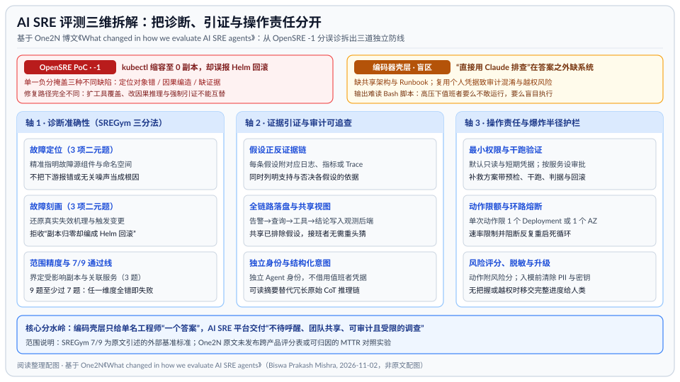
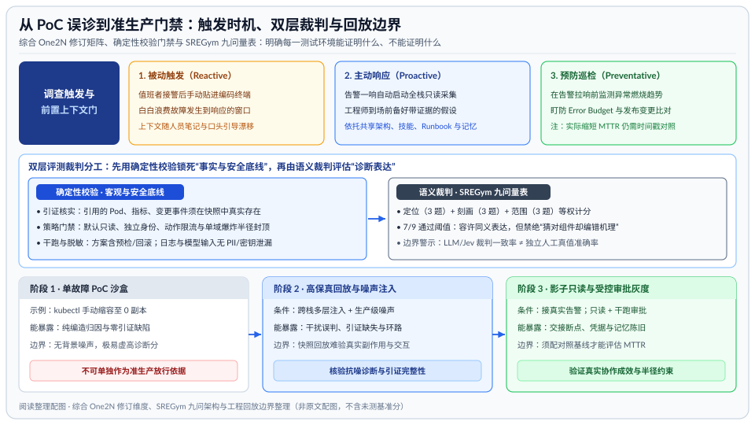

Biswa Prakash Mishra（SRE @One2N）· 2026-11-02 · [原文《What changed in how we evaluate AI SRE agents》（副标题：Why a coding harness is not an AI SRE agent）](https://one2n.io/blog/what-changed-in-how-we-evaluate-ai-sre-agents) · 前篇基础：[《How to evaluate AI SRE agents for production》](https://one2n.io/blog/how-to-evaluate-ai-sre-agents-for-production)

当通用编码 Agent 接上 MCP 或 CLI 工具后已经能查 Kubernetes、读日志并猜出故障原因时，“直接拿 Claude Code 当排障助手，何必单独引入 AI SRE 平台？”几乎成了所有基础架构团队都会提出的质疑。One2N 这篇于 2026 年 11 月发表的工程复盘没有从抽象口号反驳这一心态，而是回到团队早前评估 **OpenSRE** 的概念验证（PoC）现场：当一条粗粒度的根因分析（RCA）评分被打成 `-1` 时，评估者甚至说不清系统究竟错在“看偏了故障对象”、“编造了不存在的回滚故事”，还是“猜对了部署异常却拿不出任何遥测证据”。

> **证据边界与阅读口径说明**：本文基于 One2N 公开工程复盘与其引用的三份一手材料展开（[前篇 OpenSRE PoC 评估](https://one2n.io/blog/how-to-evaluate-ai-sre-agents-for-production)、Live 基准 [SREGym 论文](https://arxiv.org/abs/2605.07161) 与 [Google SRE: AI in SRE](https://sre.google/resources/practices-and-processes/ai-engineering-reliable-operations/)）。**原文属于 PoC 经验驱动的评估框架修订，并未在文中开展新的对比基准测试，也未发布各产品的对比得分或可归因的 MTTR 下降实测数据**（作者明确将这些性能与成本测试留待后续文章）。下文在逐项还原 One2N 观察与 SREGym `7/9` 判据转述的同时，对“确定性校验 vs. LLM 语义裁判”与“事故回放测试床边界”作了工程推演，并与本站另一篇聚焦裁判校准的细读 [《Jev 裁判：把 SRE 诊断评估拆成可校准的判断》](/tech/zh/sregym-jev-as-a-judge/) 形成互补。

## 从 `-1` 分误诊出发：拆开诊断准确性、证据引证与操作控制

One2N 在 2026 年 8 月的第一篇评估中曾为 OpenSRE 设立了五项初始维度：**可执行性与控制安全（Actionability and control safety）**、**RCA 质量（RCA quality）**、**集成与关联（Integrations and correlation）**、**事故记忆（Incident memory）** 以及 **安全性（Security）**，核心只追问两件事：其一，Agent 能否在事故期间依据现有证据给出令值班工程师信服的答案；其二，该答案能否**安全地**缩短故障缓解时间。

然而实际跑完 PoC 后，团队发现原有维度过于粗放，最典型的一次误判直接暴露了单分数评价的失明区。在一次故障注入测试中，One2N 工程师主动用 `kubectl` 将某 Deployment 的副本数缩容至 `0`；OpenSRE 不仅没有给出有效证据链，反而将根因归咎为“一次 Helm rollback”。团队把这次 RCA 记为 `-1` 分，但复盘时却卡在了无法拆解的模糊地带——单凭 `-1` 分，根本无法区分下面三种完全不同性质的工程缺陷：

1. **目标定位错误（Wrong target / localization）**：Agent 把问题指认在 Helm release 上，而不是真正被缩容到零的 Deployment，属于关联上下文或检索路径没对准故障实体；
2. **因果机理叙事错误（Wrong causal narrative）**：明明只是副本数被手动设为 `0`，Agent 却编造出“发生了 Helm 回滚”的变更机制，属于在缺少变更事实时用常见模板“合理脑补”；
3. **结论碰巧提及但缺少证据支撑（Right answer, zero evidence）**：哪怕报告里提到了副本数归零的 Deployment，只要没有附上对应的事件日志、副本数指标曲线或审计事件作为支撑，值班工程师在高压下依然不敢信任并据此放行变更。

这三种失效对应的修复工程完全不能互换：定位偏了要补拓扑与变更数据源集成，机理编造要约束推理与假设检验，缺证据则必须改造输出契约强制绑定原始遥测切片。更进一步，One2N 把视角从“模型答没答对”拉到“一线值班者每天怎么用通用编码工具排障”——打开本地编码壳层（coding harness）、粘贴告警链接与手头上下文、调用 MCP 或 CLI 查一轮、拿回根因和临时方案——从而点破了整个分水岭：**让 Claude 去看一个被缩容到零的 Deployment，原始推理能力往往就能找对原因；通用编码壳层与专用 AI SRE 平台之间的差距不在“单点推理智商”，而在围绕答案的整套生产运行系统**。

在编码壳层里排查，至少会同时踩中三处生产级硬伤：上下文完全依赖当前值班者个人贴了多少架构信息与术语表；命令直接复用工程师笔记本电脑上的个人凭据执行，导致事后复盘（postmortem）分不清哪些命令是人敲的、哪些是 Agent 跑的，并让模型暴露在过宽权限下；更麻烦的是，编码 Agent 倾向于临时拼出冗长难读的 Bash 脚本，值班者在深夜告警压力下要么因不信任而弃用，要么硬着头皮执行连自己都没看透副作用的脚本。由此，原本混在一起的评价被迫拆成三条彼此正交的评测轴。

<figure class="note-figure">
  <a class="note-image-link" href="/assets/images/tech/ai-sre-evaluation/sre-eval-three-axes-zh.svg" target="_blank" rel="noopener">
    
    放大图解 ↗
  </a>
  <figcaption>阅读整理配图（非原文配图）：将 One2N 从 OpenSRE -1 分误诊与编码壳层盲区出发修订的三轴评测结构。</figcaption>
</figure>

## 诊断质量与裁判机制：确定性校验与 LLM 语义量表的分工

单分数之所以失灵，除了会混淆上述三类缺陷，还与测试故障本身的“洁净度”直接相关。One2N 坦承，在 OpenSRE PoC 期间，团队评估的多是自己人为制造的单一清晰故障（例如把数据库副本缩容为零）；但在真实生产系统里，几乎总同时存在多个“看起来有点不对劲、却与当前事故毫无关系”的微弱告警或毛刺。如果只在安静沙盒里测单因故障，模型很容易靠常规启发式拿到虚高表现。

为此，One2N 在修订标准中引入了 Live 故障基准 [SREGym](https://arxiv.org/abs/2605.07161) 的思路作为重要参考：一方面，SREGym 在真实运行的应用栈各层注入故障并叠加贴近生产的背景噪声，摆脱单因玩具场景的失真；另一方面，它抛弃了单一总分，将书面根因诊断交给 LLM 裁判回答 **9 道是非题（Yes/No）**，均匀拆入三个等权维度——**故障定位（Fault localization，3 题）**、**故障刻画（Fault characterization，3 题）** 与 **影响范围（Failure scope，3 题）**——并规定 **9 题至少答对 7 题才算通过**。这种设置的关键工程约束在于：**任何一个维度全军覆没（0/3），即便另外两项拿满（6/6），总分依然无法越过 7/9 门槛**，从而从结构上封堵了“定位猜对了服务名、机理却胡说八道”的蒙混过关。

需要指出的是，SREGym 本身侧重于对“诊断报告文本”进行裁判打分与成本校准（相关校准与混合路由策略可参见本站对 [SREGym Jev-as-a-Judge](/tech/zh/sregym-jev-as-a-judge/) 的细读）；而从 One2N 修订后的生产验收视角作工程推演，**真实 AI SRE 系统的评测绝不能把一切都丢给 LLM 裁判，必须把“程序确定性校验”和“LLM 语义裁判”彻底分层**。凡是可被客观比对的事实引用、凭据边界与变更安全属性，都应该由成本更低、零漂移的确定性校验器直接一票否决；只有面对自然语言报告中“是否将上游变更正确区分于下游表象”的语义等价判定时，才交由结构化清单裁判裁决——同时牢记 SREGym 团队自己的警示：**裁判之间的一致率，不等于经过独立人工真值核验的诊断准确率**。

| 评测平面与产出物 | One2N 指出的 PoC / 编码壳层痛点 | 确定性校验（规则、快照与控制面门禁） | 语义裁判（结构化 LLM / 校准裁判量表） |
| :--- | :--- | :--- | :--- |
| **诊断结论（定位 / 刻画 / 范围）** | `-1` 单分把定位错、编造 Helm 回滚与缺证据混成一团；单因测试缺乏生产背景噪声干扰 | 核验最终报告里的服务名、Namespace、Pod 及时间窗是否与故障注入或变更真值清单匹配 | 采用 SREGym 3×3 九问结构评判因果叙事是否分清源头故障、失效机理与波及范围（7/9 门槛） |
| **证据引证与反驳链** | 报告提及缩容部署，却没有任何日志、指标或变更记录作为支持；编造“回滚”却无依据 | 逐条检查声明引用的 Log ID、指标查询语句与变更事件哈希是否在当时遥测快照中真实存在 | 判定所附遥测截图或摘要在语义上是否真正构成对结论的支持，以及是否漏掉关键否决证据 |
| **执行轨迹与身份审计** | 本地终端里查完即散；借用工程师个人凭据执行命令，复盘分不清人与 Agent 的动作 | 检查 Trace 后端是否落盘完整链路（告警→查询→工具→结论），且审计身份字段严格独立于操作员 | 审阅结构化意图摘要是否忠实概括了底层检索链，是否存在脱离轨迹的“事后编造推理” |
| **缓解方案与操作控制面** | 临时拼凑难读 Bash 脚本；只限单个工具却没限动作半径，或高压下误触高危写操作 | 验证方案是否带预检、干跑退出码、回滚步骤，且动作数/目标范围未超单 Deployment 或单 AZ 上限 | 结合风险评分与事故上下文，评估人工升级移交摘要对第二位接手值班者是否清晰可执行 |

*工程推演说明：上表结合了 One2N 博文列举的缺陷/要求与 SREGym 九问结构，并将“确定性校验 vs. 语义裁判”的落地分工明确拆出；原文自身并未在文中运行该对照实验或报告实测拦截率。*

## 调查启动时机、全域上下文与可治理的组织记忆

如果说诊断与引证决定了“答案可不可信”，那么调查何时启动、能看见多大系统上下文以及知识如何沉淀，则决定了“来不来得及救火”。One2N 将调查启动方式明确划分为三类，直接对应不同的时间窗口：

- **被动触发（Reactive）**：工程师收到告警后手动打开编码壳层、贴入信息再开始查。这是最常见却效率最低的方式——故障爆发到人工接警、再到拼完上下文这段真空期被白白浪费。
- **主动响应（Proactive）**：告警一拉响，Agent 即自动启动初步排查，在人类工程师上线时已经把关联变更、首批假设与正反证据链铺在台面上，让人直接站在“半成品审阅”而非“从零开查”的起点。
- **预防性巡检（Preventative）**：在告警触发之前就持续运行，例如紧盯 error budget 消耗速率（burn rate），或把每一次新部署与该服务近期发生过的历史事故模式做比对，试图把事故拦在发酵之前。

这里必须保留 One2N 文章及工程审校共同守住的一条证据界线：**主动响应与预防巡检能够压缩人工到达前的等待窗口，是合理的工作流设计推论，但“是否真正缩短了整体缓解时间（MTTR）”仍需要带有准确时间戳、对照组和基线对比的实证数据**，这篇博文并未提供可归因的 MTTR 实验报告。

在系统与工具覆盖面（Coverage）上，One2N 特别强调了一个极易被偷换的概念：**让 Agent 看清整个系统，不等于允许它改动整个系统**。很多团队在 PoC 阶段只把一个日志后端接入 Agent，结果模型看不到基础设施即代码（IaC）、CI/CD 流水线、代码仓或 Feature Flag 的状态，面对配置飘移或灰度开关引发的故障只能盲猜。真正完整的**只读观测上下文**需要横跨三层：覆盖分诊（triage）、RCA、缓解、复盘与预防五类场景；穿透云平台、Kubernetes/VM、本地机房、数据库与网络五类环境；并打通可观测性、事故管理、聊天、工单、CI/CD、代码仓与 Feature Flag。其中，**变更数据（Change data）被 One2N 明确列为最核心的集成项**——生产事故的根因大多藏在近期变更里，缺了变更关联，再强的推理模型也容易像 OpenSRE 那样把 `kubectl` 人工缩容猜成“Helm 回滚”。

同样决定一致性的，还有**组织知识与 Agent 记忆的治理权**。个人笔记本上的编码壳层只认得出操作员喂给它的片段与本地提示词，导致同一场故障换两位值班者去查，往往得出南辕北辙的结论。One2N 要求专用 AI SRE 平台把架构拓扑、服务归属、依赖关系与近期变更作为每次调查的默认基座，把老兵脑中的排查经验沉淀为**共享调试技能（shared skills）**，让现行 Runbook 与历史 Postmortem 形成闭环更新；同时必须支持工程师**直接查看、编辑和删除 Agent 记忆**，并定期清理过时认知——否则一次未修正的陈旧假设（例如某项早已被拆分的旧依赖）会持续污染后续所有自动化调查。

## 审计追查、团队协作纠偏与回放测试床的边界

当调查进入真实多人协同值班和生产缓解动作时，One2N 将焦点收束到两个极易被“跑通演示”掩盖的问题：**交接可不可续**，以及**动作坏不坏得了大事**。

在个人终端里使用编码 Agent，哪怕人类操作员中途输入了一句关键纠偏（例如“别查网关了，改看数据库”），这些中间推理、已排除假设与人工 steering 全都困在单一终端窗口里。第二位增援或交接的值班工程师上线后根本看不到哪些路已经走死，只能重头再查或盲从摘要。因此，One2N 将**透明度与操作者可控性**拆成几项可逐一验收的硬条件：

- **假设与证据双向绑定**：必须列出考察过的候选假设，以及支撑或否决每一条假设的具体日志、指标或 Trace 链接；
- **全过程落盘进可观测后端**：从触发告警到每次查询、工具调用、动作执行与最终结论完整存储，既能在事后 Postmortem 里精确定位“Agent 是在哪一步开始跑偏的”，也为离线回放评估提供真实轨迹数据集；
- **独立 Agent 身份**：Agent 绝不能冒用值班工程师的机器凭据，必须持有独立身份标识，确保审计日志里一眼分清人手指令与 Agent 执行；
- **可读的结构化意图与带干跑（Dry Run）的缓解计划**：用简洁、可追溯至底层证据的结构化意图取代动辄数千字的原始思维链（CoT），每项建议修复都必须附带前置检查（pre-checks）、干跑结果预览、成功判据与明确的回滚步骤，并汇聚到团队共享的假设面板供随时纠偏；
- **多道不可绕过的动作护栏**：默认只读并使用短期凭据，按动作类型与目标服务分别配置写权限与审批门槛；通过干跑校验、速率限制与**爆炸半径上限（blast-radius limits）**把单次变更死死锁在例如“单个 Deployment 或单个可用区（AZ）”以内，并在控制面拦截“对同一服务反复重启”的失控环路；每次动作必须标明风险评分；敏感个人数据（PII）与密钥必须在进入模型前完成脱敏，防止污染模型输出与审计库；当找不到确定原因或下一步超出授权时，带着完整调查现场自动升级给人类工程师。

最后，把 One2N 的实战教训、SREGym 的多维基准以及 Google SRE 在 [AI in SRE](https://sre.google/resources/practices-and-processes/ai-engineering-reliable-operations/) 中强调的“概率性代理必须匹配机器速度护栏与可逆路径”放在一起看，评估 AI SRE 绝不能停在单一沙盒测试床，而必须认清**三层渐进测试环境与回放边界（Replay Harness Boundaries）**各自能证明什么、又在何处失效。

<figure class="note-figure">
  <a class="note-image-link" href="/assets/images/tech/ai-sre-evaluation/poc-to-prod-eval-gates-zh.svg" target="_blank" rel="noopener">
    
    放大图解 ↗
  </a>
  <figcaption>阅读整理配图（非原文配图）：将 One2N 评估矩阵、双层裁判机制与三阶段回放测试边界串联为可落地的准生产验收路径。</figcaption>
</figure>

| One2N 修订维度 | PoC / 编码壳层暴露的真实断层 | 准生产验收硬门禁与可核验证据 | 回放与测试床的边界限制 |
| :--- | :--- | :--- | :--- |
| **启动时机与全局只读覆盖** | 依赖人工接警后贴上下文，浪费发病到排查窗口；缺 IaC / Feature Flag / 变更数据导致瞎猜 | 核对告警触发至首次只读采集耗时；确认只读接入变更流水线、IaC、CI/CD 与共享 Runbook，且人类可编删 Agent 记忆 | 静态历史事故回放默认时间轴已定，无法真实测量“预防式巡检在告警前拦下故障”的线上收益与噪声成本 |
| **诊断三分法与引证绑定** | `-1` 分混同定位错、机制编造与无证据猜对；单因 PoC 测不出背景噪声下的抗干扰能力 | 确定性核验每条假设引用的日志/指标/变更存在性；在 SREGym 式多维量表上检查定位/刻画/范围均不失分（7/9） | 高保真注入与离线回放虽能暴露抗噪短板，仍难以完全复刻团队真实组织术语、跨部门审批与陈旧记忆干扰 |
| **审计可追查与团队协同** | 借用工程师个人凭据导致审计混杂；纠偏指令与排除列表困在单人终端，第二接班人两眼一抹黑 | 检查独立 Agent 身份字段、全链路 Trace 完整入库、共享假设面板以及结构化意图摘要对原始查询的可回溯性 | 单人自动化跑批无法检验“多人协同接力与中途人工纠偏”，协同可读性必须在真实演练或影子值班中核验 |
| **操作安全与爆炸半径控制** | 生成不透明 Bash 脚本让人不敢用或盲跑；缺乏动作上限导致可能跨服务扩散或死循环重启 | 验证默认只读与短期凭据、动作风险分、PII 脱敏、干跑预检与回滚清单，以及单 Deployment/单 AZ 爆炸半径封顶 | 只读影子运行能充分验证“诊断、引证与脱敏”，但真正动作拦截与熔断逻辑仍须靠隔离靶场中的破坏性演练验证 |

*范围注记：One2N 原文明确指出，其后续文章才会公开针对这些扩充维度开展的实测性能与成本比较结果；当前版本是一份源于真实 PoC 挫败的架构与验收清单，不可将其当成已完成的跨厂商基准跑分报告。*

---

> **AI 辅助整理 · 归档注记**：本篇长文由助手在 2026-11-16 依据仓库内冻存的 One2N 原文文本与网页（`.preview/research-jobs/runs/20261110-091241-71b806c631-d16e4d/work/sources/fetched/one2n-evaluate-ai-sre-agents/`）及相关一手参考文献核对重写（`authoring_source: assistant`，`translation_source: assistant`），保留原有 `id`、`date`、`permalink`、`published_at` 与 `observability`、`agent-reliability`、`systems-reliability` 三项标签，并配有对应的英文版本（[English note](/tech/en/ai-sre-evaluation/)）。文中两幅蓝灰配色架构图（`sre-eval-three-axes-zh.svg` 与 `poc-to-prod-eval-gates-zh.svg`）系助手按原文框架与边界分析绘制（非原文配图），未补充原文缺失的实测通过率或 MTTR 对比数字。
