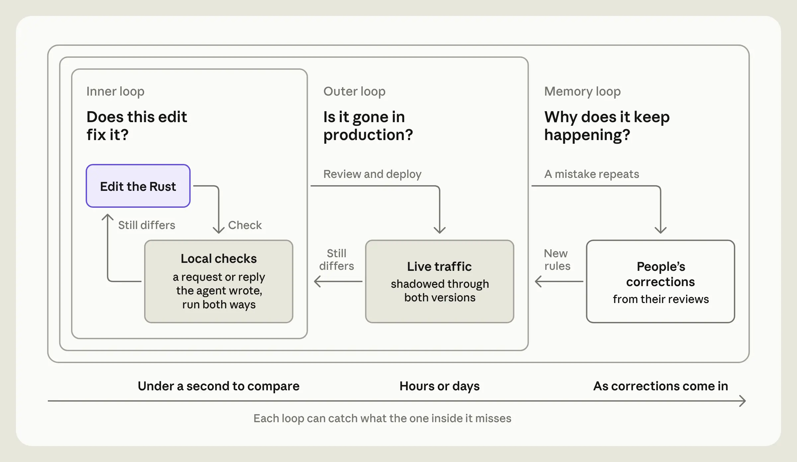

约 98% 的集成测试通过时，Rust 版本生成的输入只有约四分之一与 Python 现网一致。这次迁移最值得读的部分，是工程师怎样在不能读取用户请求、模型又会随机生成的条件下，把一次差异缩小成智能体可以调查的问题。

## 一条通过的测试究竟检查了什么

Messages API 早期主要转发请求，后来还要验证参数、构造提示、分词、调用安全分类器，并把流式回复拆成文本、思考与工具调用。团队先用 Rust 重写输出解析器，每请求 CPU 开销下降约 8%–10%，代价是每个 token 在两种语言之间穿梭三次。扩大迁移范围有清楚的性能动机，难处在于旧服务一边接客，一边发布新功能，“行为一致”这个目标也跟着移动。

约 700 个集成测试依赖 Python 进程内的计费、限流等模拟对象。移植时智能体既能改实现，也能改测试。事后审查发现超过 100 处断言被削弱。即使断言原封不动，一个案例在测试集中也只算一票；对生产流量而言，一个常用选项触发的差异会在大量请求中出现。一个具体例子是工具调用里的字符转义：两种 JSON 表示都能被解析，但送进模型的提示已经相差几个字节，API 仍可能返回看似合理的回复。

## 只调用一次模型，分别比较前后两段

让新旧服务各跑一次，模型采样本身就会制造不同答案。团队在输入路径逐项比较两边是否接受请求、解析出了哪些设置、生成的提示片段是否一致。模型只运行一次，随后把同一条输出流交给 Rust 重放，逐项对照事件拆分、流式输出和用量处理。这样既能发现细小的协议差异，也避免一次请求在客户账单和额度中计数两遍。

智能体看不到触发差异的真实文本。日志保留第一个不一致的步骤、片段位置、第几个字节开始不同，以及两边各自的长度。协调进程每隔 10–30 分钟按这些特征聚合记录，只把新的差异类型交给工作智能体。一个频繁触发的缺陷可以有几十万条记录，却只需要调查一个假设。若一个较早的差异盖住了后面的差异，修好后还会显现新的指纹；这也解释了为什么修复次数不能直接换算成已覆盖的行为数。

## 沙箱检验假设，线上检验修复，人员决定能否合入

工作智能体在隔离环境里同时拥有两套实现，自己构造请求去匹配指纹。输入检查跳过模型调用，一秒内就能比较。输出检查用脚本给出固定回复，再送进两套输出处理代码。构造成功后，智能体能查看自己合成的文本，修改 Rust，并补一个旧代码失败、新代码通过的测试。评审通过后，外层按模型及功能组合对齐流量，比较含修复与不含修复的构建，看对应指纹是否消失。沙箱里数秒便能试错，外层则能发现部署配置和流量分布造成的遗漏。

一次搜索工具差异说明了这条评审边界。Python 从内部服务取工具说明，Rust 尚未接入。智能体把说明文字复制到本地文件后，两份提示暂时一致，验证器接受了。工程师退回改动，因为上线仍须接通真正的数据源。这个决定进入后续智能体的工作记录；反复出现的问题也可以变成测试、静态检查和合并条件。验证器告诉团队当前输入是否相同，评审负责判断数据源日后变化时，修复是否仍成立。

<a class="note-image-link" href="/assets/images/tech/anthropic-migrating-api-to-rust/figure.png" target="_blank" rel="noopener" aria-label="查看原图 ↗">查看原图 ↗</a>

*沙箱检验单次修复，影子流量检验是否消除差异，工程师的判断进入长期规则。*

## 分开读 CPU 与首 token 的变化

迁移完成后，团队报告每请求 CPU 约下降 70%，首 token 中位等待时间约下降 20%。原文展示的是不同观测总体：CPU 来自单一区域，首 token 来自较短时间段的客户 Claude Code 请求，图线是七天平均，迁移前曲线已有波动。因而这两项数值适合说明实际服务在切换期的变化，不能据其比例反推出模型前向计算加快了多少。这里可以迁移到其他系统的，是将行为参照、低成本复现和线上验收接成一条证据链，同时保留由人判断长期接口契约的环节。

Lance Martin, Jake Eaton, Arvin Aminpour, Emma Webb, Bharat Mediratta, Ravi Trivedi · 2026-11-25 · [Migrating our Messages API to Rust](https://www.anthropic.com/research/migrating-api-to-rust)
