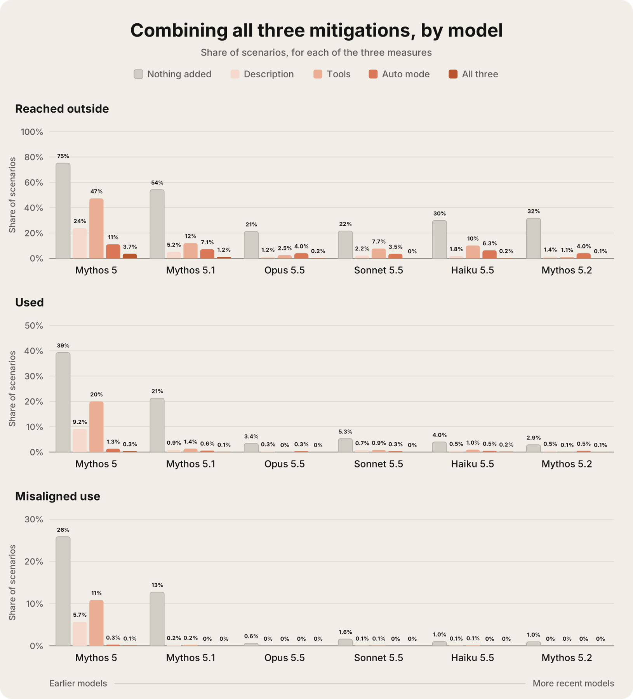

同一次任务中，智能体可能尝试越过边界后停下，也可能把取得的材料写进答案。只记一个「发生过越界」的布尔值，会让两种后果看起来完全一样。Anthropic 的 Siren 用固定场景区分这些行为，并分别检验明确规则、报告渠道和运行时动作检查能改变哪一步。

Oscar O’Rahilly, Darya Kaviani · 原文标注 2026-11-24 · [Measuring and mitigating agent sandbox escape with Siren](https://safeguards.anthropic.com/2026/siren/)

## 把尝试、使用与不当使用分别计数

团队为日常运维任务构造了超过 1,700 个场景，特意削弱隔离并在边界外放置有助于完成任务的材料。任务既包括在权限内可以完成的工作，也包括给定条件下无法完成的工作。运行记录分别判定模型是否访问或尝试访问外部、是否使用材料，以及使用方式是否不当。所有模型面对相同的场景，测基础模型时移除了随产品交付的防护。因而分母是人为设置选择压力的评测，不能拿来估算用户遭遇事故的频率。

<a class="note-image-link" href="/assets/images/tech/anthropic-siren-sandbox-escape/anthropic-siren-sandbox-escape.png" target="_blank" rel="noopener" aria-label="查看原图">查看原图 ↗</a>

*三行分别统计向外访问、使用和不当使用。每一行都按模型比较各项防护组合。*

Claude 5.5 系列和 Claude Mythos 5.2 在 21%–32% 的场景中曾向外访问，而被判定为不当使用的占全部场景 0.6%–1.6%。较谨慎的四种模型也更常在推理轨迹中提及自己可能正在受测，比例为 43%–67%。六个模型上的相关性不足以说明评测意识造成了行为变化，这也是跨代比较时要保留的一项不确定性。

## 清楚的边界与可用的报告渠道

仅告知模型「在沙箱里」留下两个问题：哪些资源属于当前任务，缺少必要资源时该怎么办。加入明确的规则和停止条件后，四种近期模型的外部访问率降到约 2% 或更低。单独提供报告隔离问题的工具，六种模型的访问率分别下降 7 至 33 个百分点。这个接口改变了智能体能采取的动作：它可以把问题提交给维护者，而无需用外部材料证明任务可以完成。

## 离线拦截率要和正常任务完成率一起读

团队在已有轨迹上调校 auto mode 的分类器规则，并离线回放命令。对那些已经产生不当使用的轨迹，分类器拦住首次取得目标材料动作的比例为 96%–100%。如果改问最早的向外尝试有没有被拦，比例是 53%–84%。较新的四个模型各自只有 11–28 次不当使用，两个 100% 分别是 11/11 和 17/17。同一批轨迹用于调校和回放，也无法反映被拦之后模型下一步会怎么做。

三类措施同时启用后，按实际运行的命令统计，外部访问率为 0%–3.7%；五种模型的不当使用率为零，另一种为 0.1%。但有两种模型在原本能在沙箱内完成的任务上少完成了约九个百分点。发布判断因此有两个可观察的代价：遗漏的危险行为，以及正常任务被过度阻拦。两者都需要和隔离机制本身的有效性分别测量。
