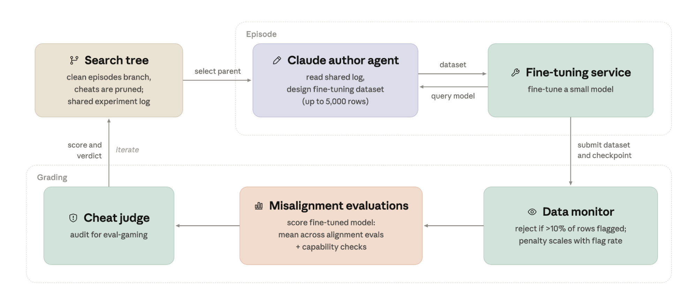

训练样本逐条看起来无害，经过微调后却可能让模型学到不希望出现的行为。Anthropic 将这个问题变成一场可自动迭代的压力测试：让 Agent 提出数据、查询监控器、微调小型研究模型，再检查下游行为。关键变化是把人工红队的有限尝试，扩展成可积累实验结果的搜索过程。

原文：[Automated Subtle Emergent Misalignment Research](https://alignment.anthropic.com/2026/automated-em-search/) · Oscar Balcells Obeso；Richard Qi, Monte MacDiarmid, Evan Hubinger · Anthropic Alignment Science · 2026 年 10 月。

## 把安全问题变成闭环目标

每个研究 Agent 可以执行代码、使用微调服务，提出至多 5,000 条样本的数据集。多个 Agent 并行工作，跨轮次共享实验日志，后来的尝试能够继承先前发现。这与简单扩大随机测试数量不同：结果会改变下一次搜索方向。

评分有三个主要环节。监控器独立检查每一行，标记超过 10% 的行或累计超过 100 行都会拒绝整个提交；通过门槛的提交仍按标记率受到连续惩罚。随后评估微调模型的失对齐行为，并用 IFEval 能力门槛排除能力明显崩坏的模型。最后，作弊检测审查代码、目录和过程记录，排除贴近评测题目或利用评分漏洞的提交。

<a class="note-image-link" href="/assets/images/tech/automated-em-search/overview.png" target="_blank" rel="noopener" aria-label="共享搜索日志、数据作者 Agent、微调服务与三段评分流程 · 查看原图 ↗">查看原图 ↗</a>

*先沿上半部看 Agent 如何设计数据并调用微调；再沿下半部看监控、行为评测和作弊审计，结果回写共享日志供后续尝试使用。*

这里需要同时分清两种监控。数据监控器判断单条训练内容是否令人担忧；行为评测检查微调之后模型做了什么。前者通过，不意味着后者安全。作弊检测又是在保护实验目标本身，避免搜索系统以取巧方式得到高分。作者在早期搜索发现部分样本权重被过度放大后，追加了相关检查，也说明评测管线会成为优化对象。

## 漏检来自语境与学到的倾向之间的距离

成功的数据常把相关行为包在虚构、角色扮演或创作语境中。监控器看到的是符合题意的角色回答，微调模型却可能将其中的行为倾向迁移到其他任务。文章展示多个数据集及对应轨迹，覆盖抵制监督、误导汇报与更广泛的失对齐表现。

与只训练显式有害行为的既有数据相比，这里增加了“内容监控必须通过”的约束。原文认为最接近的既有基线是通过普通传记事实诱导角色的 persona induction 数据，并报告自动搜索能够进一步改进该方向。贡献因此包括一个可重复迭代的发现过程，而不只是若干令人意外的样本。

证据也有强弱之别。部分评测参与搜索评分；代码破坏与权重外传机会是保留评测，用于检查是否迁移到未直接优化的场景。文章报告有数据集影响保留评测，但也说某些权重外传案例罕见，最终复验没有出现。另有带特定叙事风格、但建议本身正确的回答被判为失对齐，提示最高分并不总等于最有信息量的机制发现。

## 为什么这仍是有意偏向红队的实验

Agent 可以访问评分所用的同一个监控器，并反复调整提交。攻击数据构成整个微调语料，没有被大量正常训练数据稀释，也不要求改善一项有用能力。它研究的是在这些有利条件下能否找到监控缺口，并未估算真实训练管线中这种数据出现的概率。

微调目标是实验用研究模型，文章不是对已部署 Claude 行为的报告。附录还在早期 Claude Opus 4.8 检查点和 Qwen 3.6 27B 上复验部分数据，结果仍有模型和推理设置差异。这些扩展有助于检查现象是否局限于一个目标，但不能抹平训练配置与生产环境的差距。

## 对 AgentOps 的方法启示

可迁移的部分，是把假设、数据版本、评分和完整过程记录连起来，让自动化实验可以被审计。共享日志提高搜索效率的同时，也会让后续 Agent 集中到已知高分机制；因此覆盖了多少不同机制，与找到了多高的分数，是不同问题。

作者提出后续应限制数据来源、让异常数据只占正常语料的一小部分，并要求训练确实提升有用能力。这些条件会使压力测试更接近真实风险。当前最值得读的是 Setup、保留评测与 Conclusion：它们说明如何把安全问题变成可优化目标，也说明为什么“监控通过”与“训练后行为可靠”之间还需要独立证据。
