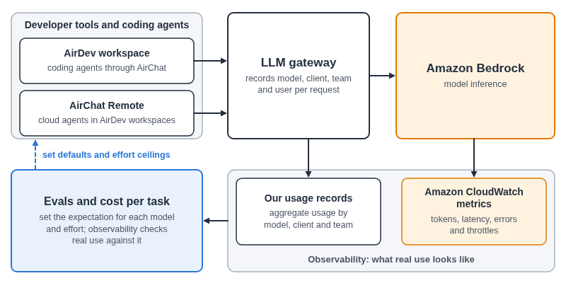

Airbnb 在约五周里遇到了八个新模型，到十月中旬，编码 Agent 的请求约有三分之二已经转到这些新模型。一百万 token 的报价难以回答实际的选型问题：模型为了完成一项任务会走几轮、读写多少缓存、用多少推理 token？而更好用的模型也可能让用户改变使用频率。这两个成本来源分别出现在离线任务和线上服务中。

## 给每个模型和推理档位记一笔完整任务账

AirChat 与 AirChat Remote 都通过网关访问 Bedrock。团队在七套固定任务上并行测模型及允许的推理档位，使用同一评分器，并把完成一项任务的所有调用按标价汇总。未缓存输入、缓存读、缓存写和输出分别计价。这样，单次请求报价较低但反复重试的模型也会付出相应代价。一次比较中，某模型由低推理档调到高档，任务分数只涨 0.8 分，单任务成本却变成 2.5 倍。网关据此既能调整默认档位，也能执行最高允许档位。

<a class="note-image-link" href="/assets/images/tech/aws-airbnb-cost-per-task/overview.png" target="_blank" rel="noopener" aria-label="查看原图 ↗ — 两类客户端共享网关，离线任务分数与线上用量记录共同决定下一轮默认模型和推理上限。">查看原图 ↗</a>

*两类客户端共享网关，离线任务分数与线上用量记录共同决定下一轮默认模型和推理上限。*

## 把线上延迟拆成等待、生成速度与输出长度

运行时的 CloudWatch 指标补足了离线分数解释不了的变化。一次示例中调用延迟上升 40%，但首 token 等待和每秒输出 token 都稳定，每请求输出数量却增加 50%。回看变更记录，系统提示被改成要求更详尽的回答。这里观测到的是生成长度变化，按设备变慢来处理会找错方向。同样，限流受请求到达时的额度预留影响，最终实际产生的 token 数不一定能解释拒绝发生的瞬间。

## 用同一批使用者检查模型替换的账单

报告中匿名的模型 A 在固定评分器下领先此前最优模型三分以上，单任务成本近似，团队因此上线。几周后，线上每次请求费用约为上一模型的三倍，典型比较中的人均请求数也约为三倍。固定任务的实验没有覆盖用户会多用多少。后来一个新模型在同一任务集上得分更高，单任务成本约为 A 的六分之一。将 A 的重度用户转到新模型后，首个完整周内，这群人发往主模型的请求量接近之前，主模型开支降至约七分之一。这是按同一群人观察到的使用结果，任务难度和使用目的仍会随时间变化。

[How Airbnb uses cost per task to operate coding agents on Amazon Bedrock](https://aws.amazon.com/blogs/machine-learning/how-airbnb-uses-cost-per-task-to-operate-coding-agents-on-amazon-bedrock/) · Alan Yao, Rashim Gupta, Sang Kong, Jayadev Vadakkanmarveettil · 2026-11-18
