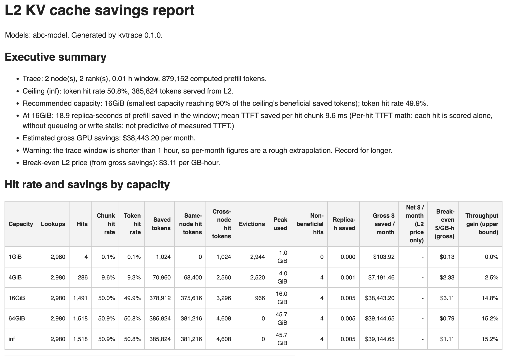

一个法律助手保存了 64K token 的对话，用户午后回来时却要等 13 秒才看到第一个 token。这是 AWS 用来演示部署技能的场景。慢在重新预填充，并不自动意味着多买一层缓存划算。用户是否回到同一台服务器、多久回来、读回历史需要多少时间，这些因素都影响答案。AWS 把这几个判断放在创建资源之前，也为接入后的错误命中设计了单独检查。

Ravi Yadav、Chaitanya Nuthalapati、Neeraj Ramachandran · AWS Artificial Intelligence Blog · 2026-11-20 · [Cut self-hosted LLM cost and latency with the distributed KV caching agent skill](https://aws.amazon.com/blogs/machine-learning/cut-self-hosted-llm-cost-and-latency-with-the-distributed-kv-caching-agent-skill/)

## 先弄清楚缺的是哪一种命中

技能引导编码智能体只读查看 GPU 实例和 EFA 接口，再询问引擎、模型、张量并行度、KV 数据类型、每小时价格及提示重复状况。模型和数据类型决定每个 token 要传多少字节；会话路由与回访间隔则决定有多少状态在本地已经失效，却仍有机会在共享层找到。只凭平均提示长度，无法推算这部分工作量。

如果本地前缀缓存没有打开，连续两轮请求就可能重复预填充，首先值得检查的是本地配置。如果会话有亲和路由，本地命中率已经高于 90%，作者把它列为可能无需共享层的例子。即使同一前缀确实会跨服务器重复，短前缀也可能重算更快。法律助手还有一个具体的约束：两个租户即便拿着相同文本，也可能不应共享一次命中，因为响应时间会泄露文本是否出现过。示例按隔离要求分缓存，或把租户标识纳入缓存键。

## 用事件重放寻找容量拐点

估算示例有八台 p5 服务器，处理 64,000 token 的多轮检索增强问答。智能体取得 GPU 和缓存节点价格，再从基准推导预填充速率与 KV 大小。在提示没有给出命中率时，它先展示多种情形。用于代入真实流量的量，是原本需要重算的 token 中有多少可以由 L2 提供。请求级命中率无法反映被挽回的是一小段提示还是整份长文档。

KVTrace 在各服务器记录 vLLM 或 SGLang 的缓存事件，包括块哈希与 token 数，随后以不同共享容量离线重放同一段轨迹。这样可以对照新增容量究竟多保留了多少本来会被重算的前缀。记录器不写提示正文或 token ID，但块哈希来自内容，敏感提示仍需使用匿名化选项。采样窗口也要覆盖实际回访周期；只采刚启动的一小段时间，会错过午后重新打开文档的用户。

<a class="note-image-link" href="/assets/images/tech/aws-distributed-kv-caching-agent-skill/figure.png" target="_blank" rel="noopener" aria-label="KVTrace 演示报告按候选容量列出命中 token 和估算节省">查看原图 ↗</a>

*沿容量行查看额外保住的 token，接近上限后再扩容，回报就会变小。*

图中的合成流量报告按可达到的节省上限取 90%，推荐满足这个目标的最小容量。八台 p5 的定价示例和这份演示报告服务于决策过程，不能作为某个生产机群的账单。节省的 GPU 时间只有在同样机器多服务流量，或减少机器数时才转成经济收益；若收益覆盖不了缓存节点价格，技能在部署前停止。

## 计数器显示命中，输出也要一致

进入测试部署后，技能为各服务器统一缓存键的哈希方式和种子，显式指定 KV 数据类型。键不同会让两台服务器各写各的，状态即使存在也找不到。布局不匹配更难发现：取回了块、命中计数正常，模型却可能读错内容。因此示例先清空本地层，让重复运行都必须从远端装载，再比较两次输出。部署后的实测 L2 份额还可同 KVTrace 预测对照，检验采样窗口是否代表当前负载。

第四段演示给出了另一种容易误判的症状：客户端能连接 Valkey，RDMA 握手也成功，真正传输时写错误计数却持续增长。握手走的是控制路径；数据面还需要 EFA 流量通过。作者示例优先检查同一安全组成员之间的规则。这是根据症状缩小排查范围的实例。文章展示了四段操作对话和一份合成重放报告，尚未给出多套生产集群上预测与实际节省之间的误差分布。
