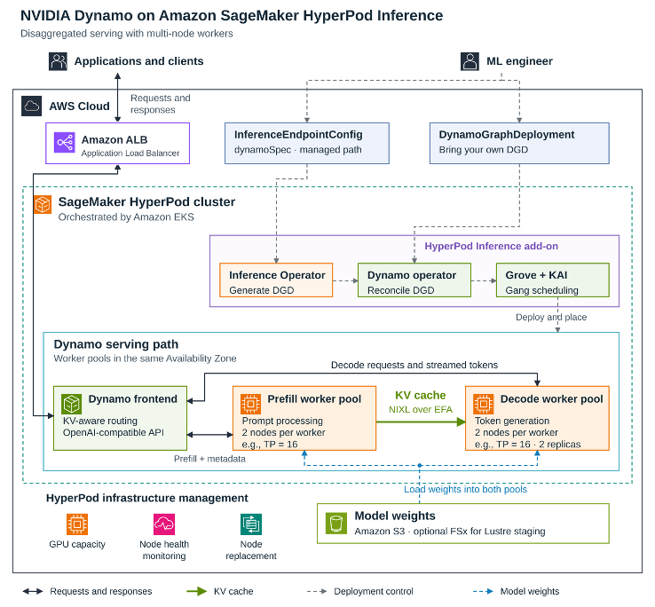

多节点模型部署有两个独立动机。一种是模型权重本身就放不下，例如 GLM-5.3 的 FP8 权重已经超过单台 ml.p5.48xlarge 的 640 GB 显存。另一种是同一组卡上，突发长提示占住计算，正在生成的请求出 token 变慢。AWS 的 Dynamo 集成允许单个 worker 跨节点，也允许预填充与解码使用独立 worker 池。两种拓扑的性能问题需要不同对照。

## 从端点描述到一组同时就绪的 GPU

在 InferenceEndpointConfig 的 dynamoSpec 中声明前端、worker 与副本的配置。HyperPod 的推理算子管理端点，Dynamo 算子管理服务图。Grove 协调关联 pod 的伸缩，KAI Scheduler 成组安排多节点 worker 所需资源，避免只拿到一部分卡的 worker 长期无法工作。HyperPod 观察节点、GPU 和 EFA 的健康，负责节点替换，编排组件重建受影响的 worker。报告说明了责任归属，但性能实验并未测故障恢复时间。

<a class="note-image-link" href="/assets/images/tech/aws-dynamo-hyperpod/overview.png" target="_blank" rel="noopener" aria-label="查看原图 ↗ — 前端把请求分到预填充和解码 worker，底层另行负责 GPU 成组调度与节点替换。">查看原图 ↗</a>

*前端把请求分到预填充和解码 worker，底层另行负责 GPU 成组调度与节点替换。*

## 两个池都要装权重，还要传交接状态

分离拓扑中，前端把提示交给预填充 worker，再由解码 worker 生成输出；两个池都需要完整模型权重，KV 状态通过 EFA 移交。这样可以独立调整两侧容量，让长提示减少对持续生成的干扰。相应的成本是重复放置权重、维持可用的跨池链路，以及避免一侧已满而另一侧空闲。聚合模式把两个阶段留在同一 worker，仍可按模型规模在节点间做张量或流水并行。

## 2.05 倍是满足交互目标的最高吞吐之比

Qwen3-235B-A22B-FP8 用 TensorRT-LLM 在两台共 16 张 H200 上测量，每请求 4,000 输入、200 输出 token。作者只保留 p90 首 token 小于一秒、每用户生成速度中位数至少 50 token/s 的测点。分离配置在并发 80 时达到每卡 207 输出 token/s，聚合配置在并发 32 时为 101。第二项实验固定八张活跃 H200、TP4 × PP2，用 Qwen3.5-397B 比较单节点八卡与两节点各四卡；高前缀复用、并发 32 时后者达到每卡 126.4 token/s，为单机的 99.1%。前者回答延迟约束下应怎样分工，后者只考察这组负载下跨节点放置的代价。

[Managed NVIDIA Dynamo on Amazon SageMaker HyperPod Inference](https://aws.amazon.com/blogs/machine-learning/managed-nvidia-dynamo-on-amazon-sagemaker-hyperpod-inference/) · Vinay Arora, Aryaman Kothari, Kshitiz Gupta, Marc Karp, Piyush Daftary, Preethi Ravula, Sai Devulapalli, Wenhan Tan, Xuan Lu · 2026-11-17
