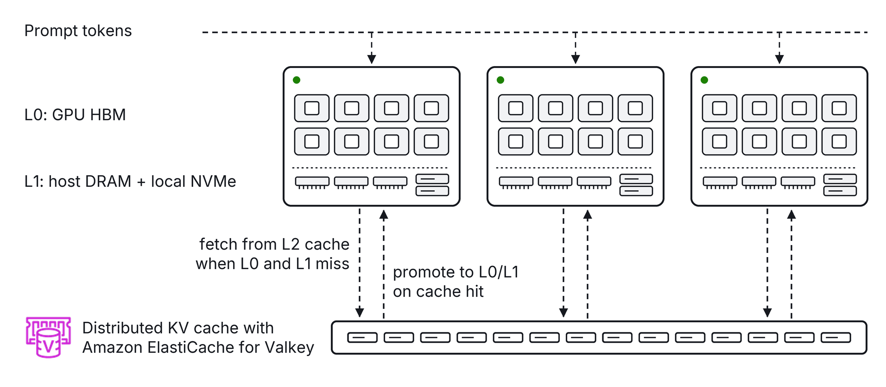

同一份合同上的第二个问题，本来只需为新增的问题做预填充。但如果负载均衡把请求送到另一台 GPU 服务器，第一台机器刚算好的注意力键和值就可能完全用不上。AWS 的 ElastiCache for Valkey 把可复用的前缀放进同一可用区内的共享缓存。判断这层缓存值多少钱，有两个合适的观察时刻：集群达到交互延迟上限时，以及一台机器刚退出服务时。

Meet Bhagdev、Chaitanya Nuthalapati、Kevin McGehee · AWS Database Blog · 2026-11-18 · [Announcing distributed KV caching for self-hosted LLMs with Amazon ElastiCache](https://aws.amazon.com/blogs/database/announcing-distributed-kv-caching-for-self-hosted-llms-with-amazon-elasticache/)

## 一次本地未命中的去向

推理引擎先查 GPU 显存中的 L0，再查本机内存或本地 NVMe 中的 L1。这两层都能避开重复计算，但命中机会跟着服务器走。把会话一直路由到同一台机器可以提高命中率，高峰时却可能让请求在热门机器前排队，而其他 GPU 仍有空位。共享 L2 让调度器多一种选择：把请求送到有余量的机器，再把这台机器缺少的前缀状态取回来。

LMCache 连接器把新生成的状态写进 Valkey；本地未命中的服务器可以按块读回并提升到本地层。热块在共享节点的 DRAM 中，冷块可转到该节点的 NVMe，保留到淘汰为止。GPU 主机与缓存节点通过 EFA 上的 RDMA 搬运大对象。AWS 在单个 cache.i8ge.48xlarge 节点上测得：读取一个 8 MB 对象的 p50 为 477 微秒，读取 128 个这样的对象、合计 1 GB 的 p50 为 41.7 毫秒。应用端看到的首 token 延迟还包含调度和剩余提示的预填充。

<a class="note-image-link" href="/assets/images/tech/aws-elasticache-distributed-kv-caching/figure.png" target="_blank" rel="noopener" aria-label="三台 GPU 主机各自保留 L0 和 L1，并连接到共享的 Valkey L2">查看原图 ↗</a>

*虚线表示本地层未命中后的读取，以及共享块回到本地缓存的路径。*

## 同样的交互目标下，一台机器能多回答几个问题

AWS 以运行 vLLM 的 2–6 台 P6 服务器做比较，每台八块 GPU。基线已经有约 150 GB L0 和 205 GB L1，实验组额外接入同可用区的一台缓存节点。在共享文档问答中，以首 token 延迟 p90 小于 5 秒、每个输出 token 用时 p90 小于 50 毫秒为目标，各服务器可承载的请求率翻倍。扣除新增缓存节点的费用后，每百万输出 token 的成本下降 40%。这个分母很重要：增加容量只有转化成更多输出或更少服务器，才会改变实际支出。

编码智能体和 AI 助手采用了不同的流量轨迹与延迟目标。在 p90 首 token 延迟不超过 30 秒的比较中，AWS 报告同负载下的吞吐提升分别最高达 1.98 倍和 1.61 倍；两种负载的峰值 token 吞吐均提高 23%。同负载下的差距和系统的峰值增幅回答的是两个问题，不能互换。

## 让一台服务器离线，观察冷启动的尾巴

在双机实验中，AWS 停掉一台服务器。随后 300 秒里，剩余服务器从 L2 取回另一台机器留下的状态，首 token 延迟 p90 为 34.7 秒，比没有共享层低 43%，完成的请求数是对照的 1.48 倍。停掉的机器重新上线后，共享缓存组在 60 秒内恢复初始吞吐与延迟。对照组花了最多 600 秒才恢复原吞吐，积压请求仍使 p90 达到 12.1 秒。共享层在这里保住的是已经付过计算成本的前缀；恢复过程还受队列和剩余 GPU 容量约束。

## 一次命中能不能抵过传输

一次命中免去了旧前缀的计算，也引入了从远端读取状态的时间。在 AWS 的八模型测试中，远端读取快于重算的长度分界因架构而异：一个稀疏模型低于 512 token，混合注意力模型约在 1,000 至 7,600 token 之间。混合模型要读回的固定大小状态，在短上下文下占比尤其大。生产流量要同时满足两个条件才能兑现问答实验中的优势：重复的历史已经离开本地层，而且取回它比重算快。单次短提示、长输出的任务即使很忙，也很少创造这样的机会。
