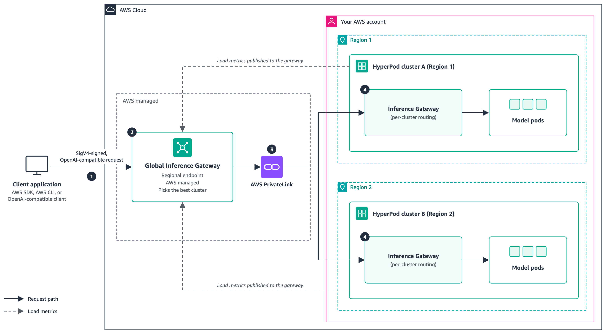

推理端点即使能在一个集群中选出最空闲的 GPU，也看不见另一区域的剩余容量。AWS 的例子是两个区域、五个集群和四个模型：逐模型逐集群访问需要客户端跟踪 20 个端点；集群内网关降为五个，客户端仍需决定往哪一个发。Global Inference Gateway 将这个选择移到托管的第一层，每个集群继续执行原有的 pod 级调度。

Dmitry Soldatkin, Aryaman Kothari, Piyush Daftary · 2026-11-20 · [Introducing Amazon SageMaker HyperPod Global Inference Gateway: One endpoint across Regions and clusters](https://aws.amazon.com/blogs/machine-learning/introducing-amazon-sagemaker-hyperpod-global-inference-gateway-one-endpoint-across-regions-and-clusters/)

## 发布集群，再组建网关

集群控制器根据现有 InferenceGatewayConfig 的 globalRouting 配置，在用户账户中发布集群的私有入口，包括负载均衡器和 VPC endpoint service。随后把选定集群加入网关。服务验证区域、证书和端点信息，给每个集群建立私有连接。客户端向一个区域端点签署 SigV4 请求，网关先检查 IAM 权限和限流，再经 PrivateLink 转发。这里的“全局”描述可选目标的范围，客户端仍有明确的接入区域。

<a class="note-image-link" href="/assets/images/tech/aws-hyperpod-global-inference-gateway-2026-11-20/figure.png" target="_blank" rel="noopener" aria-label="网关在健康集群间选择，再通过私有连接交给集群内的推理网关。">查看原图 ↗</a>

*网关在健康集群间选择，再通过私有连接交给集群内的推理网关。*

## 四个权重改变请求的去向

对每个请求，网关从健康集群中计算得分，选择最高者。默认 KV 余量、队列深度、区域邻近、近期错误率的权重分别为 0.20、0.25、0.40、0.15。可显式配置全部四个非负权重且总和为 1，也可把某个信号设为零。默认邻近权重最高，跨区转发仍可在本地排队或容量紧张时胜出。到达目标集群后，原有的 Inference Gateway 再按 KV 占用和队列选择 pod；第一层的“余量”是容量信号，本身并不表示目标持有某段请求前缀。

## 故障切走后，客户端能观测到什么

健康检查决定哪些集群参与选择，近期请求错误又能影响健康候选之间的排序。Bagelcode 在文中报告，两区域测试里一个集群不能再服务模型后，同一端点仍能接收请求。这支持跨集群切换路径确实可用。文中未给出故障探测到切换的延迟分布、在途流式请求结果或切换期间的尾延迟；这几个量才决定某个部署能否守住自己的服务目标。
