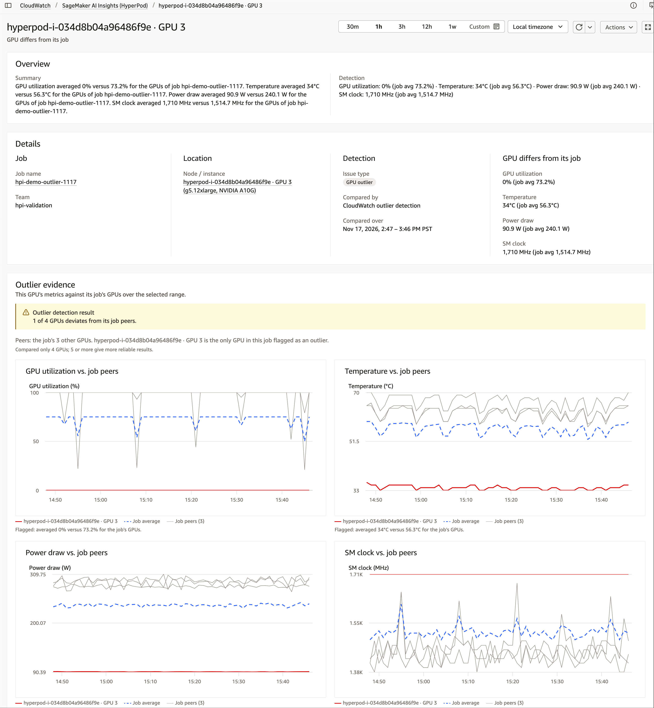

分布式训练的同步点会把一块慢卡的影响传给所有参与者。作业吞吐下降时，其他卡也可能因为等待而出现低利用率。AWS 的 HyperPod 诊断把比较范围缩到同一训练作业，再把偏离群体的设备和硬件事件放到同一时间线上。这比看集群平均利用率多回答了一个问题：哪一块卡先表现得和同伴不同？

Mijanur Palash, Aman Pratap Singh, Farrukh Sohail, Sai Kiran Akula, Subodh Kamble, Uday Singamala · 2026-11-20 · [Introducing enhanced infrastructure observability in Amazon SageMaker HyperPod](https://aws.amazon.com/blogs/machine-learning/introducing-enhanced-observability-in-amazon-sagemaker-hyperpod-to-diagnose-gpu-training-issues/)

## 采集成本取决于开启哪些指标

EKS 使用附加组件，Slurm 使用扩展。默认层每 30 秒采集集群健康、CPU、磁盘、操作系统、GPU 利用率与温度，以及作业资源占用。AWS 列出的开销约为 1%–2% CPU 和 250–300 MB 内存。可选层再加入完整 node exporter、DCGM 或 Neuron 指标以及 EFA 网络指标。时钟、功耗、PCIe、重传或丢包有助于区分算力、主机和网络问题。默认层的开销数字只对应默认指标，增加维度后需要单独评估。

<a class="note-image-link" href="/assets/images/tech/aws-hyperpod-observability-2026-11-20/figure.png" target="_blank" rel="noopener" aria-label="事件详情把受影响实例和作业与同一时段的网络指标联系起来。">查看原图 ↗</a>

*事件详情把受影响实例和作业与同一时段的网络指标联系起来。*

## 同作业比较为何能缩小调查范围

诊断摘要调用 CloudWatch DetectGroupOutliers，把同一作业内各块 GPU 的利用率、显存、温度、功耗和 SM 时钟作比较，将偏离者列为候选。另一条路径用静态规则识别 XID、ECC、过热、节流和 EFA 吞吐下降等已知模式。这两种证据可以串起来读：同伴偏离指出设备，时钟下降伴随温度上升才让热节流解释更可信；若多张卡同时等待，则还得检查通信和主机侧。

## 从离群卡回到作业时间线

操作界面能从集群诊断摘要进入具体事件，再按作业、节点和设备检查指标；网络与 NCCL 视图帮助判断异常是否沿通信链路传播。对称工作负载尤其适合同伴比较。流水线阶段分工或并行分片负载不同，同一作业内也可能存在正常的不对称，因此离群卡仍是调查入口。AWS 展示的是信号、规则和排查路径，没有给出带故障真值的数据集、误报率或修复时间分布。
