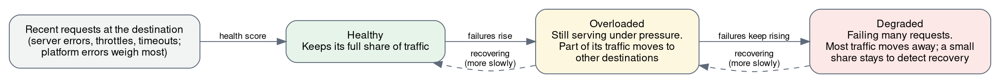

本地区域缺 GPU 时，另一个区域可能仍有空余端点。把新请求转走并不难，难的是区分三种情况：本地只是慢，确实已无法接单，或模型已经执行但调用方没有收到结果。AWS 的 inference router 为同一逻辑模型绑定多个已经运行的目的地，每次调用在这些端点间做选择。决定能否重试的依据比“这次请求失败了”更严格。

## 三种健康状态怎样改变流量

路由器优先选择自身所在区域，多台本地健康端点均分流量。每个目的地在自己的区域按近期请求计分，服务端错误、限流和超时会拉低健康度，平台侧故障影响更大。无效输入换个区域仍然无效，因此不计入。模型变慢但能正常返回，也不会单独触发跨区。实例启动失败等容量信号可以加快响应，但前提是已经有请求出错。

端点过载时，路由器转走部分请求；严重退化时只留少量流量探测恢复。持续出错后，流量通常约一分钟开始转移，低流量端点的判断可能更慢。恢复则分几分钟逐步回流，减少反复切换。远端健康数据过期时继续留在本地，避免仅因监控缺报而迁移。AWS 的测试轨迹展示了本地过载、跨账户授权丢失与恢复后实际承接请求的目的地变化，但没有给出各类生产负载的故障切换时间分布。

<a class="note-image-link" href="/assets/images/tech/aws-sagemaker-cross-region-inference-routing/figure.png" target="_blank" rel="noopener" aria-label="健康、过载与退化对应不同分流比例；保留少量请求用于观察恢复。">查看原图 ↗</a>

*健康、过载与退化对应不同分流比例；保留少量请求用于观察恢复。*

## 同一条请求可不可以再跑

健康评分面向后续请求；当前请求能否重试取决于是否能确定模型尚未运行。实时调用因限流、模型尚未就绪或特定 503 拒绝时，可在另一个目的地再试一次。对超时、500 或模型错误则不重试，因为客户端缺少确认并不足以证明推理没有执行。异步调用有另一套接收语义，路由器优先本地，每个合格目的地最多尝试一次，直到有一处接受。已在执行的请求不因后续健康状态变化而中断。

约一分钟没有响应后，客户端也可能看到服务不可用，此时模型有可能已经运行。这与目标端在执行前立即拒绝的情况有本质区别。客户端若仅按错误名称再次提交，就会绕开路由器对不确定执行结果的处理。AWS 让每个实时响应携带路由原因，同时让各端点在所属区域继续报告指标。前者能解释一次成功调用去了哪里，后者能帮助判断看似恢复的总量是否只是流量已经换了区域。

## 谁为另一区域的溢出流量留余量

备份端点也有自己的本地用户。端点所有者可以设置每实例可持续请求率，以及其中允许跨区占用的比例。每实例每秒 50 次、4 个实例、跨区上限 20% 时，可接收的远端流量为每秒 40 次；实例数变化，上限随之变化。超出上限的请求在运行模型前被拒。多个推理组件若共享同一端点，也共享这个额度。所有远端都满时仍会发生限流。

## 路由选择和容量准备的边界

路由器只在已注册且有调用权限的目的地间选择，不会替团队复制权重、创建实例或部署模型。路由器本身也是区域资源，入口区域失效时，要有另一区域的路由器和客户端切换机制。备份推理组件若缩到零副本，故障时只能先接到少量探测，扩容完成前请求仍会失败。每个逻辑模型独立故障切换，实时响应带有目的地与路由原因，可以据此区分本地命中、跨区和恢复。官方双区域示例使用非流式调用；此发布阶段不支持响应流式传输。需要逐 token 返回的服务即使有相同的冗余容量，也不能直接套用示例的调用路径。

Dmitry Soldatkin, Apoorva Chandra, Barkha Saxena, Deepti Ragha, Felipe Lopez · 2026-11-19 · [Keep inference running through regional capacity shortfalls with cross-Region inference routing in Amazon SageMaker AI](https://aws.amazon.com/blogs/machine-learning/keep-inference-running-through-regional-capacity-shortfalls-with-cross-region-inference-routing-in-amazon-sagemaker-ai/)
