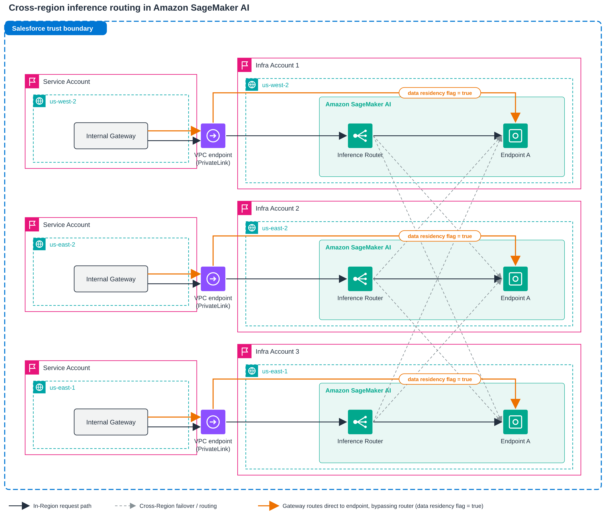

一次跨区域故障演练中，本地推理延迟的中位数从 0.2 秒涨到了 45–58 秒，探针流量却仍留在原区域。Salesforce 与 AWS 的报告解释了这个看似反常的窗口：路由器在请求开始返回错误后才转移流量。对读这次演练的人，切换前发生了什么，与切换后省下多少等待同样重要。

## 在入口先确定哪些目的地有资格接收请求

Salesforce 在三十多个区域运行自有模型。每个区域单独供给时，本地满载也可能遇到别处有空闲容量。团队把 SageMaker 路由调用接在 Internal Gateway 的逐请求出站路径上。网关先检查数据驻留条件，受约束的请求走只有本地端点的路径；其余请求才进入允许候选区域的路由。端点由 Salesforce 预先部署，跨账号访问由端点拥有者的策略授权。因此，扩大可借用的容量，需要事先在允许的区域准备好可服务的端点。

<a class="note-image-link" href="/assets/images/tech/aws-salesforce-cross-region/overview.png" target="_blank" rel="noopener" aria-label="查看原图 ↗ — 先按驻留要求限定候选端点，允许跨区的请求才能在本地容量不足时借用其他区域。">查看原图 ↗</a>

*先按驻留要求限定候选端点，允许跨区的请求才能在本地容量不足时借用其他区域。*

## 看响应落点，也看路由理由

模型调用方沿用原来的请求体与内容类型，局部容量判断、健康判断和恢复时的流量回迁交给路由层。每次响应带回实际处理请求的资源标识 InvokedRoutedResourceArn 及 RoutingReason。前者可以回答哪一个端点接了请求，后者可以解释这次为什么变更落点。把响应与 CloudWatch 按目的地的调用计数对上后，团队能把流量迁移与原区域自身的延迟变化分开看，也能检查有驻留要求的请求是否始终沿预定路径处理。

## 五分钟饱和期暴露了切换信号的边界

团队向 us-west-2 的本地端点加压，另设探针持续经路由器调用。约五分钟内服务越来越慢，直到请求越过容器 60 秒处理超时才出现错误。首批错误约两分钟后，探针首次落到 us-east-2，又过约一分钟，约 78% 的探针流量在东部处理。仍有约 20%–25% 留在本地，给路由器观察恢复的机会。分流后 p50 回到 0.2 秒，跨区域路径在 p50 上增加不到 100 毫秒；恢复后流量花约十分钟逐渐返回。

探针没有记录到错误，与本地过载请求已经报错并不矛盾：两者是不同的流量。这个实验明确展示了有权限且有余量的备选端点可以吸收流量，也留下一个具体的服务窗口：如果应用在数秒级就违反用户延迟目标，它可能在托管路由开始分流前就已退化。

[How Salesforce is advancing global-scale model serving with cross-Region inference routing in Amazon SageMaker AI](https://aws.amazon.com/blogs/machine-learning/how-salesforce-is-advancing-global-scale-model-serving-with-cross-region-inference-routing-in-amazon-sagemaker-ai/) · Apoorva Chandra, Deepti Ragha, Hrushikesh Gangur, Richard Chang, Scott Chang · 2026-11-18
