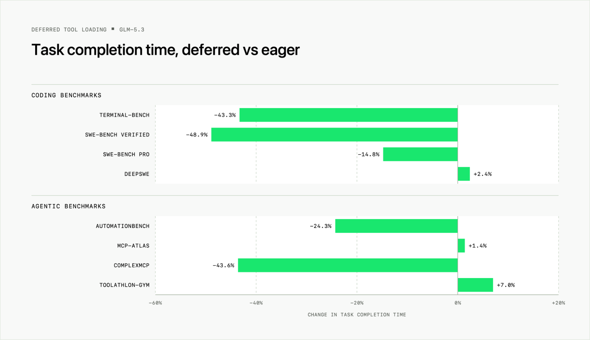

一个编码任务可能只需编辑本地文件，客户端却为它注册了 Slack、Notion 和 Baseten 的完整工具目录。在 Baseten 的测试配置中，把接口名称、参数和说明都发给模型，工具部分约占 14.1 万 token。即使前缀缓存命中，后续生成仍需对这些键值做注意力计算。这解释了为什么一个几乎不调用外部工具的任务，也会为工具目录付出显著时间和费用。

## 缓存命中之后还剩什么成本

缓存复用了此前构建的 KV，避免再次为同一前缀执行预填充。解码每产生一个 token，模型仍需要访问已有上下文。在工具很多、输出很长的任务里，两部分开销随不同量变化：省下一次预填充，并不能省下此后所有解码步对工具说明的读取。Baseten 把初始目录压缩到约 1,300 token，只留下工具名称和一个搜索入口，因此即使没有工具被实际使用，也能减少这段固定负担。

<a class="note-image-link" href="/assets/images/tech/baseten-deferred-tool-loading/figure.png" target="_blank" rel="noopener" aria-label="各智能体基准的完成时间变化方向并不一致，平均值掩盖了发现工具的额外往返。">查看原图 ↗</a>

*各智能体基准的完成时间变化方向并不一致，平均值掩盖了发现工具的额外往返。*

## 为什么工具说明要追加在会话末尾

当模型认为需要某项能力时，它调用搜索工具，客户端返回指向一个或多个具体工具的引用。服务器在对话当前位置展开这些引用，补上参数结构，随后模型才构造真正的工具调用。已经生成并缓存的前缀保持一致，新增定义只影响后缀。如果客户端发现工具后改写开头的系统提示，原本希望保住的缓存复用就会受影响。因此这一设计需要客户端与推理网关共同理解工具引用；仅在提示中告诉模型“按需找工具”不会自动提供相同的运行语义。

## 同一模型下，哪类任务获益最多

Fred Liu 和 Alex Ker 从八个基准抽取 55 个任务，用无界面的 Claude Code 运行 GLM 5.3，对照是否启用延迟加载。四个编码基准都注册上述三个 MCP 服务，平均成本下降 62.5%，任务用时缩短 26.2%。另外四个智能体基准沿用各自的工具集合，平均成本下降 51.1%，用时缩短 14.9%。两组的任务、目录和调用次数不同，不能从两组均值反推出某个具体工具的边际成本。这里的速度指标也包括整个任务的往返，而非单次推理延迟。

## 额外的发现回合何时抵消收益

每次工具搜索都可能多一次模型和客户端之间的往返。Toolathlon-GYM 平均涉及约 68 次工具调用，在作者的调用效率比较中是提前加载更有利的例外；DeepSWE 和 MCP-Atlas 的任务时间也略有变长。若目录大但实际用到的工具很少，先发名称可以把大量无关定义排除在所有后续解码之外。反过来，工具少且反复探索不同接口时，需要同时核对账单与完成时间。文章给出了这两项的分组平均和例外，并未给出所有网关与工作负载通用的切换阈值。

Fred Liu, Alex Ker · 2026-11-19 · [Deferred tool loading: Make your agent 62.5% cheaper without changing your model or harness](https://www.baseten.co/blog/deferred-tool-loading-without-changing-model-harness/)
