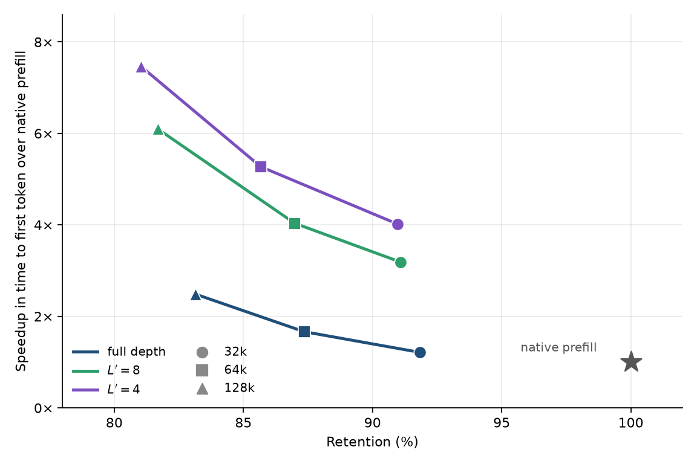

模型 A 读完长文后把工作交给模型 B，两者交换文本最简单，却要让 B 再做一次预填充。Base Labs 与 Ramp Labs 把问题改成了有损的状态转换：保留源模型读完文档后形成的表示，用一个共享网络生成目标模型可以继续使用的缓存。成本和损失都取决于交接发生在什么位置。

## 七个模型为何只训练一个翻译器

模型间的注意力头数量、宽度、位置编码和分词都可能不同。逐对学习 K/V 映射，七个模型需要覆盖 42 个有向组合。作者选择隐藏状态作为中间表示，为各模型设置轻量的对齐投影，共用翻译器主体。源侧编码器在局部 token 窗口内读取不同层的隐藏状态，得到一份记忆。目标侧从目标分词器对应的词嵌入开始，通过交叉注意力读取这份记忆，预测目标层的隐藏状态，再用目标模型冻结的权重生成它自己的键和值。

这个设计给转出的值加了一层约束。直接猜测 K/V 需要同时学会各家缓存布局，预测隐藏状态后用目标权重投影，可以沿用目标模型已有的生成路径。局部窗口也让翻译随文档长度近似线性增长。交换的前提是源端已经产生所需状态，并且系统能取到它。一个只允许提交文本、只返回生成文本的远程接口，没有提供这项交接所需的数据。

## 用行为损失决定哪些缓存误差重要

先学习接近原生状态，可以给训练提供密集信号，但同样大小的数值偏差未必对答案同样重要。第二阶段让目标模型读取翻译缓存，以原生读取时的输出分布提供监督，在给定问题和答案的条件下约束行为。滑动窗口层只需保留窗口内的内容；线性注意力层没有同样的逐 token K/V，训练为它匹配层输入及卷积和递归状态。跨模型通用的是共享学习和适配流程，处理状态时仍要尊重每种层的实际语义。

作者训练了一个 23.5 亿参数的翻译器。在不超过训练长度 8,192 token 的文档上，七模型、42 个方向、12 个任务、三个随机种子下，完整深度平均保留目标模型原生准确率的 96.9%，最弱方向为 93.1%。分母是同一目标模型使用原生缓存时的准确率；例如保留率高，仍可能对应一个原本就不擅长该任务的目标模型。原文另列相对两者中较弱模型的分数，这两个分母不能互换。

## 更长的文档让速度优势和信息损失同时变大

作者用单张 H200 和 vLLM 测多个长度，源记忆已经准备好，再计目标模型开始回答前的时间。128k token 下，完整深度翻译的首 token 加速为 2.5 倍，保留率从 32k 的约 92% 降到约 83%。把每个 token 要预测的隐藏状态数减至八个或四个，加速分别到 6.1 倍和 7.5 倍，同时再损失约一到两个百分点。因而不能把 8k 的 96.9% 与 128k 的 7.5 倍拼成同一工作点。图中速度是跨方向中位数，保留率则是跨方向和种子的均值。

<a class="note-image-link" href="/assets/images/tech/baseten-speculative-encoding/figure.png" target="_blank" rel="noopener" aria-label="查看原图 ↗">查看原图 ↗</a>

*同一条线从短到长比较上下文，横轴为原生准确率保留比例，纵轴为首 token 加速。*

作者还在问题已知时压缩翻译缓存，只对全注意力层处理。问题帮助选择保留哪些位置，保留的状态再读取全文信息后才生成较短缓存。128k、64 倍压缩的实验中，相对完整翻译缓存，保留率反而提高约四个百分点。这个结果属于给定问题的选择性阅读；若下一轮换问另一段事实，当前选择仍是否有效需要新的证据。对多模型服务，先明确能否拿到源状态、是否已知下一问，再判断这条质量与等待时间曲线是否适用。

Ben Geist, Thomas Villeneuve · 2026-11-25 · [Speculative Encoding: Many-to-Many Cache Translation](https://labs.baseten.co/articles/speculative-encoding-many-to-many-cache-translation)
