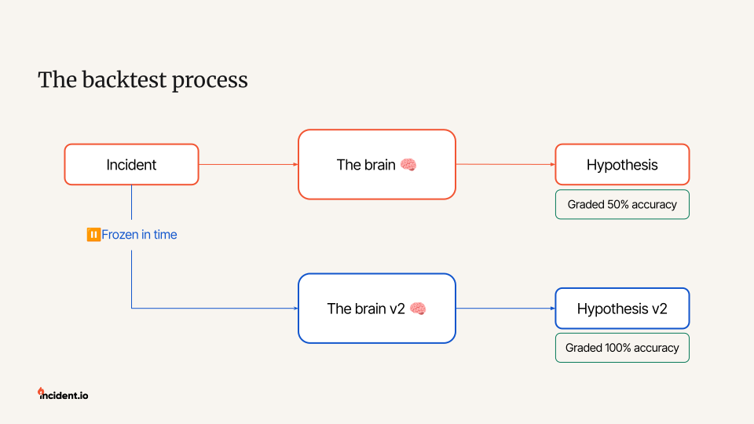
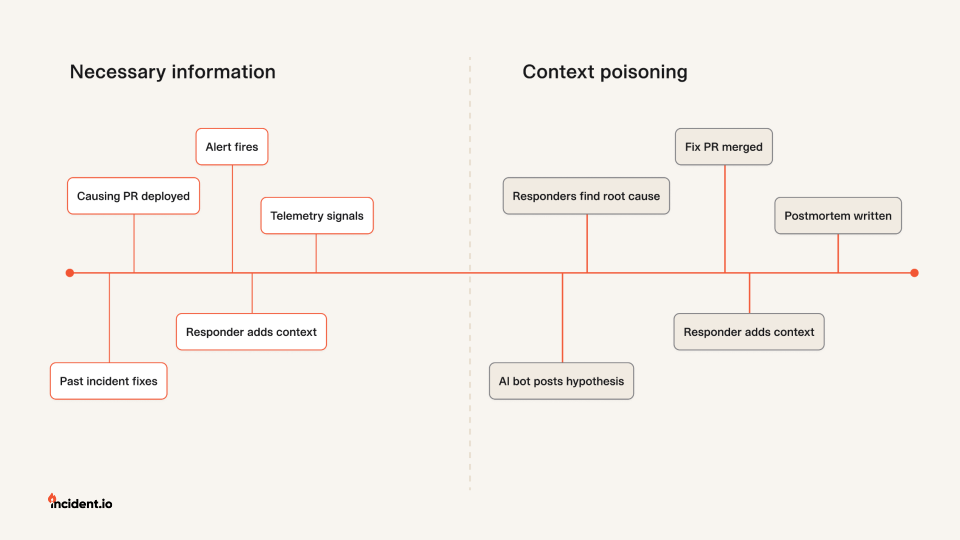
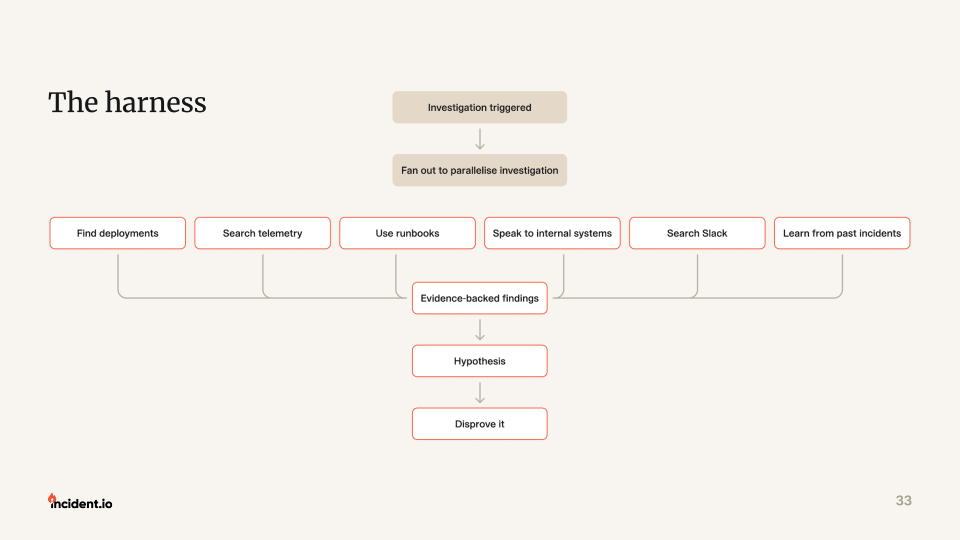
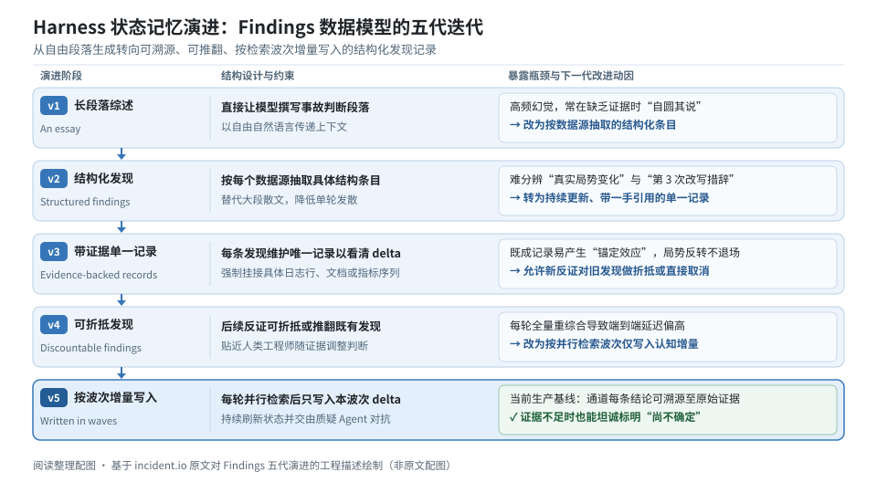
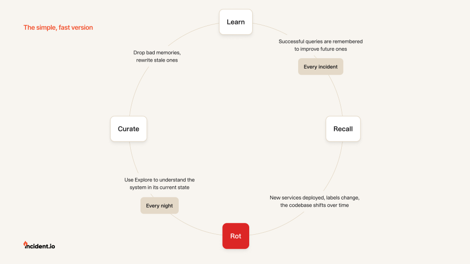

Martha Lambert · incident.io · 2026-10-01 · [原文](https://incident.io/blog/building-investigations-what-it-takes-to-build-an-ai-sre)

这篇来自 incident.io 产品工程师 Martha Lambert 的一线复盘，拆解了他们耗时约两年（从 2024 年 8 月工程师 Lisa 发起早期实验、2024 年 11 月首次成功诊断真实线上故障，到 2026 年成为生产级产品 *Investigations*）把 AI SRE 从“惊艳原型”打磨成值得值班团队深夜托付的生产系统时，水面之下真正棘手的四大工程难题。文章定位在帮准备做 **Build vs. Buy**（自研还是采购）决策的工程团队看清整座冰山：作者明确指出，在编码智能体普及的今天做出一个看似能查故障的原型很容易，但这往往是一场让你陷入数月全职维护的“原型陷阱”。

> **阅读边界说明**：本文是事件响应平台厂商基于自身生产演进的工程方法论复盘，而非中立对照实验。原文披露了回测分级尺度、状态模型演进、消息门控及夜间记忆清洗等关键机制，但未公布大规模盲测样本量、精确准确率基准表或端到端 MTTR 下降统计；文中所引原文示意图上的百分比（例如 `50%` 与 `100%`）也仅用于说明评估方法本身。

## 把评估做成“时间机器”：回测与上下文泄漏边界

在普通 AI 应用里，模型偶尔给出离谱回答或许无伤大雅；但在高优线上故障中，把值班工程师误导去错误排查方向 30 分钟，直接损耗客户信任与研发工时。因此 incident.io 将第一道防线放在可复现的离线评估——他们称之为一个事故“时间机器”（time machine）。

每一次修改提示词或替换单个节点背后的模型时，系统都不会只在 1 个样本上碰运气，而是在**整组（a whole set of）冻结在历史故障触发瞬间的样本**上重跑整个调查“大脑”（brain）。输出假设按真实值班工程师当年的处置结果做 4 档打分：

- **`100%`**：正中靶心（bullseye），直接命中真实根因；
- **`65%`**：距真实根因仅差一跳（one hop short）；
- **`35%`**：偏离方向（miss）；
- **`0%`**：完全风马牛不相及（a completely different universe）。

<figure>
  <a class="note-image-link" href="/assets/images/tech/building-ai-sre/evaluation.svg" target="_blank" rel="noopener">
    
    放大图解 ↗
  </a>
  <figcaption>原文配图（incident.io）：回测流程把历史故障“冻结在触发瞬间”，用完全相同的输入状态检验模型或提示词改动（图中 50% / 100% 为机制示例而非公布跑分）。</figcaption>
</figure>

把历史事故真正“冻结”精准，是回测里最容易自欺欺人的环节。系统必须拿到响应者刚收到告警时所能看到的一切原始信号，同时极其严格地切断所有事后才出现的信息——哪怕一点未来信息漏入上下文，都会造成“上下文投毒”（context poisoning），让模型看起来准确率虚高，实际只是在“作弊”。除时间线泄漏之外，原文还点出两个隐蔽的反向陷阱：一是某些远期链路追踪（traces）已过保留期限，导致重放输入天然缺数；二是回溯复盘时偶尔会发现，当年值班人类自己把根因归错了。

<figure>
  <a class="note-image-link" href="/assets/images/tech/building-ai-sre/context-poisoning.svg" target="_blank" rel="noopener">
    
    放大图解 ↗
  </a>
  <figcaption>原文配图（incident.io）：时间切分红线。线左的故障修复历史、致错 PR、告警、初始人工补充与遥测信号必须保留；线右的 AI 首报、人工定位结论、后续合入代码库的修复 PR 与事后复盘文档都必须彻底剥离。</figcaption>
</figure>

## 拆开引擎调参：Harness 循环与 Findings 五代状态模型

只有回测分数还不够——如果架构只是一坨把海量上下文硬塞给大模型的黑盒，看到低分也无从下手，甚至无法解释模型在声音“100% 笃定”时凭什么笃定、到底对哪个干扰信号过拟合了。incident.io 将整套围绕模型编排的控制框架称为 **harness**（作者透露它内部包含“数百条提示词与多个长周期运行进程”）。

如图解所示，一次调查被触发后并不会线性等待单一提示词作答，而是先横向并行扇出（fan out）去检索人类排障会翻找的各类数据源，将各自挖掘到的信息压缩归并成结构化的 **Findings（发现记录）**，再据此综合当前最可能的**假设（Hypothesis）**；紧接着，一个专门唱反调的**对抗式质疑 Agent**会全力尝试**证伪（Disprove it）**这条假设，随后带着未解疑问进入下一轮循环。

<figure>
  <a class="note-image-link" href="/assets/images/tech/building-ai-sre/harness.svg" target="_blank" rel="noopener">
    
    放大图解 ↗
  </a>
  <figcaption>原文配图（incident.io）：调查 Harness 主循环。先跨六大数据源并行取证，归并至“由证据支撑的 Findings”与当前假设，再经过独立质疑 Agent 的“尝试证伪”闭环后进入下一轮收敛。</figcaption>
</figure>

为了承接数百行日志、监控指标、文档片段与群聊上下文而不被模型带偏，**Findings** 数据模型本身在生产打磨中迭代了整整五代。每一代升级都不是凭空想出来的，而是被前一版暴露出的真实失败模式逼出来的：

| 演进代际 | 数据表示与机制设计 | 暴露的工程瓶颈或直接效果 |
| :--- | :--- | :--- |
| v1 · 长段落综述（An essay） | 让模型直接用自然语言撰写事故情况段落 | 模型极其擅长“自圆其说”，高频产生没有证据支撑的幻觉判断 |
| v2 · 结构化发现（Structured findings） | 按不同数据源分别抽取具体、结构化的信息条目 | 故障跨时间演进后，无法分辨模型第 3 次输出究竟是局势真变了，还是仅仅换了种措辞 |
| v3 · 带证据单一记录（Evidence-backed records） | 每条发现改为全过程唯一、持续更新的记录，显式保留增量变化并强制挂接具体日志行、文档或指标引用 | 解决了变化可视与溯源问题，但暴露了“锚定效应”——早先成立的结论哪怕后来失真也死不退场 |
| v4 · 可折抵发现（Discountable findings） | 当后续波次挖出反证时，允许对既有记录折抵降权或直接作废取消，模拟人类工程师随事实推进改主意 | 每次循环都全量重综合一次导致端到端延迟过高，拖慢首轮抢险节奏 |
| v5 · 按波次增量写入（Written in waves） | 每轮并行检索只将本波次的新发现增量（delta）写入动态记录库 | 成为当前基线：既保证首报速度与全链路证据外链，也令系统在证据不足时敢于表达不确定 |

<figure>
  <a class="note-image-link" href="/assets/images/tech/building-ai-sre/findings-evolution-zh.svg" target="_blank" rel="noopener">
    
    放大图解 ↗
  </a>
  <figcaption>阅读整理配图（非原文原图）：对照原文拆解 Findings 状态模型的五代演进链条，体现结构化状态如何取代整段散文并兼顾可证伪性与响应延迟。</figcaption>
</figure>

## 不被当成噪音关掉：Heads-up 通知门控与持续打分

就算系统准确、内部逻辑也可调，一旦工程师在实际事故频道里觉得这个机器人“很烦”，一切都会归零。作者指出一个刺痛的现实：当下研发每天都在面对大量 AI 文本，只要某次播报啰嗦、抓错时机或像在刷存在感，哪怕 **80% 的时间有价值，剩下 20% 的噪音也会迅速透支信任**；一旦被贴上“不用看”的标签，就几乎不可能把用户赢回来。

由于值班工程师在激烈排障时不会不停向上翻屏重读不断改写的顶层假设总结，Investigations 选择在发现关键信息时主动在 Slack 事故频道里发送 **heads-up（关键提醒）**。为了让这一条消息发出来真的有用，系统在开口前叠加了三层门控，每一层几乎都是被一条条“当年看着就很讨厌的坏消息”倒逼出来的：

1. **机械规则检查（Mechanical checks）**：这场事故还在进行中吗？有没有别的并发任务马上也要发同一条消息？当前证据的信念度（conviction）够不够过门槛？
2. **上下文语境判断（Vibe checks）**：即使技术条件全满足，如果人类响应者已经在频道里激烈讨论这个点了，或者现场其实已经稳住了，这时候机器人跳出来“附和一遍”就只是装饰性噪音而非增量信号，必须忍住不发。
3. **语气、长度与证据校准**：把措辞里的肯定程度严格对齐底层证据强度；极度精简长度以适配高压频道节奏；明确标出“相比上一次更新发生了什么新变化”；附带原始链接和趋势图供一线工程师随时顺藤摸瓜。

作者分享了一个体现“高信号提醒”价值的真实经历：在一次免费版用户滥用漏洞向布隆迪（Burundi）疯狂发送高额短信资费的故障中，团队刚封禁掉肇事组织并准备收尾，Investigations 在几分钟内就在频道弹出提示——**另一个刚刚新注册的组织正在以完全相同的手法发起同样的短信攻击**。这直接避免了值班人员在以为危机解除后漏掉接踵而至的二次爆发。

同样地，incident.io 也对每一条发出过的 heads-up 用 LLM 做持续评估，主要考核两个维度：**新颖性（Novelty：是否在告诉大家尚未知道的新情况）**和**准确性（Accuracy：陈述是否站得住脚）**，并在每次模型或提示词升级后用这组曲线确认系统“有没有变得更讨厌”（原文一并展示了包含 Novelty、Accuracy 与 Signal 的趋势示例图，但未披露打分样本集规模与具体阈值规则）。

## 随组织演化而不腐化：遥测可视化、落地阻力与 Explore

跨过准确率与有用性门槛后，真正的持久化考验才刚刚开始：组织天天都在高速变化（尤其团队普遍引入 AI 辅助编码后），昨天能用的上下文今天就会过期。哪怕只是重命名了一个微服务，或是某条日志格式微调，智能体多久之后才能意识到？Demo 里跑通的方案一旦丢进拥有数千个代码仓库、每个小团队自成一套可观测性栈的真实企业里，立刻会撞上层层现实壁垒。

首先是**遥测信号的“读图化”改造**。直接让模型吞吐原始 Prometheus 响应的巨大数字 JSON 数组，既容易错读也难以直观看清波峰波谷；incident.io 选择把“与人类一样做图看趋势”的思路给到多模态 LLM：每次查完监控，除整理“问了什么问题、为何要问、最小/最大值摘要统计”之外，还**直接把指标画成折线图传给模型看**——因为让视觉语言模型在一张图里认出突发尖峰，远比从一串浮点数数组里数出来更可靠。

紧接着，把产品推广到真实组织时通常会按极其固定的先后顺序遭到四个部门的“轮番质疑”：

- **第一关 · 财务团队（Finance）**：账单预警——Token 消耗失控，且找不到手段约束 Agent 一轮最多发起多少次、每次拉多大的查询。
- **第二关 · 可观测性团队（Observability）**：流量告警——自动查询把 Grafana 压垮了，导致正在一线救火的真人工程师自己查不出图。
- **第三关 · 一线研发（Engineers）**：信任质疑——“你告诉我这个查询结果有启发，但没附能点开的直达链接和趋势图，我怎么敢信？”
- **第四关 · 安全团队（Security）**：数据合规——开始追问被 Agent 读出来的海量生产日志究竟缓存在哪里、存了多久。

最后也是最微妙的问题在于**系统记忆如何对抗组织腐化（Memory Rot）**。在首次接入数据源时，Investigations 会主动读取指标标签（labels）、字段结构以及团队现有的高频监控看板，自动整理出初始化指引文档（guidance），并在背后构建一个覆盖历史故障、服务系统与团队归属的实时生产环境模型 **Nexus**。当智能体在一次调查中查出一条奏效的查询语句时，它会将这条查询经验存成“记忆”供日后复用。

但生产环境是活的：服务一旦改名或字段格式变迁，昨天百发百中的一条记忆今天再召回，就会**把调查引入歧途（start lying to you）**。为此团队设计了名为 **Explore** 的夜间自清洁机制——每天夜里自动拉出近期真实事故，对照现有记忆和指引重新回放验证，重写发生漂移（drifted）的陈旧规则，并**主动遗忘**已经彻底失效的错误记忆，使知识库在无需工程师事事人工报备的前提下次日自动跟上代码与架构的演变。

这种以验证闭环为底线的工程纪律也延伸到了客户侧定制能力（custom skills）：在用户将自定义技能推向线上值班之前，平台会先用历史事故库预演一遍它的效果；上线之后则持续在看板上逐次评估每次真实调用究竟是在帮倒忙还是在提升诊断质量。

<figure>
  <a class="note-image-link" href="/assets/images/tech/building-ai-sre/explore-memory.svg" target="_blank" rel="noopener">
    
    放大图解 ↗
  </a>
  <figcaption>原文配图（incident.io）：应对组织演化的夜间记忆闭环。成功查询会沉淀为长期记忆（Learn → Recall），但服务重命名和代码库变动会导致其腐化失真（Rot），需要 Explore 每晚回溯近期事故做清理、重写与主动遗忘（Curate）。</figcaption>
</figure>

---

> **AI 辅助整理 · 归档注记**：本篇中文解读由助手对照 Martha Lambert 原文完整重编，原文配图保留 incident.io 原始矢量图四幅，唯《Findings 五代演进》系基于原文工程叙述绘制的中文/英文双语 `v3-blue` 说明图以辅助结构对比，英文配套版见 [`building-ai-sre` (EN)](/tech/en/building-ai-sre/)。正如原文结语所提醒的，调用大模型今天早已不再是门槛——真正拉高 AI SRE 生产护城河的，是用冻结时间轴上的回测检验每一步改动、让对抗 Agent 在按波次写入的可证伪状态上挑错、用三层门控管住不该发出的提醒，并依靠每晚主动清洗和遗忘陈旧经验的记忆体系防止系统随着组织变迁而悄悄腐坏。
