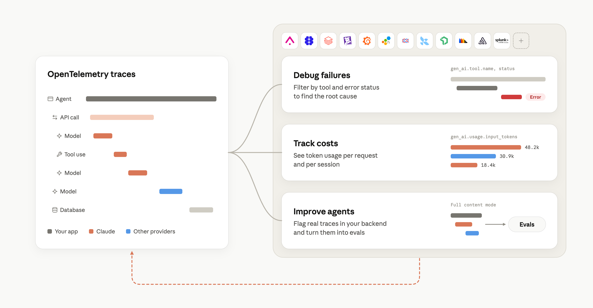
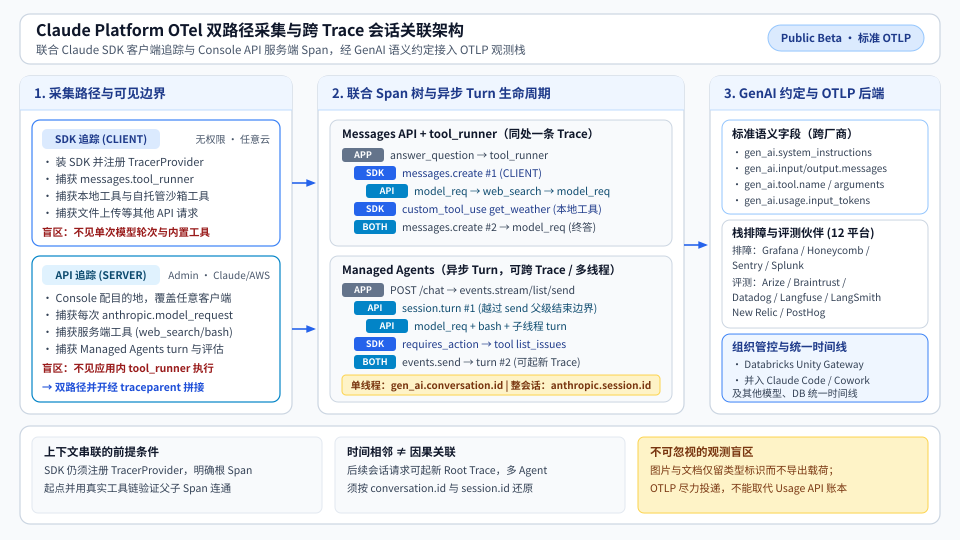
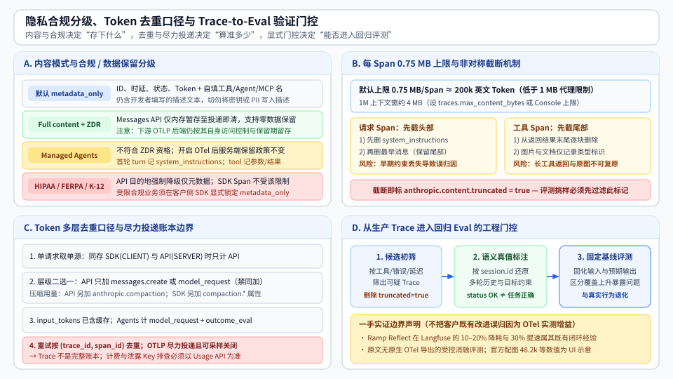

Anthropic（Claude Platform）· 2026-10-14 · [官方发布公告](https://claude.com/resources/articles/agent-observability-on-the-claude-platform)（约 3 分钟阅读）· [配套工程文档：OpenTelemetry for the Claude API](https://platform.claude.com/docs/en/manage-claude/opentelemetry)（Beta）

一次生产级 Agent 任务通常会横跨应用业务逻辑、多次 Messages API 往返、模型自带的服务端工具（如 `web_search`、`bash`）、客户端本地工具（`tool_runner` 或自托管沙箱），以及 Managed Agents 的异步多轮与子线程调度。仅靠“HTTP 200 与总耗时”无法回答三个真实排障问题：哪一步拖慢了尾部延迟、哪一次提示或工具参数引发了语义偏移、以及同一段调用树里究竟消耗了多少不重复的 token。2026 年 10 月 14 日，Anthropic 宣布为 **Claude Managed Agents**、**Messages API** 与 **Claude SDKs** 推出原生 **OpenTelemetry（OTel）** 追踪导出（**Public Beta**，遵循服务特定条款中的 Beta Services 条款），试图用标准 **OTLP** 接口和 **GenAI semantic conventions** 把模型执行过程接回团队现有的可观测性与评测栈。

> **信源与实证口径边界**：本文逐项核对上述两份冻存一手文献（2026-10-14 官方公告及配套 *OpenTelemetry for the Claude API* 技术文档）重写。两份来源均属于**架构说明、Span Schema 规范与四段客户实践引言**（Foxglove、Ramp、Sterling Labs 及基础设施负责人 Ankush Sharma），**未提供任何隔离对比原生 OTel 导出前后的受控性能基准、MTTR 降幅实验或故障定位准确率评测**。文中出现的 Ramp *Reflect* “部分 Agent 降低 10–20% token 用量、session 提速 30%”属于客户在现有 Langfuse 闭环中的既得经验，不能直接归因为 Claude 原生 OTel 导出的独立因果效果；官方架构图右侧出现的 `48.2k`、`30.9k`、`18.4k` 数值亦为界面示意样本。下文中超出文档明文规定的工程取舍与采样门控建议，均已明确标注为基于文档机理的工程推导。

## 双路径采集架构：SDK 与 API Span 分工及异步 Session 关联

理解 Claude Platform OTel 接入的第一原则，是拆穿“SDK 自动导出等于开箱看全貌”的简化印象。官方公告将采集入口概括为“Managed Agents 与 Messages API 在 Claude Console 配置目的地，Claude SDK 自动导出”；但配套技术文档明确把执行遥测拆成了两条职责互补、且必须通过 W3C `traceparent` 上下文串联的采集路径。

- **客户端 SDK 追踪（SDK tracing）**：在应用内安装 Claude SDK 并显式注册一个 OTel `TracerProvider`（无需 Console 管理员权限，不限定托管云环境）。它向后端发出 `CLIENT` 侧 Span，核心补齐 **应用侧视野**——包括 `anthropic.messages.tool_runner`、`anthropic.custom_tool_use`（本地自定义工具）、自托管沙箱工具，以及文件上传等非 Messages/Sessions 接口请求。它的盲区在于**看不到 API 内部每次单独的模型推理轮次、服务端内置工具（`web_search` / `bash`）和 Managed Agents 的 turn 调度**。
- **服务端 API 追踪（API tracing）**：由管理员在 Claude Console 配置 OTLP 导出目的地（覆盖任意客户端，无论调用方是否使用官方 SDK；云平台支持标注为 **Claude Platform** 与 **Claude Platform on AWS**）。它发出 `SERVER` 侧 Span，拆开每一次 `anthropic.model_request`、服务端工具调用、MCP 连接器工具以及 Managed Agents 的 `anthropic.session.turn` 与 `anthropic.session.outcome_evaluation`。它的盲区则是**看不到在客户进程里跑完再送回结果的本地 `tool_runner` 与自托管沙箱执行**。

<figure class="note-figure"><a class="note-image-link" href="/assets/images/tech/claude-agent-observability/28fe34519808d40faa51162351234a3790230860.png" target="_blank" rel="noopener" aria-label="查看 Anthropic 官方公告原图：OTel 轨迹连接多提供方步骤、故障排障、成本跟踪与 Evals 闭环">点击放大 ↗</a><figcaption>保留官方原图（出自 Anthropic 2026-10-14 公告）：展示应用自研步骤、Claude 模型与工具调用、其他模型提供方同处一条 OTel 时间线，并指向排障、成本分析与 Evals 闭环；图中 48.2k 等数字为产品界面示意而非实测基准。</figcaption></figure>

文档给出的两份参考轨迹精准揭示了“仅开一边”和“双路径并开（Both together）”的工程差异：

1. **Messages API 与 `tool_runner` 的双跳串联（同一条 Trace）**：应用根 Span `answer_question` 启动 SDK 的 `anthropic.messages.tool_runner`，后者发起第一条 `anthropic.messages.create`（SDK `CLIENT`）。若仅开 SDK，这条请求只是一条单柱；只有同时开启 API 追踪，它下方才会展开服务端 `anthropic.messages.create`（API `SERVER`），并在内部继续拆出“第一次 `anthropic.model_request` → 服务端工具 `anthropic.tool_use web_search` → 第二次 `anthropic.model_request`（决定调用本地工具 `get_weather`）”。随后控制权回到客户端，`tool_runner` 在本地发出 `anthropic.custom_tool_use get_weather`，再发起第二条 `anthropic.messages.create`（`CLIENT` → `SERVER` → `anthropic.model_request`）得出终答。此外，公告还强调平台级 OTel 会与团队已接入的 **Claude Code**、**Cowork** 轨迹汇入同一套可观测工具。
2. **Managed Agents 的异步生命周期（越出父 Span、可跨多 Trace 与多线程）**：在官方文档的 `POST /chat` 示例中，应用通过 SDK 的 `anthropic.sessions.events.stream` 与 `list` 监听会话流，再通过 `anthropic.sessions.events.send`（`CLIENT` → `SERVER`）投递用户消息。服务端随即开启 `anthropic.session.turn`——**关键特征在于这个 `turn` Span 在 `send` 即将结束时启动，并一直运行到远超其父 Span `send` 结束之后**。Turn 内部串联 `anthropic.model_request`、`anthropic.tool_use bash`（`gen_ai.tool.name = bash`），甚至嵌套另一个线程上的 `anthropic.session.turn`，直到模型因需要本地执行自定义工具 `list_issues` 而以 `stop_reason = requires_action` 终止本轮；客户侧 SDK 执行 `list_issues` 后再次调用 `sessions.events.send`，拉起第二轮 `anthropic.session.turn`。

正因为 Managed Agents 的后续请求可以从**全新的根 Trace** 发起，且开启 `multiagent` 后单次会话会存在**多条并发线程**，官方文档明确给出了两条聚合键**：用 `gen_ai.conversation.id` 聚合单条线程（含线程 ID）并按开始时间排序复原对话剧本；用 `anthropic.session.id` 跨多条 Trace 聚合完整 Session 的全部线程**。按时间邻近把离散请求强行拼成因果链，往往会把无关并发会话或漏掉前置上下文的子线程混为一谈。

<figure class="note-figure"><a class="note-image-link" href="/assets/images/tech/claude-agent-observability/claude-otel-telemetry-pipeline-zh.svg" target="_blank" rel="noopener" aria-label="放大查看 Claude Platform OTel 双路径采集与跨 Trace 会话关联架构图">点击放大 ↗</a><figcaption>阅读整理配图（非原文配图）：对照 SDK 客户端追踪与 Console API 服务端追踪的覆盖分工、Messages API 与 Managed Agents 的异步 Span 结构及 OTLP 输出边界。</figcaption></figure>

## OTel GenAI 语义约定与双路径能力对照

为了避免团队把某一家模型厂商的专有字段硬编码进告警和看板，Claude Platform 的 Span 尽量对齐 **OpenTelemetry GenAI semantic conventions**，只在语义约定尚未覆盖的平台概念上补充 `anthropic.*` 命名空间。例如在通用维度上使用 `gen_ai.system_instructions`、`gen_ai.input.messages`、`gen_ai.output.messages`、`gen_ai.tool.name`、`gen_ai.tool.call.arguments`、`gen_ai.conversation.id` 与 `gen_ai.usage.input_tokens`；在平台特有维度上补充 `anthropic.session.id`（跨 Trace 会话聚合）、`anthropic.tool_result.content`（工具输出内容）、`anthropic.content.truncated`（载荷超限截断标记）以及 `anthropic.usage.compaction.*`（上下文压缩专用用量）。

基于这一标准化语义层，官方公告与文档列出了 **12 家命名 OTLP 合作平台**（以及任意接受标准 OTLP 端点的自建或第三方后端），并按工程场景拆成三条明确工作流：

- **与全栈应用同台排障**：**Grafana Cloud、Honeycomb、Sentry、Splunk**——把模型调用与数据库查询、微服务慢请求放在同一张瀑布图上，区分究竟是模型生成慢，还是外部工具和下游依赖拖垮了端到端体验。
- **把真实流量转化为评测与迭代**：**Arize AI、Braintrust、Datadog、Langfuse、LangSmith（LangChain）、New Relic、PostHog**——借助标准属性筛选异常工具调用与语义退化样本，在产品使用数据与模型行为之间建立归因分析。
- **跨团队用量治理与异常审计**：**Databricks Unity Gateway**——面向平台与安全团队，按组织维度追踪 token 消耗并标记异常活动（前提仍受下文所述的尽力投递边界约束）。

| 能力维度 / Span 类型 | 仅开启 SDK 追踪 (`CLIENT`) | 仅开启 API 追踪 (`SERVER`) | 双路径同时开启 (`Both`) | 关键语义属性 / 运维前提 |
| :--- | :--- | :--- | :--- | :--- |
| **Messages API 与 Sessions API 请求** | 支持 | 支持 | 支持（含客户端与服务端父子对） | `anthropic.messages.create` 通过 Span `kind` 区分 `CLIENT` 与 `SERVER` |
| **Token 基础用量统计** | 支持 | 支持 | 支持（需按单来源去重汇总） | `gen_ai.usage.input_tokens` 已包含缓存读写 token；勿重复累加 |
| **单请求内逐次模型推理** | **不支持** | 支持 | 支持 | `anthropic.model_request` 暴露服务端多步推理拆解 |
| **Managed Agents Turn 与结果评估** | **不支持** | 支持 | 支持 | `anthropic.session.turn` 与 `anthropic.session.outcome_evaluation` |
| **服务端内置工具与 MCP 连接器工具** | **不支持** | 支持 | 支持 | 如 `anthropic.tool_use web_search`、`bash`（`gen_ai.tool.name`） |
| **客户端本地 `tool_runner` 与自托管沙箱** | 支持 | **不支持** | 支持 | `anthropic.messages.tool_runner`、`anthropic.custom_tool_use` |
| **文件上传等其他 API 请求** | 支持 | **不支持** | 支持 | 仅 SDK 客户端发起路径可观测到上传等周边请求 |
| **接入权限与云平台覆盖范围** | 无权限要求；任意云环境；仅限使用 SDK 的客户端 | 需 Console Admin；任意客户端；支持 Claude Platform 及 on AWS | 需代码注册 `TracerProvider` 且 Admin 配目的地 | W3C `traceparent` 上下文传播负责把两侧 Span 缝进同一条 Trace |

## 内容模式分级、合规脱敏边界与 0.75 MB 截断机制

一旦把生产 Agent 的轨迹送入第三方可观测平台，首要矛盾就从“看不见”变成“哪些内容绝对不能落盘到外部分析系统”。Claude Platform 在每个 Console 导出目的地与每个 SDK 客户端实例上提供两级 **Content modes（内容模式）**，但工程团队若只记住“默认不传对话正文”，很容易忽略两条文档中明确写出的微妙泄漏与合规差异。

1. **默认 `metadata_only` 模式并非“零文本”**：在默认的 **Metadata only**（SDK 中为 `metadata_only`）下，Span 不包含模型输入提示与模型回复，但**依然包含标识、耗时、状态、token 计数以及“应用主动提供的选择性文本”——文档明文点出这包括 Agent 名称与描述、工具名称与描述以及 MCP 服务器名称**。换言之，如果业务代码动态拼装包含租户名称、内部表名或用户提示片段的 Tool Description 或 Agent Name，即便全程维持 `metadata_only`，这些文本依然会被原样导出。
2. **`Full content` 模式（SDK 中为 `content`）的精确落点**：开启完整内容后，Messages API 把系统指令放入 `gen_ai.system_instructions`、请求消息放入 `gen_ai.input.messages`、模型输出放入 `gen_ai.output.messages`。而在 Managed Agents 中，`gen_ai.system_instructions` 只记录在某条线程的**首个 turn Span** 上；`gen_ai.input.messages` 涵盖用户消息、工具结果、`system.message` 事件及跨线程消息；`gen_ai.output.messages` 涵盖 Agent 消息、工具调用与工具结果；具体 `tool` Span 则额外持有 `gen_ai.tool.call.arguments` 与 `anthropic.tool_result.content`。

在企业合规与数据保留（Data Retention）层面上，官方文档划出了四条必须逐一对齐的硬边界：

- **下游保留控制权移交**：一旦导出完成，可观测平台依据**其自身的访问控制与保留周期策略**存储轨迹数据，Anthropic 侧策略不再覆盖外部 OTLP 后端。
- **HIPAA、FERPA 与 K-12 限制的“服务端强制降级”与“SDK 豁免差”**：若组织与 Anthropic 之间签有 HIPAA、FERPA 或 K-12 数据处理限制，Console 端的 API 导出目的地**无论配置为何都会强制只导出元数据（metadata only）**；然而文档紧接着明确提醒**：SDK Span 不受此限制影响（SDK spans aren't affected）**。这是因为 SDK 在客户自身应用进程内运行并直连 OTLP 后端——如果研发人员本地把 SDK 配成了 `content` 模式，受监管的原始对话依然会从应用进程直接流出到外部平台。
- **Zero Data Retention（ZDR）的适用分水岭**：对于 **Messages API** 请求，即便签有 ZDR，团队依然可以使用 `Full content` 模式，因为 API 仅在**内存中**暂存待导出内容，直到交付给 OTLP 目的地后即释放；但 **Claude Managed Agents 不符合 ZDR 资格**，其既有的数据保留策略不会因为开启 OpenTelemetry 而变成零留存。

即便完全允许导出 `Full content`，轨迹还原也受制于 **每 Span 默认 0.75 MB 的载荷上限**。文档解释该默认阈值按英语文本估算可容纳约 **200k-token** 上下文，同时留出余量以避开多数观测平台与网络代理常见的 **1 MB 单请求体限制**（若 Console 中选择了官方合作平台 Preset，会自动套用对方可接受的上限；若业务跑在 `1M`-token 超长窗口且下游支持更大载荷，需在 SDK 设置 `traces.max_content_bytes` 或在 Console 的 `Advanced settings` 调整 `Maximum content size in MB` 至约 **4 MB**）。

更值得警惕的是超限触发的**非对称截断规则（`anthropic.content.truncated = true`）**：

- **请求 Span 从“头部”删起**：优先丢弃 `gen_ai.system_instructions`（系统提示词）以及**最早期的对话消息**，尽可能保住靠近末尾的最新轮次；
- **工具 Span 从“尾部”删起**：从工具返回结果末尾逐块裁剪；
- **多模态文件只记类型**：图像与文档在 Span 中**只显示类型标识**，绝不会携带原始图像或 PDF 载荷。

从诊断可靠性的角度推导（基于文档截断机理的工程推断）：这种“保尾丢头”的请求截断极易在评测中制造假根因——当决定任务约束的早期系统提示或前几轮前置条件被静默切掉后，审查人员仅凭保留下来的尾部对话，很容易误判为“模型无缘由地违背了指令”。因此，任何把生产 Trace 自动筛选为评测集或故障案例的流水线，都必须把 `anthropic.content.truncated` 作为一等过滤条件，并明确标注多模态与超长工具返回案例的上下文残缺风险。

<figure class="note-figure"><a class="note-image-link" href="/assets/images/tech/claude-agent-observability/privacy-tiering-eval-loop-zh.svg" target="_blank" rel="noopener" aria-label="放大查看隐私合规分级、Token 去重口径与 Trace-to-Eval 验证门控图">点击放大 ↗</a><figcaption>阅读整理配图（非原文配图）：将官方文档中的内容模式与合规豁免差、0.75 MB 截断机制、Token 去重规则及 Trace-to-Eval 验证门控统一映射到可执行的工程检查点。</figcaption></figure>

## Token 去重、尽力投递边界与从 Trace 到 Eval 的工程闭环

许多团队接通 OTel 后遇到的第一个“数据惊吓”，就是直接对 Trace 树里所有节点的 token 属性求和，算出远高于月度账单的虚高成本。官方文档专门辟出 *Counting tokens* 一节拆解多层重复原因，并给出四条严格的去重口径：

1. **同一请求先选单一来源**：由于同一条 `anthropic.messages.create` 请求可以同时发出 SDK 层的 `CLIENT` Span 与 API 层的 `SERVER` Span，且两者都会附带用量字段，统计时每次请求**只能取一个来源**；两者并存时官方建议**采用 API（`SERVER`）侧 Span**（注意若 SDK 配置了 fallback 模型，Span 只记录最终实际响应模型的用量）。
2. **同一来源内部层级互斥（Forbidden Double-Sum）**：若采用 **API Span 统计 Messages API 请求**，只能累加 `anthropic.messages.create`（`SERVER`）或累加其子 Span `anthropic.model_request`——**绝不能两者相加**；若发生上下文压缩（compaction），需再累加 `anthropic.compaction` 子 Span，同时**禁止**再加父 Span `anthropic.messages.create` 上的 `anthropic.usage.compaction.*` 属性（两者装的是同一批 token）。相反，若只开启 **SDK Span**，则累加 `anthropic.messages.create`（`CLIENT`）并显式加上 `anthropic.usage.compaction.input_tokens` 与 `output_tokens`（因为标准 `gen_ai.usage.*` 不包含压缩 token）。对于 **Managed Agents**，统计口径则是累加 `anthropic.model_request` 与 `anthropic.session.outcome_evaluation` 两类 Span。
3. **缓存与投递重试去重**：`gen_ai.usage.input_tokens` **已经包含了从 prompt cache 读取及写入的 token 数**，切勿把缓存命中或写入属性再次加到输入 token 上；此外，导出链路重试可能产生重复 Span，若后端不会自动清洗，必须按 `(trace_id, span_id)` 联合去重。
4. **尽力投递（Best-Effort）与 `traceparent` 采样开关红线**：这是最容易被忽视的系统边界——OTel Span 导出是 **best effort（尽力投递）**，网络抖动或背压下 Span 可能丢失；同时调用方可以通过在请求头 `traceparent` 中关闭 `sampled` 标志来跳过该次请求的 Span 导出。因此，**OTel Trace 从来不是完整的用量与安全账本**；需要按 API key 精确核对费用或排查密钥是否泄露（leaked key）时，文档明确要求改用 **Usage API**，后者会把没有任何 Span 的请求也完整计入。

在价值落地层，公告通过四家客户的实际使用给出了从“看见轨迹”到“持续改进”的真实图景，同时保持了克制的归因边界：

- **Foxglove（Roman Shtylman，Co-Founder & CTO）**：将机器人调试 Agent 的原生 OTel 轨迹接入 **PostHog**，与产品交互埋点并排分析，用来评估实际使用表现、定位薄弱环节并排出迭代优先级。
- **Ramp（David Traina，Senior Software Engineer）**：内部构建了名为 **Reflect** 的智能体改进系统，自动给 **Langfuse** 里的 Agent 轨迹打分、聚类反复出现的失败模式并生成修复建议，此前已在部分 Agent 上实现 **token 用量下降 10–20%、session 耗时缩短 30%**；但正如 David Traina 原话所界定，Reflect 只能改进它看得到的环节，Claude API 原生 OTel 导出的角色是“无需额外接线就把高保真遥测直接喂入这套既有闭环”。
- **Sterling Labs（Hyon Lee，CTO）**：将 7×24 小时实时市场分析 Agent 的轨迹直接流式送入 **Langfuse**（比作赛车的维修区指挥台 pit wall），省去自建埋点管道的时间以专注于模型与交易边界调优。
- **财务合规场景（Ankush Sharma，Head of Infrastructure）**：负责记账与对账的 Agent 必须像人类会计一样“留痕佐证”；将 Claude Platform 轨迹送入 **Grafana Cloud** 后，prompt 版本、工具调用、时延与 token 花费会跟底层对账工作流落进同一条时间线，直接回应审计师“Agent 做了什么、为什么这么做”的核查。

基于文档的采集机制与上述客户闭环，团队把生产 Trace 转成回归 Eval 时还必须补齐最后两道非自动化工程门控（助理工程推导）：第一，**状态正常不等于语义正确**——工具返回 `OK` 或模型无报错结束，不代表结果满足用户约束，仍需结合完整输入上下文与业务规则贴标，且须过滤掉 `anthropic.content.truncated = true` 或缺少 `anthropic.session.id` 前序轮次的残缺样本；第二，**警惕“可观测性覆盖率幻觉”**——同时打开 SDK + API 或切入 `Full content` 后，过去隐藏的局部工具重试或子线程异常会首次浮出水面，使短期错误数看似攀升，这代表**观测变清晰而非系统突然退化**，发布前后的可靠性对比必须固定在相同的采集路径、内容留存条件和案例定义之上。

| 关键机制 / 实证项 | 冻存一手原文的精确口径 | 工程实践中常见误读 | 上线核对与使用边界 |
| :--- | :--- | :--- | :--- |
| **内容模式与隐私边界** | 默认 `metadata_only` 仍发 Agent/工具/MCP 名称与描述；HIPAA/FERPA/K-12 仅强制降级 Console API 目的地，SDK 不受影响 | 误以为默认模式绝不外发应用文本，或签了合规协议就高枕无忧 | 严禁把 PII 或密钥写入工具描述；受限业务须在 SDK 显式锁定 `metadata_only` |
| **ZDR（零数据保留）兼容性** | Messages API 开 `Full content` 时仅内存暂存至投递；Managed Agents 不符合 ZDR 资格且保留期不变 | 误以为整个平台开 OTel 都受 ZDR 保护，或忽略下游 OTLP 后端存储策略 | 核对下游观测平台保留期与 ACL；涉敏 ZDR 业务勿把长留存会话切入不兼容路径 |
| **0.75 MB 截断与多模态** | 超限标 `anthropic.content.truncated = true`；请求从系统提示与最早消息删起，工具从末尾删；图片/文档仅留类型 | 把尾部截断后的错误归因当成“模型无视早期指令”；误以为能从 Trace 重放图片 PDF | 选样本进 Eval 时排除截断 Trace；`1M` 上下文需按需放宽至约 `4 MB` 并核对代理限制 |
| **Token 去重与账本红线** | 同请求优先 API（`SERVER`）；`create` 与 `model_request` 二选一；`input_tokens` 含缓存；OTLP 尽力投递且可采样关闭 | 对整棵 Trace 树直接求和导致费用翻倍；用 OTel 追踪泄露 API key 或做财务对账 | 按 `(trace_id, span_id)` 去重并隔离层级；完整用量与安全审计一律以 Usage API 为准 |
| **客户增益与图示数字边界** | Ramp *Reflect*（`10–20%` token 下降、`30%` 提速）属既有系统在部分 Agent 的结果；官方图 `48.2k/30.9k/18.4k` 为 UI 示意 | 将 Ramp 既有闭环成效宣传为“接入 Claude 原生 OTel 即可立降三成时延”的受控实测 | 公告与文档无原生 OTel 导出的受控消融评测；上线前须以固定采集口径自建对比基线 |

---

### 参考来源与一手核对链接

- 官方发布公告：Anthropic, *[Agent observability on the Claude Platform](https://claude.com/resources/articles/agent-observability-on-the-claude-platform)*, 2026-10-14（Public Beta，包含 Foxglove、Ramp、Sterling Labs 与 Ankush Sharma 四段客户引言及概览配图）。
- 配套官方文档：Anthropic, *[OpenTelemetry for the Claude API](https://platform.claude.com/docs/en/manage-claude/opentelemetry)*（Admin → OpenTelemetry Beta，包含 SDK/API 覆盖矩阵、Content modes、HIPAA/FERPA/K-12 与 ZDR 说明、0.75 MB 截断规则、Messages API 与 Managed Agents 轨迹示例、Token 统计去重及 Usage API 边界；文档内另按篇名索引 *OpenTelemetry span reference*、*Token usage*、*Usage API*、*Claude Code monitoring*、*Agent SDK observability* 与 *Cowork activity monitoring*）。

> **AI 辅助整理 · 归档注记**：本篇中文深度解析与配套英文版（[English note](/tech/en/claude-agent-observability/)）由助手对照冻存官方公告原文及 *OpenTelemetry for the Claude API* 冻存技术文档逐项核对重写，保留原 `id`、`date: '2026-10-14'`、`permalink`、`published_at` 与 `source_url` 元数据，保留原始官方配图 `28fe34519808d40faa51162351234a3790230860.png`，并新增助手绘制的两幅 `v3-blue` 架构与边界图解（`claude-otel-telemetry-pipeline-zh.svg`、`privacy-tiering-eval-loop-zh.svg`）。全篇仅链接已核验的一手网址，将客户既有改进经验与官方原生 OTel 导出的架构能力严格区分，未外推未测性能结论。
