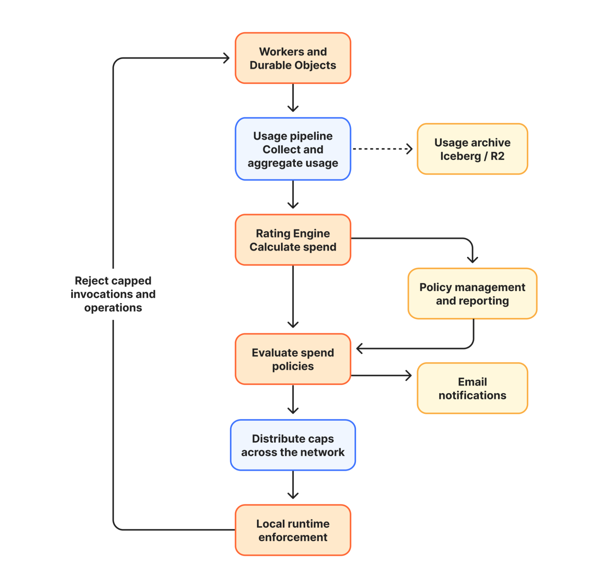

当一个 Worker 收到请求时，执行节点可以立即计量这次调用，却未必知道整个账户在本账期已经花了多少钱。CPU 时间、请求数和存储操作有不同的计价单位，账户还可能有套餐额度。Cloudflare 为按量付费用户上线的 Spend Management Beta 从 Workers 和 Durable Objects 开始，让用户在触及阈值时收到通知或暂停产品。这里最难的步骤发生在发出账单之前：怎样把分散到达的用量及时变成全球节点都能执行的决定？

## 两次聚合各自消除哪一种重复工作

如果把每次执行的原始事件一路送到计价引擎，下游需要为大量相同账户、相同计量维度的小记录反复做同样的归并。第一级在解析原始事件时就把它转换为用量，通常在一分钟窗口内合并匹配记录。解析器彼此独立，因此同一账户同一时间段仍可能留下好几份局部小计。

第二级用相同的分组规则合并这些局部结果，窗口通常是五分钟。合并后的数据另存档，日后分析或对账能回到这层记录。Usage Engine 再把不同产品的计量映射为统一记录，包括账户、窗口、指标、数量和相关维度。这个顺序让计价器看到可以相加的数量，也保留了核算所需的产品差异。代价是一次刚发生的请求需要等待窗口推进，支出读数天生有延迟。

<a class="note-image-link" href="/assets/images/tech/cloudflare-spend-management-metering-pipeline/cloudflare-spend-management-metering-pipeline.png" target="_blank" rel="noopener" aria-label="从请求产生用量开始，沿计量、计价和策略传播走一遍，终点是节点本地执行上限。 查看原图 ↗">查看原图 ↗</a>

*从请求产生用量开始，沿计量、计价和策略传播走一遍，终点是节点本地执行上限。*

## 用量先到、订阅后到，不能把未定价误计为免费

系统按账户分区，使同一账户的累计用量和订阅信息在同一处理位置相遇。这样，账户是否已耗尽包含额度，可以在本地判断。分区维护快速访问的本地状态，同时把变更写入持久的预写日志；处理器发生故障时，替代实例可以据此重建进度。这里解决的是状态恢复，与上一级为对账而归档的聚合记录用途不同。

订阅变更与用量来自两条独立数据流。一次 webhook 失败就可能让用量先到，却没有足够信息定价。Rating Engine 将其置为 pending，待信息齐全再处理。以 CPU 毫秒为例，同样的一百万毫秒，在套餐尚有额度时与用尽之后对应不同费用。引擎依据目录中的费率、额度和舍入规则对累计用量计价，避免每次调用单独舍入。账期起点也和订阅生效有关，月中开通的账户不宜用自然月去对照仪表盘。

## 达到上限之后，还有一次异步传播

计价结果触发策略后，策略服务把上限状态送到运行时配置服务，经 Quicksilver 异步复制。各节点定期刷新后，才在本地拒绝受限调用。正常请求无需等待中央计价引擎，边缘执行由此保留了本地判定的延迟特性；与此同时，聚合、计价、复制和刷新之间仍有时间窗。流量突然上升时，不能把界面上的阈值理解为每次请求都同步检查余额。

文章给出的当前量级是不到十分钟的近实时更新；缩短到一分钟以内属于后续目标。现阶段控制粒度是受支持产品，按应用或单个智能体任务分摊支出的标签也在规划中。对于一次因支出异常而暂停的服务，读懂这条链路有助于区分三个时刻：产生费用、累计费用越线，以及具体节点开始执行限制。

Celso Martinho, Sid Chatterjee, Brendan Irvine-Broque, Zunayed Ali, André Cruz · 2026-11-13 · [Introducing Spend Management: Spending limits and alerts for Cloudflare](https://blog.cloudflare.com/spend-management/)
