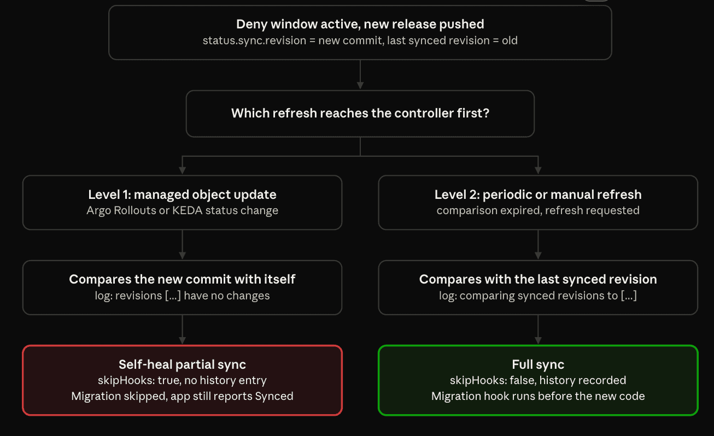

同一提交发往五个区域，三个区域跑了数据库迁移，另外两个却让新代码对着旧表结构运行了 36–44 分钟。Afzal Ansari 在 CNCF 的复盘给出一个定位这个问题的线索：展开成功操作，看控制器实际选择了哪些资源。两个出错区域都列出 13 个特定资源，且带有一次 self-heal 尝试。界面上的 Synced 和 Healthy 正确描述了这些已应用的资源，却无法回答迁移 Job 是否执行。

Afzal Ansari · 2026-11-20 · [When a sync window closes: How Argo CD self-heal skipped the migration hook](https://www.cncf.io/blog/2026/11/20/when-a-sync-window-closes-how-argo-cd-self-heal-skipped-the-migration-hook/)

## 控制器记住了两个不同的版本

应用启用了自动同步、清理和漂移修复。发布发生在禁止同步窗口内，控制器仍会周期性比较 Git，把新提交记入 status.sync.revision；最后一次真正部署的仍是旧提交。窗口结束时没有一个专门的“执行待发版本”事件，随后最先到来的刷新决定采用哪条路径。

<a class="note-image-link" href="/assets/images/tech/cncf-argo-cd-self-heal-sync-window-2026-11-20/figure.png" target="_blank" rel="noopener" aria-label="窗口解除后的首次刷新可能走向完整同步或漂移修复，两条路径对 hook 的处理不同。">查看原图 ↗</a>

*窗口解除后的首次刷新可能走向完整同步或漂移修复，两条路径对 hook 的处理不同。*

周期刷新对照目标版本，能发现部署仍落后一版，于是执行带 hook 的完整同步。受管资源变化触发的刷新可以复用先前比较结果。这个分支拿已经记录的新版本来比较，判断版本未变，再把差异当作漂移，只同步选中的资源。部分同步跳过 hook，也没有完整发布记录。代码和配置都能更新成功，依赖它们同时发生的迁移却留在上一版。

## 为什么多区域会得出两个结果

即使共用提交和同步窗口，每个 Application 仍有自己的刷新顺序。作者的实验里，若周期刷新抢先，同一配置会正常完成迁移。六次对照中五次触发故障；应用报告新版本已同步，迁移 Job 的 release 标签却仍是旧值。这解释了为什么只重查 Git 中有没有迁移、或者只看最后一次操作是否成功，都难以定位跨区域差异。最直接的对照是提交版本、操作类型，以及实际完成的迁移版本。

## 把迁移完成写进期望状态

作者把迁移改为普通受管 Job，每个发布使用唯一名称，放在应用之前的 sync wave。新版本对应一个尚不存在的资源，部分同步也能看到它。实验中，即使仍经过原先的 self-heal 分支，迁移也在新版 ConfigMap 和 Deployment 应用前一秒完成。按版本命名还能绕开 Job 模板不可变的约束；由 prune 清理旧任务，可避免定时清理已完成 Job 后又触发漂移修复。该实验验证的是成功迁移的顺序，迁移本身失败时能否阻止推进仍需另验。

作者还做了一组关闭 self-heal 的对照。出错的比较此时只会让应用留在旧版，约两分钟后由周期刷新完整发布。代价是人工改动造成的漂移可能持续到下一次提交。两种办法保护的运行条件不同：前者把发布依赖写成受管资源，后者改变控制器在错误判断后还能执行的动作。
