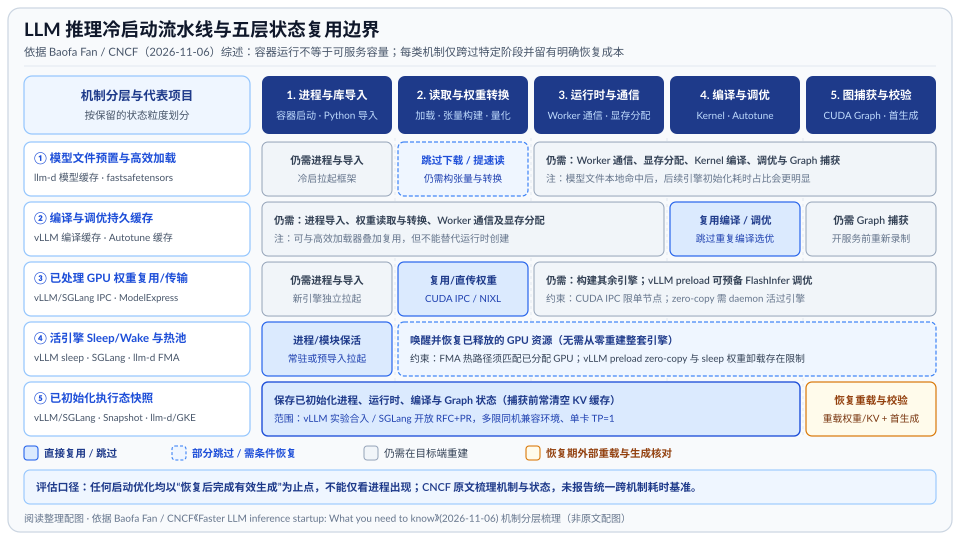
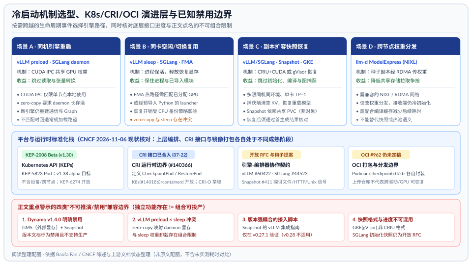

Baofa Fan（DaoCloud）· CNCF Member Post · 2026-11-06 · [原文《Faster LLM inference startup: What you need to know》](https://www.cncf.io/blog/2026/11/06/faster-llm-inference-startup-what-you-need-to-know/)

弹性扩容、副本故障重启或模型切换时，调度器把容器拉起甚至进入 `Running` 状态，并不意味着推理集群已经多出一份可用算力。从进程诞生到成功返回第一个生成结果之间，LLM 推理服务器还必须穿过权重读取与张量转换、多 Worker 通信与显存初始化、Kernel 编译、Autotune 选优以及 CUDA Graph 捕获等多道阻塞环节。DaoCloud 工程师 Baofa Fan 于 2026 年 11 月 6 日在 CNCF 博客发表综述，按**“究竟保存并复用了哪一层状态”**横向拆解了引擎、平台与云原生基础设施三层正在并行演进的冷启动优化路径，并重点点出了相似名称背后截然不同的内存所有权与版本兼容边界。

> **口径与范围说明**：这篇 CNCF 综述是一份**机制分层与生态实现状态清单（ecosystem taxonomy & status audit），未在统一工作负载下提供横向恢复耗时对比，也未报告实测延迟数值**；文中提到的各上游 PR、RFC、KEP 与版本限制均以原文发布时点（2026-11-06）所引官方材料为据。若需查看具体的 GPU 检查点端到端耗时测量边界，可对照本站在同一专题下的另一篇精读 [NVIDIA Snapshot 实测边界解析](/tech/zh/nvidia-snapshot/)——两者恰好形成互补：NVIDIA 博客给出了 B200 / VAST NFS 上的具体恢复秒数，而本篇 CNCF 综述给出了跨机制的抽象边界与 K8s/CRI/OCI 生态落点。

## 状态分层图谱：五类冷启动机制各保住了哪一段初始化

原文首先把推理引擎从“冷进程”走向“可接流”的工作拆成两股力量：第一股是**基础装载与初始化**（拉起进程、导入 Python 与框架库、读取模型权重文件、构造 Tensor 并执行量化或分片变换、建立执行运行时与 Worker 间通信、分配显存缓冲区）；第二股则是**为了换取稳态高吞吐而前置到启动期的优化成本**——编译（产生可执行 Kernel）、自动调优（Autotune 为当前硬件/配置挑选最优实现）以及 CUDA Graph 捕获（预先录制 GPU 计算图以压低后续逐次调用开销）。正如 [vLLM 优化文档](https://github.com/vllm-project/vllm/blob/main/docs/configuration/optimization.md) 指出的那样，稳态推理越依赖图捕获与深度调优，冷启动阶段需要咽下的准备工作就越重。

<figure class="note-figure">
  <a class="note-image-link" href="/assets/images/tech/cncf-faster-llm-inference-startup/coldstart-state-boundary-taxonomy-zh.svg" target="_blank" rel="noopener">
    
    放大图解 ↗
  </a>
  <figcaption>阅读整理配图（非原文配图）：将 CNCF 综述中的冷启动阶段拆分与五类复用层级映射为对齐的阶段跨度视图。</figcaption>
</figure>

更关键的工程规律在于**瓶颈转移效应**（shifting bottlenecks）：启动各段耗时并非固定比例，而是随存储、模型、硬件和软件栈动态漂移。一旦模型文件已在节点本地命中，拉起进程与引擎初始化的耗时就会浮出水面；一旦 GPU 显存中的权重也能直接复用，Python 模块导入、Kernel 调优和 CUDA Graph 捕获便会跃升为新的长尾。因此，评估任何冷启动方案的唯一起止口径只能是：**从触发启动/恢复开始，到引擎能够真正生成响应（例如通过生成校验）为止**——不能把容器拉起或文件到达本地误记为“就绪”。

| 保留的状态层级 | 优化思路 | 原文列举的代表项目与特性 | 恢复后仍可能残留的成本与依赖 |
| :--- | :--- | :--- | :--- |
| **模型文件**（Model files） | 预置缓存与高效加载器 | llm-d 模型缓存、`fastsafetensors`、SGLang 预分片与流式加载器 | 仍需构造 Tensor、执行权重变换，以及完整的引擎初始化与图捕获 |
| **编译产物与调优结果**（Compiled & tuning artifacts） | 持久化缓存复用 | vLLM 编译缓存与 Autotune 缓存（含 `vllm preload` 预备 FlashInfer 调优） | 不能替代进程拉起、权重读取、运行时与通信初始化或 CUDA Graph 捕获 |
| **已处理权重**（Processed weights） | 权重守护进程与点对点传输 | vLLM `preload`、SGLang 权重缓存 daemon、ModelExpress（NIXL/RDMA） | 接收端或新引擎仍需自行完成进程导入、Worker 通信、显存与 Graph 构建 |
| **活引擎实例**（A live engine） | Sleep/Wake 休眠唤醒与热实例池 | vLLM `sleep` 模式、SGLang 内存释放/恢复接口、llm-d FMA | 需恢复此前释放或卸载的 GPU 资源；FMA 热路径高度依赖与分配 GPU 的匹配度 |
| **已初始化执行态**（Initialized execution state） | 引擎或容器级快照 | vLLM 初始化快照、SGLang 快照 RFC/PR、Snapshot 项目、llm-d/GKE Pod 快照 | 仍需完成校验、还原与重挂载；多数方案捕获前清空 KV 且外部重载模型权重 |

原文特别强调，这五层优化**可以组合，但不能互相代指，且组合条件由各实现细节严格决定**。例如，引擎可以在复用持久化编译缓存的同时，使用 [SGLang 文档](https://docs.sglang.io/docs/advanced_features/model_loading) 介绍的预分片（pre-sharded）、`fastsafetensors` 或流式加载器加快权重读取（也可参见 [llm-d 启动概览](https://github.com/llm-d/llm-d/blob/main/docs/operations/startup/model-loading-and-startup.md)）；而进入初始化快照路径时，系统通常会在捕获前主动丢弃空的 KV Cache（存放注意力计算中间状态），在恢复后再重新创建。

## 引擎与平台路径：权重复用、Sleep/Wake 与快照的兼容边界

顺着“保住哪一层状态”的标尺往底层代码深挖，就能看清 vLLM、SGLang、`ai-dynamo/snapshot`（及 Dynamo）与 `llm-d` 四套路线在架构所有权上的本质差异：

1. **vLLM 与 SGLang 的权重守护进程（CUDA IPC 解耦所有权）**：vLLM 的 Fast Start（实现见 [PR #54921](https://github.com/vllm-project/vllm/pull/54921)，路线图见 [Issue #56049](https://github.com/vllm-project/vllm/issues/56049)）引入了一个常驻权重 daemon，提前加载并完成张量转换后将结果驻留在 GPU 显存中，再通过 **CUDA IPC** 暴露给新启动的兼容引擎。根据 [vLLM `preload` 文档](https://github.com/vllm-project/vllm/blob/main/docs/features/preload.md)，`preload` 还会预先准备 FlashInfer 的 Autotune 结果。在 **zero-copy 模式**下，新引擎直接映射 daemon 已有的 GPU 分配，配置校验不匹配时可回退普通加载。但这带来两条硬约束：**第一，daemon 必须比所有使用其显存的引擎活得更久**；**第二，CUDA IPC 句柄严格局限于单台主机本地**，多节点部署必须在每个节点各自持有对应分片，不能把 IPC 当成跨机共享池。SGLang 也已合入类似的权重缓存 daemon（[PR #27139](https://github.com/sgl-project/sglang/pull/27139)），不过更广的模型与量化覆盖、内存传输和生命周期管理仍在 [Fast Engine Recovery 路线图（#33522）](https://github.com/sgl-project/sglang/issues/33522) 推进中。
2. **Sleep/Wake 保活进程与 zero-copy 冲突**：与“重开新引擎进程 + 映射权重 daemon”相反，[vLLM Sleep Mode](https://github.com/vllm-project/vllm/blob/main/docs/features/sleep_mode.md) 以及 SGLang 对外暴露的内存释放/恢复（release/resume）与生成暂停/继续（pause/continue）接口，选择**保留活着的服务器进程**，按需卸载或释放大部分 GPU 显存并在唤醒时恢复。SGLang 的文档提示，释放后权重是否可快速取回取决于配置的内存策略（包括是否保留 CPU 备份）。然而，vLLM `preload` 文档明确指出了 **zero-copy 权重复用与 sleep 权重卸载之间的组合限制**——两者的根源都在于同一块 GPU 显存究竟由外部 daemon 永久持有，还是允许被引擎自身释放回收。
3. **初始化引擎快照与外部编排器分工**：[vLLM 已合入实验性 `vllm snapshot`](https://github.com/vllm-project/vllm/blob/main/docs/features/initialized_snapshots.md)（设计见 [PR #51360](https://github.com/vllm-project/vllm/pull/51360)），利用 **CRIU** 冻结与恢复 Linux 进程态，并用 **CUDA checkpoint** 接管 GPU 状态。但原文划出了极为严格的适用范围：**必须同机器、兼容软件环境、单张 NVIDIA GPU 且张量并行度 `TP = 1`**；它在捕获前释放权重与 KV 状态，恢复时再重新加载模型文件，并核对一段预设的生成结果——换言之，**模型文件依然是快照恢复的强外部依赖**。相比之下，SGLang 的初始化快照（在引擎完成初始化且尚未绑定 HTTP 服务前捕获）在原文发表时仍处于**开放 RFC 与开放实现 PR** 阶段（[#43965](https://github.com/sgl-project/sglang/issues/43965)、[PR #40736](https://github.com/sgl-project/sglang/pull/40736)），初始目标同样限定在单卡 `TP = 1` 与同机同环境。由于节点守护进程最擅长操作 CRIU/存储，而推理引擎自己最清楚请求、缓存与通信何时处于可安全捕获的静默边界，vLLM（[#60422](https://github.com/vllm-project/vllm/issues/60422)）与 SGLang（[#44523](https://github.com/sgl-project/sglang/issues/44523)）均提出了与外部 Checkpoint Orchestrator 协作的 RFC。
4. **平台集成中的版本断层与禁用组合（Snapshot / Dynamo vs. llm-d）**：`ai-dynamo` 组织下的独立 [Snapshot 项目](https://github.com/ai-dynamo/snapshot) 通过 Kubernetes Operator 与 Node Agent（`PodSnapshot` / `SnapshotJob`）调度 CRIU 与 CUDA checkpoint，[存储文档](https://github.com/ai-dynamo/snapshot/blob/main/docs/operations/storage.md) 当前采用各节点可挂载的**共享 `PersistentVolumeClaim`（PVC）**，对象存储后端尚在未来计划中。框架侧仍需要入口脚本完成“预热—暂停—释放内存—发捕获就绪信号—恢复后唤醒并校验生成”的握手：例如 [SGLang 指南](https://github.com/ai-dynamo/snapshot/blob/main/docs/guides/sglang.md) 展示了完整生命周期包装，而 [vLLM 指南](https://github.com/ai-dynamo/snapshot/blob/main/docs/guides/vllm.md) 明确标明该入口脚本仅在 `v0.27.1` 上验证通过且**明确在 `v0.28` 上无法工作**。更值得警惕的是 Dynamo 自身的组合红线：Dynamo 另行开发了将 GPU 显存所有权移出引擎进程的 [GPU Memory Service（GMS）](https://github.com/ai-dynamo/dynamo/tree/main/lib/gpu_memory_service)，而 [Dynamo v1.4.0 Snapshot 文档](https://docs.dynamo.nvidia.com/dynamo/v1.4.0/kubernetes/operations/cold-start-optimizations/dynamo-snapshot) 明确写出 **`GMS` 与 `Snapshot` 的组合处于禁用状态且不支持生产**——两个独立可用的特性绝不能被默认推演为可叠加投产。而在 llm-d 侧，三条启动路径各自解决完全不同的环节：[Pod Snapshots 指南](https://github.com/llm-d/llm-d/blob/main/guides/pod-snapshot/README.md) 基于 **GKE Sandbox（gVisor）**、Google Cloud Storage 与 [GKE Pod snapshots](https://docs.cloud.google.com/kubernetes-engine/docs/concepts/pod-snapshots?hl=en) 的 NVIDIA 检查点能力（与 CRIU 并非同一快照格式，llm-d 的平台无关 CRIU 后端仍在开发中）；[Fast Model Actuation（FMA）](https://github.com/llm-d/llm-d/blob/main/guides/fast-model-actuation/README.md) 通过 requester/launcher Pod 架构唤醒匹配 GPU 的休眠实例，或借助已预导入 Python 模块的 launcher 缩短冷启；[ModelExpress](https://github.com/llm-d/llm-d/blob/main/guides/modelexpress-p2p/README.md) 则通过 **NIXL 与 RDMA** 从种子副本向同伴节点分发权重，其余初始化仍留给接收端完成。

## Kubernetes、CRI 与 OCI 标准化进度：接口合入不等于跨环境可恢复

当视线从单个推理引擎上移到容器运行时与 Kubernetes 集群平面时，CNCF 综述呈现出一幅“接口已跨出关键一步，但全链路端到端能力仍在拆段施工”的清晰图景。把**已合入的接口规范**、**仍开放的实现 PR** 与**纯粹的路线图目标**分开，是避免基础设施选型误判的关键：

| 技术层次与项目 | 原文核对的当前状态（2026-11-06） | 明确的边界、约束或局限 | 原文对应上游文档或追踪链接 |
| :--- | :--- | :--- | :--- |
| **K8s 容器级检查点（KEP-2008）** | Kubernetes `v1.30` 已达 **Beta** | 仅覆盖单容器检查点 API，未解决整 Pod 协作与 GPU 分配语义 | [Container checkpoint API](https://kubernetes.io/docs/reference/node/kubelet-checkpoint-api/) |
| **K8s Pod 级检查点（KEP-5823）** | 状态为 Implementable，设定 `v1.38 alpha` 目标 | **交付目标而非已发布能力**；初始范围显式排除设备状态与跨节点恢复 | [KEP-5823 提案](https://github.com/kubernetes/enhancements/tree/master/keps/sig-node/5823-pod-level-checkpoint-restore) |
| **K8s GPU 状态提案（KEP-6274）** | Provisional 提案，**PR 仍处于开放状态** | 正在讨论设备分配记录与恢复兼容条件 | [KEP-6274 PR #6275](https://github.com/kubernetes/enhancements/pull/6275) |
| **CRI 运行时接口与实现** | `CheckpointPod` / `RestorePod` 于 **2026-07-22 合入** | 接口定义捕获、恢复后继续与失败清理；但 K8s 编排、`containerd` PR 仍开放，CRI-O 为 Draft | [CRI PR #140366](https://github.com/kubernetes/kubernetes/pull/140366) · [K8s #140186](https://github.com/kubernetes/kubernetes/pull/140186) · [containerd #13822](https://github.com/containerd/containerd/pull/13822) · [CRI-O #10313](https://github.com/cri-o/cri-o/pull/10313) |
| **OCI 制品分发与镜像格式** | Image/Dist `v1.1.1` 可传输通用制品；**#962 提案仍开放** | Podman、`checkpointctl` 与 `containerd` 各自有封装或 media type；入库不等于跨驱动/GPU 可恢复 | [OCI #962](https://github.com/opencontainers/image-spec/issues/962) · [`checkpointctl`](https://github.com/checkpoint-restore/checkpointctl) · [`containerd` media types](https://github.com/containerd/containerd/blob/main/core/images/mediatypes.go) |
| **引擎-外部编排器握手与钩子** | vLLM / SGLang 提案开放；Snapshot 钩子讨论中 | 讨论通过文件、HTTP 或 Unix 信号同步“安全捕获/恢复完成”，尚未形成跨项目统一协议 | [vLLM #60422](https://github.com/vllm-project/vllm/issues/60422) · [SGLang #44523](https://github.com/sgl-project/sglang/issues/44523) · [Snapshot #411](https://github.com/ai-dynamo/snapshot/issues/411) |

这张对照表揭示了云原生 GPU 检查点最容易被营销话术掩盖的一条边界：**CRI 与 OCI 各司其职，且彼此都不承诺执行态可移植性**。[Kubernetes Checkpoint Restore 工作组章程](https://github.com/kubernetes/community/blob/main/wg-checkpoint-restore/charter.md)（[WG 目录](https://github.com/kubernetes/community/tree/main/wg-checkpoint-restore)）明确聚焦编排接口并提示要重新审视 checkpoint 归档效率；而 2026 年 7 月合入 CRI 的接口也把内部文件布局留给容器运行时自己决定。在更外层的分发侧，尽管 [OCI Image Spec 制品指南（v1.1.1）](https://github.com/opencontainers/image-spec/blob/v1.1.1/manifest.md#guidelines-for-artifact-usage) 与 [OCI Distribution Spec（v1.1.1）](https://github.com/opencontainers/distribution-spec/blob/v1.1.1/spec.md) 已经能让镜像仓库安全搬运包含检查点二进制载荷的 artifact 并挂载 referrers，但专门约束检查点镜像元数据与互操作语义的 [OCI issue #962](https://github.com/opencontainers/image-spec/issues/962) 仍未关闭。现实中 Podman、`checkpointctl` 与 `containerd` 各用各的包装或 media type——把一个 GPU 检查点打包推送到 OCI Registry，绝对不意味着它能跨越不同的容器运行时、内核/CRIU 版本、NVIDIA 驱动或 GPU 型号成功恢复。

## 架构选型决策：按故障恢复与弹性边界组合冷启动路径

综合 Baofa Fan 梳理的三层机制与现状，我们在工程落地时不应从“听说某项目快了多少倍”出发，而应先锁定**当前生产架构真正要跨越的生命周期边界**，再对照检查四项前置条件——保留了哪层状态、谁拥有显存、恢复后还要依赖哪些外部文件，以及哪些组合已被明确标为禁用。

<figure class="note-figure">
  <a class="note-image-link" href="/assets/images/tech/cncf-faster-llm-inference-startup/coldstart-tradeoff-decision-matrix-zh.svg" target="_blank" rel="noopener">
    
    放大图解 ↗
  </a>
  <figcaption>阅读整理配图（非原文配图）：基于 CNCF 综述建立的“生命周期边界 × 标准化栈 × 已知禁用约束”选型决策视图。</figcaption>
</figure>

以下四条设计检核，基于原文披露的机制约束归纳而成，可直接用于架构评审与运维验收：

- **以“生命周期边界”而不是流行度选路径**：若痛点是单机上进程偶发崩溃或同节点模型热切换，**持久化权重 daemon（`vllm preload` / SGLang 权重缓存）+ 编译/Autotune 缓存**能以较低侵入性剥离权重加载成本，前提是接受 CUDA IPC 的单节点边界并看护 daemon 生命周期；若目标是同卡多模型分时复用且允许保活常驻进程，**Sleep/Wake 或 FMA** 更直接，但需盯紧 GPU 调度匹配与 CPU 备份开销；若要在 Pod 重建或自动扩容中跳过初始化、编译与 CUDA Graph 捕获，才需要引入 **CRIU + CUDA checkpoint 或 GKE gVisor 快照**；若瓶颈集中在大集群拉起副本时的模型分发拥塞，**ModelExpress（NIXL/RDMA）** 应与本地编译缓存配合使用，而非单独指望它消除引擎启动延迟。
- **上线前强制审计“显存所有权与功能组合矩阵”**：从原文暴露出的两条典型冲突——`vllm preload` zero-copy 与 `sleep` 权重卸载存在限制，以及 **Dynamo v1.4.0 明确禁用 `GMS + Snapshot`**——可以看出，只要两个特性都试图管理 GPU 显存的所有权或释放周期，就不能未经版本文档核对直接叠加；同理，`ai-dynamo/snapshot` 的 vLLM 示例从 `v0.27.1` 到 `v0.28` 即告失效，说明引擎内部状态钩子仍处高频变动期，版本矩阵必须纳入 CI 回归。
- **明确区分“接口已合入”与“集群级开箱即用”**：Kubernetes 上游虽然已在 2026-07-22 合入 CRI 的 `CheckpointPod`/`RestorePod`，但 K8s 编排、`containerd`、CRI-O 实现与 GPU 支持提案（KEP-6274）、Pod 检查点目标（KEP-5823 `v1.38`）及 OCI #962 均未全部收口。当前在 Kubernetes 上落地 GPU 快照，仍依赖专用 Operator/Node Agent（如 `ai-dynamo/snapshot` + 共享 PVC）或特定云托管沙箱（如 GKE Pod Snapshots + gVisor + GCS），且跨驱动、跨 GPU 型号及跨多卡 `TP > 1` 拓扑仍存在严格限制。
- **用“端到端恢复校验”统一评测口径**：无论采用哪条路径，验收脚本都应像 `vllm snapshot` 与 `Snapshot` 指南那样，把**模型文件外部可访问性检查 + 恢复唤醒 + 首次真实生成校验**纳入“就绪（Ready）”定义，并独立记录冷启各阶段（容器拉起、权重获取、进程/CUDA 还原、图捕获或唤醒、首 token 返回）的耗时，才能真正看清瓶颈是否只是被转移到了下一层。

---

> **AI 辅助整理 · 归档注记**：本篇中文长文与对应的英文配套版（[English note](/tech/en/cncf-faster-llm-inference-startup/)）均由助手依据 CNCF 博客冻存原文（Baofa Fan, DaoCloud, 2026-11-06）及原文内嵌的 40 余条上游文档/PR/KEP 链接逐项核对重写，保留原 `id`、`permalink`、`published_at` 与 `inference-serving`、`systems-reliability` 两项标签。文中两幅 `v3-blue` 图解（`coldstart-state-boundary-taxonomy-zh.svg` 与 `coldstart-tradeoff-decision-matrix-zh.svg`）系助手按原文机制分层与兼容边界绘制（非原文配图）；原文未提供跨机制统一延迟基准，本文亦未补充或虚构任何未经测量的耗时数值。
