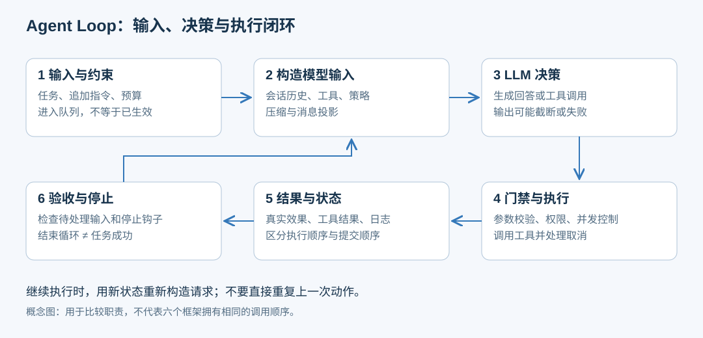
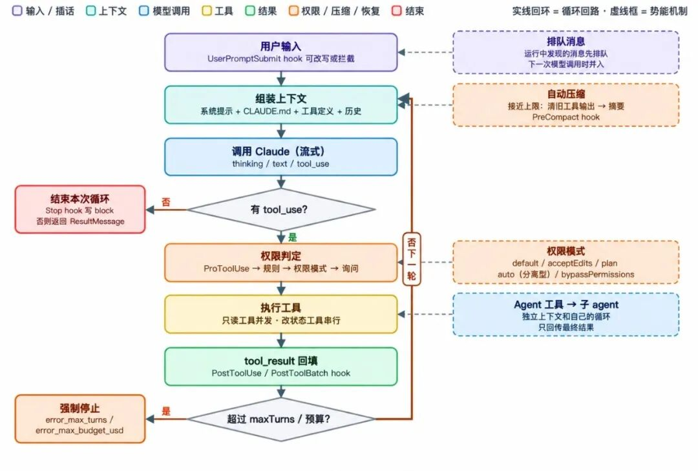
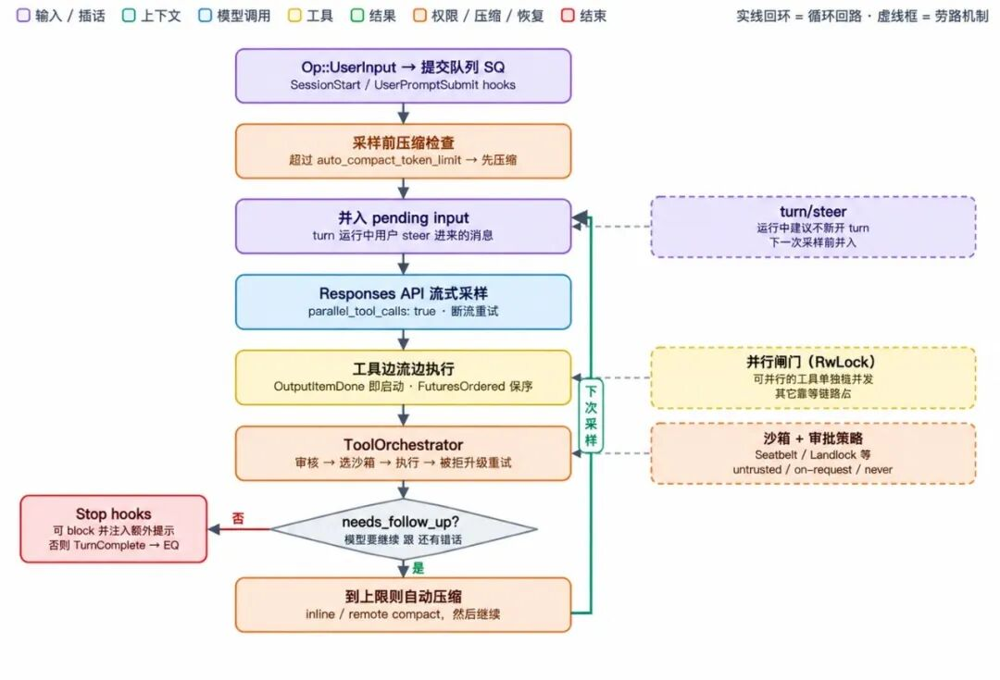
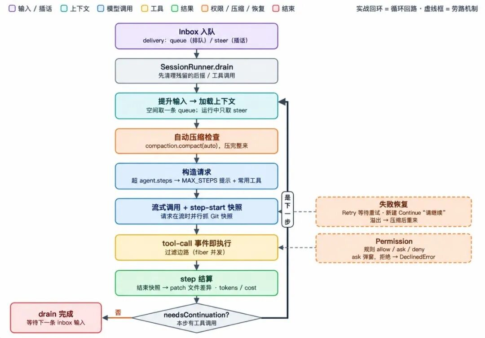
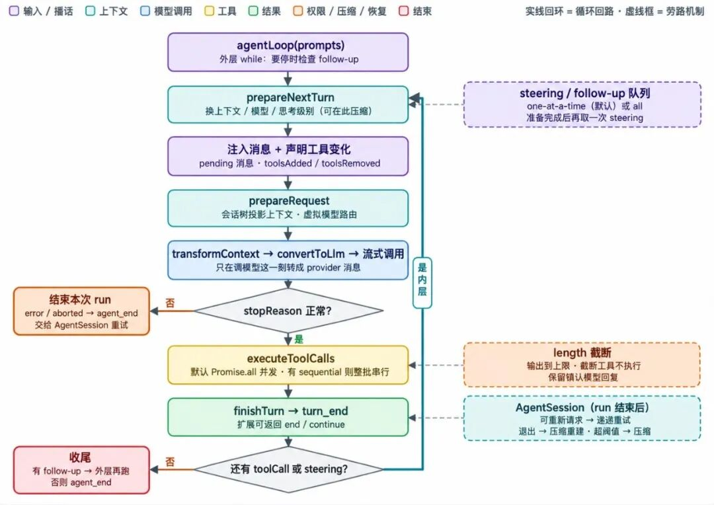
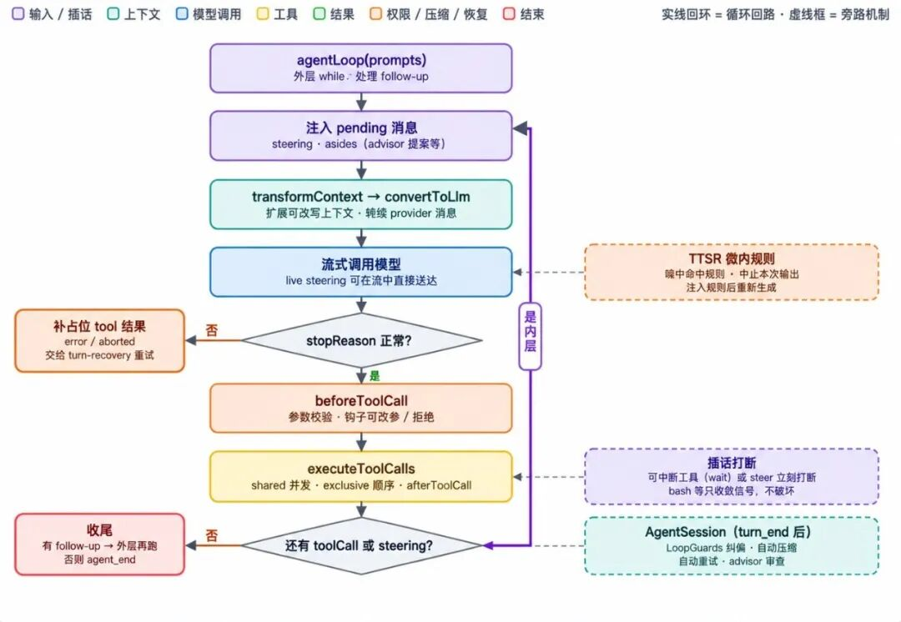
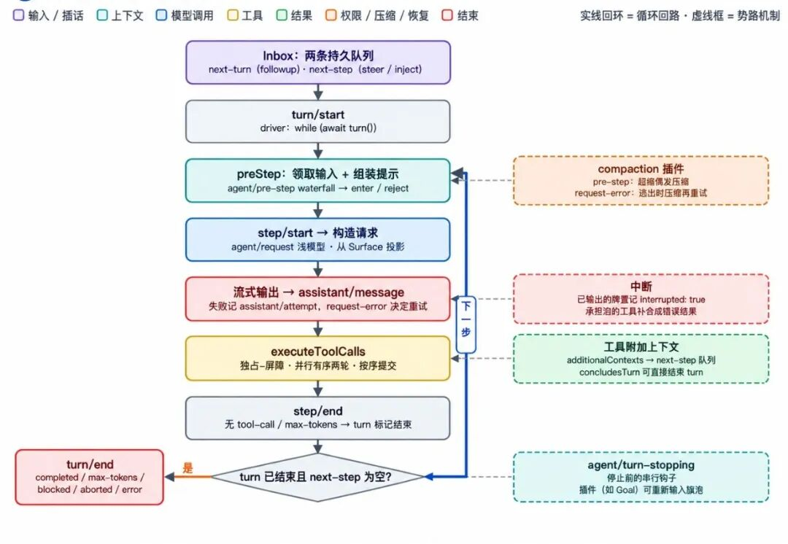
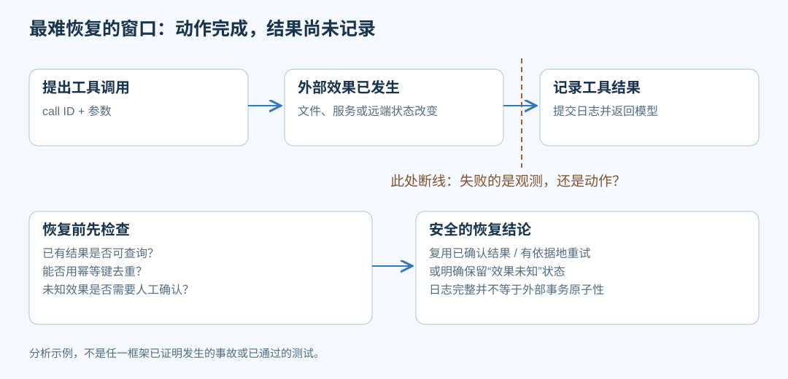

同一个模型，换一个 Harness，为什么会在相同任务上表现不同？差别不只来自提示词。用户追加的信息何时生效，工具能否并行，失败之后重跑哪一段，以及系统何时接受“做完了”，都由模型外面的执行系统参与决定。

PaperWeekly 的[《不同Harness的Agent Loop怎么做？Claude Code、Codex等6套方案详解》](https://mp.weixin.qq.com/s/GryGhL7SLCPwDQF0VjsPeg)提供了六套实现的阅读入口。本文沿着一次编码任务展开，再对照固定版本源码讨论其中的运行边界：**Loop 决定下一步是否发生，Harness 决定它在什么状态和约束下发生；两者都不能单凭模型的一句回答证明任务已经成功。**

## 先统一词义：一个 turn 不一定是一次模型调用

不同项目的同名术语不能直接对齐。比较执行成本、重试次数或“多少轮完成”之前，应先说明计数边界。

| 层级 | 本文的含义 | 可以观察的证据 |
| --- | --- | --- |
| 用户任务 | 从接收一个目标到交付结果的一段工作 | 输入、约束、最终验收 |
| 模型请求 | 将选定上下文发送给模型的一次调用 | 请求配置、消息、输出与 usage |
| 工具批次 | 一个模型响应提出的若干工具调用 | 调用 ID、参数、启动和结束事件 |
| 请求尝试 | 为完成某次请求进行的一次发送或重试 | 错误类型、退避、重试次数 |
| 会话 | 跨请求、跨任务保留的状态 | 历史、队列、摘要、检查点 |

例如 Codex 的一个用户 turn 可以包含多次采样；DeepSeek Harness 明确区分 turn、step 和 attempt；Pi 的核心循环事件也使用 turn，但不能据此把它与另外两者的统计单位视为相同。CLI 是交互入口，runtime 才负责推进这些状态。一个 CLI 命令卡住，原因可能在模型请求、工具子进程、审批等待，也可能是队列没有被消费。

<a class="note-image-link" href="/assets/images/tech/coding-agent-loop-harness-close-reading/loop-zh.svg" target="_blank" rel="noopener" aria-label="从输入和上下文到模型、工具、记录及停止检查的六阶段概念闭环">查看图解 ↗</a>

*助手绘制的职责图。回到下一次请求时，必须同时携带新的执行证据和已生效的用户约束。*

## 沿着一次修复任务看完整闭环

设想任务是“修复失败测试，但不要改公共接口”。这不是某个框架的实测案例，而是用于解释边界的共同场景。

**第一步是接收输入，不是立即调用模型。** 系统要确定项目、会话、指令和工具集合，并处理排队消息。如果用户在测试运行中补充“不要删除兼容代码”，收到消息与下一次推理看到这句话之间存在一个交接点。测试应检查它在哪一次请求生效，而不能只看终端是否已经显示出来。

**第二步是构造模型可见状态。** 磁盘里保存了完整日志，不代表模型收到了完整日志。摘要、截断、工具结果过滤和会话树投影都会改变输入。如果压缩后丢失“不要改公共接口”，后续失败就不能只归因于模型没有遵循指令。

**第三步才是模型生成决策。** 模型可能输出文字、工具调用或两者。运行系统要区分完整调用与截断参数，也要区分流断开、输出上限和正常结束。对于有副作用的命令，“收到了一部分 JSON”绝不是执行依据。

**第四步是工具准入与调度。** 工具名是否合法、参数是否完整、权限是否允许、是否与另一个工具冲突，是不同的检查。两个读取任务可能适合并发；但“读取旧配置”和“写入新配置”即使最终按顺序显示结果，也可能在执行时发生竞争。

**第五步是把真实结果交回模型。** 返回值、文件差异、退出码、异步任务状态和外部服务效果可能不一致。模型需要知道失败来自工具、环境、审批还是请求本身，而不是收到一句丢失上下文的通用报错。

**第六步是决定继续还是停止。** 没有新工具调用只说明本轮模型没有再请求动作。测试是否通过、约束是否遵守、异步操作是否完成，还需要独立验收；停止钩子可以要求继续，但如果验收器本身错误，也可能把系统推入无限循环。

## 六套框架，把复杂性放在了哪里

### Claude Code：公开文档中的生命周期与策略边界

<a class="note-image-link" href="/assets/images/tech/coding-agent-loop-harness-close-reading/claude-code-original.jpg" target="_blank" rel="noopener" aria-label="Claude Code 原文 Agent Loop 流程图，包含输入、模型调用、工具执行和继续／停止分支">查看原图 ↗</a>

*原文流程图 · [PaperWeekly／风儿轻轻er](https://mp.weixin.qq.com/s/GryGhL7SLCPwDQF0VjsPeg)。Claude Code：上下文、工具、权限与停止检查。此图是原文对公开文档的概括，不是官方内部调用图。*

官方文档将流程描述为收集上下文、采取行动和验证结果，并把 Harness 定义为模型外围的工具与上下文管理层。Hooks 在输入、工具执行、压缩和停止等生命周期位置介入；其中停止检查可以要求继续执行。[工作原理](https://code.claude.com/docs/en/how-claude-code-works)与[Hooks 参考](https://code.claude.com/docs/en/hooks)是这里的直接依据。

这解释了为何同一个模型会因权限或扩展配置而产生不同轨迹。不过，公开文档的概念循环不能当作内部源码调用图。本文不将“所有读工具必并发、所有写工具必串行”或某个固定审批顺序推广为所有版本的实现保证。做实验时，至少要记录具体工具、权限模式和启用的 hooks。

### Codex：一次用户 turn 内，持续采样与执行

<a class="note-image-link" href="/assets/images/tech/coding-agent-loop-harness-close-reading/codex-original.jpg" target="_blank" rel="noopener" aria-label="Codex 原文 Agent Loop 流程图，包含输入、模型调用、工具执行和继续／停止分支">查看原图 ↗</a>

*原文流程图 · [PaperWeekly／风儿轻轻er](https://mp.weixin.qq.com/s/GryGhL7SLCPwDQF0VjsPeg)。Codex：在一个用户 turn 内并入输入、采样、执行工具，并判断是否继续。*

在固定版本的 `run_turn` 中，模型要求继续与尚未处理的用户输入共同影响 `needs_follow_up`。因此，“模型没有继续请求工具”与“整个 turn 可以结束”并非同一个判断。请求前后的上下文管理也属于执行路径，不能从模型 token 数反推出运行系统做过多少维护工作。

工具并发由运行系统的能力判定控制：`parallel.rs` 对可并行调用使用读锁，对其他调用使用写锁独占。这里的“读锁”是调度机制，不是说任何名字带 Read 的工具都自动安全。`orchestrator.rs` 则集中处理审批和沙箱执行。原文将其概括为安全外壳，精读时更应追问：哪个检查拒绝了动作、拒绝是否被模型看见、后续尝试是否仍受同一权限边界约束。

[固定版本的 turn、并发门禁与工具编排源码](https://github.com/openai/codex/tree/d1d1ba0b837d34f314b7f469896e8babbc91f949)支持上述划分。这一架构适合把失败分解成请求、并发、审批与环境问题，而不是给所有失败统一贴上“模型没做好”的标签。

### OpenCode：step 结果与会话状态分开表达

<a class="note-image-link" href="/assets/images/tech/coding-agent-loop-harness-close-reading/opencode-original.jpg" target="_blank" rel="noopener" aria-label="OpenCode 原文 Agent Loop 流程图，包含输入、模型调用、工具执行和继续／停止分支">查看原图 ↗</a>

*原文流程图 · [PaperWeekly／风儿轻轻er](https://mp.weixin.qq.com/s/GryGhL7SLCPwDQF0VjsPeg)。OpenCode：由 inbox 推进 step，并结合快照、压缩与恢复；图示对应原文的 dev 分支描述，当前状态枚举差异见下文。*

本文核对的是 `dev` 分支中的 core 实现，不能直接等同于任意已发布客户端。`step.ts` 明确区分 `Completed`、`Retry`、`RecoverFull`、`Compacted` 和 `OutputLimit` 等结果；模型请求遇到上下文溢出，可以进入压缩恢复路径，而不是与正常回答共用一个成功出口。

一个值得注意的细节是：step 起始快照可以在 provider 请求进行时并行捕获，但本地工具运行前必须已有该快照。结束时再记录快照及文件变化。这个顺序让文件差异具有明确的观察边界，但**文件快照不包含远端 API、数据库或已经发送的消息**，所以不能据此称为整个任务的事务回滚。

[固定源码](https://github.com/anomalyco/opencode/tree/88ca792e024aa2085fa6e15288be37037c4871d2)的结果枚举已经与原文简化伪代码不完全相同。比较时应依据实际分支和提交，而不是机械复刻文中的每个状态名。

### Pi：内层处理工具与 steering，外层接收 follow-up

<a class="note-image-link" href="/assets/images/tech/coding-agent-loop-harness-close-reading/pi-original.jpg" target="_blank" rel="noopener" aria-label="Pi 原文 Agent Loop 流程图，包含输入、模型调用、工具执行和继续／停止分支">查看原图 ↗</a>

*原文流程图 · [PaperWeekly／风儿轻轻er](https://mp.weixin.qq.com/s/GryGhL7SLCPwDQF0VjsPeg)。Pi：内层处理工具与 steering，外层在准备停止时检查 follow-up。*

Pi 的核心 `runLoop` 把两个时机分开：执行中的 steering 在轮间进入内层循环；准备停止时，再检查 follow-up，让外层启动下一轮。`prepareNextTurn` 可能进行较长准备，因此代码在合适条件下再次读取 steering，避免准备期间到达的消息被漏掉，同时避免 one-at-a-time 模式一轮取两条。

工具调度也有明确的保守规则：全局设为 sequential，或批次内任一工具声明 `executionMode: sequential`，会让整个批次走串行分支。遇到 `stopReason: length`，该响应中的工具调用被判为失败而非执行，因为参数可能已经截断。`finishTurn` 可以要求 end 或 continue，重试和压缩的更多策略则在外层 `AgentSession`。

[固定版本源码](https://github.com/earendil-works/pi/tree/5a14e69c067d40dfbff4f2fff7d3b34c897e2dc9)显示的重点是核心循环与会话策略的分工。增加扩展可以改变模型输入和续跑决策，但不能凭一个扩展回调就获得进程崩溃后的安全重放；持久任务机制另见本站 [Pi Durable 精读](/tech/zh/pi-durable-runtime/)。

### Oh My Pi：工具批次内部也有控制与纠偏

<a class="note-image-link" href="/assets/images/tech/coding-agent-loop-harness-close-reading/oh-my-pi-original.jpg" target="_blank" rel="noopener" aria-label="Oh My Pi 原文 Agent Loop 流程图，包含输入、模型调用、工具执行和继续／停止分支">查看原图 ↗</a>

*原文流程图 · [PaperWeekly／风儿轻轻er](https://mp.weixin.qq.com/s/GryGhL7SLCPwDQF0VjsPeg)。Oh My Pi：在 Pi 式循环中加入流内纠偏、工具并发控制与中断处理。*

Oh My Pi 沿用相近的循环骨架，但增加了更细的工具并发和中断处理。当前源码允许工具按参数返回 shared 或 exclusive；若并发模式计算抛错，会回退为 exclusive。调度同时记录先前独占任务、共享任务和可能有副作用的共享调用，不能简单解释成“shared 就可以任意同时运行”。

运行中的 steering、等待类工具的中断、流内规则和会话层恢复又形成更多边界。它们的价值是让新的控制信息不必一直等到长工具批次完全结束；代价是更难判断取消信号到达时，哪些工作只是被要求停止，哪些已经产生效果。

[固定实现与 streaming 文档](https://github.com/can1357/oh-my-pi/tree/57771ae562b9345e0579bceb2d68d585e3e6927e)适合作为可中断执行的研究对象。实验必须记录工具的取消语义，不能把补了一个错误结果、发了 abort 信号或不再显示输出，当成外部动作已经回滚。

### DeepSeek Harness：日志投影、step 边界与插件职责

<a class="note-image-link" href="/assets/images/tech/coding-agent-loop-harness-close-reading/deepseek-harness-original.jpg" target="_blank" rel="noopener" aria-label="DeepSeek Harness 原文 Agent Loop 流程图，包含输入、模型调用、工具执行和继续／停止分支">查看原图 ↗</a>

*原文流程图 · [PaperWeekly／风儿轻轻er](https://mp.weixin.qq.com/s/GryGhL7SLCPwDQF0VjsPeg)。DeepSeek Harness：按 turn、step、attempt 组织执行。注意图中“agent/request 选模型”属于原文描述；本次核对版本已在 step 准备阶段锁定模型，详见下文。*

DeepSeek Harness 从会话日志派生请求上下文，并区分任务、请求步骤和失败尝试。队列区分 next-turn 与 next-step；工具通过受控流水线执行，输入领取、请求尝试和停止原因都有可观察事件。这个设计让“下一步依据了哪些已记录事实”更容易追踪，但事件日志并不自动保证外部系统与本地提交原子一致。

**版本差异尤其重要。** 原文把 `agent/request` waterfall 描述成 provider、model 和 effort 的选择入口；在本次固定版本中，step 准备已捕获模型选择。若 `agent/request` 再改变 provider、model 或 reasoning effort，代码会拒绝，并提示在 step 准备前通过 `agent.model.select()` 选择。README 也将这一 hook 标为 deprecated，并保留它对其他请求控制的兼容用途。

这不是证明原文在发表时错误，而是说明扩展点的权限会演化。现在若想做模型路由 RSI，修改旧 hook 可能触发运行时拒绝；正确实验必须先确认改动能在哪个边界生效。[固定源码与模块说明](https://github.com/deepseek-ai/deepseek-harness/tree/2e39e70496aa02986ca6a820c5d497e816b69d7e)给出了这一限制。

## 并行执行、按序提交与确定性是三件事

| 机制 | 可以提供什么 | 不能单独保证什么 |
| --- | --- | --- |
| 工具串行或独占屏障 | 限制并发重叠 | 工具不会失败、外部环境不会变化 |
| 按调用顺序回填结果 | 稳定模型看到的结果次序 | 工具的真实副作用也按该顺序发生 |
| 持久队列和事件日志 | 追踪输入、决策与记录状态 | 动作效果与日志提交是同一个事务 |
| 文件快照 | 比较或恢复被跟踪文件状态 | 撤销网络请求、数据库写入或通知 |
| 固定模型参数与随机种子 | 减少部分生成差异 | 全链路轨迹完全确定、结果必然正确 |

设想一个工具重启了服务，但在写入成功结果前连接断开。此时模型看到失败，不代表重启没发生；重新调用可能产生第二次重启。运行系统要么查询已提交结果，要么依靠幂等键去重，要么保留“效果未知”并升级处理。**为了凑齐消息协议而补出工具结果，只修复了对话结构，不会修复现实世界的状态。**

<a class="note-image-link" href="/assets/images/tech/coding-agent-loop-harness-close-reading/recovery-zh.svg" target="_blank" rel="noopener" aria-label="工具外部效果与本地结果提交之间的故障窗口，以及查询、去重和人工确认路径">查看图解 ↗</a>

*助手绘制的故障分析示例。恢复策略必须针对动作真实状态，而非仅针对报错字符串。*

## Skill、插件、runtime 与 model，各自能改什么

| 改动位置 | 典型对象 | 更适合解决的问题 | 通常不能直接解决 |
| --- | --- | --- | --- |
| Skill / 指令 | 步骤说明、工具使用规则、验收清单 | 遗漏检查、错误工作顺序、领域知识缺口 | 队列丢消息、子进程泄漏、存储写入不原子 |
| Hook / 插件 | 已公开边界上的拦截、上下文变换、续跑策略 | 工具准入、结果整理、受控路由、停止验收 | 扩展点未覆盖的底层状态转换 |
| Runtime / Harness 核心 | 调度、取消、持久化、重试、会话投影 | 并发竞争、失败恢复、消息协议和资源生命周期 | 在正确证据下仍然错误的模型推理 |
| Model | 权重、推理策略、模型选择 | 正确输入与工具反馈下的规划和判断能力 | 工具已产生但运行时丢失的外部效果 |

这些不是互斥故障标签。模型可能选择了危险命令，而 runtime 又缺少应有门禁；一个不准确摘要也可能同时包含模型压缩错误与上下文保存策略缺陷。归因需要分离观察点：原始指令是什么、实际请求包含什么、工具实际执行什么、结果怎样被提交、系统凭什么结束。

因此，某个 RSI 方法声称“优化 harness”时，首先应列出可编辑面。只能改 skill 或 hook 的方法，与能够修改工具调度器、存储协议或模型权重的方法，不在同一干预空间。扩展丰富有利于快速探索，但不能推出任何执行失败都可在扩展层修复。

## 从稳定性出发，怎样比较或改进这些运行系统

与其先给六套框架排优劣，不如用同一任务和故障位置建立可比较证据。下面是本文建议的实验设计，不是已经跑过的基准结果。

| 注入位置 | 应观察的行为 | 建议验收条件 |
| --- | --- | --- |
| 模型流在工具参数中途截断 | 是否执行了不完整调用 | 不产生未授权或不完整参数的副作用 |
| 用户在压缩或长工具运行时追加约束 | 何时领取输入、进入哪次模型请求 | 不丢失、不重复，边界可解释 |
| 写工具已成功但结果记录失败 | 是否能查证已发生的效果 | 不盲目重放，未知状态显式可见 |
| 两个工具竞争同一文件或资源 | 实际开始／结束与提交顺序 | 并发策略符合工具的副作用合同 |
| 停止 hook 拒绝结束 | 是否恢复到有意义的工作 | 有预算约束和原因记录，避免无限空转 |
| 进程重启或切换实现版本 | 队列、历史、工具状态怎样重建 | 旧状态与新代码兼容，恢复不重复副作用 |

对照实验要固定模型版本、工具能力、权限、输入上下文和预算，区分“完成率提高”来自更好的恢复机制，还是允许了更多调用。统计除了成功率，还应包括不可恢复失败、重复副作用、约束违反、恢复时延和总调用成本。

对一次运行不稳定的任务，可以先冻结模型输出，重放相同工具调用来检查 runtime；也可以冻结工具结果，让模型反复处理同一上下文，观察决策变化。但这只是隔离变量的办法，回放环境与真实环境不同的部分仍需记录。最后还要回到端到端任务，验证局部修复没有把问题转移到下一层。

## 阅读这篇材料最值得带走什么

六套系统的共同点是模型—工具反馈闭环；真正影响实验解释的差别，是**输入、执行、提交、恢复与停止由谁拥有，以及这些职责之间如何交接**。比较框架时，不要把循环行数、hook 数量或“支持重试”直接当成可靠性指标。

这也连接到两条研究主线：AI4SRE 需要为模型提供可信的调查证据和安全动作接口；SRE4AI 则要检验 Agent 运行时本身在异常条件下能否保持可解释、可恢复的执行。前者不能忽略后者提供的基础。

### 原文与核对范围

原文：PaperWeekly，风儿轻轻er，2026-10-28。[微信公众号文章](https://mp.weixin.qq.com/s/GryGhL7SLCPwDQF0VjsPeg)。本文为独立分析，保留原文六张流程图并标注来源，另配两张助手绘制的解释图；英文版保留中文原图，提供英文图注和解读，不作逐段翻译。开源实现固定于本次读取的提交，正文链接可回到该版本；Claude Code 部分依据公开文档，没有将文档抽象冒充内部源码。上述故障实验是建议，未在六套框架上执行。
