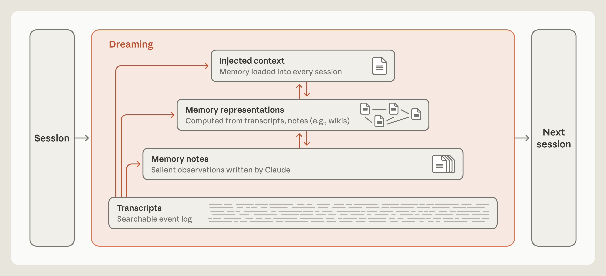

**Anthropic · Lance Martin · 2026-11-06**  
原文：[The components of agent memory](https://www.anthropic.com/engineering/components-of-agent-memory)

Agent 的记忆不只是把更多历史塞回 prompt。任务结束时留下什么、之后怎样纠错、下次如何找到，会共同决定持久信息是资产还是负担。Anthropic 的这篇工程文章把跨会话记忆分成可搜索 transcript、主动笔记、wiki 等派生表示，以及每次会话预先加载的顶层上下文，并用实验观察它们各自解决什么问题。

## 捕获经验，也是预测未来需要什么

这里的记忆指从交互和任务中获得、在后续会话还能读取的知识，不包括权重训练，也不等同于为延续当前会话进行 compaction。每条新笔记都隐含预测：这项信息以后仍有用，而且值得占用检索或上下文预算。

CL-Bench 1.0 的数据库任务让每个问题在新会话中开始，模型答题后得到正确反馈，只共享一个持久记忆目录。较弱模型会留下未测试的猜想；更强模型逐渐把记录组织成经过检查的规则、过去答案与陷阱提示。关键差别是“错误—假设—验证—可复用规则”的闭环，而非文件是否写成功。

Pokémon 的观察也很直观：约一万步时，Sonnet 3.7 留下 413 个文件、225 个目录，只获得一个徽章；Fable 5 用九个文件、两个目录和一个 global.md 获得四个。后者保留目标、路线策略与规则，前者不断保存屏幕已可看到、又很快过时的状态。这是各一次运行的案例，不能据此单独估计记忆策略的因果收益，但它揭示了维护成本如何挤占任务本身。

## 离线整理如何修正错误记忆

dreaming 在会话之外回看原始 transcript，核验或重写笔记、合并重复内容、创建链接，并调整哪些知识进入顶层。它与即时写笔记互补：即时写入可立即供下一步使用，离线整理能综合多段经验，却要花额外计算，也存在更新延迟。

<a class="note-image-link" href="/assets/images/tech/components-agent-memory/hierarchy.png" target="_blank" rel="noopener" aria-label="从原始记录到笔记、知识表示与会话注入的记忆层次 · 查看原图 ↗">查看原图 ↗</a>

*读图：底层保留可追查记录，dreaming 整理上层表示；只有较小一层预先进入下次会话。*

文章展示一条导航错误：Claude 把洞穴入口附近的地标记到错误方位，后续又把由此导致的绕路解释成自己早已走出洞穴。错误记忆被反复读取，反而稳定了错误判断。dreaming 回到 transcript 修正那条笔记后，继续执行能到达下一城市；未修正分支则多次回到旧路线。这个例子说明纠错需要能追溯原始证据，不能只对笔记本身继续总结。

顶层注入尤其敏感。每次都加载的错误会污染每次决策，长指令又降低遵循效果。文中描述 Claude Code auto memory 只预加载 MEMORY.md 的前 200 行或 25 KB，作为索引而非全部知识。具体限制是产品实现细节，真正可迁移的是让小型顶层入口指向按需检索的下层材料。

## Wiki 何时比直接搜索有用

在约 35 万文件、4.2 亿 token 的内部文档语料上，作者用 128 次连续会话构建、纠正、合并并核对 wiki，评估集为 25 个问题。随着整理从两次扩展到 128 次，单用 wiki 的评分从 13% 升至 48%；wiki 加搜索从 54% 升至 61%，仅搜索约 53%，每题还节省约两万 token。

这些数字支持“结构化索引帮助跨文档找信息”，但没有包含构建 wiki 的计算摊销，也不是普遍替代搜索的证据。在另一组并购文档的 24 个问题上，需要综合多个来源的题目用 wiki 得分 87%，仅搜索为 73%；某些主要从单文档即可提取证据的法律 brief 任务没有明显增益，另一个 wiki 甚至比原文件更大。没有形成抽象时，多了一层表示也可能只是多一份需要维护的数据。

## 丢事实还可能是写入协调问题

一个合同任务最初让多个 Agent 同时改共享条款表，关键内容被过度概括或互相覆盖，只保留 57 条评分事实中的 41 条。分析后改成每份合同一页、单个 Agent 负责，并原样保留关键条款，57 条全部保住。变化同时涉及写入责任、存储粒度与提示，不能只归因于某个记忆模型更强。

这个例子与 AgentOps 的关系很直接：派生知识的正确性不只取决于模型抽取，还取决于并发修改与证据保留。断链也会造成“明明存了却找不到”，文章中第二轮整理曾把九个指向缺失页的链接转到已有页，并补出索引。记忆系统需要管理引用和修改过程，才能把内容可靠地交给下一会话。

## 可靠记忆需要维护预算

只记失败的硬规则会削弱强模型在 CL-Bench 上的记忆收益，而提醒较弱模型先读笔记、检验猜想却有帮助。这说明显著性判断能力与任务类型会改变最佳写入策略。离线核验也不可能无限进行：哪些记忆易变、访问频率多高、何时值得重查，都影响成本。

这篇文章提供的是多组工程实验与案例，而非一套已证明适用于所有任务的记忆算法。最值得借鉴的是将捕获、证据核验、表示构建和检索分开观察；跨文档综合可能获益较大，单源查询则可能直接搜索更合适。
