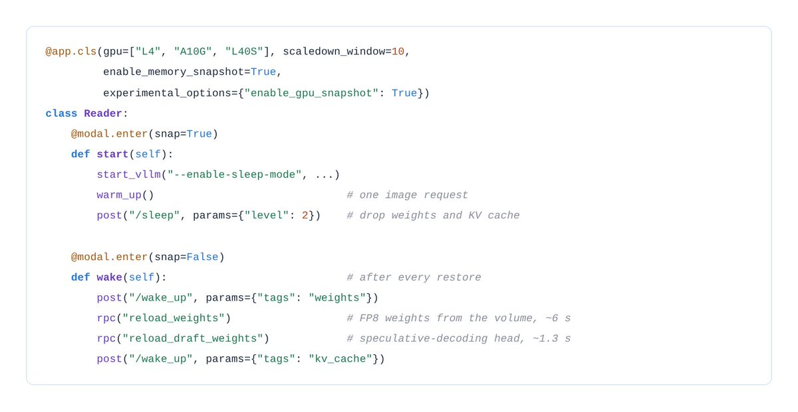

低频自定义模型很难像共享大模型服务那样填满 batch。为少量突发请求长期保留 GPU，主要付的是空闲费用；每次请求都重新启动，又可能让用户等数分钟。Sahil Mahendrakar 的长文给出了一个具体工程取舍：保留昂贵初始化的结果，让 GPU 可以更积极地缩到零，而不是试图消除所有启动工作。

原文：[Serving custom models efficiently with fast cold starts](https://x.com/sahilmdkr/status/2121284035968139573) · Sahil Mahendrakar · 2026-11-13

## 从哪里开始计时，决定了“15 秒”的含义

文章比较三个路径：启动停止状态的 AWS GPU 主机、创建全新 Modal 容器，以及恢复 Modal GPU 内存快照。AWS 分配 GPU 可能花一分钟或更多，受容量影响；Modal 的分配约为 5 秒。新启动路径还需引擎初始化、KV 容量分析和 CUDA Graph 捕获，单这些阶段就可能各耗约一分钟。

权重加载也不同：AWS 的 EBS 路径超过两分钟，全新 Modal 容器约 35 秒。因此不能把两条平台路径的总差距全归于快照。作者另调整预取权重、按实际 batch 范围捕获图、提前写好 FP8 checkpoint，将 checkpoint 从 18 GB 减到 12 GB，削减了全新 Modal 启动近一分钟。快照收益之外，还叠加了存储与配置优化。

<a class="note-image-link" href="/assets/images/tech/custom-model-snapshots/restore-sequence.jpg" target="_blank" rel="noopener" aria-label="先预热并释放大块状态，恢复后依次重载权重与分配 KV · 查看原图 ↗">查看原图 ↗</a>

*读图：先预热并释放大块状态，恢复后依次重载权重与分配 KV。*

标题所说约 15 秒是恢复到可服务的量级；成本表采用 20 秒快照启动，突发的首次完整回答约 30 秒。它们不是同一测量边界。原始冷启动的 3–7 分钟也受平台与配置影响，不应压成一个稳定的通用加速比。

## 快照特意不保存权重与 KV 内容

昂贵步骤包括 Python 导入、CUDA context 建立、库加载、kernel 编译、KV 容量分析和图捕获。完成后，很多结果只是 CPU/GPU 内存里的字节，恢复这些结果可以代替重复计算。

这里最关键的细节是：作者在保存快照前让 vLLM 进入 sleep，释放权重和 KV cache，但保留地址预留，以维持已捕获图的有效性。大量权重进快照并不会天然比独立加载更快，还会扩大保存时间，增加容器在保存途中停止的风险。恢复后再加载权重约 6 秒、重新分配 KV 约一两秒；避免的是重新推导容量与捕获执行图，而不是永远不再分配 KV。

这个工作流依赖服务平台的 GPU 内存快照支持、vLLM 的 sleep/wake 行为与地址保持。它不能直接推导为任意进程做普通 fork 就能继承 CUDA 状态。与 Cairn 共享编译产物、继续捕获进程绑定图的设计相比，这是不同的状态复用边界。

## 费用下降来自空闲与启动两部分

作者的 L4 上 9B 模型实验中，单次快照唤醒约需 0.01–0.02 美元，新启动约 0.05–0.07 美元。后续月成本比较则使用模拟突发：每次 5 个请求、每请求约 12 秒、空闲 10 秒就释放容器，Modal L4 加 CPU/内存约 0.95 美元/小时。快照路径取 20 秒启动，新容器取 3 分钟，并从容器启动计费到缩容。

因此，收益不只是首请求等待时间变短。启动本身占用的计费 GPU 时间减少，还允许缩短保温窗口。反过来，如果请求已经很密集，频繁释放与重启未必比保持热实例划算。这些月度数字来自特定流量和单价假设，不是所有自定义模型的真实账单。原文对另一模型服务的价格对照也绑定同一任务，不能脱离质量与输出长度直接推广。

## 缩到零仍没有解决活跃期间的利用率

模型醒着时仍独占 GPU；若每次只有少量请求，decode 仍可能受内存带宽限制。多 LoRA 服务与快速模型切换可能进一步共享资源，但文章没有验证这些组合的端到端收益。它也没有给出跨多种模型、驱动、图配置的恢复正确性矩阵。

这篇实践最有用的贡献是把快照内容与恢复顺序讲清楚：哪些状态值得保留，哪些大块数据应重新加载，哪些初始化可以跳过。评估同类方案时，应把可服务时间、首 token、完整回答和计费区间分别记录，同时保留平台容量、权重来源和图捕获范围；这样才能判断省掉的是哪一段启动工作。
