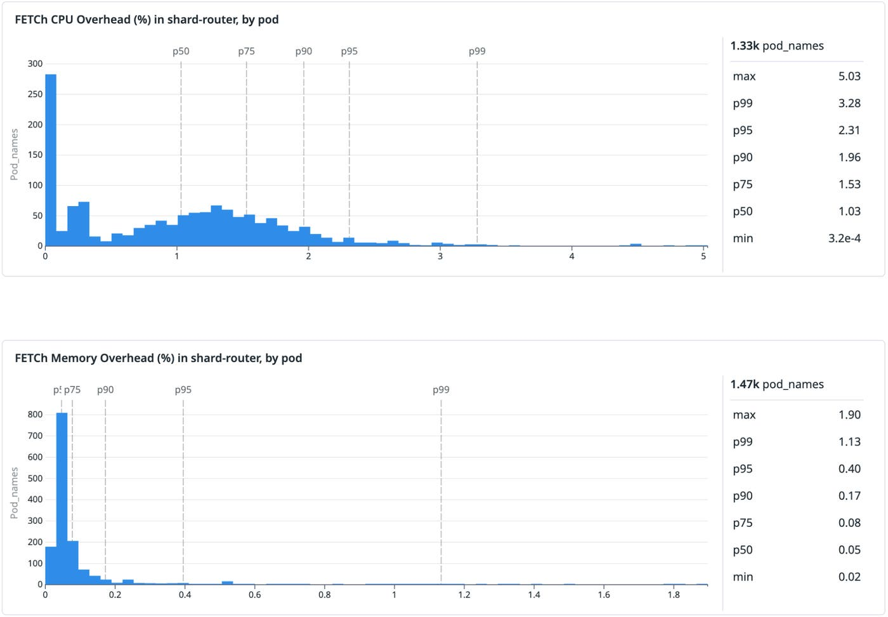

[How we continuously validate formal specifications in production](https://www.datadoghq.com/blog/engineering/continuous-formal-spec-validation/)  
Nicolas Couvrat · 2026-11-05

一份通过模型检查的规约可能很正确，却逐渐不再描述生产系统。Datadog 的 FETCh 针对这种规约与实现的偏离，将 TLA+ 允许的状态转移编译成 Rust 监控器，并在 Husky 路由系统中发现了正常运行不暴露、故障恢复时才会出问题的状态冲突。

<a class="note-image-link" href="/assets/images/tech/datadog-continuous-formal-spec-validation/official.png" target="_blank" rel="noopener" aria-label="FETCh sidecar 在生产 pod 中的 CPU 与内存开销分布 · 查看原图 ↗">查看原图 ↗</a>

*上图 CPU 的 p90 为 1.96%，下图内存为 0.17%；这些是该路由部署的观测分布，不是所有监控器的开销保证。*

## 为什么只检查不变量还不够

模型检查需要有界状态空间，生产监控面对的却是持续到达的无界输入。简单地把设计时的模型原样接到日志上，容易遇到抽象不匹配或状态爆炸。原文的锁服务例子说明另一个问题：只检查“锁计数不超过 1”，仍允许重复释放把计数减成负数。某个不变量成立，并不意味着每次动作都属于规约允许的转移。

FETCh 用 refinement 连接两种用途。抽象规约 A 描述真实系统允许的行为；可模型检查的 B 引入必要边界，并保证 B 的行为都被 A 允许。设计时检查 B 对 A 的精化关系，生产中监控 A。这样可以继续使用同一形式化基础，同时承认设计探索和线上观测需要不同粒度。

## 从 TLA+ 动作生成事件处理函数

生成的 Rust 监控器维护规约变量，为 `Next` 中的动作建立处理函数。收到事件后，先验证对应动作的前置条件，再更新监控状态；前置条件失败意味着实现执行了规约不允许的步骤。

TLA+ 没有直接提供 Rust 所需的类型信息。FETCh 利用动作中的存在量化指定输入集合，通过 `fetch:u32` 等注解映射常量类型，再从 `TypeOK` 取得变量类型。这个转换建立在受支持的 TLA+ 子集上，并不是任意规约都能自动上线。运行时还依赖工程师把真实事件正确接入对应动作。

## 把全局正确性拆成可承受的监控状态

Husky 希望同一事件 ID 总是路由到同一 shard。最直接的规约为所有 ID 保存映射，但一个摄入窗口有数万亿个不同事件，还要跨监控器重启持久化，状态成本不可接受。

团队把证明义务拆成两部分。全局监控 placement 存储，确保 ID 范围分配不冲突；每个路由进程的 sidecar 检查它只使用先前收到、未经修改的 placement，并按正确哈希发布事件。数千实例分担事件检查，全局只保留数量小得多的数百万 placement。作者还建立形式化证明，说明两项规约都满足时，路由一致性不会被破坏。

局部监控状态只需跟随进程生命周期，无需跨重启保存，也避免为每个事件发送远程验证载荷。全局 placement 状态依然较大，于是 `FetchMap`、`FetchSet` 允许替换底层容器，接入 RocksDB 支撑持久状态。这是本篇最有工程价值的设计：先分解正确性条件，再选择状态存放位置，而非先把所有事件集中起来。

## 找到的是潜伏的恢复故障

作者报告，在处理每秒数千万事件的部署中，sidecar 的 p90 CPU 开销约 2%，内存低于 0.2%；配图分别覆盖约 1,330 和 1,470 个 pod。全局批量校验用 1 CPU 和数 GB 内存，在约一小时内处理数天、数百万条 placement。

局部路由规约未发现违规，但存储监控发现冲突 placement。原因是一年前为改善均衡而允许某些特殊情况跳过去重，却仍把这些记录持久化。冲突比例估计低于 0.01%，正常操作无害；一旦发生 placement 数据丢失，两条冲突就足以使 backfill 恢复失败。它不是已发生的大规模数据事故，而是生产证据暴露出的恢复路径缺陷。

## 规约仍有覆盖边界

FETCh 目前只支持 TLA+ 子集，且前置条件只针对当前状态检查。插桩、事件完整性以及分布式全局状态的验证仍需要系统专门设计。该案例不能证明全部 Husky 行为都正确，但说明规约可以在发布多年后继续发挥作用：检测的对象不仅是服务异常，也包括实现变化是否让原来的正确性论证失去前提。
