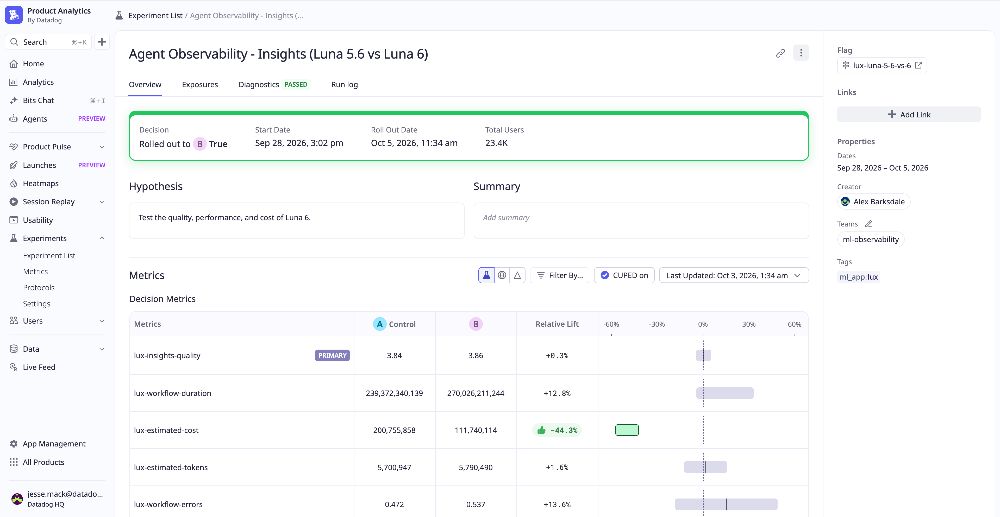

原文: [Compare AI agent changes with Online Experiments in Agent Observability](https://www.datadoghq.com/blog/online-experiments-agent-observability/) 
Alex Barksdale, Yakov Shapiro, Demetri Pananos, Miguel Tulla Lizardi · 2026-11-04

## 换模型要比较整次工作

较低的 token 单价并不保证一次调查更便宜：新模型可能调用更多工具、产生参数错误，或靠多轮重试才恢复。Datadog 用内部 Insights agent 的模型切换说明，在线实验应该同时观察质量、成本、耗时和错误，并用底层轨迹解释这些指标为何变化。

这篇产品技术文章的独有信息是一个真实使用场景的对照结果。团队将流量均分给 GPT-5.6 Luna 与 GPT-6 Luna，以前者为参考。Insights agent 的任务是依据轨迹调查代理行为；LLM judge 根据用户请求、工具输入输出与调查结论给出 1–5 分，考虑准确性、完整性、证据支持及是否承认不确定性。耗时、估计成本、token 使用和工作流错误另行从 trace 统计。

## 随机分流与可观测性连接起来

离线测试擅长检验已知回归，但固定数据集未必包含真实用户的新请求或长尾工具结果。在线实验保留同期控制组，通过随机分配降低“新版恰好处理更简单问题”的混杂。质量判定仍依赖团队定义的 rubric；在线流量并不会自动让裁判正确。

Datadog 的实现将 Agent Observability 的 evaluator 分数接入 Experiments，并与运维指标共同计算相对变化和置信区间。应用接好不同变体后，Feature Flags 可控制曝光比例。遇到模糊结果时，可以回到原始工具选择、参数和返回值，而不是仅凭一个成功率判断。

<a class="note-image-link" href="/assets/images/tech/datadog-online-experiments-agent-observability/results.png" target="_blank" rel="noopener" aria-label="Datadog 模型对照实验的质量、耗时、成本和错误指标 · 查看原图 ↗">查看原图 ↗</a>

*成本区间完整落在零以下；耗时和错误区间跨过零，不能据此宣称没有退化。*

## 均值相近，不代表质量等价

作者报告 Luna 6 的估计成本降低 44.3%，置信区间为降低 37.5%–51.2%。质量均分分别为 3.84 与 3.86，差异很小，但原文明确指出，接近的平均数不能建立等价质量。

其他指标保留了重要不确定性。耗时点估计增加 12.8%，区间覆盖降低 4% 到增加 30%；工作流错误点估计增加 13.6%，区间从降低 16% 到增加 43%。因此，数据既容许变化很小，也容许具有运维意义的增加。把“不显著”写成“不会变慢或出错”会错过需要调查的问题。

团队检查轨迹后发现，所查看的 Luna 6 运行更常提供无效工具参数，通常经过重试自行纠正。最终调查报告可能仍然很好，综合 judge 分数却不直接表达失败调用频率和恢复所花的工作。于是团队先处理参数问题，再推进更便宜的模型版本。这是文章最值得关注的因果链：成本结果支持继续尝试，轨迹分析指出尚需修改的具体行为，而不是让一个省钱百分比替代上线判断。

## 把线上发现带回离线测试

失败调用可以成为回归用例，后续实验再检验工具定义或错误反馈的修改。这样的循环让离线测试随真实流量扩展，同时让线上实验继续检验行为和运行成本是否一起改善。

这仍是一个供应商自报的单代理案例，不能把成本降幅推广到所有模型切换；文章也没有给出足以独立重建全部统计分析的实验协议。其可靠测量启示更稳健：保留同期控制、把质量与资源指标拆开、读取区间而非只看点估计，再通过轨迹定位机制。对于已经部署 AgentOps 监控的团队，这说明监控数据不仅用于事故排查，也可以成为变更评估的证据。
