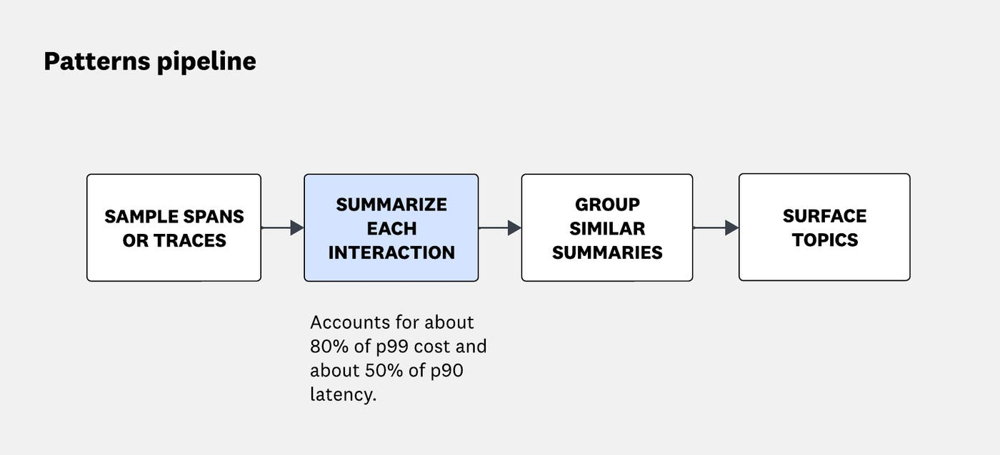

Patterns 把生产中的 Agent 交互按主题聚类。一次分析可以抽到数千条轨迹，每条包含提示、工具调用与响应，数据量可达数 MB。真正昂贵的步骤在聚类之前：先按照用户给定的聚类指令，把每次交互压成一句摘要。Datadog 测得这一步约占一次分析 p99 成本的 80%、p90 延迟的 50%。它既是明确的瓶颈，又有相对固定的输入输出格式，适合单独调整。

## 从可观测记录构造监督样本

摘要服务的调用本身被记录成 LLM span。团队用 pup finetune 提取交互及当次指令作为输入，把原摘要模型的输出作为监督目标。不同指令会强调用户意图、执行内容等不同特征，因此同一个样本不能脱离指令只学一句“通用摘要”。划分数据时按 trace 分组，重复请求也进入同一集合，避免同一交互的多个版本同时出现在训练和测试中。限制每条轨迹可贡献的行数，还能降低少数特别繁忙会话的权重。

<a class="note-image-link" href="/assets/images/tech/datadog-patterns-baseten/overview.png" target="_blank" rel="noopener" aria-label="查看原图 ↗ — 每条交互先生成摘要，后续才分组和展示主题。测得的生成加速作用在第二个框。">查看原图 ↗</a>

*每条交互先生成摘要，后续才分组和展示主题。测得的生成加速作用在第二个框。*

## 先看基座模型失败在哪一步

Baseten 上的 Qwen 3.5 9B 经常在推理阶段耗尽 token 预算，还没写出可供下一步解析的摘要。对于能完成的回答，其内容通常已经不错。这样，微调的具体目标是让模型在预算内稳定交付符合格式的短答案。编码 Agent 通过 skill 串起数据审阅、基座评测、训练和比较，付费操作由人工批准。调用也能重新留下 span，使后续评估有机会观察生产分布是否变化。

单看 judge 的总通过率，会以为模型对“怎样写出好摘要”的理解有了大幅提升。拆开失败类型，基座的 83 个失败里有 78 个耗尽预算或无法解析。在它成功交付且可解析的 72 条中，67 条通过 judge，约为 93%；微调后可解析的 150 条中，140 条通过，比例同样约为 93%。提升主要发生在能否交付答案这一层。

## 50 倍对应单条摘要的平均生成时间

留出测试有 150 条样本，来自五条完全隔离的轨迹。基座只有 72 条完成且可解析，微调后为 150 条；以记录中的摘要为参照，LLM judge 判可替代的答案从 67 条增至 140 条。专用 Baseten 采样器上每条平均生成时间由 44.7 秒降至 0.89 秒。改善的一个直接来源是减少尚未交付摘要就耗尽预算的长生成。该实验测的是摘要步骤，用户看到的 Patterns 还包括抽样、嵌入与聚类。五条测试轨迹内的 150 个判断也不能当作 150 个独立生产场景。

[How we fine-tuned a faster model for Patterns on Baseten](https://www.datadoghq.com/blog/fine-tuning-patterns-baseten/) · Fouad Wahabi, Vincent Cornet, Alex Barksdale · 2026-11-18
