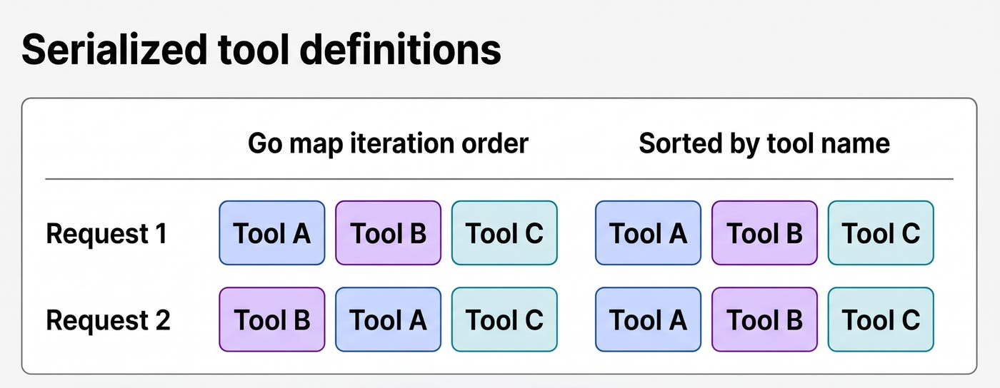

[How we investigated prompt cache misses with Datadog](https://www.datadoghq.com/blog/prompt-cache-investigation-ccm-agent-observability/)  
Bruno Volpato, Will Potts, JC Mackin · 2026-11-06

开启缓存选项后，Agent 的费用仍可能几乎没有下降。Datadog 的案例把这个问题拆成可定位的调用链：账单指出昂贵应用，轨迹显示缓存读写，最终发往提供商的请求才揭示缓存为何不能复用。文章的价值在于具体失效机制，而不是一个通用节省比例。

<a class="note-image-link" href="/assets/images/tech/datadog-prompt-cache-investigation/official.png" target="_blank" rel="noopener" aria-label="Go map 无序迭代与按工具名排序后的序列化请求对比 · 查看原图 ↗">查看原图 ↗</a>

*两次请求的工具内容相同，左侧顺序变化仍会改变前缀；右侧先排序，使可复用部分保持一致。*

## 先确认观测代表一次真实调用

团队从 Cloud Cost Management 查看提供商支出，再在 Agent Observability 比较同一任务的首次和后续模型调用。工具定义、系统指令与历史消息会反复发送，后续调用是否增加缓存读取，是判断复用的重要线索。还需同时看输入量、估算费用与首响应时间。

原文展示的无命中示例，每次输入超过 180,000 token，输入估算费用为 0.74–0.82 美元；另一组有缓存读取的请求总费用为 0.02–0.14 美元。两组不是同一工作负载修复前后的对照实验，不能直接相除当成优化收益。

在查业务代码前，作者先检查记录完整性：应用和网关可能各记录一次同样的模型调用，从而重复算钱；缺少缓存字段则会把已命中误判为未使用缓存。遗漏系统指令或工具列表的 trace 也不足以解释前缀差异。观测数据本身是诊断链条的一部分。

## 相同信息不等于相同前缀

提示缓存依赖请求开头的匹配。若时间、组织信息、功能开关或事故上下文被放在稳定指令之前，小变化就会使后面相同的大段文字无法复用。作者提出把稳定部分放前面、动态部分放后面，并在支持的接口上标记缓存边界。

但动态字段也要逐项验证。一个每日变化的 UTC 日期只能解释跨日失效，不能解释全天每次都失效；另一个看似位于开头的时间戳其实属于记录的用户内容，改系统提示不会解决它。

更隐蔽的原因是顺序。一项服务通过 Go map 迭代生成工具列表，同样的 A、B、C 可以变成 B、A、C，改变序列化前缀。补丁先对工具名排序，测试以不同插入顺序构造 map 并比较输出列表。另一个从源文件生成提示的服务也受 map 顺序影响，而且会改变截断后保留哪些文件。排序解决确定性问题；实际缓存改善还需要后续提供商请求验证。

## “已启用”可能没有传到提供商

某服务的 `WithPromptCaching` 开关只加了 beta header，未在请求体中带上缓存控制。另一项应用没有把 SDK 的缓存选项传给真正组装请求的组件。两者都说明配置层的布尔值不能证明线上行为，应沿组装链检查最终发出的控制信息。

接口路径也决定能力。团队在 Anthropic 原生 Messages 流量中看到缓存读取，在 OpenAI 格式兼容路径上未看到；调查时的官方文档也说明后者不支持提示缓存。迁移原生接口前，仍需核对消息角色、工具结果和流式返回，不能只因缓存机会就假设协议转换没有行为差异。

## 以完整任务核算收益

缓存写入可能另收费，几乎不再使用的内容反复写缓存反而更贵。更长的历史也可能让命中 token 变多，却抬高总输入量。因此，比较必须固定应用路径和任务类型，观察后续读取、输出费用、重试、回退模型、首响应以及任务总耗时，最后用账单确认财务收益。

还有一个容易忽略的口径：Datadog 归一化输入总量已包含缓存读写，再加一次会重复计算。这个案例适合负责多层 SDK、网关和 Agent 编排的团队：定位点是实际请求及其顺序、控制字段与路由能力，不能把“开关开了”当成验收标准。
