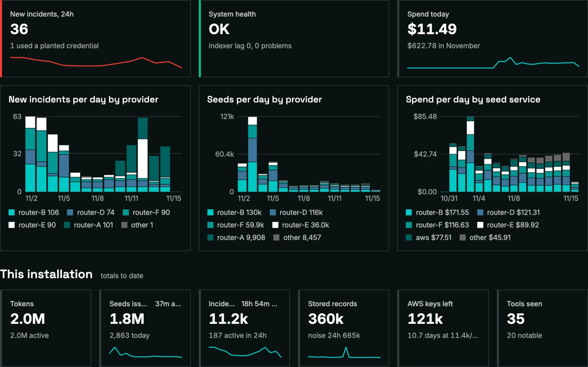

推理服务通常把延迟、错误和费用记到请求完成为止。HD Moore 在 Dragos 的研究追踪了另一条时间线：请求结束几小时、几天乃至几个月后，其中的内容还会在哪里出现？研究者向 AI 服务发送近两百万条带独有标记的提示词，发现有些本该只出现在一次推理中的信息，后来在完全不同的系统上产生了访问记录。

## 怎样把一次后续访问关联回原请求

研究让每条测试请求携带不同的标记，再把标记与当时的模型、路由和隐私设置关联起来。于是，一个私有链接在数天后被打开，仍能对应到某次已结束的调用。若测试凭证也被使用，还能区分单纯获取链接与主动使用请求内容这两种行为。一次标记命中能定位原请求，却不能自动确定是哪一跳把内容交给了访问者。

<a class="note-image-link" href="/assets/images/tech/dragos-prompt-canaries/console.png" target="_blank" rel="noopener" aria-label="Dragos 控制台分别展示每日观察事件、投放量与花费">查看原图 ↗</a>

图中间一行按日列出事件数、投放量与花费。不同日期的投放规模相差很大，事件又可能来自更早发出的请求，因此不能把同一天两根柱子的比值当作泄漏率。

## 同一模型换了卖家，观察也随之改变

研究者报告，发给某个卖家的两条提示词中的链接约一天半后都被打开；相同模型经另一卖家处理的对照请求没有出现相同行为。报告指出，部分转售商可通过日常日志看到客户输入。这里有两层运维问题：服务本身是否失陷，以及按原有权限运行的中间商能读到什么。只调查主机入侵，会漏掉后一种暴露。

在另一组与某实验室模型相关的测试中，7 月至 10 月间，超过半数请求中的私有链接被获取，其中标有禁止收集或 ZDR 的请求约有三分之二出现这种现象。这个比例属于特定模型和测试路径。它不能外推成整个推理市场的违约率，单次链接读取也不能独立证明读取者的身份或目的。

## 暴露时间、发现时间与归因

报告把至少三家托管商的事件归为入侵，并称它们在研究者通知之前均未察觉。还有一条启用 ZDR 的测试请求，其独有链接在 24 天后出现在企业聊天中。研究者此前向服务商披露时只给了链接开头的八个字符，随后被打开的却是完整链接。这比单独一个访问时间戳提供了更强的留存线索。

对负责推理平台的人，最值得读的是报告如何从一条告警逐步收窄解释：标记命中指出原请求，对照路由帮助定位差异，服务商自己的调查才能继续解释内部经过。反过来，标记一直安静只说明没有看到可识别的后续使用；被动读取、未抽中的路由以及从未触碰标记的处理方都可能不可见。

HD Moore · 2026-11-19 · [Three breaches, endless leaks: Your AI supply chain needs canaries](https://www.dragos.com/blog/ai-supply-chain-security-canary-tokens)
