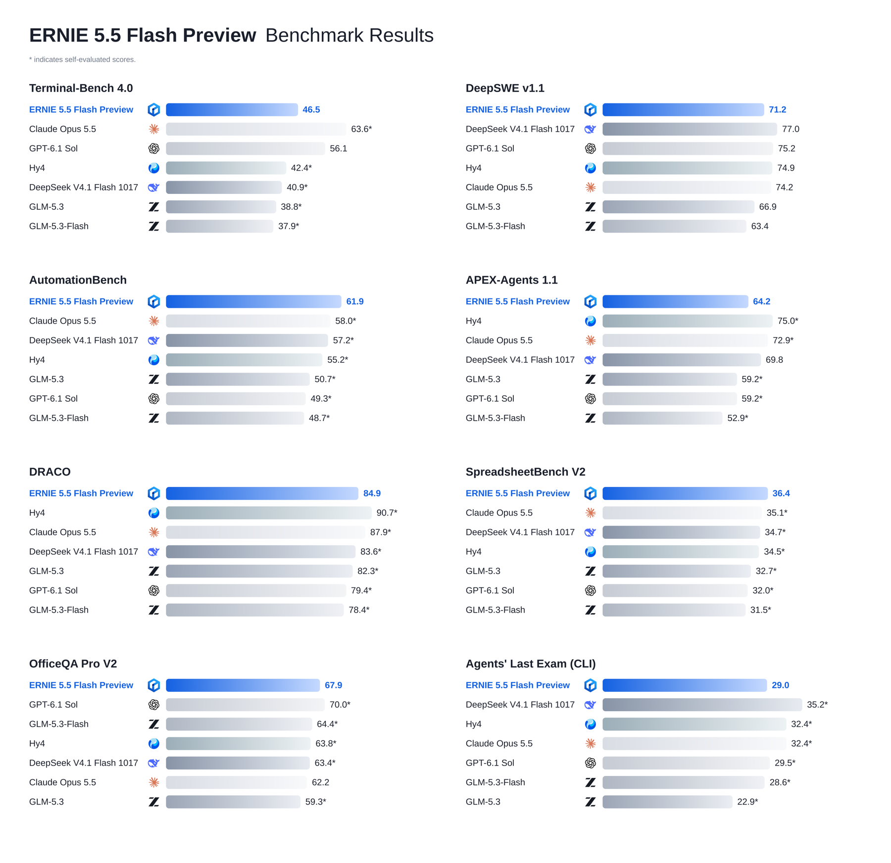

一段能运行的演示可以证明模型曾完成一次任务，却很难告诉我们下一次成功的概率。ERNIE 5.5 Flash Preview 的发布材料中，最值得分别阅读的是模型卡的基准条件，以及团队如何把一个文本模型接入能给它反馈的工程环境。

Baidu ERNIE · 原文标注 2026-11-11 · [Introducing ERNIE 5.5 Flash Preview](https://ernie.baidu.com/release/ernie-5-5-flash-preview/)

## 先确定比较的是哪一个模型

这是基于 ERNIE 5.5 Flash Base 的首个后训练版本，也是仍在继续后训练的中间检查点。模型总参数 280B，每枚 token 激活 14B，最大上下文为 1,048,576 个 token。输入和输出都是文本。模型卡列出可关闭的思考模式，开启后可以选低、中、高三个 effort，默认高。服务评估如果只记录模型名，复测时可能同时改变思考预算和权重精度。官方模型卡把 Apache 2.0 许可明确限定到 Preview 权重，Base 使用独立许可。

<a class="note-image-link" href="/assets/images/tech/ernie-5-5-flash-preview-release/ernie-5-5-flash-preview-release.png" target="_blank" rel="noopener" aria-label="查看原图">查看原图 ↗</a>

*不同任务采用各自的判分条件，应在同一测试的横向条带内比较。*

## 文本模型怎样收到画面之外的反馈

发布页记录了一个持续 11 小时的 Unreal Engine 5.8 编码案例。模型用 C++ 实现游戏，试玩中发现撞墙距离、碰撞时机和相机位置等问题后，把这些现象转成可测的代码条件，逐步扩大测试套件。这条链路中的观测和修正十分具体：模型不能直接看屏幕，维护者需要区分试玩反馈、模型编写的测试以及最终画面的效果。场景、角色等外部素材在原文中单列了来源。

另一个案例把小游戏规则与呈现逻辑拆开，规则作为确定性模拟运行，再用机器人试玩、状态空间搜索和逐关回放检查是否可以通关。这样的环境让「项目文件已生成」和「每关都存在可行路径」成为两个可以分别测试的条件。演示集经过挑选，发布页没有给出反复执行同一项目的失败率或实际人工反馈成本。

## 将案例放回基准分数的口径

模型卡报告 Terminal-Bench 4.0 为 46.5、DeepSWE v1.1 为 71.2，而 ProgramBench 的 29.5 明确对应 Almost Solved 口径。这些数字属于不同任务与判分规则，不能按高低直接推断哪类工程工作更容易。对于需要脚本工具、测试和长时间状态保持的任务，发布材料给出了可检查的成品与运行方式，基准表则给出了跨任务集的成绩。两者仍然没有给出一次 11 小时任务的延迟分布或单位成功成本。

[官方模型卡与评测表](https://huggingface.co/baidu/ERNIE-5.5-Flash-Preview)
