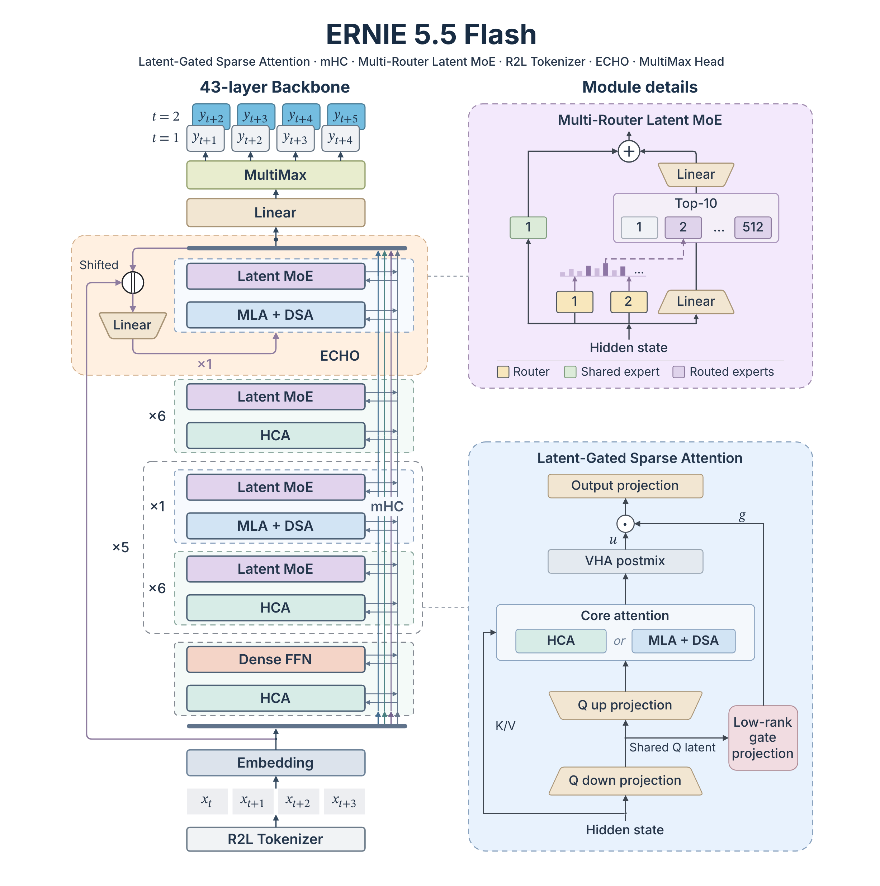

ERNIE-5.5-Flash-Base 的发布价值不只是新增一组大模型权重。它把混合注意力、潜在空间 MoE 和可复用的草稿层组合成一套面向进一步训练与推理效率的架构，SGLang 同时给出硬件与精度配置。阅读时首先要分清：当前开放的是预训练结束后的 Base，不是已经训练好对话、推理或工具调用行为的成品 Agent 模型。

原文：[ERNIE-5.5-Flash](https://docs.sglang.io/cookbook/autoregressive/Baidu/ERNIE-5.5-Flash) · SGLang 部署文档；架构与发布日期依据 [ERNIE 5.5 Flash Base](https://ernie.baidu.com/release/ernie-5-5-flash-base/) · Baidu ERNIE · 2026-11-05

## 容量、激活量与上下文不是同一个规模

模型总参数为 280B，每 token 激活 14B，以 33.5T token 从头预训练。官方说明总参数包含输入 embedding 和输出 head，激活量计入输出 head，不计 embedding lookup；二者不包含额外的 0.36B ECHO 参数。43 层中，第一层是 dense FFN，其余为 MoE。激活量决定部分计算成本，却不表示只需为 14B 权重准备存储。

预训练上下文逐步扩到 128K，配置允许微调与推理到 1M。这两个长度描述不同阶段：能启动 1M 请求，不等于原生在 1M 长度上训练，更不直接证明远距离精确检索质量。部署时还必须容纳长 prompt 的激活及 KV 状态，而非只把权重装进显存。

<a class="note-image-link" href="/assets/images/tech/ernie-5-5-flash-sglang/architecture.png" target="_blank" rel="noopener" aria-label="左侧是压缩层与全历史访问层交错的骨干，右侧展开潜在 MoE 与注意力门控，ECHO 复用末层草拟未来 token。 · 查看原图 ↗">查看原图 ↗</a>

*左侧是压缩层与全历史访问层交错的骨干，右侧展开潜在 MoE 与注意力门控，ECHO 复用末层草拟未来 token。*

## 多数层压缩历史，少数层保留逐 token 访问

37 个 HCA 层将每 128 token 压成一个缓存条目，同时保留最近 128 token 的窗口；六个 MLA 层保留 token 级历史，并用 DSA 索引器筛选 top-k 位置参与核心注意力。于是模型不是简单丢掉远处所有内容：多数层看压缩历史，少数层仍可选择细粒度位置。

计算更便宜的 HCA 采用 512 维 head，昂贵的 MLA 使用 256 维。注意力还加入从低秩 query latent 计算的门控，以及跨 head 的低秩 VHA 混合。官方称门控投影比从完整 hidden state 出发少 75% 权重，这是局部模块参数比较，不是整模型减少 75%。同样，DSA 使核心注意力处理预算受控，不意味着索引、缓存和整条推理开销都与上下文无关。

MoE 在 2048 维潜在空间执行专家，相对 4096 hidden width 缩小 dispatch/combine 张量；512 个 routed experts 中选十个，另有一个 shared expert。Multi-Router 用多个独立初始化的 sigmoid router 共同评分，希望降低单个 router 误选后缺乏反馈的自强化。它改善的是路由表达与训练，不是运行时热专家副本分配，因此不能与本期 vExpert 的负载均衡机制混为一谈。

## ECHO 复用最后一层，但草稿收益仍需看验证成本

ECHO 用骨干自身最后一层预测未来 token，使未来 token 的训练损失直接作用到骨干参数，同时将同一层用于投机草稿。它预训练只预测一步，推理时可递归草拟多步；SGLang 通过 EAGLE 或 NEXTN 选项启用，当前注意力后端只支持链式草稿，top-k 必须为一。

文档在 GSM8K、batch 1、greedy 条件下报告一、二、三步草稿的平均接受长度分别为 1.93、2.28、2.36，准确率不变。第三步增加的接受长度已很小；这些数字不是吞吐倍数，因为还要支付草稿与验证耗时。文档推荐低延迟路径使用两步 ECHO，高吞吐路径使用 attention DP 且不带草稿，恰好说明单请求优化不能直接搬到高并发。

Base checkpoint 不带 DSpark 草稿。未来的 ERNIE-5.5-Flash 后训练版本计划提供对话、reasoning、tool calling 与 DSpark；不能因为文档提前展示了 parser 和示例，就写成这些能力已经随 Base 开放。

## 文档中哪些配置已验证，哪些仍有限制

FP8 权重约 280 GB，BF16 约 560 GB。最小 FP8 方案为两张 288 GB B300/GB300，或四张 B200/GB200，或八张 H100。官方核验覆盖这些单节点 FP8 方案与 B300 上的 BF16；其他 BF16 配方按容量推导，尚未验证。支持矩阵要保留这种证据差别。

模型自动选用 ernie55 attention backend、256 的 page size 和 FP8 KV dtype 等设置。attention TP 必须整除八；DeepEP expert parallel 需要至少四路，decode 的 CUDA Graph batch 乘以每请求草稿 token 数还须满足每 rank dispatch 上限。1M 请求应降低并发，文档对两张 B300 建议降到个位数，并为 prefill 激活留出数十 GB，默认 256 请求数不能照搬。

HiCache 可将长共享前缀扩展到主存并选择 Mooncake 存储层；PD 分离也有具体限制：并行 sampling 的 n>1 当前会因共享 bootstrap room 挂起，需发送 n=1 请求。这些约束比“Day-0 支持”更有部署判断价值。

## 值得关注的是可验证的效率组合

官方发布说明提供训练与架构消融，部署文档给出接受长度和已验证矩阵，但没有用这些条件证明任意业务都可获得固定加速。其研究意义在于把预训练检查点、稀疏激活、长上下文状态和草稿路径一起开放，便于在相同起点比较后续训练方法。工程评估仍应分别检查 Base 的任务适配、长上下文质量、内存余量与目标并发下的延迟，避免把激活参数少、支持长度长和服务更快写成同一结论。
