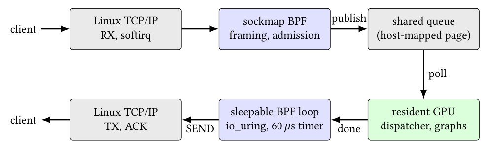

当小模型和短 GPU 任务的计算足够快，接收请求、排队和发送响应就可能成为显眼的成本。bpf-gpu-server 把这条请求循环交给 eBPF、io_uring 与常驻 GPU dispatcher，却得到一个值得关注的负面结果：在共享同一 GPU 执行器的对照中，移入内核并没有带来可辨认的 CPU 或尾延迟收益。真正改变性能的，是执行容量、TCP 小包行为与连接回收。

**yunwei37（配套报告署名 Yusheng Zheng）· 官方文章发布于 2026-10-17**  
原文：[Does moving a GPU server's request loop into the kernel save CPU?](https://eunomia.dev/blog/2026/10/17/bpf-gpu-server/) · 配套报告：[Does Kernel-Owned Networking Make GPU Serving Cheaper? Lessons from an eBPF-Driven GPU Server](https://eunomia.dev/_content-assets/docs/papers/bpf-gpu-server.pdf)

## 请求怎样绕开用户态循环

启动时，用户态进程创建监听 socket、捕获 CUDA graphs、映射 CPU/GPU 共享内存并挂载 BPF 程序，随后启动常驻 GPU dispatcher。它仍保留内存所有权并处理关闭，但不再逐个处理请求。这里省掉的是用户态请求线程的介入，不是所有 CPU 工作。

请求仍先经过普通 Linux TCP/IP 协议栈。sockmap BPF 对重组后的字节流分帧、校验并准入，将任务发布到共享队列；GPU dispatcher 读取队列，启动对应 graph，再发布输出。sleepable BPF 循环负责观察完成、通过 io_uring 发回响应、维持回复顺序和回收连接；有在途工作时，它等待完成事件或 60 微秒定时器。

<a class="note-image-link" href="/assets/images/tech/eunomia-bpf-gpu-server/architecture.png" target="_blank" rel="noopener" aria-label="内核请求路径与常驻 GPU 执行器 · 查看原图 ↗">查看原图 ↗</a>

*沿箭头从左上读到右侧 GPU，再沿下方返回。蓝色模块接管请求循环，灰色 TCP 收发路径仍然存在；这正是成本未随用户态循环一起消失的关键。*

同一通路既能执行未修改的 cuBLAS/cuFFT graphs，也能回放 Qwen2.5-0.5B、SmolLM2-135M 的上游 vLLM 或 Hugging Face prefill/decode graphs。报告使用 Linux 7.3-rc3，无需自定义内核模块；这些是该原型的版本条件，不能理解为任意现有内核都可直接运行。

## 对照必须只改变请求循环的位置

主基线是调优的 C++ 非阻塞 epoll 服务，与内核路径使用同一共享队列、GPU dispatcher 和计算 graphs。这样才能隔离网络循环位置的影响。官方 vLLM 0.31 是另一个外部参照，但其 API、调度器与 KV 管理都不同，不能把两者的整体差距归因于 eBPF。

测试服务器配置为 Intel Core Ultra 9 285K、24 个逻辑 CPU 和 RTX 5090，另一个主机产生负载。每个条件进行五组成对进程运行，交错运行顺序，并通过精确回放校验输出。CPU 统计分开报告服务进程组与整机：前者包含线程的用户态、系统态时间及 io-wq，但不包含记到其他上下文的全部 softirq；两种口径不能相加。

Qwen2.5-0.5B 使用 FP16、短提示、64 个输出 token，以每秒 192 个请求运行 60 秒。在 16 个 GPU slots 下，两条路径均达到 11,645 tokens/s；完成延迟 P99 为内核路径 3,304 ms、epoll 3,314 ms，差值的置信区间跨过零。每请求进程组 CPU 分别为 0.835 和 0.812 ms，也没有可辨认的优势。这组 CPU 数字不应被概括成所有工作负载都“相差不到 2%”。

小任务实验进一步用 280 字节请求、256 字节响应和 128 条持久连接，扫描计算量、负载与 CPU 亲和性，随后以新随机种子确认三个点。共 312 万次请求没有观察到失败，但三个确认点均未达到预设的 CPU/尾延迟收益标准。仅限一个逻辑 CPU 时，内核路径 P99 约为基线的 2.6 倍。

## 用户态时间下降，成本去了哪里

每秒 1,000 个 FFT 请求时，用户态时间从每请求 11.3 微秒降到 2.8 微秒，系统态时间却从 26.2 微秒升至 35.2 微秒。高精度总 CPU 为 37.56 与 37.96 微秒，差约 1.1%；GEMM 对应总量差约 1.9%。分项来自较粗的计时采样，不宜把四舍五入后的分项当作精确总量。

原因在于 sockmap 位于 TCP 重组之后，两条通路仍承担中断、softirq、socket buffer、TCP 状态机和 ACK 等开销。同时，GPU 完成后仍需要 CPU 上的执行上下文检查队列并提交发送；BPF map 操作和 io_uring 协调也有成本。epoll 可一次取回多个就绪 socket，而内核路径仍需逐请求处理程序调用和队列项。少了一次边界穿越，并不意味着少了主要工作。

报告还公开了曾经误导判断的早期状态：修复忙轮询后，一版内核路径的进程 CPU 曾低于基线，但这个优势没有在最终集成路径重现，也没有出现在整机 CPU 中。这使负面结果更有价值：优化过程中的局部改善，与最终对照中的净收益，是不同结论。

## 改变尾延迟的是容量和协议细节

16 slots 时，输入速率超过执行器实际交付能力，队列不断增长。epoll 路径的首 token 时间从前 10 秒约 235 ms 升到最后 10 秒约 3,003 ms，而生成阶段仍约 86 ms。在另一组原生传输实验中，将容量提高到 32 slots，完成 P99 从 3,337 ms 降至 217 ms；相近吞吐下 vLLM 为 406 ms。代价包括更多 graph/KV 内存，以及相对 vLLM 每请求多约 0.34 J 的设备能耗。这是容量调整的证据，并非内核网络加速的证据。

另一处尾延迟来自 Nagle 与 delayed ACK 的组合：一次 4 字节写入使后续 36 字节等待 ACK 约 41 ms。设置 `TCP_NODELAY` 后，token 间隔 P99 从 40.5 ms 降至 2.3 ms，吞吐由 8,842 提高到 11,260 tokens/s。连接生命周期也曾制造真实失败：已完成连接等无关的全局队列排空才释放，导致 2,947 个 socket 停在 `CLOSE_WAIT`，最终耗尽 socket map；改为按连接回收后，该项实验的 4,157 次超时降为零。

## 对推理系统优化的启发与边界

这项工作的新增价值，是用共享执行器的对照把“GPU 常驻调度的收益”与“请求循环进入内核的收益”拆开。前者相对 vLLM 的较低进程 CPU，还包含返回 token ID 而非 JSON 文本等协议差异；后者在本测试中没有净优势。对于 Ops4LLM，容量不足、网络小包与连接泄漏往往会产生相似的延迟表象，这里的逐层解释比单看一个吞吐数字更有用。

结论限于单台服务器、单个远端客户端、小模型、固定形状请求、二进制协议且无 TLS 的环境。整机统计含观测开销，五组成对运行也不提供强多重比较保证。绕过主机协议栈的 NIC-to-GPU 路径或不同硬件仍可能得到不同结果。值得优先阅读报告的对照设计、CPU 归因和修复前后数据，而不是把它推广为“eBPF 不能加速服务”。
