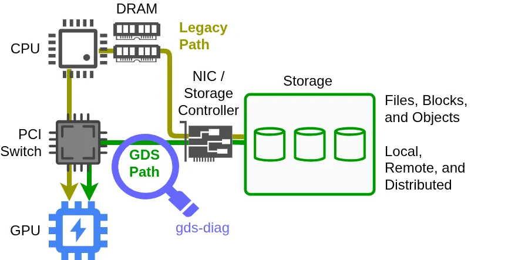

GPU 能访问存储，不代表应用已经走上期望的 GPUDirect Storage 路径。平台支持、CUDA 与驱动环境、容器设置、挂载点和配置覆盖都会影响实际行为。NVIDIA 新介绍的 gds-diag 把这些问题整理成可独立运行的诊断子命令，再用可选 Agent 技能提供自然语言入口。

原文：[How to Check and Configure NVIDIA GPUDirect Storage for Your Platform](https://developer.nvidia.com/blog/how-to-check-and-configure-nvidia-gpudirect-storage-for-your-platform/) · Phil Carns · NVIDIA · 2026-10-30。

## 新增的是诊断层

GDS 提供 GPU 与存储之间的数据路径，减少传统经过 CPU 和主机内存中转的开销。本文的新增内容是环境评估工具：找出硬性阻塞、配置风险和优化机会，而不是新提出一种传输算法，也没有报告普遍适用的训练或推理加速倍率。

<a class="note-image-link" href="/assets/images/tech/gds-diagnostics/overview.webp" target="_blank" rel="noopener" aria-label="传统 CPU 与 DRAM 中转路径和 GDS 路径对比 · 查看原图 ↗">查看原图 ↗</a>

*绿色路径连接存储与 GPU，放大镜表示 gds-diag 检查相关环境。图说明数据路径目标，不能仅凭安装工具就断定应用已经使用该路径。*

工具本身是单个 Python 脚本，要求 Linux 与 Python 3.8 及以上；文章所列 GDS 环境要求包括 NVIDIA 数据中心级 GPU 和 CUDA Toolkit 12.2 及以上。诊断程序能先于 GDS 环境完备运行，这对上线前检查尤其有用：不能把诊断工具的依赖与被诊断系统的依赖混为一谈。

## 沿部署阶段选择证据

`all` 针对指定路径选择并执行检查，适用于裸机、虚拟机与容器。部署前可以用 `pre-install` 看 GPU 和 CUDA 条件，用 `support-matrix` 核对存储支持；部署后用 `post-install` 找安装阻塞，用 `config-audit` 查看配置及环境变量的有效组合。更深的检查由 `container-check` 与 `mount-check` 定位容器或具体目录。

这种分层避免一个常见误判：主机通过安装检查，不等于容器中的某个挂载点也可用。支持矩阵还有静态与实时模式，前者给一般支持关系，后者结合当前环境。黄色条件支持需要读对应约束，而不是把所有非红色项当作相同结论。

每项发现提供状态、解释与缓解建议。FAIL 指硬阻塞，WARN 指潜在阻塞，INFO 是值得注意的信息；PASS 默认不显示，需 verbose。JSON 输出让结果可以归档或接入其他诊断流程。这里的状态是环境检查结论，不是对业务吞吐或端到端正确性的认证。

文章的配置例子先审查候选配置文件，发现拼写错误，纠正后再检查。它还说明无参数的配置审计会考虑当前配置与环境变量修饰。这提醒运维读者：磁盘上某份配置看起来正确，不等于进程最终使用的有效配置正确。

## Agent 负责解释，不替代底层检查

可选技能根据自然语言意图选择子命令、组织多步排查、结合系统上下文解释发现。确定性的检查仍来自 CLI，而不是让模型重新猜平台是否支持 GDS。容器示例中，Agent 查看启动脚本，选择诊断工具，再提出修改并验证。

需要特别区分动作边界：gds-diag CLI 自己不会实施缓解或修改系统，但调用它的编码 Agent 可能根据请求执行修复。是否要求确认由当地策略与工具权限决定。因而“底层检查只读”不能被解读为整个 Agent 工作流都只读。

对 AIOps，这篇教程提供的可迁移模式是：将稳定的领域检查做成可组合工具，让 Agent 处理意图、上下文和后续路线；保留结构化发现，便于比较修复前后状态。文章尚未给出诊断覆盖率、漏检率或性能提升实测。优先读发现格式与配置审计示例，再判断现有运维链是否缺少对应的证据接口。
