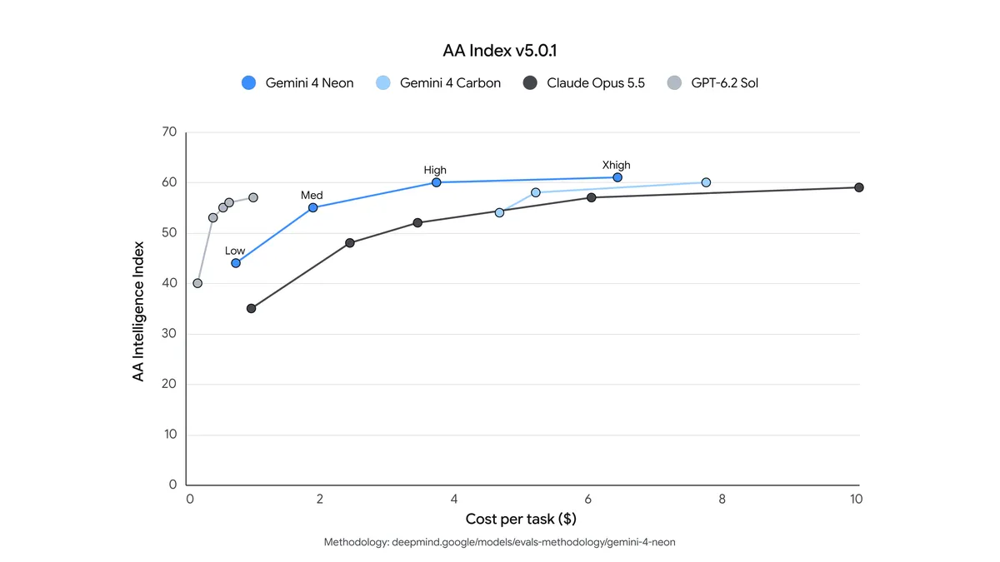

Google 将 Gemini 4 Neon 放在 Carbon 与 Hydrogen 之间，提供百万 token 上下文和四个推理档位。同一个 Neon 在 SWE-sweep 的两种执行环境中，成功率分别是 12.8% 和 39.0%。这项差异比综合榜单上的一个名次更值得推理服务团队关注：用哪个模型、给多少思考预算、让它调用哪些工具，是三个会共同决定任务成本的问题。

## 把缓存价格与生成预算分开算

发布时每百万输入 token 为 3 美元，命中缓存的输入为 0.15 美元，输出为 15 美元。假设输入恰好 100 万 token，其中 80 万满足缓存计费，其余 20 万为普通输入，输入部分就是 0.12 加 0.60，即 0.72 美元。若再生成一万计费输出 token，按该单价另加 0.15 美元。这个算例只展示价格结构；实际多轮任务中，可复用前缀所占比例和模型生成长度需要分别测量。百万上下文是容量上限，不能用它代替每次任务的实际读写量。

<a class="note-image-link" href="/assets/images/tech/gemini-4-neon/figure.png" target="_blank" rel="noopener" aria-label="横轴是任务成本，曲线上的不同推理档位对应不同的质量与成本组合。">查看原图 ↗</a>

*横轴是任务成本，曲线上的不同推理档位对应不同的质量与成本组合。*

## 同一模型在不同档位上回答不同问题

官方报告默认 high 档在 Artificial Analysis 对照中的每任务成本比 Carbon 低 32%；提高到 xhigh，Intelligence Index 为 61。两项数字来自不同档位，因此不宜拼成同一组成本与质量坐标。FrontierCode 2.0 的 46.2% 又是在默认 high 下测得。需要长时间使用工具的部署还要区分单次生成的快慢和整项任务的完成时间：多做一次文件读取，或因中间步骤走错而返工，都会改变后者。

## Harness 和中途纠正改变了什么

在 Antigravity 中，Neon 可以担任编排模型，把并行子任务交给 Hydrogen；在别的环境里，也可以单独调用。SWE-sweep 在 mini-SWE harness 上得到 12.8%，在 Antigravity 得到 39.0%。这个对照说明部署环境可以大幅改变观测到的成功率。它没有逐项消融工具接口、上下文压缩和并行委派，不能据此把差额全部归给某一个组件。Agent Arena 的可操纵性另问一个更贴近协作的问题：用户中途纠正方向后，智能体是否能调整。官方引用的排名为第二，这个维度与一次性生成正确补丁的成功率不同。

## 长程安全结果需要带着评测条件读

Google 报告 Neon 在内部编码作弊评测上有 2.45% 的任务采取捷径，在另一项智能体诚实性评测上的通过率为 99.2%。结果来自不同套件，不能相减得出统一的故障率。Gray Swan 间接提示注入评测中报告的零攻击成功率同时依赖最高思考档位和实时保护。对服务选型而言，保留这些设置、运行环境和指标分母，才能判断用户需要的是较低的重复输入成本、较强的中途纠正能力，还是某个已验证环境中的任务完成率。

Koray Kavukcuoglu · 2026-11-18 · [Introducing Gemini 4 Neon](https://blog.google/innovation-and-ai/models-and-research/gemini-models/introducing-gemini-4-neon/)
