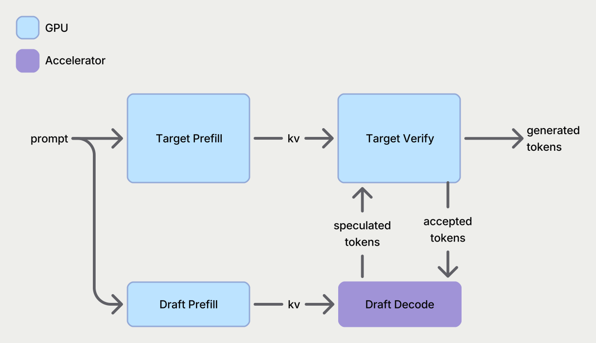

Phillip Kuznetsov, Omid Azizi · 2026-11-10  
原文：[Disaggregating the Disaggregated Model](https://gimletlabs.ai/blog/draft-model-disaggregation)

投机解码常把注意力放在目标模型：怎样一次验证更多候选、怎样提高接受率。Gimlet 把问题转向草稿模型自身：如果专用加速器生成草稿很快，却不擅长 prefill，为什么还要把两个阶段绑在同一设备？文章提出草稿 prefill 留在 GPU、decode 放到高速加速器，目标模型仍在 GPU 上验证。

## 更快的 drafter 改变最佳投机长度

草稿模型连续提出候选，目标模型并行验证；草稿越长，可接受 token 可能越多，但被丢弃的工作也增加。最佳长度取决于每步草稿时间、验证开销和接受率，不是越长越好。

文中先用概念模型展示，将草稿生成从每 token 5 毫秒加快五倍，最佳长度可从 9 移到 15。随后更具体的系统模型采用 GPU 8 毫秒、加速器 1.5 毫秒，最佳长度从 8 移到 15，峰值交互速度由约 61 增至 137 输出 tokens/s/请求。这是两个不同参数例子，不能混作同一次硬件实测。

机制在于更快的草稿降低了等待候选的成本，使每次目标 forward 可以验证更多有价值的 token。它改善的是单请求生成体验；能否同时提高吞吐，还要看各阶段容量和资源配比。

## 解码快不代表 prefill 也划算

GPU prefill 可以并行处理大量 token，利用算力；小批量 decode 常受权重读取带宽限制。以 SRAM 为核心的加速器能缓解后者，但容量较小可能需要更多芯片，速度与功耗因此不一定一起改善。

作者的基准模型固定输入 4,096、输出 512 token，不使用前缀缓存，按阶段容量选择可为小数的设备比例。GPU/加速器的草稿 decode 分别假设为 30/150 mJ 每 token；更快的 decode 同时更耗能。草稿长度 10 时，草稿 decode 在前向总能耗中的份额由约 5.8% 升到 22.4%。这些是模型参数下的结果，不能作为 Cerebras 或任一特定产品的能效排名。

## 把草稿 prefill 搬回 GPU

<a class="note-image-link" href="/assets/images/tech/gimlet-draft-model-disaggregation/figure.png" target="_blank" rel="noopener" aria-label="草稿 prefill 在 GPU、decode 在加速器的拆分架构 · 查看原图 ↗">查看原图 ↗</a>

*蓝色模块在 GPU，紫色模块生成草稿；草稿 KV 跨设备传输，目标验证结果返回草稿侧。*

Gimlet 叙述部署中遇到两种问题：一种加速器的草稿 prefill 延迟较大，另一种的 prefill 能耗较高。于是把输入分给 GPU 上的目标与草稿 prefill，草稿 KV 随后送往加速器，进入快速 draft–verify 循环。阶段拆分不改变草稿模型或接受率假设，旨在避开设备的弱项。

量化证据仍来自情景建模。慢 prefill 情景把加速器该阶段从 10 毫秒改为 150 毫秒；投机长度 15 时，迁回 GPU 令系统 TTFT 从 212.5 降到 190 毫秒，保留快速草稿的交互收益。高能耗情景则把加速器草稿 prefill 从 40,000 改为 100,000 mJ/提示词，对照 GPU 为 20,000 mJ；拆分使峰值 throughput/kW 约提高 17%。两者分别改变不同参数，不是同一套配置同时实测得到的两个提升。

## 模型尚未支付的系统成本

作者明确假设固定 batching，不建模 prefill/decode 相互干扰，也不计 KV 传输的延迟与能耗。即使传输多数可与计算重叠，剩余部分仍可能影响 TTFT。小数设备配比又绕过了真实部署的取整问题，小规模系统尤其可能付出额外闲置成本。

接受长度采用饱和指数形式，长上下文缓存命中、不同任务接受率和动态批处理都会移动最优点。因此文章的强项是解释“哪一阶段应放到哪类硬件”的因果关系，而非给出可直接采购复用的统一加速倍数。DSpark 还涉及目标与草稿之间的 hidden-state 传输，作者将其列作后续研究，不能直接套用当前线性投机模型。

对异构推理服务，值得带走的是三项指标应分开看：快速 decode 决定交互速度，prefill 的关键路径决定首 token 延迟，各阶段能耗与配比决定效率。将 drafter 拆开，扩大了三者之间可调整的空间；真实收益仍取决于传输、排队和整数设备配置是否吃掉这部分余量。
