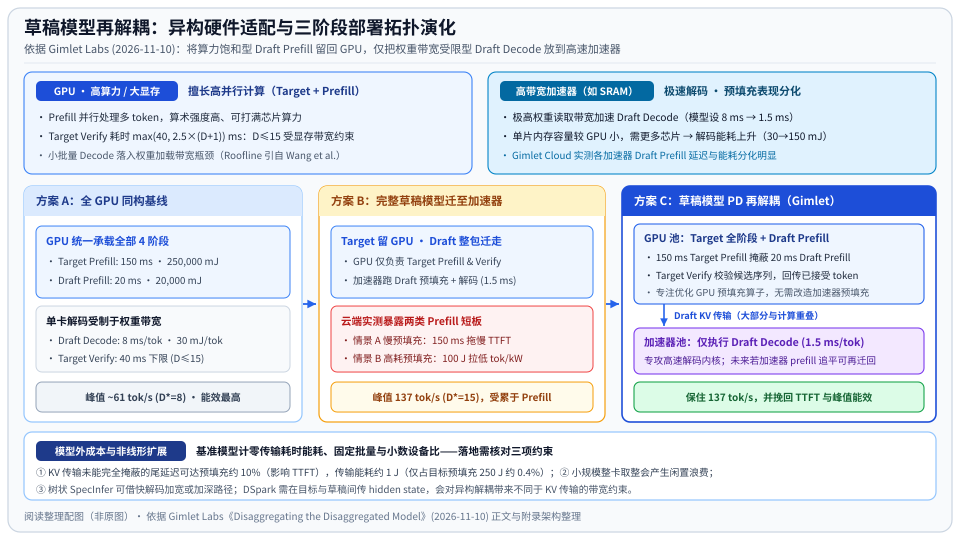
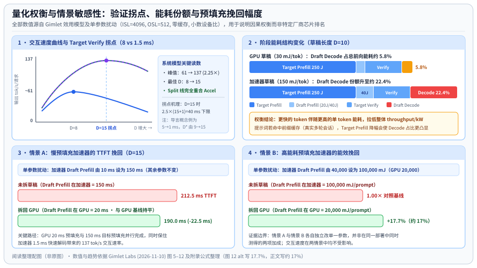

Phillip Kuznetsov, Omid Azizi（Gimlet Labs）· 原文发布于 2026-11-10 · [Gimlet Blog 原文《Disaggregating the Disaggregated Model》](https://gimletlabs.ai/blog/draft-model-disaggregation) · 前序相关文章：[将草稿模型迁至更快加速器（Corsair）](https://gimletlabs.ai/blog/low-latency-spec-decode-corsair) · [以 SRAM 为核心的推理芯片分析](https://gimletlabs.ai/blog/sram-centric-chips)

在常规投机解码（Speculative Decoding）工程讨论中，优化重心往往落在目标模型（Target Model）或算法层——例如如何提升草稿接受率、如何设计树状验证结构。Gimlet Labs 在这篇文章中先把草稿模型拆出 GPU（[前文《Moving the Draft Model onto a Faster Accelerator》](https://gimletlabs.ai/blog/low-latency-spec-decode-corsair)），紧接着又追问了一个更贴近云端生产落地的问题：**当高带宽专用加速器确实能把草稿解码（Draft Decode）跑到极快，但同一批加速器在草稿预填充（Draft Prefill）阶段却出现高延迟或高能耗时，为什么还要把草稿模型的两个阶段死绑在同一类硬件上**？为此，Gimlet Cloud 给出的解法是“对已经拆出来的草稿模型再做一次 PD 分离”：把算力密集的 **Draft Prefill 留回 GPU**（与 Target Prefill、Target Verify 同在 GPU 池），仅把受权重读取带宽限制的 **Draft Decode 留在高速加速器上**。

> **口径与建模范围说明**：全文所有延迟、交互速率与能耗曲线均来自 Gimlet Labs 构建的**高层利用率优化解析模型与单参数情景扰动**（固定 `ISL = 4,096`、`OSL = 512`、关闭前缀缓存、固定批大小、允许小数设备配比、不计 Prefill/Decode 相互干扰且假设 KV 传输零耗时与零能耗），**不是受控端到端真实集群基准实测**。尽管 Gimlet 网站页眉同期发布了将 Cerebras 接入 Gimlet Cloud 的公告（[Cerebras 接入公告](https://gimletlabs.ai/blog/cerebras-announcement)），作者在正文中明确说明：GPU 参数取材于真实负载灵感，而“Accelerator”参数用于体现通用专用推理硬件的典型提速与功耗特征，**不构成针对 Cerebras 或任何单一厂商芯片的产品能效排名**。同时，文章前半段的概念曲线（`5 ms → 1 ms`）与后半段的系统模型（`8 ms → 1.5 ms`）采用两套独立参数；后文的“慢预填充（`150 ms`）”与“高耗预填充（`100,000 mJ`）”也是彼此独立的单参数扰动情景。

## 为什么更快草稿能推高最佳投机长度，以及 GPU 与高带宽芯片的分化

线性投机解码的基本机制是：由参数规模小、速度快的草稿模型（Drafter）连续自回归提出 `D` 个候选 token，再交由大模型 Target 一次性并行验证。原文图 1 以直观例子说明收益——在目标模型逐个解码 2 个 token（`"capital of"`）的时间内，投机解码可并行产出一个完整的 5 token 片段（`"capital of France is Paris"`）。

但“每次向前猜测多少步（即草稿长度 / 投机深度 `D`）”并不是越大越好。随着 `D` 拉长，远端候选被目标模型拒绝的概率上升、被丢弃的无效计算增多。原文在附录中明确采用**饱和指数函数**（saturating exponential）刻画期望接受长度随 `D` 呈现的边际递减规律（原文图 13）。在这个前提下，最佳投机深度高度取决于“多生成几个草稿 token 的时间成本”与“目标验证收益”的平衡。原文先以一组**概念参数**做灵敏度演示（图 2）：当每个草稿 token 的生成耗时从 `5 ms` 加快 5 倍至 `1 ms` 时，全曲线交互速度全面抬升，峰值对应的最佳草稿长度也从 **9 个 token** 向后推至 **15 个 token**。

支撑这一提速的硬件根源在于计算与访存的不对称性。原文引用 **Wang 等人** 的 Roofline 屋顶线研究（[`arXiv:2512.01644v1`](https://arxiv.org/pdf/2512.01644v1)，图 3）与 Gimlet 前作《[SRAM-Centric Chips](https://gimletlabs.ai/blog/sram-centric-chips)》指出：Prefill 阶段并行处理大量提示词 token，算术强度（arithmetic intensity）高，能够充分打满 GPU 算力；而小批量 Decode 阶段每步只处理极少量 token，GPU 必须反复把完整模型权重从显存搬进计算核心，从而落入典型的**权重读取带宽受限区**（memory-bound）——而且不仅 Prefill 与 Decode 之间存在算术强度差异，同一阶段内部不同算子之间也存在分化。

以片上 **SRAM** 为代表的新一代推理芯片能提供远高于 GPU 显存的权重读取带宽，因此极擅长加速受带宽约束的 Decode。但这种高速并非没有代价：这类芯片单颗内存容量通常小于 GPU，装下同一个模型往往需要**更多芯片数量**；芯片增多直接推高总功耗，从而拉低整套系统的**每千瓦输出吞吐**（throughput/kW），在**用户交互速率**（interactivity）与**能源效率**之间形成根本张力。

<figure class="note-figure">
  <a class="note-image-link" href="/assets/images/tech/gimlet-draft-model-disaggregation/gimlet-draft-disagg-topology-zh.svg" target="_blank" rel="noopener" aria-label="点击放大查看草稿模型再解耦与三阶段拓扑演化图解">
    
    点击放大 ↗
  </a>
  <figcaption>阅读整理配图（非原图）：依据 Gimlet Labs（2026-11-10）整理硬件算术强度分化、三种投机解码部署拓扑的演化逻辑与模型外边界。</figcaption>
</figure>

## 基准系统模型：交互速度翻倍背后的功耗代价与验证拐点

为了把上述架构权衡落到可比较的数量级上，Gimlet 构建了一个基于固定工作负载（`ISL = 4,096`、`OSL = 512`、无缓存前缀）的高层利用率优化模型，按各阶段能力需求分配可为小数的设备比例，以此先评估“把完整草稿模型从 GPU 迁往加速器”的基线后果（原文图 4–8）。

| 系统阶段与指标 | GPU 建模参数（基准） | 加速器建模参数（基准） | 核心机理与模型公式备注 |
| :--- | :--- | :--- | :--- |
| **Target Prefill 延迟 / 能耗** | `150 ms` · `250,000 mJ/prompt`（约 `60 mJ/tok`） | —（留在 GPU） | 高并行算力饱和阶段；`250 J` 占总前向能耗绝对大头 |
| **Target Verify 延迟公式** | `max(40, 2.5 × (D + 1)) ms` | —（留在 GPU） | 当 `D ≤ 15` 时稳定受 `40 ms` 访存下限支配；超过 `15` 后转为线性算力受限 |
| **Target Verify 能耗公式** | `720 + 40 × (D + 1) mJ/verify` | —（留在 GPU） | 随每轮验证候选数 `D + 1` 线性增加；单次校验固定基底为 `720 mJ` |
| **Draft Prefill 延迟 / 能耗** | `20 ms` · `20,000 mJ/prompt`（约 `5 mJ/tok`） | `10 ms` · `40,000 mJ/prompt`（约 `10 mJ/tok`） | 基准假设中加速器更快但更耗能；后文情景扰动分别将此项改至 `150 ms` 与 `100,000 mJ` |
| **Draft Decode 延迟 / 能耗** | `8 ms/tok` · `30 mJ/tok` | `1.5 ms/tok` · `150 mJ/tok` | 加速器解码快 `5.33×`，但每草稿 token 能耗高出 `5×` |
| **峰值交互速率与最佳深度** | 约 `61 tok/s/req`（最佳 `D = 8`） | 约 `137 tok/s/req`（最佳 `D = 15`，`2.25×`） | 仅迁移小草稿模型即翻倍以上单用户生成速度，但依赖更深投机步长 |
| **总能效对比（D = 10 份额）** | 更高 `throughput/kW` · Draft Decode 占前向能耗约 `5.8%` | 更低 `throughput/kW` · Draft Decode 占比升至约 `22.4%` | 若计入提示词前缀缓存压缩 Target Prefill，草稿解码功耗占比还将进一步放大 |

把表中的 Target Verify 公式与峰值移动放在一起验算（此步为助手基于作者已公开公式的算术核对），就能看清最佳深度为何精确落在 `D = 15`：在 `max(40, 2.5 × (D + 1)) ms` 中，只要 `D ≤ 15`，`2.5 × (D + 1) ≤ 40 ms`（`D = 15` 时恰好达到 `2.5 × 16 = 40.0 ms`）。也就是说，在 `D ≤ 15` 区间内，**目标模型并行验证的耗时完全停留在 40 ms 显存带宽下限平台期，多验证候选 token 几乎不额外拉长单次 Target Verify 的时间**。当草稿模型在 GPU 上以 `8 ms/tok` 慢速串行提出候选时，每多猜 1 个 token 都要付出高昂等待时间，因此最优点在 `D = 8` 就早早折返；一旦把草稿解码迁到 `1.5 ms/tok` 的高速加速器，等待成本大幅下降，最佳投机深度得以一路推到 `40 ms` 验证拐点 `D = 15`（此时继续加长 `D` 不仅面临饱和指数接受率递减，还会触发 Target Verify 进入 `2.5 × (D + 1) > 40 ms` 的算力线性增长区）。

然而，这种 `2.25×` 的交互速度跃升伴随着明确的功耗账单：在模型参数下，加速器每生成 1 个草稿 token 的能耗是 GPU 的 5 倍（`150 mJ` 对 `30 mJ`）。在草稿长度 `D = 10` 时，**Draft Decode 在全部前向计算能耗中的占比由 GPU 方案的约 5.8% 跃升至加速器方案的约 22.4%**（原文图 6–8），直接拉低了全系统的 `throughput/kW`。值得注意的是，在真实的多轮对话或开启前缀缓存（Prefix Caching）场景中，Target Prefill 那 `250 J` 的巨大基数会被大幅削减，届时 `150 mJ/tok` 的草稿解码能耗占比还会显得比基准模型更加刺眼。

## 草稿模型 PD 分离架构：为什么把 Draft Prefill 搬回 GPU

把整套草稿模型搬上加速器的设想，在进入 Gimlet Cloud 实际云端部署后很快碰到了与理论基准的偏差。作者在文中总结道：**各款加速器在 Draft Decode 阶段的表现与模型预测相当一致，但 Draft Prefill 阶段的实测表现却出现剧烈分化**——在一类加速器上，Draft Prefill 延迟高到足以拉高全系统的首 token 延迟（TTFT），甚至慢过纯 GPU 方案；在另一类加速器上，Draft Prefill 消耗了远超预期的能量，显著压低了系统的 `throughput/kW`。

这直接催生了 Gimlet Cloud 最终采用的**草稿模型 PD 分离架构**（原文图 9，即下方保留的原图 `figure.png`）：输入提示词同时送往 GPU 池上的 Target Prefill 与 Draft Prefill；Target Prefill 产出的 KV 留在 GPU 供 Target Verify 使用，而 GPU 上的 Draft Prefill 完成之后将**草稿 KV 状态（Draft KV）跨设备传送至高速加速器**，随后双方进入仅传递候选 token 与已接受 token 的高速 `Draft Decode ↔ Target Verify` 闭环。

<figure class="note-figure">
  <a class="note-image-link" href="/assets/images/tech/gimlet-draft-model-disaggregation/figure.png" target="_blank" rel="noopener" aria-label="查看 Gimlet Labs 原文图 9：草稿模型 PD 分离架构原图">
    
    点击放大 ↗
  </a>
  <figcaption>Gimlet Labs 原文图 9（保留官方原图）：蓝色模块运行在 GPU（包含目标模型两阶段与 Draft Prefill），紫色模块运行在高速加速器（仅承担 Draft Decode）；草稿 KV 单向跨设备传送，验证循环仅交换 token 索引。</figcaption>
</figure>

在基线参数下建模对比时（原文图 10），拆分草稿模型与不拆分的交互速度曲线**完全重合**——因为一旦提示词预填充完成，决定后续稳定输出速率的只是 `Draft Decode + Target Verify` 循环，而该循环依然享受 `1.5 ms/tok` 的加速器极速解码；在基准参数（加速器 Draft Prefill 仅为 `10 ms` / `40,000 mJ`）下，拆分本身既没有额外加速也没有带来显著能效劣势。真正体现拆分价值的，是把云端实测到的两类“预填充异常”分别代回模型做单参数压力情景验证：

- **情景 A（慢预填充加速器 → 挽回 TTFT，原文图 11）**：将加速器的 Draft Prefill 延迟从基准 `10 ms` 恶化 15 倍至 **`150 ms`**（其余参数维持基线）。在投机长度 `D = 15` 时，未拆分方案的系统 TTFT 升至 **`212.5 ms`**；而将 Draft Prefill 搬回仅需 `20 ms` 的 GPU 后，系统 TTFT 降至 **`190 ms`**（减少 `22.5 ms`），直接追平全 GPU 方案的 TTFT，同时完整保留加速器带来的 `137 tok/s/req` 交互速度收益。结合时序关键路径来看（助手按文中数值核对）：当 Draft Prefill 在 GPU 仅需 `20 ms` 时，紧随其后的首轮 15 个草稿 token 解码（`15 × 1.5 ms = 22.5 ms`）合计 `42.5 ms`，刚好完全掩蔽在 `150 ms` 的 Target Prefill 并行窗口之内，Target Verify（`40 ms`）在 `150 ms` 结束即可无缝开跑（`150 + 40 = 190 ms`）；反之若 Draft Prefill 在加速器拖满 `150 ms`，首轮草稿解码就被迫从 `150 ms` 之后串行起跑，把 `22.5 ms` 直接暴露在关键路径上（`150 + 22.5 + 40 = 212.5 ms`）。
- **情景 B（高耗预填充加速器 → 挽回峰值能效，原文图 12）**：将加速器的 Draft Prefill 能耗从基准 `40,000 mJ/prompt` 调高 2.5 倍至 **`100,000 mJ/prompt`**（对照 GPU 为 `20,000 mJ/prompt`，其余参数维持基线）。把 Draft Prefill 移回 GPU 后，全系统峰值 `throughput/kW` **提升约 17%**（原文图 12 图像的 `alt` 属性给出的更精确读数为 **17.7%**），且交互速度完全不受影响。

除了即时指标改善，作者还强调了一项工程组织层面的架构弹性：把 Draft Prefill 放在 GPU 上，团队可以继续沿用成熟的 GPU 预填充优化栈，同时让加速器团队**心无旁骛地打磨极速 Decode 内核**，无需在加速器尚不擅长的长序列 Prefill 算子上过早投入精力；而且这种分离是可逆的——未来只要某代加速器的 Prefill 延迟与能效追平或反超 GPU，随时可以把 Draft Prefill 重新迁回加速器。

<figure class="note-figure">
  <a class="note-image-link" href="/assets/images/tech/gimlet-draft-model-disaggregation/speculative-disagg-tradeoffs-zh.svg" target="_blank" rel="noopener" aria-label="点击放大查看 Gimlet Labs 量化权衡与情景敏感性四象限图解">
    
    点击放大 ↗
  </a>
  <figcaption>阅读整理配图（非原图）：汇总 Gimlet Labs（2026-11-10）图 5–12 与附录模型公式的核心量化关系，并明确标示情景 A/B 为独立单参数扰动。</figcaption>
</figure>

## 模型边界之外的系统账本：KV 传输尾延迟、整卡配比与非线形投机扩展

读懂这类解析建模文章，关键不仅在于记住 `137 tok/s`、`190 ms` 或 `17%`，更在于审视作者自己在正文与附录（Appendix）中主动摊开的**七项建模简化与失效边界**。下表逐一对照原模型假设、作者披露的工程隐患以及实际集群上线时的核对要点：

| 模型假设（Gimlet 原文与附录） | 作者披露的局限与真实偏差方向 | 面向生产部署的工程判据（结合原文边界推导） |
| :--- | :--- | :--- |
| **KV 传输记零延迟、零能耗** | 虽大多可与 Prefill 计算重叠，但**未掩蔽尾延迟最高可达 Prefill 的约 10%**（直接加在 TTFT 上，不影响交互速度）；传输能耗估算约 **`1 J`**（仅占 Target Prefill `250 J` 的 **0.4%**） | 只传体积远小于大模型的 **Draft KV**，因此传输能耗极低；但若跨机互联带宽不足导致尾延迟超过“在 GPU 上跑 Draft Prefill 省出的 TTFT”，拆分就会净亏 TTFT |
| **允许小数设备配比（如 `1.8` 个 worker）** | 消除设备取整量化误差；作者直言**小规模部署下取整误差会表现很差**（“looks really bad”），大规模集群才会摊薄 | 在小集群内新增“GPU Draft Prefill + 加速器 Draft Decode + GPU Target”三类配比维度，一旦整卡对齐产生闲置，利用率折损可能吃掉模型估算的 `~17%` 能效红利 |
| **固定输入输出与零前缀缓存**（`4096 / 512`） | 真实多轮会话长度动态变化且存在高前缀缓存命中率 | 开启 APC / 分布式前缀缓存后，Target Prefill 的 `250 J` 与 `150 ms` 均大幅缩小：既降低掩蔽 GPU Draft Prefill 的余量，也抬高 Draft Decode 的相对能耗权重 |
| **固定批大小且忽略 P/D 相互干扰** | 真实批大小随并发动态波动，且同卡混跑 Prefill/Decode 会引发算力与显存争抢 | 在高并发混部下，若 GPU 端同时跑 Target Prefill、Draft Prefill 与 Target Verify 而缺乏隔离调度，重型 Prefill 仍可能卡住 `40 ms` 的 Target Verify 节奏 |
| **每阶段固定耗时/能耗与饱和指数接受率** | 任务类型（代码、推理、闲聊）与采样温度会改变真实接受长度与最优 `D` | 最佳投机深度需随模型与任务分布自适应调节，尤其当 `D` 跨过 Target Verify 算力拐点后，过深投机在算力受限区会迅速丧失收益 |
| **仅覆盖线性投机解码** | 树状方法（如 [SpecInfer](https://arxiv.org/abs/2305.09781)）与隐状态草稿（如 [DSpark](https://arxiv.org/abs/2607.05147)）机制不同 | SpecInfer 可借快解码扩大树宽或深化高概率分枝；而 **DSpark 需在目标与草稿模型之间传输 hidden state**，网络与互联带宽约束远重于仅传 Draft KV 与 token ID |

综合原文的一手结论与上述边界约束，在生产异构推理平台评估是否引入“草稿模型 PD 再解耦”时，应当将以下三本账明确拆开核算：

1. **三项优化目标分开度量，不做单一指标幻想**：用 **Draft Decode + Target Verify 循环时间**衡量单用户交互速率，用 **Prefill 关键路径加跨设备 KV 传输残余尾延迟**核算 TTFT，再用**全阶段能耗与整卡配比后的实际设备利用率**核算 `throughput/kW`——任何只拿单请求交互倍数去推断集群能效或 TTFT 的做法都会失真。
2. **先算“GPU 草稿预填充掩蔽窗”与“KV 尾延迟”之差**：只有当加速器的 Draft Prefill 延迟高到暴露在 Target Prefill 窗口之外（或消耗的焦耳数接近/超过 GPU Draft Prefill 且互联传输能耗确实保持在 `~1 J` 量级）时，把 Draft Prefill 搬回 GPU 才具备净收益；一旦业务因前缀缓存命中把 Target Prefill 压缩到接近或小于 Draft 链路时延，整个关键路径就要重新测算。
3. **区分“传 KV 一次”与“每步传 Hidden State”的算法边界**：线性投机解码与树状投机解码（SpecInfer）在提示词阶段只需单向传输一次 Draft KV，后续验证环仅传轻量 token 序列，适合跨设备异构拆分；但对于像 **DSpark** 这类依赖每步交换中间隐藏层向量的架构，是否适合做跨设备草稿解耦仍是作者明确列出的开放研究问题，不可直接套用本模型结论。

---

### 参考来源与一手核对链接

- 一手主文献：Phillip Kuznetsov, Omid Azizi, *[Disaggregating the Disaggregated Model](https://gimletlabs.ai/blog/draft-model-disaggregation)*, Gimlet Labs Blog, 2026-11-10。
- 前序异构草稿文章：Gimlet Labs, *[Moving the Draft Model onto a Faster Accelerator](https://gimletlabs.ai/blog/low-latency-spec-decode-corsair)*（文中作为前序草稿迁移参考）。
- 硬件背景文章与云平台公告：Gimlet Labs, *[SRAM-Centric Chips](https://gimletlabs.ai/blog/sram-centric-chips)* 与 *[Bringing Cerebras to Gimlet Cloud](https://gimletlabs.ai/blog/cerebras-announcement)*。
- 文中引用论文：Wang et al., *[Roofline Analysis Reference (arXiv:2512.01644v1)](https://arxiv.org/pdf/2512.01644v1)*（图 3 算术强度分布引源）；Miao et al., *[SpecInfer: Accelerating Generative Large Language Model Serving with Tree-based Speculative Inference and Verification](https://arxiv.org/abs/2305.09781)*；*[DSpark (arXiv:2607.05147)](https://arxiv.org/abs/2607.05147)*。

> **AI 辅助整理 · 归档注记**：本篇中文深度重编与配套英文版（[English note](/tech/en/gimlet-draft-model-disaggregation/)）均由助手依据 Gimlet Labs 冻存原始网页与文本逐项核对重写，保留原 `id`、`date: '2026-11-13'`、`permalink`、`source_url`、`source_published_at: '2026-11-10'`、`published_at` 及标准标签 `inference-serving`。正文保留原文图 9 官方原图 `figure.png`，并新增助手绘制的两幅 `v3-blue` 架构与量化权衡图解（`gimlet-draft-disagg-topology-zh.svg`、`speculative-disagg-tradeoffs-zh.svg`）。全部定量数据严格限定于原文解析模型与单参数情景假设，未将模型推算外推为任何特定厂商硬件的实测排名。
