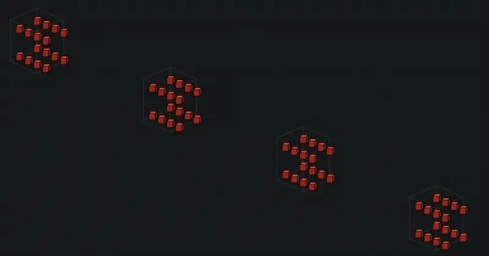

TPU 训练作业的拓扑需求会变化，但传统 GKE 部署往往为每种 slice 固定创建一个 nodepool。扩缩拓扑要删除重建，单点硬件故障又可能拖垮整个 slice。Dynamic Slicing 将物理容量预配与逻辑 slice 组装分开，既服务启动速度，也改变故障后的修复单位。

原文：[GKE dynamic slicing for higher resilience, and efficiency for TPUs](https://cloud.google.com/blog/products/containers-kubernetes/gke-dynamic-slicing-on-tpus/)  
Kavitha Gowda、Wenzhe Li · 2026-11-10

## 先准备 Cube，再在提交作业时拼接

基础容量按 TPU cube 管理，每个 4×4×4 cube 包含 16 台 VM。super-slicing 在作业调度时，用光路交换 OCS 动态连接多个 cube，形成 manifest 请求的较大拓扑。文章的例子用四个 cube 组成 4×4×16 slice，即 64 台 Ironwood VM、256 个芯片。

<a class="note-image-link" href="/assets/images/tech/gke-dynamic-slicing/official-0.webp" target="_blank" rel="noopener" aria-label="四个 TPU Cube 动态拼成较大 Super-slice · 查看原图 ↗">查看原图 ↗</a>

*读图：动画把原先独立的 cube 连接为一个逻辑拓扑；改变的是运行时连接关系，物理容量已经预配。*

这里减少的是逻辑拓扑形成前反复创建 nodepool 的工作。物理机器仍必须预先可用，OCS 也不是给普通任意网络增加软件覆盖层，而是使用 TPU 系统已有的可重构互连能力。因此，不能把这种启动改善直接迁移为普通 GPU 集群的时间承诺。

## Sub-slicing 利用健康的局部容量

sub-slicing 将一个预配 cube 切为较小的独立 slice，让不同拓扑要求的作业共存。调度器读取工作负载注解，slice controller 创建 Slice CR，配置互连，逻辑 slice 就绪后放置工作负载；作业完成再拆除并归还分区，物理 nodepool 不必删除。

这也使部分不健康的 cube 仍有利用空间：调度器可以选择健康分区，避免整池不可用。文章要求通过 incremental provisioning 把 ICI mesh 的动态配置纳入预配流程；仅仅给旧集群加一条作业注解，不能替代底层准备。

## 故障时重组什么

大于一个 cube 的 slice 遇到主机或网络故障，调度器移走不健康 cube，以健康 cube 重新组装；小 slice 则使用可用健康分区重建。官方称坏 cube 可在一至两分钟内替换，启动最多快 5 倍、恢复快 4.5 倍。这里的机制是缩小重新配置和资源替换的单位，并未证明训练状态无需检查点或进程完全无中断。

原文没有给出这些最高倍率的完整负载规模、对照分布与重复实验表，因此数字应保留为厂商公告结果，不能当作任何作业的 SLO。重组互连、重新调度和应用恢复也属于不同阶段；硬件健康恢复，不等于训练立刻回到故障前进度。

## 可用范围与可靠性意义

该功能在公告中已 GA，但只支持 reservation 模式下的 TPU All Capacity。文中强调可在提供 TPU 的区域使用，实际还需相应预留容量与集群配置。预配统一 cube 提高灵活性，也意味着平台要管理空闲预留和逻辑 slice 的分配。

对系统可靠性而言，值得跟踪的是逻辑故障域从固定整池转向可重组单元：既不因某一 VM 故障就重新供应整个大拓扑，也不把部分健康资源全部丢弃。它与本期缓存论文的联系是资源所有权的清晰化；不过，本文讲硬件拓扑重建，后者讲缓存字节的核算与回收，不能据题材相近视为重复。
