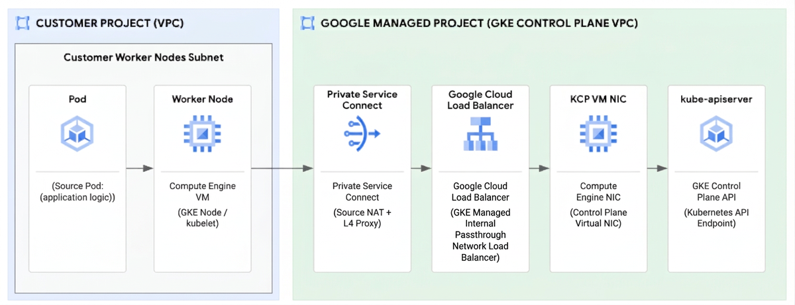

同一个 `i/o timeout` 可以由完全不同的层产生。Google Cloud 的这篇事故复盘更进一步：多个层的行为叠加，使本来能自行恢复的连接状态一直留存，随后又阻断了清理旧状态的协议路径。它最有价值的部分，是从“API 不通”逐步缩小到 TCP 状态转换的证据链。

原文：[When the Kubernetes API went silent: A three-layer networking mystery](https://cloud.google.com/blog/products/networking/the-three-layer-gke-network-mystery/) · Akash Thakur · Google Cloud · 2026-10-30。文章描述一位匿名客户在 2026 年初的事故：多个 europe-west 集群受影响，约 800 名开发者数周无法正常发布。这是该客户环境的影响范围。

## 先排除容易讲通的故事

最初怀疑的是新部署的自定义 Operator，但错误在部署前八天就已出现，停用后仍存在。移除 External Secrets Operator、安全代理也没消除超时。控制平面 conntrack 表只用了约一半容量，扩大控制平面 VM 后仍无改善，kube-apiserver 自身延迟却看起来正常。

这些排除项的重要性在于，它们使“最近改了什么”成为可检验假设，而不是根因结论。故障还覆盖系统 Pod、业务工作负载与外部客户端，进一步把调查范围从某个应用收缩到共同访问路径。API 服务正常处理已建立连接，与客户端无法建立新连接，可以同时成立。

<a class="note-image-link" href="/assets/images/tech/gke-network-mystery/overview.png" target="_blank" rel="noopener" aria-label="Pod 经工作节点、Private Service Connect、负载均衡器与控制平面网卡访问 API · 查看原图 ↗">查看原图 ↗</a>

*从左到右追踪连接经过的边界。对多个位置同时抓包，才能区分包没有到达、在中间被过滤，以及到达后被旧连接状态拒绝。*

## 新 SYN 为什么收到旧连接的 ACK

作者同时检查控制平面 VM 网卡与容器侧数据，发现 SYN 已到达，但响应不是新连接应有的 SYN-ACK，而是与旧连接相关的 ACK。线索指向端口复用：NAT 后的新连接复用了相同五元组，而服务端旧 socket 仍停在 FIN_WAIT_2。

TCP 的 challenge ACK 机制可以帮助处理这类残留状态。新客户端收到与自身连接不匹配的 ACK 后，用 RST 清理旧状态，再重新握手。但 Private Service Connect 的 USPS 包交换层此前为修复另一问题而加强检查，将握手尚未完成时的这类 ACK 判断为无效并丢弃。与发布相关的 invalid ACK 丢包计数上升，形成了网络层的另一条证据。

回滚 USPS 改动后，丢包计数回落，客户到三月初确认恢复。**回滚证明了一个触发路径，却没有解释旧连接为什么留了那么久。** 复盘没有把服务恢复当作根因调查终点，而是继续追问 FIN_WAIT_2 的寿命。

## 三个条件让旧状态无法退出

首先是乱序。Private Service Connect 对未命中的流走较慢路径，以建立 NAT 状态并添加代理协议头，后续包可能走快路径。对宿主网卡与虚拟网卡同时抓包，暴露了这段路径中关闭连接的 FIN、ACK 顺序变化。

其次是关闭方式。前置 Envoy 调用 `shutdown(SHUT_WR)` 关闭写侧，但仍持有 socket 接收数据。作者指出，设为 60 秒的 `tcp_fin_timeout` 只适用于孤立 socket；仍有进程持有的半关闭 socket 不满足条件。于是，“配置了 60 秒超时”并不等于这个连接将在 60 秒后被清理。

最后是内核处理。原文描述 `tcp_ack()` 对旧但仍在可接受窗口内的 ACK 返回零，关闭路径未继续处理携带的 FIN，导致连接不能退出 FIN_WAIT_2。乱序制造触发条件，内核路径漏处理 FIN，Envoy 持有 socket 又让孤立连接超时兜底不适用。随后 NAT 复用端口，再加上 challenge ACK 被过滤，新连接便陷入超时。

这不是三条可互换的根因标签，而是一条状态链。Envoy 的半关闭本身是合法行为；把它单独归为错误，会丢掉它与内核缺陷、网络过滤之间的条件关系。

## 缓解、协议修正与根因修复分开看

处置分成三层：先回滚过滤改动恢复可用性，再修正代理协议层对 challenge ACK 的处理并加入 PacketDrill 回归测试，最后通过 COS 镜像交付 Linux TCP 关闭路径修复。文章列出上游提交 `795a7dfbc3d9`，并报告修复随相关 GKE/COS 版本交付；实际判断某环境是否受影响，需要核对其镜像和回移补丁，不能只比一个主版本号。

对 AIOps 与混沌工程，可迁移的是证据组织方式：同时保留路径上多个观测点、协议状态和发布事件，区分“症状消失”与“状态机已修正”。这起匿名案例没有给出普遍发生率，也不能证明所有 API 超时都来自此链条。优先读抓包位置、旧 socket 的存活条件和回滚后继续追查的过程；它们比单独记住某个内核参数更有用。
