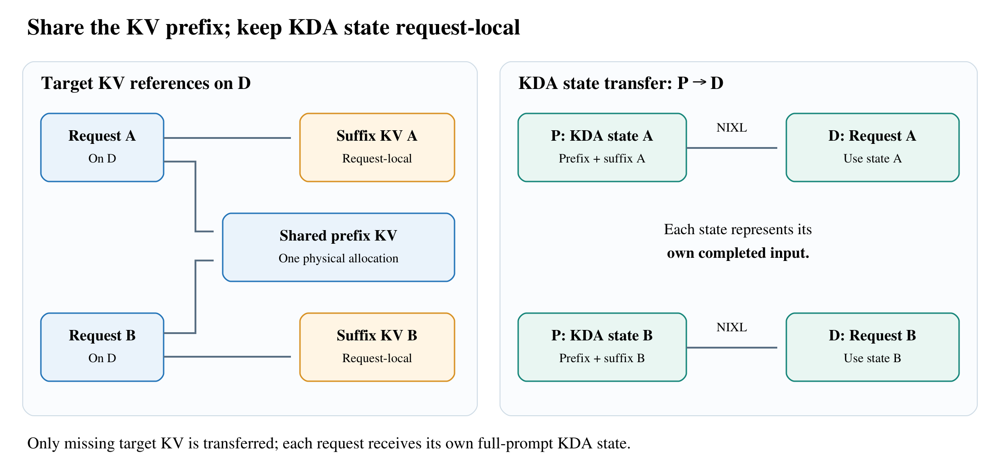

[Accelerating GLM-5.3-Flash on H200: High-Throughput Disaggregated Serving](https://www.lmsys.org/blog/2026-11-01-glm53-h200-pd/) · LMSYS / Ant International AI Infra · 2026-11-01

GLM-5.3-Flash 的优化难点来自三种结构同时存在：稀疏注意力要保存并检索历史 KV，循环线性注意力要维持当前状态，MoE 又让矩阵形状随专家路由变化。Ant International AI Infra 的这篇 SGLang 实践，将内存复用、投机周期和 prefill 数据流一起调整。最有价值的是它解释了各部分怎样互相制约，而不仅是给出最高吞吐倍率。

## KV 能共享，循环状态仍属于各自请求

稀疏注意力的 KV 对应历史位置，KDA 循环状态则代表某个序列边界。请求 A 和 B 共用长前缀、后缀不同，可以共享前缀 KV，却不能直接共用完整输入结束时的循环状态。

<a class="note-image-link" href="/assets/images/tech/glm53-h200/architecture.png" target="_blank" rel="noopener" aria-label="GLM-5.3-Flash：先分清状态，再平衡 H200 上的 prefill 与 decode · 查看原图 ↗">查看原图 ↗</a>

*左边共享同一份前缀 KV，右边仍为 A、B 分别传输各自完整输入后的 KDA 状态。*

KV-only decode RadixCache 在 decode 端引用已经存在的目标模型前缀 KV，只为缺失 KV 分配空间、接收传输。prefill 端仍分别给每个请求提供其完整输入末端的 KDA 状态。decode 因而无需为了得到这个状态，重新把已缓存前缀送过 KDA。若 N 个请求共享长度 Lp 的前缀，各自后缀为 Ls，忽略页面对齐，目标 KV 从 N(Lp+Ls) 降为 Lp+N·Ls；循环状态没有同步缩成一份。

容量还受多个池共同约束。初始长上下文配置 KV 几乎满了，循环状态池却只用约 5%；简单调高请求上限还可能预留更多状态、继续挤压 KV。作者结合 FP8 KV、BF16 循环状态和 ReplaySSM。后者保存紧凑重放信息，在接受投机 token 后推进状态，减少对每个候选步骤保存完整状态矩阵的需求。

## 每轮接受更多 token，未必更快

服务接近饱和时，吞吐取决于活跃请求数、每轮有效输出与整轮耗时。DFlash2 block8 与七步串行 MTP718 都验证八个 token，在接近 128 个活跃请求、相同 MoE 配置下，前者平均接受长度稍低：7.03 对 7.37。但 drafting 从 9.13ms 降至 3.15ms，整轮由 86.94ms 缩到 74.14ms，实际吞吐从 10,570 升至 11,459 token/s。

这组结果解释了为什么不能只优化接受率。减少单轮执行成本可抵消少接受几个 token；同时，draft KV 和 speculative state 占用内存，也可能降低可并发请求数。

kernel 调优同样按真实负载进行。MoE 不只看总行数，还采样不同层、rank 与时点的真实专家分布，联合选 tile、warp 和流水线参数，并在留出的路由上检查。DSA Partial 将足够 query 并行度下的 KV tile 从 32 扩为 128，减少循环、softmax 更新和累加器重缩放；它不增加实际被选择的 KV 位置。

## prefill 的重点是少搬一次、少等一次

prefill 侧采用 TP4/EP1/CP4，把路由和量化前移到各 rank 的本地 token shard：路由仍使用 BF16 输入，之后将 FP8 激活、scale、专家 ID 与路由权重一起 AllGather，专家 GEMM 直接复用量化结果。该通信 payload 下降约 47.5%，而不是把整个系统所有通信减半。

作者还融合 SwiGLU 与 FP8 量化、KDA 归一化与布局准备，扩大 prefill chunk 到 32K，并在支持路径上让通信 tile 到达即可启动投影，推迟但不删除保护 buffer 重用的同步。四张 H200、64K 输入/10 输出、无共享前缀的组合结果为 23,305→48,064 输入 token/s，平均 TTFT 5.61→2.72 秒。

## 端到端倍率由前缀复用率决定

四卡 decode 的 4.32× 结果使用 64K/1K、99.9% 共享前缀，目的是减弱 prefill 供给约束；请求运行上限由 56 增至 132，平均 TPOT 从 16.28 降至 10.07ms。它不代表零复用业务也能得到同样增益。

在十六卡 3P1D 的端到端评测中，0%、50%、93.75% 共享前缀分别得到约 2.30×、2.11×、4.28× 输出吞吐。前两者仍被 prefill 限制，优化配置采用更高客户端负载，平均 TTFT 分别从 3.58→4.00 秒、2.59→4.72 秒；50% 场景的 p99 TTFT 达 7.56 秒。因此“满足平均 TTFT<6 秒、TPOT<25ms 的高吞吐运行点”不能写成所有尾延迟都改善。

文章给出的版本和配置使这些机制可以具体追查：集成基线为 SGLang v0.5.20，优化构建固定到 3cb45d3dc。两次 GSM8K 准确率检查分别为 95.7% 和 95.4%，每次 1,314 题；它只提供一项质量检查，不能覆盖所有长上下文和多模态任务。当前实践针对文本，图像编码器尚在未来方向中。
