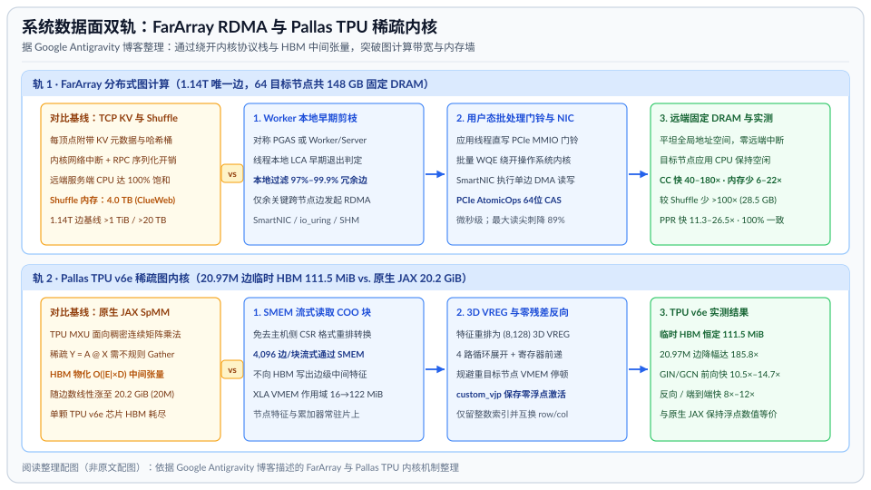
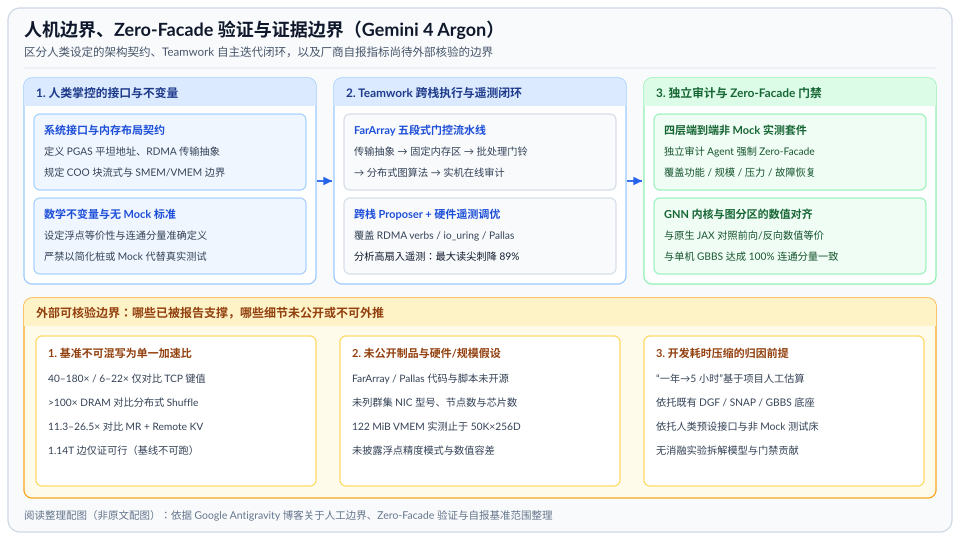

The Antigravity & Google Research Team · 2026-10-26 · [Google Antigravity 官方博客原文《How Gemini 4 Argon Upleveled Agents on Antigravity: Trillion-Edge Graphs and Custom TPU Kernels》](https://antigravity.google/blog/gemini-4-argon-trillion-edge-graphs-and-tpu-kernels)

同样讨论 Google Antigravity 的多智能体框架 [Teamwork](https://antigravity.google/blog/teamwork-when-ai-becomes-a-research-partner) 与 [Gemini 4 Argon](https://antigravity.google/blog/gemini-4-argon-in-google-antigravity)，本站的另一篇笔记 [《Antigravity /teamwork：长任务如何组织独立验证》](/tech/zh/antigravity-teamwork/) 侧重声明式工作流模式、依赖顺序重写、快速代理评测与 Borg 调度收益；而本篇聚焦于 **底层硬件数据面与算子内存模型的协同设计**——Google Graph Mining 与 Graph Learning 团队如何在内部 [Distributed Graph Flow（DGF）](https://dgf.readthedocs.io/en/latest/) 技术栈中，以人工定义接口、内存布局与无 Mock 验证契约为锚点，让智能体实现 **万亿边分布式图计算底座 FarArray** 与 **O(N) 内存的 Pallas TPU 稀疏图内核**。

> **事实口径与边界声明**：本文关于吞吐、墙钟加速比、内存占用及“将一年分布式系统路线图压缩为 5 小时门控冲刺”的表述，全部来自 Google Antigravity 2026 年 10 月 26 日内部工程案例自报，原博客未开源 FarArray 或 Pallas 内核代码与基准测试脚本。文中区分“原文明确陈述的架构与实测指标”以及“笔者基于系统原理补充的机制推演与规模边界”。

## FarArray 架构：用内核旁路 RDMA PGAS 消除分布式图计算的“键值税”

在单机多核场景下，Google 开源的 [Graph Based Benchmark Suite（GBBS）](https://github.com/ParAlg/gbbs) 等共享内存图库可以通过稠密平坦数组上的无锁原子操作，在数秒内处理数十亿条边；但一旦图规模超出单台服务器 DRAM，传统扩展方案就会撞上原文所称的 **“分布式图计算税（Distributed Graph Tax）”**。

传统集群图管线通常依赖 [MapReduce](https://research.google/pubs/connected-components-in-mapreduce-and-beyond/) 等分布式批处理框架，或搭配 [CliqueMap](https://research.google/pubs/cliquemap-productionizing-an-rma-based-distributed-caching-system/) 这类远程键值（RKV）系统与 TCP 键值存储来做状态查表。原文指出通用键值存储之所以在十亿至万亿边规模下失去效率，核心原因有三层叠加的开销：

1. **每顶点元数据与序列化膨胀**：每个顶点状态外层都被包裹了一套沉重的 per-key 元数据、哈希表桶结构与序列化帧头，直接放大整个集群的 DRAM 消耗。
2. **操作系统内核中断与服务端 CPU 饱和**：大量小粒度远程读改写迫使主机频繁处理内核网络中断与 RPC 调度。原文报告在对比测试中，TCP 键值服务器端的 CPU 负载直接达到 **100% 饱和**。
3. **跨库状态同步的额外内存拷贝**：对于个性化 PageRank 嵌入算法（[InstantEmbedding](https://arxiv.org/abs/2010.06992)），MapReduce 与远程 KV 串联架构采用“一次性写出（write-once）”阶段模型，进一步推高峰值并发内存与累计内存开销。

为了绕开这些税负，团队设计了 **FarArray**：受 [SNAP 微内核](https://research.google/pubs/snap-a-microkernel-approach-to-host-networking/) 启发，将集群内固定（pinned）的物理 DRAM 直接暴露为一块平坦、可硬件寻址的 **分区全局地址空间（PGAS）**，完全省去每键元数据、哈希表桶与序列化装帧。

<figure class="note-figure">
  <a class="note-image-link" href="/assets/images/tech/google-fararray-tpu-agents/fararray-tpu-architecture-zh.svg" target="_blank" rel="noopener">
    
    放大图解 ↗
  </a>
  <figcaption>阅读整理配图（非原文配图）：将 Google 原文中的两条底层数据面协同设计整理为对比与流水视图——上轨为 FarArray 内核旁路 RDMA 数据面，下轨为 TPU v6e 上消除边级 HBM 张量的 Pallas 稀疏内核。</figcaption>
</figure>

在网络拓扑与数据路径上，FarArray 具备三项关键系统机制：

- **可插拔传输抽象与双形态拓扑**：底层实现覆盖 **SmartNIC RDMA**、**Linux `io_uring`** 以及 **POSIX 共享内存**，面向应用暴露统一的 PGAS 原语；部署形态同时支持 **对称 PGAS**（Worker 节点自身也托管可全局寻址的固定内存）和 **专用 Worker/Server 架构**（专用内存目标节点还可运行自定义原生扩展，从而减少网络跳数并扩展硬件加速操作）。
- **批处理门铃与零远端 CPU 中断的单边硬件原子操作**：在具备 RDMA 能力的 SmartNIC 上，应用线程通过 **PCIe MMIO 门铃**（在门控流水线中以批处理门铃方式）将工作队列元素（`WQE`）直接投递给本地网卡；RDMA 网卡随后通过 **PCIe AtomicOps** 直接在硬件侧针对远端固定 DRAM 执行单边 DMA 读、写与 **64 位原子 `CompareAndSwap`（`CAS`）**，延迟降至**微秒级**且产生**零远端主机 CPU 中断**，使目标节点的应用 CPU 保持空闲。
- **算法与硬件协同 · 线程本地 LCA 早期退出剪枝**：如果把万亿级冗余边直接送进 NIC 门铃队列，再快的 RDMA 也会在重度扇入（fan-in）下形成尾延迟拥塞。FarArray 将硬件原子操作与线程本地的 **最近公共祖先（Lowest Common Ancestor，LCA）早期退出剪枝**结合——**在本地 Worker 内存中即过滤掉 `97%–99.9%` 的冗余边**，避免其触及网络。（**笔者工程推演**：在基于并查集或指针跳跃的连通分量计算中，凡能在 Worker 本地祖先缓存里判定属于同一连通分量的边均可就地丢弃，相当于把跨节点远程 RDMA `CAS` 流量压缩 1 至 3 个数量级；即便如此，重度扇入下依然出现了尾延迟尖刺，促使智能体基于硬件遥测继续调优并把最大读延迟尖刺降低了 89%。）

## Pallas TPU 稀疏图内核：在 SMEM 与 VMEM 中消除边级 HBM 中间张量

如果说 FarArray 解决的是“分布式主机间内存税”，那么 Google Graph Learning 团队面对的另一道墙，则是**面向稠密矩阵乘（MXU）与连续访存优化的 Cloud TPU 如何高效运行稀疏图神经网络（GNN）**。

在稀疏图消息传递（`Y = A @ X`）中，计算需要依据不规则的边索引列表（`row_ids`、`col_ids`）聚合源节点嵌入到目标节点。按照标准的 [JAX](https://docs.jax.dev/en/latest/) 写法（如先按 `row_ids` gather 再调用 `jax.ops.segment_sum`），编译器会在 **高带宽内存（HBM）** 中显式物化一张尺寸随边数线性膨胀的 **`O(|E| × D)` 中间张量**。原文以 **50K 节点、256 维特征、边数从 214K 扩展至 20.97M** 的扫描测试为例指出：在 **2000 万（`20.97M`）条边**时，原生 JAX 临时 HBM 占用飙升至 **20.2 GiB**，直接打穿单颗 **TPU v6e** 芯片的片上 HBM 容量限制。

由 Teamwork 智能体与研究者协同编写、验证的定制 **Pallas TPU SpMM 内核**，通过三项片上内存与寄存器层级协同设计，彻底避开了边级 HBM 中间张量：

1. **通过 SMEM 流式吞吐 COO 边块并扩展片上 VMEM 作用域**：内核无需在主机 CPU 侧把图重排为 CSR 格式，而是直接以 **每块 4,096 条边** 的粒度，将原始坐标格式（COO：`row_ids`、`col_ids`）边列表流式送入 **TPU 标量内存（SMEM）**；与此同时，将 XLA 为该算子分配的受控 **向量内存（VMEM）作用域从 `16 MiB` 扩展至 `122 MiB`**，使稠密的节点特征表与累加器表得以完整常驻片上内存，整个规约过程**不向 HBM 写出任何 `O(|E| × D)` 中间张量**。（**笔者规模边界补充**：在原文评测的 `50K 节点 × 256 维` 场景下，节点特征表与累加器均可完整落入扩展后的 `122 MiB` VMEM；若实际业务图的节点数与特征维乘积超出 VMEM 容量，则仍需沿节点维度做片上分块或跨芯片切分——原文未评测超出 50K 节点的跨片扩展场景。）
2. **硬件对齐的 `(8, 128)` 3D VREG 分块与软件寄存器前递**：为压榨 TPU v6e 向量单元吞吐，内核将二维节点特征重排为硬件对齐的 **`(8, 128)` 三维向量寄存器（3D `VREG`）分块**，并结合 **4 路循环展开（4-way loop unrolling）与软件 store-to-load 寄存器前递**——当流式到达的连续边命中相同目标节点时，直接在寄存器层级完成接力累加，避免频繁读写 VMEM 引发的流水线停顿（pipeline stalls）。
3. **零浮点激活残差的反向传播（`custom_vjp`）**：在训练阶段的反向传播（`dX = A^T @ dY`）中，常规自动微分往往需要保留前向特征或中间激活；该自定义 `custom_vjp` 内核**保存零个浮点激活残差**，仅保留整数边索引并在反向时直接互换 `row_ids` 与 `col_ids`，从而在完整的前向加反向训练步中保持严格的 **`O(N)` HBM 占用**。

下表严格按原文不同任务、数据集规模与对照基线汇总两项系统的自报实测数据（不把不同基线的数字混写为单一加速比）：

| 系统与工作负载 | 数据规模与实验配置 | 对照基线 | 原文自报实测结果 |
| :--- | :--- | :--- | :--- |
| **FarArray 连通分量**（ClueWeb12 / HyperLink 2012） | 最高 **3.56B** 顶点，**113.6B–128.7B** 条边 | TCP 键值存储基线 & 分布式 Shuffle 管线 | 较 TCP KV **吞吐高 60× 与 90×**、**墙钟快 40×（ClueWeb12）与 180×（HyperLink 2012）**、**RAM 少 6×–22×**；较 Shuffle **DRAM 少超过 100×（`28.5 GB` vs. `4.0 TB`）**；与单机 GBBS 达到 **100% 精确分区一致** |
| **FarArray 万亿级连通分量**（Planet-Scale） | **18.0B** 顶点，**1.14T 唯一边**（**2.27T 对称边**） | `>1 TiB` TCP KV 与 `>20 TB` Shuffle（基线不可行） | 在 **64 个目标节点**上仅用 **148 GB 总固定 DRAM**（每节点 `2.31 GB`）完成计算，**0 次 OOM** |
| **FarArray 分布式 [InstantEmbedding](https://arxiv.org/abs/2010.06992)**（PPR 节点嵌入） | **955M–3.56B** 顶点，最高 **98.0B** 有向边（ClueWeb12 / Hyperlink 2012） | MapReduce + 远程 KV 串联服务器 | 将量化嵌入存为全局可寻址可变状态：峰值并发 RAM 降 **8.7–13.9×**（图注详列 `8.69×` / `13.85×`），累计内存降高达 **55.9×**（`55.87×`），每跳延迟快 **12.90×–30.26×**，8 跳迭代墙钟快 **11.3–26.5×**（`11.29×–26.46×`） |
| **Pallas TPU v6e 稀疏图内核**（SpMM / GIN / GCN） | **50K** 节点，**256D** 特征，**214K–20.97M** 边；含 GIN（`SUM` / `MEAN`）与单层/4 层 GCN | TPU v6e 上原生 JAX（`jax.ops.segment_sum`） | 20.97M 边临时 HLO 内存恒定 **111.5 MiB** vs. JAX **20.2 GiB**（降 **185.8×**）；前向快 **10.5×–14.7×**（图注 `10.45×–14.66×`），反向及端到端训练快 **8×–12×**（图注 `7.96×–11.98×`），与原生 JAX **浮点数值精确等价** |

## 人定边界、智能体实施：无 Mock 门控流水线与遥测闭环

Google 在这篇工程复盘里反复强调的并非“让大模型自由发挥”，而是**人类研究者与 Gemini 4 Argon / Teamwork 智能体之间极硬的职责切分**。Gemini 4 Argon 具备 **100 万 token 上下文窗口**、可调推理深度以及原生子智能体编排能力，覆盖 C++ RDMA verbs、Linux `io_uring`、无锁图算法与 Pallas/XLA 编译器降维（lowering）等跨栈领域；但**人类工程师自始至终握住三项控制权**：定义系统接口、锁定内存布局与数学不变量、编写不允许作弊的端到端验收测试床。

<figure class="note-figure">
  <a class="note-image-link" href="/assets/images/tech/google-fararray-tpu-agents/argon-verification-boundaries-zh.svg" target="_blank" rel="noopener">
    
    放大图解 ↗
  </a>
  <figcaption>阅读整理配图（非原文配图）：拆解 Gemini 4 Argon 在系统工程中的控制闭环，以及厂商自报结果与独立外部核验之间的证据分界。</figcaption>
</figure>

这套工程闭环包含三个决定交付质量的控制点：

- **五段式里程碑门控（Milestone Gated Pipeline）**：在 FarArray 开发中，团队没有一次性让智能体生成整套分布式引擎，而是切分为 **`Transport Abstraction → Core Pinned Arena → Batched Doorbells → Distributed Algorithms → Live Audit`** 五道递增关卡，每一步的界面与状态语义由人类先行钉死。
- **独立审计智能体与“Zero-Facade”零模拟门禁**：代码编写者（proposer）与验证者（adversarial verifier / independent auditor）角色分离。独立审计智能体执行严格的 **“Zero-Facade”** 规则——**严禁使用 Mock 对象或简化桩函数替代真实传输与计算路径**，并强制要求可审阅的变更列表（CL）通过涵盖**功能（functional）、规模（scale）、压力（stress）与故障恢复（failure-recovery）四层测试**的端到端实测。
- **基于硬件遥测的性能闭环调优**：当集群基准暴露出重度扇入负载下的**尾延迟尖刺（tail-latency spikes）**时，Teamwork 智能体直接读取硬件遥测数据进行根因定位与调参，将最大读延迟尖刺削减 **89%**；在 TPU 侧，智能体则通过循环设计—实测验证闭环，在 GIN 与 GCN（1 层与 4 层）上同时对齐原生 JAX 数值输出与 TPU v6e 硬件加速比。

## 厂商自报指标的证据边界与 AgentOps 工程启示

尽管两项工程落地于 Google 内部 Distributed Graph Flow 栈且技术细节扎实，但在引用和外推其结论时，必须看清以下四条 **独立核验边界**：

1. **不可将异构基准压成单一“最高 180×”结论**：`40×–180×` 耗时加速与 `6×–22×` RAM 节省针对的是连通分量对比 TCP KV；`>100×` DRAM 降幅（`28.5 GB` vs. `4.0 TB`）针对分布式 Shuffle；`11.3–26.5×` 迭代加速针对 InstantEmbedding 对比 MapReduce + Remote KV；而 `1.14T` 唯一边用例（64 节点共 `148 GB`）报告的是 `0 OOM` 可行性（对比基线因超过 `1 TiB` / `20 TB` 不可行），并非实测加速比。
2. **代码与底层硬件配置尚未公开供第三方复现**：原博客未开源 FarArray C++/RDMA 实现、Pallas SpMM 内核或测试数据集/脚本，也未披露集群运行的 SmartNIC 具体型号、网络拓扑带宽、ClueWeb/HyperLink 跑分的节点数以及 TPU v6e 测试所用的具体浮点精度（例如 `bf16` vs. `fp32`）和“精确等价”的数值容差阈值。
3. **片上 VMEM 容量约束决定了内核的适用边界**：`122 MiB` 作用域 VMEM 让 `50K 节点 × 256D` 的特征与累加表免于回写 HBM；但如果节点特征规模超越单芯片 VMEM 上限，内核必须配合节点分块或跨芯片切分才能避免重新触发 HBM 读写。
4. **“从数月/一年压缩到 5 小时”属于项目估算而非孤立实验**：该时间对比基于团队内部路线图估计，且建立在 Google 内部既有 DGF、SNAP、CliqueMap、GBBS、Pallas 基础库之上，由人类研究者先行抽取出精确接口、内存布局与无 Mock 测试床；原文未做消融实验以拆分 Gemini 4 Argon 模型推理、五段门控结构与 Zero-Facade 审计各自贡献了多少收益。

| 工程层面 | 原文明确提供的支撑证据 | 尚待披露或不可直接外推的边界 | 对面向底层系统的 AgentOps 团队的启示 |
| :--- | :--- | :--- | :--- |
| **FarArray（RDMA / PGAS）** | 描述对称与 Worker/Server 双拓扑、PCIe MMIO 批处理门铃、64 位 `CAS`、97%–99.9% 本地 LCA 剪枝，以及三类图基准的实测对比与 GBBS 100% 一致性 | 代码与集群 NIC 型号/拓扑未开源；TCP KV、Shuffle 与 MapReduce+RKV 基线互异；未单列纯硬件传输与本地 LCA 剪枝各自的贡献占比 | 让智能体编写底层网络代码前，先把内存所有权、无锁原子语义与降扇入剪枝契约固化为接口规格，而非只给抽象性能目标 |
| **Pallas TPU 稀疏内核** | 明确 `4,096` 边/块 SMEM 流式 COO、VMEM `16→122 MiB`、`(8, 128)` 3D VREG 4 路展开前递、`custom_vjp` 零浮点残差，以及 214K–20.97M 边实测 | 内核源码、浮点精度与等价容差阈值未公开；扩展测试止于 50K 节点 × 256D，超大节点表跨芯片/分片外溢表现未在文中实测 | 用物理资源硬上限（如 HBM 中间张量字节数、片上 VMEM 容量、反向激活保留字节数）作为编译器/内核智能体的强制约束与回归指标 |
| **Teamwork / Argon 工作流** | 给出 5 阶段门控、Zero-Facade 禁止 Mock 规则、功能/规模/压力/故障恢复 4 层实测、扇入尾延迟 -89% 遥测闭环 | “一年压缩为 5 小时”为内部项目估值；高度依赖人类设计的零 Mock 测试床与既有 DGF/GBBS 基础设施；缺少模型与门控机制消融 | 把“写测试”与“写代码”职责隔离，用“Zero-Facade”禁止审计智能体放行 Mock 桩，并直接将硬件性能计数器/遥测接入修订环 |
| **跨文章关联与定位** | 本篇（2026-10-26 博客）深挖 RDMA PGAS 与 TPU 片上寄存器/内存协同；后续 2026-11-13 博客（见本站 [Antigravity /teamwork 笔记](/tech/zh/antigravity-teamwork/)）泛化为 `/teamwork` 通用模式 | 两篇各自覆盖不同项目与内部环境，不可将 Rust 重写或 JAXBench 数据混拼进 FarArray / Pallas 案例 | 构建内部编码智能体体系时，需要同时设计通用调度工作流与针对硬件特性（NIC/TPU/GPU）的专属真机验证门槛 |

对于正在探索用编码智能体挑战基础设施硬骨头的团队而言，Google 这两项案例最可复用的经验不在“提示词技巧”，而在**先由人类把物理边界（零内核拷贝、片上 VMEM 容量、零浮点残差、无 Mock 硬件测试床）翻译成刚性接口与不变量，再由分离的 Proposer 与 Zero-Facade Verifier 在真实硬件遥测中迭代收敛**。

---

> **AI 辅助整理 · 归档注记**：本篇中文深度技术笔记与配套英文版（[English note](/tech/en/google-fararray-tpu-agents/)）由助手精读冻存原文网页后逐项核校改写，保留原 `id`、`date`、`permalink`、`published_at` 与 `source_url`，设定 `long_read: true`、`authoring_source: assistant`、`translation_source: assistant`，标签严格限定在网站既有主题词表内（`multi-agent`、`systems-reliability`、`coding-agents`、`agent-reliability`）。两幅 `v3-blue` 配图 `fararray-tpu-architecture-zh.svg` 与 `argon-verification-boundaries-zh.svg` 均基于原文技术架构与自报数据绘制（非原文配图），未添加任何原文之外的未核实基准。
