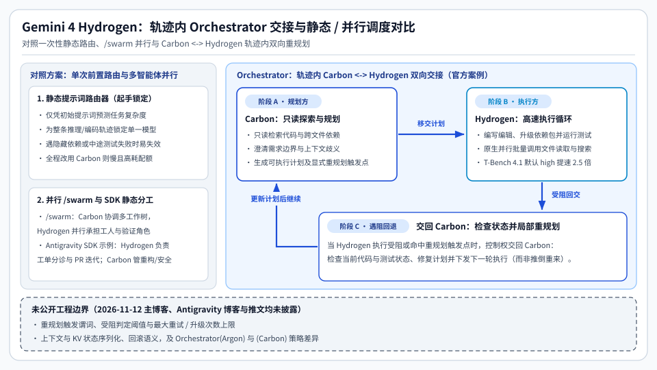
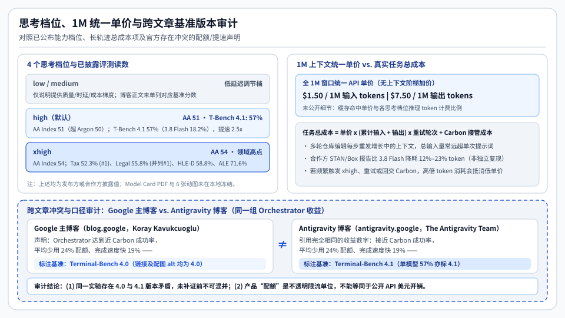

2026 年 11 月 12 日，Google DeepMind 首席 AI 架构师 Koray Kavukcuoglu 在 [Google 官方发布博文](https://blog.google/innovation-and-ai/models-and-research/gemini-models/introducing-gemini-4-hydrogen/) 中推出 **Gemini 4 Hydrogen**，同步搭配 [Google Antigravity 团队配套工程博文](https://antigravity.google/blog/gemini-4-hydrogen-in-google-antigravity/) 发布跨模型编排机制 **Orchestrator**，并通过 [Google DeepMind 官方 X 账号](https://x.com/GoogleDeepMind/status/2120940338869055788) 宣发。就核心信号而言，此次发布包含两条工程主线：一条是定位高速智能体执行的新模型能力与 1M 上下文统一定价，另一条是在**单条任务轨迹中途**动态切换前沿规划模型（Carbon）与快速执行模型（Hydrogen）的双向交接设计。

本文精读严格依据 2026 年 11 月 13 日归档冻结的两篇官方 HTML 博文、纯文本抽取稿与 X 推文 JSON 数据撰写；由于主博客内嵌的 6 张基准动图（GIF）与外部 [Gemini 4 Hydrogen Model Card PDF](https://storage.googleapis.com/deepmind-media/Model-Cards/Gemini-4-Hydrogen-Model-Card.pdf) 未在本地抓取冻结，文中不从动图或未冻结 PDF 补推任何数字，并明确区分发布方/合作方披露数据与工程边界分析。

## 1. 轨迹内 Orchestrator 交接：为何替代单次静态路由与全量并行

围绕多模型协作，两篇一手文章首先给出了清晰的架构对照，说明为什么传统的**静态提示词路由器**在长周期编码任务中容易失灵，而全程由前沿模型驱动又会拖慢迭代节奏：

- **一次性静态路由（Upfront Model Router）的局限**：静态路由器通常只在轨迹第 0 步读取用户初始提示词，猜测任务难度后便将整条执行轨迹锁定到单个便宜模型。正如 Antigravity 团队指出，软件工程与长程排障任务往往在中途才暴露真正的复杂性——例如隐藏的跨文件依赖、构建失败或意外的测试回归——初始一步根本无法预判是否需要高阶推理；相反，若为了保底而在每一次琐碎文件编辑或测试循环中都调用 Gemini 4 Carbon，不仅反馈变慢，还会快速消耗前沿模型配额。
- **跨智能体并行拆分（`/swarm` 与 Antigravity SDK）**：在 Orchestrator 之外，Google 也继续保留面向独立子任务的显式角色分工。此前随 Carbon 推出的 `/swarm` 已在 Antigravity 中衍生出“数万次 swarm 运行”，由 Carbon 担任全局协调者（coordinator），Hydrogen 并行驱动多个隔离工作树中的工人（worker）与验证器（verifier）智能体；在开源工单分诊的 **Antigravity SDK** 示例中，开发团队同样将工单分诊、代码检索、澄清提问及 PR 评论后的快速 UI 修改交给 Hydrogen，把大型重构、新功能开发与安全检查保留给 Carbon。
- **Orchestrator 的轨迹内双向交接（Intra-Trajectory Handoff）**：与上述“任务前决定谁负责哪块”不同，Antigravity 博客展示的 Orchestrator 案例把模型切换嵌入到**同一条连续执行轨迹内部**。轨迹起点由 **Carbon 在只读阶段（read-only phase）**探索代码库依赖、澄清规范歧义，并生成包含**显式重规划触发条件（explicit re-planning triggers）**的执行计划；随后控制权交给 **Hydrogen** 快速编写代码改动、更新依赖包并运行测试；一旦 Hydrogen 在执行中遇到阻塞或命中预设条件，控制权便**回交（hand back）给 Carbon** 检查最新代码与测试状态、修正计划，再交还 Hydrogen 继续推进。

<figure>
  <a class="note-image-link" href="/assets/images/tech/google-gemini-4-hydrogen/orchestrator-handoff-loop-zh.svg" target="_blank" rel="noopener">
    
    放大图解 ↗
  </a>
  <figcaption>图 1：Google 主博客与 Antigravity 博客披露的 Orchestrator 轨迹内双向交接流程，对比单次静态路由、/swarm 并行以及未公开实现边界。</figcaption>
</figure>

**未公开的内部实现细节**：尽管两条官方博客用典型轨迹说明了“只读探索—快速执行—遇阻回退重规划”的闭环逻辑，但**关键运行机制均未在 11 月 12 日公告中披露**，包括重规划触发器的具体谓词语法与受阻判定阈值、跨模型交接时上下文与 KV 缓存的序列化传递方式、失败编辑的回滚规则、最大重试或升级上限，以及 `Orchestrator (Carbon)`（Google AI Ultra 可用）与 `Orchestrator (Argon)`（Google AI Pro 及 Ultra 可用）之间的编排策略差异。在产品覆盖面上，Hydrogen 单模型面向付费 Google AI Pro / Ultra 开放，消费端 Gemini 应用免费用户也会通过自动模型选择命中（见主博客脚注 1），同时登陆 Google AI Studio、Gemini API、Android Studio、Google Search、Google Sheets 画布与 Gemini for business。

## 2. Gemini 4 Hydrogen 的思考档位、公开评测读数与安全信号

在单模型侧，Google 将 Hydrogen 定位为兼具智能体规划执行力与高速低延迟的新一代主力模型，并把思考控制从三档扩展为 **`low`、`medium`、`high`（默认）与新增的 `xhigh` 共 4 个档位**，称其可在质量、时延与成本之间提供“平滑且可预测的推进梯度”。在执行行为上，主博客强调 Hydrogen 具备**原生并行批量调用文件读取与检索工具**的能力（在 SWE-sweep 上有所体现，但正文未给出具体百分比）。

| 维度 | 核心指标 | 对照与说明 | 证据边界 |
| --- | --- | --- | --- |
| `low` / `medium` | 低时延与低成本运行档 | 官方未在博文正文中单列分档得分 | 发布方定性说明（主博客） |
| `high`（默认） | Artificial Analysis Intelligence Index **`51`**；Terminal-Bench 4.1 **`57%`** | AA 超过 Gemini 4 Argon（`50`）；T-Bench 4.1 为 3.8 Flash（`18.2%`）的 3 倍以上，任务完成提速 **`2.5×`** | 发布方与榜单披露（未独立复现） |
| `xhigh` | Artificial Analysis Intelligence Index **`54`** | 相对默认 `high` 档位再提升 3 分 | 发布方与榜单披露（缺额外时延与 token 量） |
| 开放与专业基准 | Agent Arena **`#5`**；HLE-Diamond **`58.8%`**；Vals Tax **`52.3%`**（`#1`）；Vals Legal **`55.8%`**（并列 `#1`）；MKA **`53.4%`**；ALE v1.1 **`71.6%`** | AutomationBench-AA 称居同类前列；6 张动图内分项表格未在本地冻结 | 发布方正文披露（主博客） |
| 安全与对齐（vs. 3.8 Flash） | 越权动作最高 **`-81%`**；服务不足最高 **`-79%`**；对齐偏差/抄近路降 **`12×`**；绕过权限概率最高降 **`2×`** | 内部诚实度 **`96.7%`**；CoT 可读性 **`99.9%`**（超 20 万轮 `0` 次欺骗改写）；Gray Swan IPI 抗性 **`>2.3×`**；HealthBench Pro 误拒 **`<0.4%`** | 发布方自述及内部审计；Model Card PDF 未冻结 |
| 合作方案例 | 复杂图谱/SQL/企业流提速 **`2×–2.8×`**、降耗 **`12%–23%`** token | STAN（`100%` 合规、`-28%` 时延、`-23%` token、最高 `2.8×` 提速）；Box（约 `2×` 提速、`-12%` token）；LatchBio（`67%` vs. 非 Gemini 最高 `37%`）；Pixelcut（`276` 次提速 `1.8×`）；Sheets（`>30%` 提速） | 精选案例与证言，缺完整评测分布 |

需要特别留意的是，上表中的安全与合作方指标虽然展示了 Hydrogen 在工具调用并发度与指令遵循上的侧重方向，但诸如“超 20 万轮零欺骗性推理改写”或企业案例提速数字目前仅以博客摘要形式存在；若需审查评测采样方法、置信区间与越狱攻击原数据，仍需补抓并核验未包含在此次归档中的 Model Card PDF。

## 3. 1M 上下文统一单价 vs. 长轨迹真实成本与跨文章口径审计

在 API 商业化定价方面，Google 为 Hydrogen 公布了面向完整 **`1M`** 原生上下文窗口（输出上限同为 `1M` tokens）的统一阶梯外费率：**输入 `$1.50` / 1M tokens、输出 `$7.50` / 1M tokens**，不因上下文长度超过特定阈值而分段加价。然而，一手博文**并未披露**前缀缓存（context caching）命中单价，也未说明 `low`、`medium`、`high`、`xhigh` 四个思考档位是否产生不同的内部推理 token 放大系数。

从系统工程成本模型来看，**单位 token 定价低并不自动等于端到端任务账单更省**。一条编码智能体轨迹的真实成本接近 `单价 × Σ(第 t 轮累计重发输入 + 输出 tokens) × 重试次数 + 升级接管开销`，同时还受开发者等待的墙钟时间约束。由于多轮代码修改和终端排障会不断向对话上下文追加文件片段、编译日志与测试输出，除非缓存命中率极高，否则累计输入 token 随轮次呈平方级膨胀。如果 Hydrogen 在模糊需求上频繁走弯路、反复回交 Carbon 重规划，或者团队为了追求 `54` 分而默认打开 `xhigh` 档位，单价优势很容易被总 token 倍数和 Carbon 接管单价抵消。

更关键的证据瑕疵出现在**两篇官方博客对 Orchestrator 同一组收益数据的引用冲突**上：

| 审计项 | Google 主博客（`blog.google`） | Antigravity 博客 | 工程审计结论 |
| --- | --- | --- | --- |
| 编排收益 | 接近 Carbon 成功率；平均**少用 `24%` 配额**、完成速度**快 `19%`** | 接近 Carbon 成功率；平均**少用 `24%` 配额**、完成速度**快 `19%`** | 两组数值完全一致，指向同一组官方内部实验 |
| 基准版本 | 明确写为 [Terminal-Bench 4.0](https://www.tbench.ai/news/terminal-bench-4-0)（页面图表 alt 文本亦写 `Terminal-Bench 4.0`） | 同一段收益明确写为 **`Terminal-Bench 4.1`**，并与单模型 `57%`（`T-Bench 4.1`）并列 | **存在未解释的版本冲突（`4.0` vs. `4.1`）**，勘误前不可直接归因于 `4.1` |
| 成本口径 | 仅使用产品侧的**“配额（quota）”**百分比 | 仅使用产品侧的**“配额（quota）”**百分比 | **配额是不透明限流单位，不等同于 API 美元账单**：跨模型权重未公开，社区 X 回复亦有用户反映 `/teamwork` 下高速循环迅速触及 5 小时限额 |

<figure>
  <a class="note-image-link" href="/assets/images/tech/google-gemini-4-hydrogen/hydrogen-operating-cost-audit-zh.svg" target="_blank" rel="noopener">
    
    放大图解 ↗
  </a>
  <figcaption>图 2：Gemini 4 Hydrogen 思考档位读数、全 1M 上下文统一定价下的长轨迹成本项，以及 Google 主博客与 Antigravity 博客之间的基准版本及配额口径冲突审计。</figcaption>
</figure>

## 4. 面向编码 Agent 的工程落地边界与可复现验证清单

把这次发布拆解为可执行架构决策时，工程团队更值得关注的不是宣传口径中的单项降本百分比，而是它暴露出的三道系统边界与落地检查项：

1. **把“只读探索 + 显式触发器”沉淀为独立调度层，而非盲目全自动路由**：Orchestrator 将 Carbon 限制在只读探索和异常重规划，把高频代码写入与测试执行交给 Hydrogen，这一职责切分在逻辑上优于启动时盲猜难度的静态路由器。在自研 Agent 框架中，即便不使用 Antigravity 产品，也可显式划分“只读规划阶段（产出契约、边界和失败回退条件）”与“快速执行循环”，仅在测试连续失败或架构假设被推翻时升级回强推理模型。
2. **明确区分 Antigravity 订阅配额与 Gemini API 美元账单**：在预算评估和 SLA 规划中，不应拿“节省 `24%` 配额”来推算 API 费用，更不能忽略单步 `$1.50/$7.50` 之外的缓存策略、`xhigh` 思考深度倍率与 Carbon 回交比例。建议在真实仓库基准上按“总输入 token、缓存命中 token、输出与推理 token、墙钟总耗时、任务一次通过率”五个直接可计量指标做 A/B 压测。
3. **自建熔断与回滚保护，填补未公开编排语义的空白**：既然官方未公布 Orchestrator 的触发阈值、上下文序列化规范和单次失败回滚方式，若通过 Gemini API 自行组合 Carbon 与 Hydrogen，工程侧必须显式配置最大交接次数、工具循环步数上限、测试停滞检测以及 Git worktree 级快照回滚，防止高速执行模型在低延迟循环中快速放大无效修改或耗尽额度。
4. **合规与基准复核动作**：在正式把 Hydrogen 纳入生产白名单前，应补充下载并核对原生的 [Model Card PDF](https://storage.googleapis.com/deepmind-media/Model-Cards/Gemini-4-Hydrogen-Model-Card.pdf)，在固定版本仓库基准（确认是 `Terminal-Bench 4.0` 还是 `4.1`）上独立测算 `high` 与 `xhigh` 两档的性价比拐点。
