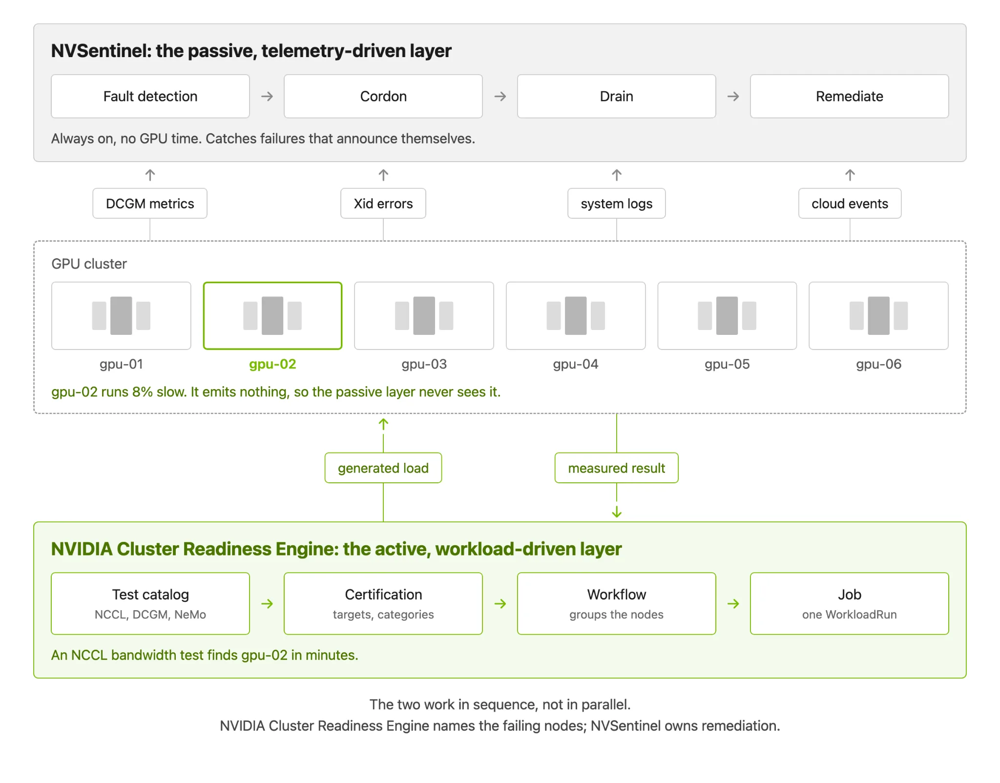
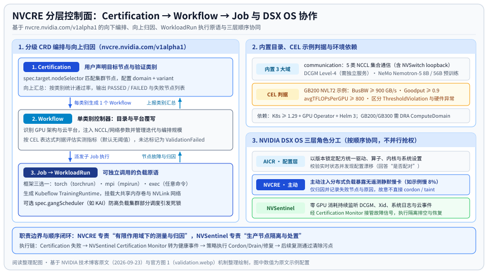
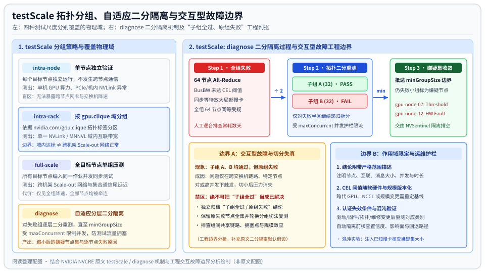

Dhvani Chheda（NVIDIA 解决方案架构师）、Kai Wombacher（NVIDIA 产品经理）· 2026-09-23 · [NVIDIA 技术博客原文](https://developer.nvidia.com/blog/validate-gpu-cluster-readiness-before-ai-workloads-land/) · [v0.8.0 官方文档](https://docs.nvidia.com/cluster-readiness-engine/v0.8.0/overview/introduction) · [GitHub 仓库（Apache 2.0）](https://github.com/NVIDIA/cluster-readiness-engine)

一台单卡自检全绿的节点，并不等于它能在 512 卡分布式训练任务里稳住吞吐。哪怕每块 GPU、每条网络链路以及所有 Pod 都汇报健康，只要存在一块在高压下掉速的 GPU、一条在持续通信时退化的链路，或一处把流量悄悄路由到低速路径的配置偏差，整批作业就会被同步屏障拖慢甚至中断——运维人员往往要在任务跑出数小时或接到业务故障单之后才会察觉，接着花上数天手工二分机架来定位问题，昂贵算力全程空转。**NVIDIA Cluster Readiness Engine（NVCRE）** 正是为填平这一缝隙而推出的开源 Kubernetes 控制器（Apache 2.0 协议），也是 **NVIDIA DSX OS**（NVIDIA DSX AI Factory 平台操作层）的三大核心组件之一。

> **口径与证据边界说明**：原文发表于 2026-09-23，定位为**架构机制与工作流介绍，未包含跨集群受控消融基准或故障检出率统计表**。文中涉及的 `512` 卡训练场景、`64` 节点二分场景、图 1 中 `gpu-02` 降速 `8%` 的示例、GB200 NVL72 示例 CEL 阈值（`busBandwidthGBps >= 900`、`goodputRatio >= 0.9`、`avgTFLOPsPerGPU >= 800`）以及两条 CLI 报告示例（8 节点 `42m 18s` 失败报告与 AWS `gb300` 16 节点 `3m 56s` 通过报告）均属**机制阐述或文档演示样例**，并非通用集群实测基线。下文同时明确区分 NVIDIA 原文机制与我们围绕“交互型故障盲区、阈值版本化、认证失效门槛与混沌校准”所作的工程延伸分析。

## 为什么被动健康检查接不住分布式故障：主动施压与 DSX OS 顺序分工

GPU 集群走向生产并非一蹴而就，而是依次跨越**开局调试（bring-up）、烤机老化（burn-in）、准生产（preproduction）与生产运行（production）**四个阶段，每一阶段的质量门槛各不相同：能通过单机冒烟测试的节点，远不足以直接编入 512 卡同步训练任务。平台团队往往被迫在节点配置、GPU 共享和调度编排之外，额外维护一套拼凑在脚本、手册或电子表格里的 NCCL 验收流程。

从运行时底座来看，Kubernetes 相比传统 Slurm 存在明显缺口。在 Slurm 上发起一次多节点集合通信验证往往只需一条 `srun` 命令；而 Kubernetes 原生并不具备对称原语，工程师必须自行协调 GPU 与 RDMA 资源申请、匹配底层网络织网（fabric）的 NCCL 环境变量、足够大的共享内存（shared-memory）卷，以及确保所有 Rank Pod 同时启动的协同调度能力。只要其中一环参数偏差，测试要么调度死锁，要么跑出失真带宽。

为了在生产规模下系统回答集群交付前的三个核心问题，NVIDIA DSX OS 将职责拆给三层既可独立部署、又可串联协作的组件：

1. **NVIDIA AI Cluster Runtime（AICR）——回答“配置是否正确”**：以版本锁定的配方（recipes）固化驱动、Operator、内核与系统参数组合，负责在多集群间复现调优配置、校验实时状态并发现配置漂移。
2. **NVIDIA Cluster Readiness Engine（NVCRE）——回答“能否稳定承载真实 AI 负载”**：作为**主动、负载驱动层**，直接在目标节点组上运行真实集合通信或预训练负载，专门暴露“没有任何错误遥测、但实际算力或带宽偷偷退化”的静默故障。
3. **NVIDIA NVSentinel——回答“集群此刻是否健康”**：作为**被动、遥测驱动层**，以**零 GPU 计算耗时**持续消费集群已经产生的信号（DCGM 指标、Xid 报错、系统日志与云厂商维护事件），检测运行时异常并驱动隔离（cordon）、排空（drain）与自愈修复。

<figure class="note-figure">
  <a class="note-image-link" href="/assets/images/tech/gpu-cluster-readiness/validation.webp" target="_blank" rel="noopener" aria-label="放大查看 NVIDIA 原文图 1：NVSentinel 被动遥测层与 NVCRE 主动负载验证层的顺序协同机制">
    
    点击放大 ↗
  </a>
  <figcaption>原文原始配图（NVIDIA Technical Blog Figure 1，保留原图）：对比 NVSentinel 被动遥测与 NVCRE 主动施压的分工；图中 gpu-02 降速 8% 且无报错仅为阐明静默退化检测机制的示例设定。</figcaption>
</figure>

这张官方结构图点出了一条极易被忽视的架构纪律——**两者必须顺序协同，而非并行抢占节点控制权**。NVCRE 在设计上**故意不执行 `cordon`、`taint` 或直接修补节点条件（node conditions）**，以免多个控制器并发修改节点状态造成动作冲突与清理失步。相反，NVCRE 只负责精确记录失败节点与原因；**NVSentinel NVCRE Certification Monitor** 会把失败的认证结果翻译成标准健康事件，再交由已配置的 NVSentinel 策略去完成隔离、排空或触发外部修复；待维修完成且新一轮 Certification 通过后，再由 NVSentinel 清除故障信号并释放污点。

## 分级 CRD 控制面与 WorkloadRun 执行原语

NVCRE 把集群验证产品面直接建立在 Kubernetes 自定义资源（CRD，`nvcre.nvidia.com/v1alpha1`）之上，从而天然兼容 `kubectl` 观测与 GitOps 流程。其核心编排由三层资源自上而下驱动，再将结构化归因自下而上回传：

- **`Certification`（声明层）**：由平台团队创建，通过 `spec.target.nodeSelector`（例如 `nvidia.com/gpu.present: "true"`）圈定候选节点，并列出待执行的 `categories`（每项包含 `domain` 与 `variant`）。它为每个类别创建一个 `Workflow`，最终按类别汇总通过数与整批结果（`PASSED` / `FAILED`）。
- **`Workflow`（编排与判据层）**：管理单个测试类别的生命周期，负责叠加目录默认参数、云平台与 GPU 架构覆写、迭代次数以及节点分组编排策略，并生成对应的子 `Job`，再将底层的测量判定汇总回 `Certification`。
- **`Job`（执行与归因层）**：在目标节点组上真正启动负载（如官方图 1 所示，每个 `Job` 驱动一个 `WorkloadRun`），同步监控节点健康状态，并将具体失败节点及失败原因（例如区分代表性能不达标的 `ThresholdViolation` 与代表硬件报错的 `HardwareFailureDetected`）逐节点记录下来。

在测试负载来源上，NVCRE 内置了覆盖三大领域（domains）的默认目录，并能从目标节点自动探测 GPU 架构与云平台，推导出每节点 GPU 数、NCCL 环境变量及平台专属网络配置：

1. **通信域（`communication`）**：提供 5 类 NCCL 集合通信测试变体，涵盖 `all-reduce`、`all-gather`、`all-to-all`、`loopback` 以及跨 NVIDIA NVSwitch 的 `loopback`。
2. **诊断域（DCGM）**：集成 NVIDIA Data Center GPU Manager（DCGM）Level-4 深度诊断套件（需要集群部署独立的 DCGM 服务）。
3. **训练域（`training`）**：内置基于 NVIDIA NeMo 框架的 **Nemotron 5**（`8B` 与 `56B` 参数）预训练负载（博客 YAML 示例为 `variant: nemotron5-8b`）。

在准入门槛设计上，NVCRE 坚持两项清醒约定：**第一，默认不自带任何性能通过阈值**，所有及格线均须由运维团队通过通用表达式语言（**CEL**，Common Expression Language）结合实测指标显式声明——例如原文针对 GB200 NVL72 级系统给出的演示阈值包括 `nccl-all-reduce` 的 `busBandwidthGBps: "value >= 900"`，以及 `nemotron5-8b` 的 `goodputRatio: "value >= 0.9"` 与 `avgTFLOPsPerGPU: "value >= 800"`；**第二，作业运行完成与性能达标严格解耦**——只要实测指标未通过 CEL 校验，NVCRE 便写入 `ValidationFailed` 条件，即使所有容器都以退出码 0 正常结束，该类别依然判定为失败。

对于不需要完整 `Certification` 流程、只想在 Kubernetes 上稳定跑起多机 GPU 测试或外部压测工具的团队，NVCRE 还抽取出了可独立使用的 **`WorkloadRun` CRD**：

- **三选一框架抽象与运行时自动生成**：在 `spec.framework` 中选择 `torch`（基于 `torchrun` 的分布式训练）、`mpi`（适用于 NCCL tests 等 MPI 作业，指定 `binary`、`args` 与 `mpirunPath`）或 `exec`（任意自定义命令），配合 `spec.image`（示例为 `nvcr.io/nvidia/pytorch:26.01-py3`）和 `spec.numNodes`，控制器即可自动生成匹配的 `Kubeflow TrainingRuntime`、挂载共享内存卷、配置 NCCL/平台变量并在硬件支持时启用 NVLink 纵向扩展网络，同时可选挂载 `bandwidthMeasurement`（如 `logProfileRef: nccl-bandwidth` 与 `testType: all_reduce`）提取带宽采样。
- **通过 `spec.gangScheduler` 消除忙碌集群死锁**：Kubernetes 默认调度器按 Pod 逐个落位，当集群资源紧张时，先启动的部分 Rank Pod 会占住 GPU 在框架 rendezvous 处苦等永远排不进去的同伴节点，形成“占卡死锁”。设置 `spec.gangScheduler`（如 **KAI Scheduler**）可让组调度器在全部 Pod 齐备前暂缓占卡，避免半拉子调度拖垮共享集群。
- **前置环境清单与 CLI 闭环**：基础运行需要 Kubernetes `1.29` 及以上版本、`kubectl`、Helm `3.x` 与 NVIDIA GPU Operator；若运行 **GB200 NVL72 / GB300 NVL72** 目录项，还必须安装 **NVIDIA DRA Driver for GPUs** 以创建 `ComputeDomain` 资源；DCGM Level-4 依赖独立 DCGM 服务。部署与验收通过 `nvcrectl` 串联为三步：`nvcrectl setup init` 安装 CRD、控制器、Kubeflow Trainer 与默认日志解析配置，随后执行 `nvcrectl certification run --cert-file certification.yaml --wait` 并在结束后通过 `nvcrectl certification report` 拉取逐节点与带宽汇总报告。

| 架构层次 / 组件 | 核心输入与触发机制 | 关键技术细节与输出语义 | 边界条件与前置依赖 |
| :--- | :--- | :--- | :--- |
| **`Certification` CRD** | `spec.target.nodeSelector` 与 `categories`（`domain` + `variant`） | 为每个类别拉起 `Workflow`，按类别汇总通过数及整体 `PASSED` / `FAILED` | 需由团队自定义 CEL 阈值；不直接改动节点污点或调度条件 |
| **`Workflow` CRD** | 单个测试类别、迭代数、编排参数与 CEL 表达式 | 自动识别 GPU 架构与云平台并注入 NCCL/网络变量；未达 CEL 置为 `ValidationFailed` | 默认不附带硬编码阈值；跨平台或跨卡代需重新标定表达式 |
| **`Job` & `WorkloadRun` CRD** | `spec.image`、`numNodes`、`framework`（`torch` / `mpi` / `exec`）与可选 `bandwidthMeasurement` | 自动生成 `Kubeflow TrainingRuntime`、共享内存卷与 NVLink 配置；回传 `ThresholdViolation` / `HardwareFailureDetected` | 忙碌集群建议配置 `spec.gangScheduler`（如 KAI）；`WorkloadRun` 可脱离外层独立使用 |
| **内置测试目录** | 5 类 NCCL、DCGM Level-4、NeMo Nemotron-5 `8B` / `56B` | 提供平台感知默认参数，覆盖节点单卡健康、域内通信与真实预训练端到端路径 | GB200/300 NVL72 需 **NVIDIA DRA Driver**（`ComputeDomain`）；DCGM L4 需独立 DCGM 服务 |
| **DSX OS 三层配合** | AICR 配方 → NVCRE 主动负载 → NVSentinel 被动遥测（含 `Certification Monitor`） | AICR 管配置防漂移；NVCRE 主动压测抓静默降速；NVSentinel 零 GPU 监听并执行隔离与解封 | 严格**顺序分工**；NVCRE 只写结果事件，由 NVSentinel 执行 `cordon` / `drain` / 修复 |

<figure class="note-figure">
  <a class="note-image-link" href="/assets/images/tech/gpu-cluster-readiness/nvcre-certification-workflow-zh.svg" target="_blank" rel="noopener" aria-label="放大查看 NVCRE 分级 CRD 控制面、内置目录与 DSX OS 三层顺序协作架构图">
    
    点击放大 ↗
  </a>
  <figcaption>阅读整理配图（非原文配图）：将 NVCRE 的三层 CRD 归因链路、WorkloadRun 运行时自动装配与 DSX OS 顺序闭环整理为统一系统视图。</figcaption>
</figure>

## `testScale` 拓扑分组、自适应二分隔离与交互型故障边界

分布式基础设施最棘手的工程难题，在于许多退化只有在特定通信尺度与拓扑跨度下才会现形。为此，NVCRE 没有把测试规模隐藏在黑盒默认参数里，而是通过 `Workflow` 上的 **`testScale`** 字段将分组策略显式暴露给平台团队：

- **`intra-node`**：逐台节点独立测试，专门筛查单机内部的 GPU 算力、PCIe 通道或机内互联故障。
- **`intra-rack`**：依据节点上的拓扑标签 **`nvidia.com/gpu.clique`** 切分测试域，用来验证单个 NVLink / MNNVL 高速域内部的纵向互联能力。
- **`full-scale`**：将所有选定节点放进同一组运行，真正压测跨机架 Scale-out 网络织网以及全规模集合通信同步。
- **`diagnose`**：开启自适应分层故障隔离（Adaptive Fault Isolation）。

原文明确点明了一个经常被误解的物理事实：**在同一个 NVLink 域内跑通 NCCL 测试测的是 NVLink 带宽，而跨三个机架跑同一份 NCCL 测试测的是 Scale-out 织网带宽——两者测量的是完全不同的硬件子系统**。因此，局部域测试通过绝不能自动推导出全规模训练就绪。

当作业推进到 `full-scale` 时，另一个痛点随之而来：**集体牵连**。例如一个 64 节点的 `all-reduce` 返回了低于预期的带宽，表面上看 64 个节点全部卷入了同一场降速，单凭聚合带宽无法指认哪台机器在拖后腿；传统人工二分机架往往要耗掉数天工程师时间。开启 **`testScale: diagnose`** 后，NVCRE 会自动执行拓扑感知的分层分组测试：引擎把当前失败的节点组对半拆分成两个子组并重新跑测，再对仍然失败的子组继续向下递归拆分，直到子组规模触及设定的 **`minGroupSize`** 为止；到达最小粒度后依然未通过的子组会被标定为**嫌疑节点集（suspects）**，同时输出每个节点的失败原因。此外，调度参数 **`maxConcurrent`** 用来限制同时并行跑测的作业数，防止诊断流量自己把共享网络链路打满，从而制造出并非底层硬件引发的拥塞假象。

需要进一步指出的是（以下属于**基于原文二分算法边界的工程推导与补充策略**），自动化二分隔离默认隐含了一个单调性前提——即“引起整组降速的故障在组规模减半后依然存在”。而在大规模 GPU 网络中，有几类**交互型故障（interaction faults）**恰恰会打破这一前提：

1. **二分切小后症状消失**：若降速根因只发生在跨脊柱/叶交换机的特定转发表项哈希冲突、某对跨机架节点之间的路径劣化，或者全规模高并发集合通信下的拥塞控制失稳，一旦将 64 节点切成两个 32 节点小组（尤其当切分恰好落在各自机架/交换机域内部时），两个子组会**双双测试通过**。
2. **绝不可把“子组全过”误判为“故障自愈”**：如果在运维自动化里只记录最后一层叶片节点的通过情况，这种交互型隐患就会被安静吞掉。工程上必须把 **“两个子组均通过、但父组失败”** 保留为一种独立的一等诊断结论——它明确指向组间互联链路、跨分区路由不均、共享队列拥塞或并发规模门槛。
3. **保留原失败集与轮换切分策略**：针对这类信号，复测计划应冻结并保留触发失败的原始节点集合，主动**变更分组切分维度**（例如从按机架顺序对半切改为跨机架交错配对切分，或调整消息大小与并发流数），借此检验失败结果是否对特定拓扑划分策略敏感。
4. **紧盯同期分布而非仅看进程退出码**：由于同步训练（如 DDP/FSDP 或模型并行集合通信）会被最慢的那个 Rank 强行拉齐步调，即便受损卡没有抛出任何 CUDA/Xid 报错，它也会把全组有效输出拉低；因此排障时应同时审视任务总吞吐与各参与节点的耗时/带宽分布差异。

<figure class="note-figure">
  <a class="note-image-link" href="/assets/images/tech/gpu-cluster-readiness/bisection-interaction-boundaries-zh.svg" target="_blank" rel="noopener" aria-label="放大查看 NVCRE testScale 拓扑分组、diagnose 自适应二分隔离及交互型故障边界图解">
    
    点击放大 ↗
  </a>
  <figcaption>阅读整理配图（非原文配图）：左半部分对照四种 testScale 物理测量域，右半部分结合原文二分流程与工程上的交互型故障及失效边界。</figcaption>
</figure>

## 原文实证边界、示例报告口径与安全运维闭环

把所有原文出现过的数字与案例放回各自的生成语境，是防止把文档演示外推成普遍承诺的关键一步。NVIDIA 这篇博客在介绍 CLI 验收体验与 CEL 表达式时给出了两组完整报告片段与几组示例门槛，但本身并未发布多集群对比实验数据：

| 原文出现的数据 / 样例 | 真实上下文与出处定位 | 直接支撑的工程结论 | 不应过度外推的边界 |
| :--- | :--- | :--- | :--- |
| **`512` 卡训练卡顿 / `64` 节点二分** | 正文开篇与 `Adaptive fault isolation` 段落的**运维场景设定** | 直观说明单卡隐性降速与全局集合牵连为何让手工排查耗费数天 | 并非某个特定生产集群的故障率统计或排障时长对照样本 |
| **图 1 `gpu-02` 慢 `8%` 且无遥测** | 原文图 1（`validation.webp`）内的**机制说明示例** | 清楚演示“无 Xid/DCGM 报错的静默慢卡”只有靠主动负载才能在数分钟级暴露 | 不代表所有硬件退化都表现为固定 `8%` 降速，也不等价于召回率实测 |
| **GB200 NVL72 CEL 示例阈值** | 正文明确注明为**示例**：`busBandwidthGBps >= 900`、`goodputRatio >= 0.9`、`avgTFLOPsPerGPU >= 800` | 展示如何用 CEL 把“容器退出 0”与“带宽/Goodput 达标”分开（未达置 `ValidationFailed`） | NVCRE **默认不发货任何阈值**；不同网络、模型尺度或卡代直接套用会失真 |
| **失败 CLI 报告片段** | `communication/nccl-all-reduce`，`full-scale`，`8` 节点/作业，耗时 `42m 18s`，`1/2` 类别通过，`FAILED` | 展示逐节点结构化归因格式：`gpu-node-07`（`ThresholdViolation`）与 `gpu-node-12`（`HardwareFailureDetected`） | 为文档演示输出格式，未给出底层集群硬件型号与通信参数矩阵 |
| **通过 CLI 报告片段** | `aws` / `gb300` / `16` 节点，`MNNVL: Enabled`，`16 GB` 消息，`AlgBW 473.44 GB/s`、`BusBW 932.09 GB/s`（`9` 采样，耗时 `3m 56s`），`PASSED` | 验证 NVCRE 在启用 MNNVL 的 `16` 节点 GB300 集群上实测带宽汇总口径（AlgoBW/BusBW 分列） | 仅代表该特定 `16` 节点、`16 GB` 消息下的当次快照，不能外推至所有消息档位或更大集群 |
| **受控定量对比实验（缺省项）** | 原文未附带独立基准论文或消融报告 | 架构逻辑、CRD 分层与 NVSentinel 对接契约清晰可验证 | 原文**未报告**“对比人工二分 MTTR 节省比例”“并发测试噪声误报率”或“大规模生产误杀率” |

综合原文的架构设计以及我们针对集群运维的工程边界推导，把 NVCRE 真正接入生产级 AI 工厂时，建议落地四条不可跳过的制度化约束：

1. **给每份通过报告钉死“有效范围标签”**：工程上应把**参与节点清单、互联物理域（如单个 `gpu.clique` 还是跨机架全网）、消息大小区间、并发度与测试持续时长**一并归档为认证元数据。一份 `intra-rack` 或固定 `16 GB` 消息尺寸下得到的 `PASSED`，只证明该范围在测试窗口内满足预设 CEL 门槛，不能自动升级为“后续任何通信模式与千卡混跑都不会掉速”的永久担保。
2. **把 CEL 阈值纳入软硬件版本控制**：硬件代际切换、CUDA / NCCL 通信库升级、拓扑布线变更或集群扩容后，原有 CEL 阈值往往立即失效——继续沿用过宽阈值会漏掉真实退化，沿用过严阈值则会把正常的架构代际或噪声波动变成一连串误报。
3. **建立显式的“认证失效事件”与灰度隔离门控**：千万不要把一次合格结果贴成节点上的永久健康标签。应在运维控制面明确定义失效触发器——凡发生**GPU 驱动升级、NIC 固件更新、交换机拓扑调整或节点返修上线**，自动废止受影响节点的旧认证并触发对应类别的复测。同时，在配置 NVSentinel 根据 `Certification` 失败事件执行自动 `cordon`/`drain` 之前，应先校验诊断置信度（排除 `maxConcurrent` 过高引起的测试自拥塞）、在途生产作业的爆炸半径以及误隔离后的快速回退机制。
4. **用可控混沌实验校准二分隔离本身**：对于重视高可用验证的平台团队，NVCRE 的 `WorkloadRun` 与 `diagnose` 模式恰好构成一套清晰的混沌工程实验目标——人为注入已知比例的单节点降速、跨交换机链路丢包限速或错误 NCCL 路由配置，实测检验整个闭环的**检出覆盖率、最终嫌疑节点集收敛大小以及隔离过程本身消耗的 GPU 机时与时间成本**，确保在有限验证预算内稳定拿到准确、可执行的维修信号。

---

### 参考来源与一手核对链接

- 一手博客原文：Dhvani Chheda, Kai Wombacher, *[Validate GPU Cluster Readiness Before AI Workloads Land](https://developer.nvidia.com/blog/validate-gpu-cluster-readiness-before-ai-workloads-land/)*, NVIDIA Technical Blog, 2026-09-23。
- 官方架构与接口文档：*[NVIDIA Cluster Readiness Engine Documentation (v0.8.0)](https://docs.nvidia.com/cluster-readiness-engine/v0.8.0/overview/introduction)*。
- 开源控制器代码库（Apache 2.0）：*[NVIDIA/cluster-readiness-engine](https://github.com/NVIDIA/cluster-readiness-engine)*（原文安装脚本路径对应 `https://github.com/NVIDIA/cluster-readiness-engine/releases/latest/download/installer`）。

> **AI 辅助整理 · 归档注记**：本篇中文深度重编与对应的英文配套版（[English note](/tech/en/gpu-cluster-readiness/)）均由助手对照冻存的 NVIDIA 技术博客全文、官方配图 `validation.webp` 及上述已核验一手文档链接整理撰写。保留原 `id`、`date`、`permalink`、`source_url`、`source_date` 与 `systems-reliability`、`observability` 标签；保留原始一级配图 `validation.webp`，并新增两幅 `v3-blue` 整理图解（`nvcre-certification-workflow-zh.svg`、`bisection-interaction-boundaries-zh.svg`）。正文中所有具体字段、示例数字与 CLI 输出严格归属原文或文档示例，交互型故障判据、阈值版本化及失效重测条款明确标注为工程延伸分析，未虚构任何第三方实测对比基准。
